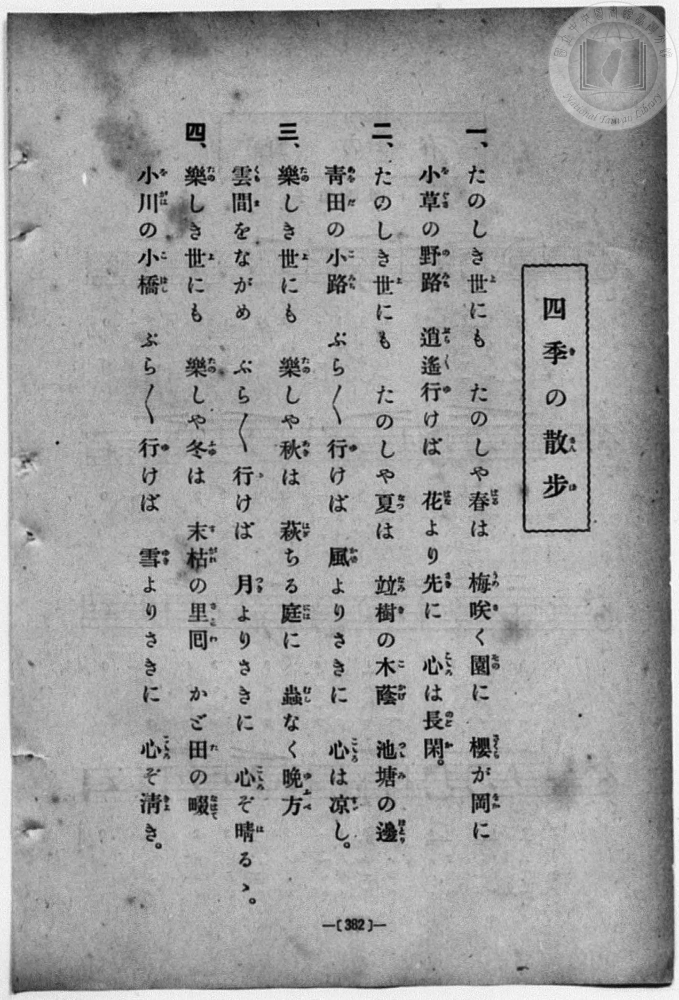
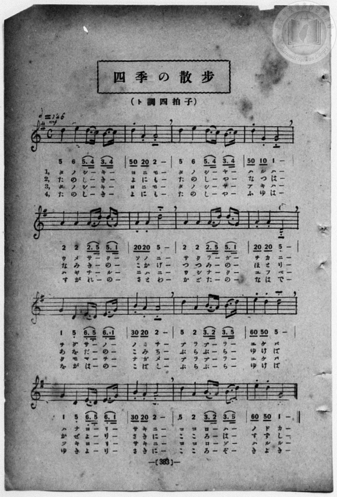

# 四季の散歩

> Re:Shōka 使用 AI 協助辨識與重建樂譜，可能會有錯誤。歡迎回報。

- **鋼琴伴奏版**：<br><audio controls src="shiki_no_sanpo.mp3"></audio>
- **NEUTRINO 歌聲合成版**：<br><audio controls src="shiki_no_sanpo_neutrino.mp3"></audio>

- book: 新編 小學校・公學校 唱歌教材集（高等科一・二學年用）
- 一條慎三郎 編《新編 小學校・公學校 唱歌教材集》（大正十二年十二月，索書號 0725-41）

## 說明

> [!NOTE]
> **原書資訊與歌詞全文**（對應 `P391.jpg`–`P392.jpg`，原書 pp. 382–383，高等科一・二學年第 22 首）：
> - **曲名**：四季の散步（譜面頁作「四季の散歩」）
> - **調性與拍號**：ト調四拍子（G 大調 4/4 拍），速度 ♩= 126
> - **譜面特徵**：奇數小節第 3、4 拍皆為附點八分音符接十六分音符圓滑線（如 `5. 4 3. 4`），偶數小節第 1、2 拍為八分斷音接八分休止符（如 `5 0 2 0 2 -`），生動表現散步步伐。
>
> **一、**
> たのしき世（よ）にも　たのしや春（はる）は　梅（うめ）咲（さ）く園（その）に　櫻（さくら）が岡（をか）に
> 小草（をぐさ）の野路（のみち）　逍遙（ぶら〳〵）行（ゆ）けば　花（はな）より先（さき）に　心（こころ）は長閑（のどか）。
>
> **二、**
> たのしき世（よ）にも　たのしや夏（なつ）は　竝樹（なみき）の木蔭（こかげ）　池塘（つつみ）の邊（ほとり）
> 青田（あをだ）の小路（こみち）　ぶら〳〵行（ゆ）けば　風（かぜ）よりさきに　心（こころ）は涼（すず）し。
>
> **三、**
> 樂（たの）しき世（よ）にも　樂（たの）しや秋（あき）は　萩（はぎ）ちる庭（には）に　蟲（むし）なく晩方（ゆふべ）
> 雲間（くもま）をながめ　ぶら〳〵行（ゆ）けば　月（つき）よりさきに　心（こころ）ぞ晴（は）るゝ。
>
> **四、**
> 樂（たの）しき世（よ）にも　樂（たの）しや冬（ふゆ）は　末枯（すがれ）の里回（さとわ）　かど田（た）の畷（なはて）
> 小川（をがは）の小橋（こばし）　ぶら〳〵行（ゆ）けば　雪（ゆき）よりさきに　心（こころ）ぞ清（きよ）き。


## 歌詞

```text
（TMD 檔案未包含歌詞註解）
```

## ABC

```abc
X:1
T:四季の散歩
M:4/4
L:1/16
Q:1/4=126
K:G
V:V1 name="Piano" snm="Pia"
[V:V1]
!mf! d4 e4 d3 c B3 c | d2 z2 A2 z2 A8 | d4 e4 d3 c B3 c | d2 z2 G2 z2 G8 |
w: 1.~た の し _ き _ | よ に も | た の し _ や _ | は る は
w: 2.~た の し _ き _ | よ に も | た の し _ や _ | な つ は
w: 3.~た の し _ き _ | よ に も | た の し _ や _ | あ き は
w: 4.~た の し _ き _ | よ に も | た の し _ や _ | ふ ゆ は
A4 A4 A3 d d3 g | A2 z2 A2 z2 d8 | A4 A4 A3 d d3 g | A2 z2 A2 z2 D8 |
w: 1.~う め さ _ く _ | そ の に | さ く ら _ が _ | を か に
w: 2.~な み き _ の _ | こ か げ | つ つ み _ の _ | ほ と り
w: 3.~は ぎ ち _ る _ | に は に | む し な _ く _ | ゆ ふ べ
w: 4.~す が れ _ の _ | さ と わ | か ど た _ の _ | な は て
G4 D4 E3 D E3 G | B2 z2 A2 z2 A8 | d4 A4 B3 A B3 d | e2 z2 d2 z2 d8 |
w: 1.~を ぐ さ _ の _ | の み ち | ぶ ら ぶ _ ら _ | ゆ け ば
w: 2.~あ を だ _ の _ | こ み ち | ぶ ら ぶ _ ら _ | ゆ け ば
w: 3.~く も ま _ を _ | な が め | ぶ ら ぶ _ ら _ | ゆ け ば
w: 4.~を が は _ の _ | こ ば し | ぶ ら ぶ _ ら _ | ゆ け ば
G4 D4 E3 D E3 G | B2 z2 A2 z2 A8 | d4 A4 B3 A B3 d | e2 z2 d2 z2 G8 |
w: 1.~は な よ _ り _ | さ き に | こ こ ろ _ は _ | の ど か
w: 2.~か ぜ よ _ り _ | さ き に | こ こ ろ _ は _ | す ず し
w: 3.~つ き よ _ り _ | さ き に | こ こ ろ _ ぞ _ | は る る
w: 4.~ゆ き よ _ り _ | さ き に | こ こ ろ _ ぞ _ | き よ き
```

## TMD 檔案連結

- [主旋律 TMD 檔案](shiki_no_sanpo.tmd) [[在 TMD Studio 編輯](https://tmdlang.github.io/Tmd-TS/#tmd=s7IKdvYPcrWy4qpTUCpJTLdSSM7PyUlNLsnMz7MqzsjPTozPrsyvSsyML84ojTe0NDJWgqssy88pzU21ys4vyY83jDdCSBTnlxYlp1oVJ2fk5-fEl6RWlCTl52ejy8cXJKanWgUYWxoiZAqK8stS8xLzgLoLijLzSlJTwNoRClLLMlNSQdLFyYl58WWpRZlpmakpSG5KLSoGOx1iRUlRYl5xclFmAcg_CFX5RSUZ-elFiQUZlVYZmcUl-UWZyYk58dmJeYkIRSUZqUDfFacmFufnFSPrzUzPzLMqzQM5pARqvZaWwtPZs5-uXfy4cd2zqYufrV2poKXFpWirYGhkxmVvq-DOZWOib2IHMgQUFFYKz6ZteL59hcLTDf1P1-54tmDh4-bdT1vXQNgKT6dsfLa259nUmc_mTng5u-39no6Xq2c8X9v5fPnEJzsagEqf7OoBKn26c8vzKSve7-kEOw4o82zR3GetfU92dL5s7lMAGv-4oYsUex43dAOterpk-bO1i5_2NoIs2bkFwng2p-P9np7nWxY9m73jxcz5CgbmRqa6JoZgu7n0tRRsqQW4FBQU7BSiFf38Q1xjIRwtrad980H2bm5_saLrRUc70M0vVs572rri2bR2LS2Qkzf0PmvvVEgApSW9rIL0hEcNk0EcIzAH6HCIAQoFBXoKxhZGQFljC2OgMM5QXbNGwchI4eWyaUAPvt8zC-IOXaBLns3e9HRCL8jSWajxvRTojBdr57ycu-jlgsYne-c8buhBSxCPG3qBpiGMerFq_7OG5SDvdPcCgxRs5uPmDqAwUCNQ7OnaCUAz3RWA8QEUUwAmHwWgKNhBPS8b5j_dtUzh0cyVkBSGMBTshOedO5_u2wpx5dL2Z1N3AKP_-foGkLeMHzc0gg16PqvtedOulzNbXu4GBuXqpx1tL-dvfr5m2bO-pcAof9q6Fi7ydM7kZ7snPt8-CxTSy5oUEkz1FEwUjIEEMGhBrnnauA3FDkOgHUZgO5p2QYx-Nm070CyQ0WDukz0Tn61dBDQabqKCgYIRGOtCzXw-Zf7T7qkvFq543r8PEsBA9GTPhMcNTWDfwpIGKOYaGoF5Dcx_3DgfGN6PG6c_bux9sgMYex2Pm4AJt_Nx4-rHTU2PGxoQCppans0ARdrjxvWPm4DpHqhmPVDBs0WtYMG2x02NQMGnkzaBuVPBCvqfzpkE5s4FGgI1Fqhl9W6IGqCCx01AxwPFe55uWgi2fdLjRojhqyEuBIbSi16gGojUBJjJ6162973Yvh5sDtB5-x83ArV3Ag1_2dD7snEmWHwb0PDHDZsfN2wFSr1Y2AM2BFg4ALVPfNy4Aaj4RddGqI8aV4HEm4AKup62AkMA4jxQ6oG4-en-ZrDgZBBqgoivfzl1-8tpE2FuWAl1OXqA7-ohN8CfLukHG77qceMSeIA_Xz332YqdMHGgxyGOWfdszooXU9bCHNn9uBEY8qAAebZxwdOFM8DiS8BoPzQAm7rAgrsfN64A-hqe1V7OnfR8ygawVBM4zBdA1IMiAhrgQPMRAY4czlgD-eUiYJEL1AV00hx4IEOCF0_YPtu2Byw483EjMB8BRaZjpmSgrfCAfbaiCaweFHpQ9ThCGIvKppbny0FFOcjL0PAEBfWLCSthyaMPLLgQmPKf7oIE8mqgODx5vJgPTvZNwNCYDhYERk3_s5krn00Dx1RT2-PGrY8bgWxYIM_e9HLaZLA5wCwAtHQfOGSAoQ3U2APMSsQELLiOgUQr2M1EBey8ZzO3QDwF1tL9uGkuesACi1PqBezTtjVgwa0wx4MLjTmrn82DpCVg_AL9C_QdJFMDK4F5sNwHTJbA9A9JY8DEsxKWLOdDFD-fuh2WC4ARBCwaoWELqrq3z4WVGD2waAIl4GcrIbEMDJAN0JgiJgHPBhYOkEgkJZx3QArGXlgo9ULDmfI6HwoUtPS5uIIzMrMz_fKDE_MK8q0CMhPz8h1qDGqqQRYp2BiaaYFjVQFbi0MBWPUAawOglxU0TEChBqyNdBRgrQBNLBqA9oEMq1Gozk2rVTAFVqAgaAalIXxgRQela8AiBkAMrKXgNDKEqCDODEMkGsUMsJN8DGtARStUDBjZcNZ0OKsXbiswRqCmAeMPxmpqwnAdARObWpBUroeb0w03GySGxa1GA-3WVXATlxByq_FAuxWkG2IiyB68bjUZaLduhZvThset-DPkrh5yMiQsZ6HSptD8ZBgHVYKcGWFZD-FVcgyJx_AeIjuCAgESSI0wVuNUOKsfbi-weQgPLlAQIyIFPSowdQNLbrhYD0Jl0yS4OYjsiGEiUnYEZQmIKfvhrF44CxbxIJWTsZgMsg3draCsBdGNYCHMRjZxN9ycFTBWUxd2t4KzIyxJAVslcNZCGAtc_MBMhidsRPGELVybGuDmILIKIkSQYgopYcMTe-NO7G4FZ8eZcFNgsQOs7OFiyKEAilv0UIDZjByuMP8BGwRwFmYWRS3mEL5fhuFWAvUjqONAcnaEVVLw7GEGYQD5UJYhUBWokiOueoTJQKpFIyhtClQBqjhhuRlrrkbkR3CegITSBDgLkaOQQw6RC0EpFsKCpTDkuNgG042UCzHFUNPNRDhrA3a3gvMjrCBGdvUCrG5F5McBcCs4PyLKIrirG_dhuB81RYLyACSNw8pGmrsVlB-RQhORCxHlCfZwBZkHYcFKB1q6FW9-BHZNhlZ-xNdcRYQ7vKwFN0ogLFgNgFo29sJZ2OpHUJxBTISzmkA6IGIw-1BzOKgURdRnWNwKzo-IUncO3d0KqkMg5syCszBSIlJ-RNS3cPNo6tZ5SCqxdAPgNTKaW8H5Ed5GGgC3ws1BagrDVCLcWsvFpWungNzNVADylbkA)]
- [鋼琴伴奏 TMD 檔案](shiki_no_sanpo_piano.tmd) [[在 TMD Studio 編輯](https://tmdlang.github.io/Tmd-TS/#tmd=s7IKdvYPcrWy4qpTUCpJTLdSSM7PyUlNLsnMz7MqzsjPTozPrsyvSsyML84ojTe0NDJWgqssy88pzU21ys4vyY83jDdCSBTnlxYlp1oVJ2fk5-fEl6RWlCTl52ejy8cXJKanWgUYWxoiZAqK8stS8xLzgLoLijLzSlJTwNoRClLLMlNSQdLFyYl58WWpRZlpmakpSG5KLSoGOx1iRUlRYl5xclFmAcg_CFX5RSUZ-elFiQUZlVYZmcUl-UWZyYk58dmJeYkIRYlFQM3pqbmpeSVWBZmJefnxicnJ-bkFiXmZIDGEwpIMoCKr4tTE4vy8YiUuLS2Fp7NnP127-HHjumdTFz9bu_L9no6Xs2c-6-x-2b3n-YQtT_Zsebq0__2eTgUtLS5FWwVDIzMue1sFdy4bE30TO5CxoOCyUng2bcPz7SsUnm7of7p2x7MFCx83737augbCVng6ZeOztT3Pps58NnfCy9ltICtWz3i-tvP58olPdjQAlT7Z1QNU-nTnludTVgDtAjsXKPNs0dxnrX1PdnS-bO5TABr_uKGLFHseN3QDrXq6ZPmztYuf9jaCLNm5BcJ4Nqfj_Z6e51sWPZu948XM-QoG5kamuiaGYLu5PPNKivKtAkDBGOThUGNQU82lAAQ2hmZadmBWjUJ1blqtgqGCLhiaxkMZZhAGkA9lGQKVGgNpAyA2QqKRYY2CKZQFkwHpAPEgtClQhRlUL0gliIbZDGKDzeCqRXG2D7KzTdBcHa8QbRgLo4C2xwNZpvGxCAYBMaBOA4iNwRmZ2Zl--cGJeQV4w0tfS8EWHSg8X7MGGMUvFvYoaJiA4vP5-gYdBWAOM9LLKkjXxKJBSx_ZG7BAAwUNJJhApAk00EygwUpcwBM2AxTgyAEPNwPsJB_DGoXHjfOhYsCsBGdNh7N64bY-buqAmva4cTWM1dSE4ToCJja1IKlcDzenG242SAyLW40G2q2r4CYuIeRW44F2K0g3xESQPXjdajLQbt0KN6cNj1vxZ8hdPeRkSFjOQqVNofnJMA6qBDkzwrIewqvkGAIreNGiApwdQYEACaRGGKtxKpzVD7f3ceNceHCBghgRKehRgan7cVMnXKwHobJpEtwcRHbEMBEpO4KyBMSU_XBWL5wFi3iQyslYTAbZhu5WUNaC6EawEGYjm7gbbs4KGKupC7tbwdkRlqQeN_bBWQthLHDxAzMZnrARxRO2cG1qgJuDyCqIEEGKKaSEDU_sjTuxuxWcHWfCTYHFzuMmOAslFEBxix4KMJuRwxXmv8eNK-EszCyKWswhfL8Mw60E6sdOcrLjwLVLMHI1Ij-C8wQklCbAWYgchRxyiFwISrEQFiyFIcfFNphupFyIKYaabibCWRuwuxWcH2EFMbKrF2B1KyI_DoBbwfkRURbBXd24D8P9qCkSlAcgaRxWNtLcraD8iBSaiFyIKE-whyvIPAgLVjrQ0q148yOwqzS08iO-5ioi3OFlLbhRAmHBagDUsrEXzsJWP4LiDGIinNUE0gERg9mHmsNBpSiiPsPiVnB-RJS6c-juVlAdAjFnFpyFkRKR8iOivoWbR1O3zkNSiaUbAK-R0dwKzo_wNtIAuBVuDlJTGKYS4VasvUxKu7dQSUwRmC6ogchdXjTT8IgYARlGucjGw8oBMnveVDcQS1de104BPH6gAGQgB3i0D9BkDDEjLGLGWMRMwGLKXAA)]

## 分析

```text
================================================================================
📊 TMD Song Profile: [ 四季の散歩 ]
================================================================================
⏱  Duration:       0:30 (30.5s), 16 measures total
🎼 Key & Tempo:    首調基準 G, != 126.0 BPM, <4/4>
   - 分析範圍：      由實際發聲的音符與和弦推測調性；播放脈絡另行呈現
🎤 人聲音域:    D4 (MIDI 62) – G5 (MIDI 79) [跨度: 17 個半音 / 1.4 個八度, 難度: challenging]
   - 最低音:  D4 in [ShikiNoSanpo #1 @ m.8, 0:14]
   - 最高音: G5 in [ShikiNoSanpo #1 @ m.5, 0:09]
   - 適合: soprano, mezzo-soprano, tenor, baritone
🏛  結構:      ShikiNoSanpo (30.5s)
⚡ 編曲密度:        Peak 1 軌道同時演奏
🗝  調性診斷：       D 大調（純淨自然大調，未偵測到可信轉調）
   - 風格氣質:    純淨自然大調（陽光明朗、易唱易記，無明顯調外色彩）
   - 轉調歷程:    全曲維持單一推測調性（未偵測到可信轉調）
   - 核心骨幹音:  D, A, G, E, B
   - 調性數值:    D 大調 [相關度: 0.88, 穩定度: High, 自然音純度: 98.2%]
   - 候選調性 (K-S): D 大調 (0.88), D 小調 (0.64), A 大調 (0.62)
   - 五度圈歷程:   +2
   - 各段落調性細節:
     • [ShikiNoSanpo #1]: D 大調 (r: 0.88, 自然音純度: 98.2%, 調外音: C)

  [ 五度圈游移軌跡 ]
               C  
         F            G  
      Bb              [D ]*
      Eb               A  
         Ab           E  
            Db       B  
               F# 
     (* = active key center)

  [ 十二半音累積音高分佈 ]
     C  : █                          1.8%
     C# :                            0.0%
     D  : ████████████████████████  33.0%
     D# :                            0.0%
     E  : ████████                  10.7%
     F  :                            0.0%
     F# :                            0.0%
     G  : ██████████                13.4%
     G# :                            0.0%
     A  : ███████████████████████   31.2%
     A# :                            0.0%
     B  : ███████                    9.8%
--------------------------------------------------------------------------------
Assignment 軌道音域：
  - Piano         : D4 – G5 (17 個半音 / 1.4 個八度, 72 個音符)
================================================================================
```


## 原書掃描頁






