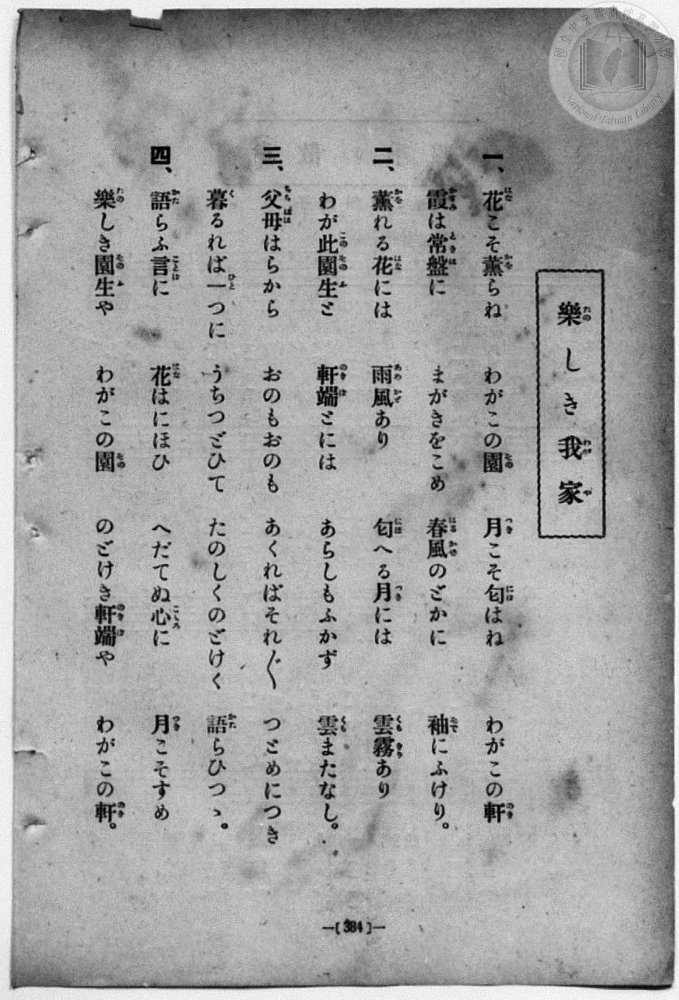
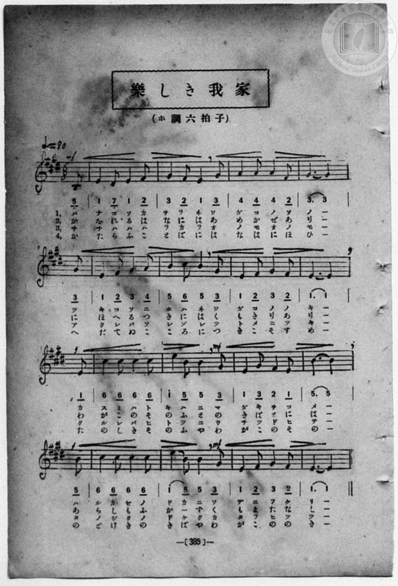

# 樂しき我家

> Re:Shōka 使用 AI 協助辨識與重建樂譜，可能會有錯誤。歡迎回報。

- **鋼琴伴奏版**：<br><audio controls src="tanoshiki_wagaya.mp3"></audio>
- **NEUTRINO 歌聲合成版**：<br><audio controls src="tanoshiki_wagaya_neutrino.mp3"></audio>

- book: 新編 小學校・公學校 唱歌教材集（高等科一・二學年用）
- 一條慎三郎 編《新編 小學校・公學校 唱歌教材集》（大正十二年十二月，索書號 0725-41）

## 說明

> [!NOTE]
> **原書資訊與歌詞全文**（對應 `P393.jpg`–`P394.jpg`，原書 pp. 384–385，高等科一・二學年第 23 首）：
> - **曲名**：樂しき我家
> - **調性與拍號**：ホ調六拍子（E 大調 6/8 拍，弱起 1 拍），速度 ♩.= 80
> - **圖檔編頁備註**：本資料夾所含之 `P395.jpg`（原書 p. 386）與 `P396.jpg`（原書 p. 387）實為下一首第 24 首〈曉景（二部輪唱）〉之五線譜與簡譜頁（因原書裝訂頁序將 pp. 386–387 置於〈曉景〉歌詞頁 pp. 388–389 之前）。
>
> **一、**
> 花（はな）こそ薰（かを）らね　わがこの園（その）　月（つき）こそ匂（にほ）はね　わがこの軒（のき）
> 霞（かすみ）は常盤（ときは）に　まがきをこめ　春風（はるかぜ）のどかに　袖（そで）にふけり。
>
> **二、**
> 薰（かを）れる花（はな）には　雨風（あめかぜ）あり　匂（にほ）へる月（つき）には　雲霧（くもきり）あり
> わが此（この）園生（そのふ）と　軒端（のきば）とには　あらしもふかず　雲（くも）またなし。
>
> **三、**
> 父母（ちちはは）はらから　おのもおのも　あくればそれ〴〵　つとめにつき
> 暮（く）るれば一（ひと）つに　うちつどひて　たのしくのどけく　語（かた）らひつゝ。
>
> **四、**
> 語（かた）らふ言（こと）ばに　花（はな）はにほひ　へだてぬ心（こころ）に　月（つき）こそすめ
> 樂（たの）しき園生（そのふ）や　わがこの園（その）　のどけき軒端（のきば）や　わがこの軒（のき）。


## 歌詞

```text
（TMD 檔案未包含歌詞註解）
```

## ABC

```abc
X:1
T:樂しき我家
M:6/8
L:1/16
Q:3/8=53
K:E
V:V1 name="Piano" snm="Pia"
[V:V1]
!mf! z2 z2 z2 z2 z2 B,2 | E4 D2 E4 F2 | G4 F2 E4 G2 | A4 A2 A4 F2 |
w: 1.~は | な こ そ か | を ら ね わ | が こ の そ
w: 2.~か | を れ る は | な に は あ | め か ぜ あ
w: 3.~ち | ち は は は | ら か ら お | の も お の
w: 4.~か | た ら ふ こ | と ば に は | な は に ほ
G10 G2 | E4 F2 G4 A2 | B4 c2 B4 G2 | E4 F2 G4 F2 |
w: 1.~の つ | き こ そ に | ほ は ね わ | が こ の の
w: 2.~り に | ほ へ る つ | き に は く | も き り あ
w: 3.~も あ | く れ ば そ | れ ぞ れ つ | と め に つ
w: 4.~ひ へ | だ て ぬ こ | こ ろ に つ | き こ そ す
!f! E10 E2 | c4 c2 c4 c2 | !mf! e4 B2 B4 G2 | E4 G2 F4 E2 |
w: 1.~き か | す み は と | き は に ま | が き を こ
w: 2.~り わ | が こ の そ | の ふ と の | き ば と に
w: 3.~き く | る れ ば ひ | と つ に う | ち つ ど ひ
w: 4.~め た | の し き そ | の ふ や わ | が こ の そ
!f! B10 B2 | c4 c2 c4 c2 | !mf! e4 B2 B4 G2 | E4 F2 G4 F2 |
w: 1.~め は | る か ぜ の | ど か に そ | で に ふ け
w: 2.~は あ | ら し も ふ | か _ ず く | も ま た な
w: 3.~て た | の し く の | ど け く か | た ら ひ つ
w: 4.~の の | ど け き の | き ば や わ | が こ の の
!mf! E10 B,2 | E4 D2 E4 F2 | G4 F2 E4 G2 | A4 A2 A4 F2 |
w: 1.~り は | な こ そ か | を ら ね わ | が こ の そ
w: 2.~し か | を れ る は | な に は あ | め か ぜ あ
w: 3.~つ ち | ち は は は | ら か ら お | の も お の
w: 4.~き か | た ら ふ こ | と ば に は | な は に ほ
G10 G2 | E4 F2 G4 A2 | B4 c2 B4 G2 | E4 F2 G4 F2 |
w: 1.~の つ | き こ そ に | ほ は ね わ | が こ の の
w: 2.~り に | ほ へ る つ | き に は く | も き り あ
w: 3.~も あ | く れ ば そ | れ ぞ れ つ | と め に つ
w: 4.~ひ へ | だ て ぬ こ | こ ろ に つ | き こ そ す
!f! E10 E2 | c4 c2 c4 c2 | !mf! e4 B2 B4 G2 | E4 G2 F4 E2 |
w: 1.~き か | す み は と | き は に ま | が き を こ
w: 2.~り わ | が こ の そ | の ふ と の | き ば と に
w: 3.~き く | る れ ば ひ | と つ に う | ち つ ど ひ
w: 4.~め た | の し き そ | の ふ や わ | が こ の そ
!f! B10 B2 | c4 c2 c4 c2 | !mf! e4 B2 B4 G2 | E4 F2 G4 F2 |
w: 1.~め は | る か ぜ の | ど か に そ | で に ふ け
w: 2.~は あ | ら し も ふ | か _ ず く | も ま た な
w: 3.~て た | の し く の | ど け く か | た ら ひ つ
w: 4.~の の | ど け き の | き ば や わ | が こ の の
E10 z2 |
w: 1.~り
w: 2.~し
w: 3.~つ
w: 4.~き
```

## TMD 檔案連結

- [主旋律 TMD 檔案](tanoshiki_wagaya.tmd) [[在 TMD Studio 編輯](https://tmdlang.github.io/Tmd-TS/#tmd=s7IKdvYPcrWy4qpTUCpJTLdSSM7PyUlNLsnMz7MqzsjPTozPrsyvSsyML84ojTe0NDJWgqssy88pzU21ys4vyY83jDdCSBTnlxYlp1oVJ2fk5-fEl6RWlCTl52ejy8cXJKanWgUYWyIZWVCUX5aal5gH1F1QlJlXkpoC1o5QkFqWmZIKki5OTsyLL0stykzLTE1BclNqUTHY6RArSooS84qTizILQP5BqMovKsnITy9KLMiotMrILC7JL8pMTsyJz07MS0QoKslIBfouLTE3M6cSXTQjPzcV2bjM9Mw8q9zUzKxMJO9qaSk8W9H0uHH648beZx0Tn67bpqClxaVoq2BhwGVvq-DKZWOmb2EHMgWk3krh2bQNz7evUHi6of_p2h3PFix83Lz7aesaCFvh6ZSNz9b2PJs689ncCS9nt73f0_Fy9YznazufL5_4ZEcDUOmTXT1ApU93bnk-ZcX7PZ1g1wFlni2a-6y178mOzpfNfQpA4x83dJFiz-OGbqBVT5csf7Z28dPeRpAlO7dAGM_mdLzf0_N8y6Jns3e8mDlfwcDcyFTXxBBsN5e-loIttQCXgoKCnUK0op9_iGsshKOl9bRvPsjeze0vVnS96GgHuvnFynlPW1c8m9aupQVy8obeZ-2dCgmg9KWXVZCe8KhhMohjAuYAHQ4xQKGgQE_B2MIEKGtsYQoUxhmqa9YoGBkrvFw2DejB93tmQdyhC3TJs9mbnk7oBVk6Cy26EWperNr_rGE5yJ3dvcCwAit-3DwbKPy0dS1Q7OnaCUA3uyoAAxoopgBMFwpAUZAr92x8sXW7giGEC7S452XD_Ke7lik8mrlSD5yS4HY8nTPt2aopwJh9uaDxadPMFyt2Q9w0Zw0wlJ5Nm_l0yb5nnQ1PJ6x-srMbHC6m0KDogAUFKCTMgLYA3QlWYIZNgTlQwdP1y5437XqyoxsYSMAQAYeNCShsHjd0PJvd-WzmeqAmYNC9bF7xYs8qYJIC6nnc0Am0-MkuoAtnvVg7B2jH8w0LgQyga0E2zF4AjdHFc1-saAJ5YVf_0w3t0PgxA8ePucLzveueTdsDtwVoJiTigeqhKi3AKi0VgHY97QQF2eOGJnAYwRIOKF4bGoEZEcx_0QV0W8fjxvWPG1eBFDdOftw498W0DWDB7sdNk0CCTUDxtY8bGh439T9u7AGrWfd0DlAKqGYukA22pQGcH4AiS4DxDzfqaU8TWHD148bdYEGgRehGvdgNMWodRCPEYS_nzIO6oXHm48b9EL1Pd-x4PnsJWHwFUDFQBCy-GmRg4z6wgb1AN4OMbWoEOWnG0peLgKUB2INNQKOAaA5YC9CulWAuSO-LRcBEDfHLcqiBjVsfN0583NSFEXq7epBDDz2geoC2YAQp0DRgTDW8nL0C5pgmkPMQjgFygRY1YITVDqBpGKEKN23TyzlA1wKl-h83AbMd0ONdcNMgzoME8rO1kBADBTUo7c6Z9HzKfHjcAX0K1gUsGBuAEfF8NSjpQuLicSPQd2ApmKVgw4Ei08E2AoMI6IVZEMfAXQLWAoyL-UDvg1RiJD9gWoEH4POObc_WA_0F1LsQjICBBolTYHwBSWDAgpLW48YukJNAlsIYEMeAbARG-gaQX4CMhi2PG7aCpYDBtQIcyECXg4IOYt2zWcAQALkTHFlAw0F6gRkCLLgJqAVsNVA9JEW1gZ0E5AKTClB2GVgQ6C9g4AALOWDYQlLRRBAbGHqr4CkWGLyQXAPUteRx01z0QHg6ezZyKsKiceuLFRBXAWMN4iqgH8FpFT11ARmgBAOyC-S8HY8bF4Cc2rjm6f5mmAnA7ABLPDjyKSiXNTVCQ2kFJB2CfApWACrRsSebphaCxQJSKPViT2AYhqAVCNDQo7wihQIFLX0urpDEvPzijMzszPDE9MTKRKuATKCAQ42uYU01yDIFGwstcHQpYKvJFYAlPjDZvFjYo6ABraG0FYxBLYrn6xuATFCFYALlAkthBVNQ9aWjAKt-NbGYCHQTyLYaBQM4rM5Nq1UwjQeKGQIrOPN4MGUE5BqDaRDPGMgzAdImYBImB4FAObCRPobIhgITDFAVMPEAVQBDG4jnglndINGmSSB2UyeQvxbM6ger7YGrXQdmzQWLgtgQCExLMLuMUO1CNrUHiLvBqpFdsBrMB7GawGoboa4Blo1Iol1Idq2G2WWMatdCsKkLoTbATAXbBfQR1FQoqwvuA2BZAuaDRNeB1TYh2QW0HWKXCRZ_Nc6Hh9ZWaAiBRFeA2RvALkX3LchdENHdYNFNSHbtANqFP8Xt6gGnOOTU9WzOamDSwkx9FmSmPkgSAyUiEyDPFEibgUlQQkPIgRIaiAeB1cBkaoiU2IC5Fi1xAaMM7GVYEOBLXOBIAJsACxhgYMMTF8yUHfDEBEx6cBsRiQlsNjgqQXKQBIQlMYHcAE9MIF3QhAqMPnhCB_JB7HlwFsRGcDQDkyssQhHugLkbbjYw8QBLZbDYMiBeg5RYJoNNAboQwxTk8JsJzxows-cTTCw7OuGJBZYYcCUWQyMyU4sZOH1ASGCKiAMyTMHJBVx0wdKMMTC96IJSCFgKkWZMUdLMTLC_9sNjcAVSSCCyzT6kNAOKV3DRAglLlPABZjqkNIO7AANlXViWRaQ8SPaFiELSLshNGIUCKM1AUiFSmtmEVAgsgbu7DalwAomuRFK7DC1eEWkG4sLpcFehubupBZaG8foRZjbQf_jTDLBZAk8z8DQBTzSwIoeqaQNbeWKAnC6guRxRIUBiCRJ-IFFI-EJ8uxwaY7ACeSJafoebDEoV0KoAGLrQcmIr2AyQfSDeLDCJXI7sA8cPiLUKrHI6prngUgQRa-DyBMXFE-Gi6FUIqCqA5f8lmCaD0wPCDEh6QEuxeNMDerkKMrmWi0vXTgGtKaSAXUiZCwA)]
- [鋼琴伴奏 TMD 檔案](tanoshiki_wagaya_piano.tmd) [[在 TMD Studio 編輯](https://tmdlang.github.io/Tmd-TS/#tmd=s7IKdvYPcrWy4qpTUCpJTLdSSM7PyUlNLsnMz7MqzsjPTozPrsyvSsyML84ojTe0NDJWgqssy88pzU21ys4vyY83jDdCSBTnlxYlp1oVJ2fk5-fEl6RWlCTl52ejy8cXJKanWgUYWyIZWVCUX5aal5gH1F1QlJlXkpoC1o5QkFqWmZIKki5OTsyLL0stykzLTE1BclNqUTHY6RArSooS84qTizILQP5BqMovKsnITy9KLMiotMrILC7JL8pMTsyJz07MS0QoSiwCak5PzU3NK7EqyEzMy49PTE7Ozy1IzMsEiSEUlmQAFVmlJeZm5lSii2bk56YqcWlpKTxb0fS4cfrjxt5nHROfrtv2fk_Hy9kzn3V2v-ze83zClid7tjxd2v9-T6eClhaXoq2ChQGXva2CK5eNmb6FHchIUABaKTybtuH59hUKTzf0P12749mChY-bdz9tXQNhKzydsvHZ2p5nU2c-mzvh5ew2kA2rZzxf2_l8-cQnOxqASp_s6gEqfbpzy_MpK4BWgZ0KlHm2aO6z1r4nOzpfNvcpAI1_3NBFij2PG7qBVj1dsvzZ2sVPextBluzcAmE8m9Pxfk_P8y2Lns3e8WLmfAUDcyNTXRNDsN1cnnklRflWAaCADfJwqDGoqeZSAAIbCy07MKNGoTo3rVbBTEEXiCFkjYJhHJBhCoS6CsYgLpA2ArJAJIQHgQYKNVy1KFb44LHCJD5eIdokPhZCoPKApgK5hkAeEAOZYLMhDFOgQhDWVYg2xaUS5IoQoPXFGZnZmeGJ6YmViQgv6xpiOsgADsFOM42H-ss8HurZGqh3QTxQEJgAaRMwCZODQKAc2EgfQ2RDHzeuB6p63LgKqOJx42QgngtmdYNEmyaB2E2dQP5aMKsfrLYHrnYdmDUXLApiQ-DjxiUwu4xQ7UI2tQeIu8GqkV2wGswHsZrAahuhrnncOAdJtAvJrtUwu4xR7VoINnUh1AaYqWC7gD6CmgpldcF98LipCcwHia4Dq21CsgtoO8QuEyz-apwPD62t0BACia4AszeAXYruW5C7IKK7waKbkOzaAbQLmgYQqdoEyAOldTOCKb4amFgMkaIcWNCgRTEw4MAWwxyCL4rBQQE2AeY8oJfhUQwzZQc8SoEJAG4jIkrBZoMDFCQHiUYsUQpyAzxKQbqgyQUYiPDkBuSD2PPgLIiN4MAGJhpYsCLcAXM33GxgFD5uXAAWWwbEa5CibDLYFKALMUxBDr-Z8AQKM3s-IspwllLgXAyLOGNgpOmCogkshYg4U5SImwk2fD88GFcgOQeRgvYhRRwocMG5DOIhFEcC0x9SxOHOy6BUDEu9iOiHpGSIKCQBgdyEkT9AEQdJCkgRtwkpPyyBu7sNKZ-CRFciqV2GFriIiIO4cDrcVWjubmqBJSS8foSZDfQfaRGHq46BRxo0HyAKLkgQQjwHEoV4HuKU5dDghBUcE9FyBNxkUJRBiyyg16E5aSvYDJB9IN4sMImc0_aBAw_EWgVWOR3TXHA-QwQpOMehuHgiXBS9qAMVWbAcsgTTZHBkIcyARBZacsIbWeglD746FFSnE1GHwitsY2AdCqu4kepwMANUaQMrU5S63wjIMcoFckAE9uodWmCjGAUyBJjDwS0DEBvCAkoR224AFQkIw0lrnaD6GCSMZD2ICbYTTEAkqGcZse0hXTsFcMNMAchAi9doH6BabMJG2IWNsQubgIWVuQA)]

## 分析

```text
================================================================================
📊 TMD Song Profile: [ 樂しき我家 ]
================================================================================
⏱  Duration:       1:12 (72.0s), 32 measures total
🎼 Key & Tempo:    首調基準 E, != 80.0 BPM, <6/8>
   - 分析範圍：      由實際發聲的音符與和弦推測調性；播放脈絡另行呈現
🎤 人聲音域:    B3 (MIDI 59) – E5 (MIDI 76) [跨度: 17 個半音 / 1.4 個八度, 難度: challenging]
   - 最低音:  B3 in [TanoshikiWagaya #1 @ m.1, 0:01]
   - 最高音: E5 in [TanoshikiWagaya #1 @ m.11, 0:22]
   - 適合: soprano, mezzo-soprano, contralto, tenor, baritone, bass
🏛  結構:      TanoshikiWagaya (36.0s) -> TanoshikiWagaya (36.0s)
⚡ 編曲密度:        Peak 1 軌道同時演奏
🗝  調性診斷：       E 大調（純淨自然大調，未偵測到可信轉調）
   - 風格氣質:    純淨自然大調（陽光明朗、易唱易記，無明顯調外色彩）
   - 轉調歷程:    全曲維持單一推測調性（未偵測到可信轉調）
   - 核心骨幹音:  E, G#, B, C#, F#
   - 調性數值:    E 大調 [相關度: 0.95, 穩定度: High, 自然音純度: 100.0%]
   - 候選調性 (K-S): E 大調 (0.95), C# 小調 (0.74), G# 小調 (0.57)
   - 五度圈歷程:   +4 -> +4
   - 各段落調性細節:
     • [TanoshikiWagaya #1]: E 大調 (r: 0.94, 自然音純度: 100.0%)
     • [TanoshikiWagaya #2]: E 大調 (r: 0.95, 自然音純度: 100.0%)

  [ 五度圈游移軌跡 ]
               C  
         F            G  
      Bb               D  
      Eb               A  
         Ab          [E ]*
            Db       B  
               F# 
     (* = active key center)

  [ 十二半音累積音高分佈 ]
     C  :                            0.0%
     C# : ██████████                13.5%
     D  :                            0.0%
     D# : █                          1.0%
     E  : ████████████████████████  31.2%
     F  :                            0.0%
     F# : ████████                  10.4%
     G  :                            0.0%
     G# : ███████████████           19.8%
     A  : █████                      6.2%
     A# :                            0.0%
     B  : ██████████████            17.7%
--------------------------------------------------------------------------------
Assignment 軌道音域：
  - Piano         : B3 – E5 (17 個半音 / 1.4 個八度, 112 個音符)
================================================================================
```


## 原書掃描頁






