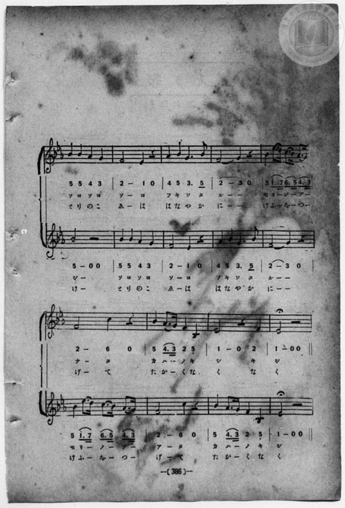
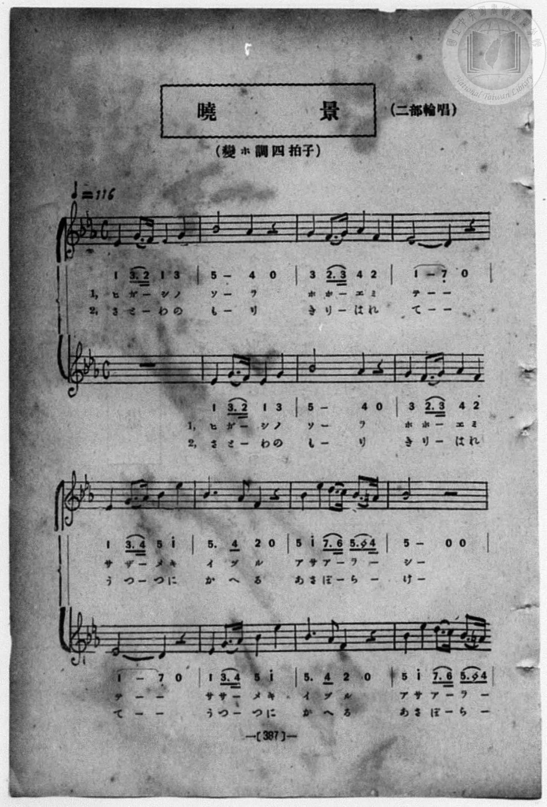
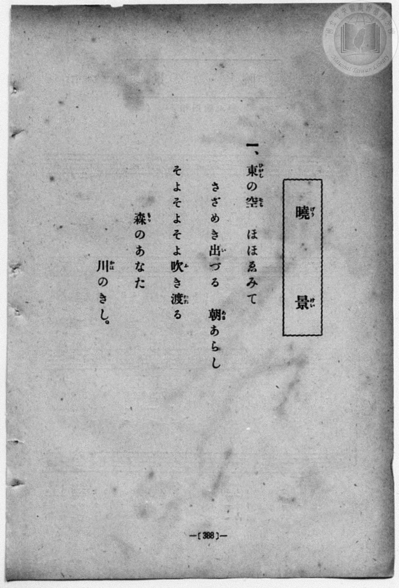
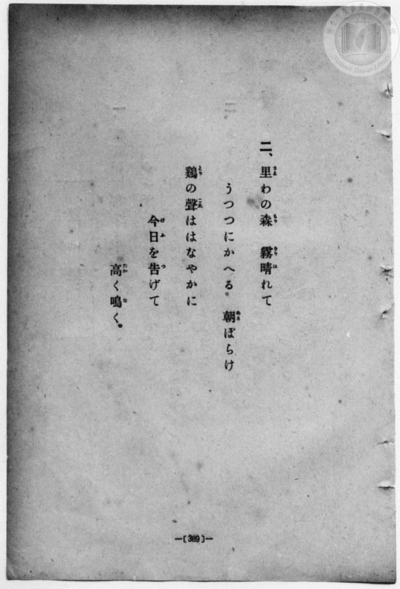

# 曉景（二部輪唱）

> Re:Shōka 使用 AI 協助辨識與重建樂譜，可能會有錯誤。歡迎回報。

<audio controls src="gyokei.mp3"></audio>

- book: 新編 小學校・公學校 唱歌教材集（高等科一・二學年用）
- 一條慎三郎 編《新編 小學校・公學校 唱歌教材集》（大正十二年十二月，索書號 0725-41）

## 說明

> [!NOTE]
> **原書資訊與歌詞全文**（對應 `P395.jpg`–`P398.jpg`，原書 pp. 386–389，高等科一・二學年第 24 首）：
> - **曲名**：曉景（二部輪唱）
> - **調性與拍號**：變ホ調四拍子（E♭ 大調 4/4 拍），速度 ♩= 116（二部輪唱，全 17 小節）
> - **圖檔編頁備註**：因原書裝訂順序將本曲樂譜頁置於歌詞頁之前，且左右對開頁碼顛倒，本曲五線譜與簡譜前半載於 `23_tanoshiki_wagaya/P396.jpg`（原書 p. 387）、後半載於 `23_tanoshiki_wagaya/P395.jpg`（原書 p. 386），而歌詞全文則載於本資料夾之 `P397.jpg`（原書 p. 388，第一節）與 `P398.jpg`（原書 p. 389，第二節）。
>
> **一、**
> 東（ひがし）の空（そら）　ほほゑみて
> さざめき出（い）づる　朝（あさ）あらし
> そよそよそよ吹（ふ）き渡（わた）る
> 森（もり）のあなた　川（かは）のきし。
>
> **二、**
> 里（さと）わの森（もり）　霧（きり）晴（は）れて
> うつつにかへる　朝（あさ）ぼらけ
> 鷄（とり）の聲（こゑ）ははなやかに
> 今日（けふ）を告（つ）げて　高（たか）く鳴（な）く。


## 歌詞

```text
（TMD 檔案未包含歌詞註解）
```

## ABC

```abc
X:1
T:曉景（二部輪唱）
M:4/4
L:1/16
Q:1/4=116
K:Eb
V:V1 name="Alto" snm="Alt"
V:V2 name="Vocal" snm="Voc"
[V:V1]
z16 | E4 G3 F E4 G4 | B8 A4 z4 | G4 F3 G A4 F4 |
w: 1.~ひ が _ し の | そ ら | ほ ほ _ ゑ み
w: 2.~さ と _ わ の | も り | き り _ は れ
E8 D4 z4 | E4 G3 A B4 e4 | B6 A2 F4 z4 | B4 e4 d3 c B3 =A |
w: 1.~て _ | さ ざ _ め き | い づ る | あ さ あ _ ら _
w: 2.~て _ | う つ _ つ に | か へ る | あ さ ぼ _ ら _
B8 z4 z4 | B4 B4 A4 G4 | F8 E4 z4 | A4 B4 G6 B2 |
w: 1.~し | そ よ そ よ | そ よ | ふ き わ た
w: 2.~け | と り の こ | ゑ は | は な や か
F8 G4 z4 | B4 e3 d c3 B A3 G | F8 c4 z4 | B4 A3 G F4 B,4 |
w: 1.~る _ | も り _ の _ あ _ | な た | か は _ の き
w: 2.~に _ | け ふ _ を _ つ _ | げ て | た か _ く な
E8 z4 z4 | z16 | E4 G3 F E4 G4 | B8 A4 z4 |
w: 1.~し | ひ が _ し の | そ ら
w: 2.~く | さ と _ わ の | も り
G4 F3 G A4 F4 | E8 D4 z4 | E4 G3 A B4 e4 | B6 A2 F4 z4 |
w: 1.~ほ ほ _ ゑ み | て _ | さ ざ _ め き | い づ る
w: 2.~き り _ は れ | て _ | う つ _ つ に | か へ る
B4 e4 d3 c B3 =A | B8 z4 z4 | B4 B4 A4 G4 | F8 E4 z4 |
w: 1.~あ さ あ _ ら _ | し | そ よ そ よ | そ よ
w: 2.~あ さ ぼ _ ら _ | け | と り の こ | ゑ は
A4 B4 G6 B2 | F8 G4 z4 | B4 e3 d c3 B A3 G | F8 c4 z4 |
w: 1.~ふ き わ た | る _ | も り _ の _ あ _ | な た
w: 2.~は な や か | に _ | け ふ _ を _ つ _ | げ て
B4 A3 G F4 B,4 | E8 z4 z4 |
w: 1.~か は _ の き | し
w: 2.~た か _ く な | く
[V:V2]
E4 G3 F E4 G4 | B8 A4 z4 | G4 F3 G A4 F4 | E8 D4 z4 |
w: 1.~ひ が _ し の | そ ら | ほ ほ _ ゑ み | て _
w: 2.~さ と _ わ の | も り | き り _ は れ | て _
E4 G3 A B4 e4 | B6 A2 F4 z4 | B4 e4 d3 c B3 =A | B8 z4 z4 |
w: 1.~さ ざ _ め き | い づ る | あ さ あ _ ら _ | し
w: 2.~う つ _ つ に | か へ る | あ さ ぼ _ ら _ | け
B4 B4 A4 G4 | F8 E4 z4 | A4 B4 G6 B2 | F8 G4 z4 |
w: 1.~そ よ そ よ | そ よ | ふ き わ た | る _
w: 2.~と り の こ | ゑ は | は な や か | に _
B4 e3 d c3 B A3 G | F8 c4 z4 | B4 A3 G F4 B,4 | E8 z4 F4 |
w: 1.~も り _ の _ あ _ | な た | か は _ の き | し き
w: 2.~け ふ _ を _ つ _ | げ て | た か _ く な | く な
E8 z4 z4 | E4 G3 F E4 G4 | B8 A4 z4 | G4 F3 G A4 F4 |
w: 1.~し | ひ が _ し の | そ ら | ほ ほ _ ゑ み
w: 2.~く | さ と _ わ の | も り | き り _ は れ
E8 D4 z4 | E4 G3 A B4 e4 | B6 A2 F4 z4 | B4 e4 d3 c B3 =A |
w: 1.~て _ | さ ざ _ め き | い づ る | あ さ あ _ ら _
w: 2.~て _ | う つ _ つ に | か へ る | あ さ ぼ _ ら _
B8 z4 z4 | B4 B4 A4 G4 | F8 E4 z4 | A4 B4 G6 B2 |
w: 1.~し | そ よ そ よ | そ よ | ふ き わ た
w: 2.~け | と り の こ | ゑ は | は な や か
F8 G4 z4 | B4 e3 d c3 B A3 G | F8 c4 z4 | B4 A3 G F4 B,4 |
w: 1.~る _ | も り _ の _ あ _ | な た | か は _ の き
w: 2.~に _ | け ふ _ を _ つ _ | げ て | た か _ く な
E8 z4 F4 | E8 z4 z4 |
w: 1.~し き | し
w: 2.~く な | く
```

## TMD 檔案連結

- [主旋律 TMD 檔案](gyokei.tmd) [[在 TMD Studio 編輯](https://tmdlang.github.io/Tmd-TS/#tmd=s7IKdvYPcrWy4qpTUCpJTLdSSM7PyUlNLsnMz7MqzsjPTozPrsyvSsyML84ojTe0NDJWgqssy88pzU21ys4vyY83jDdCSBTnlxYlp1oVJ2fk5-fEl6RWlCTl52ejy8cXJKanWgUYW5ojZAqK8stS8xLzgLoLijLzSlJTwNoRClLLMlNSQdLFyYl58WWpRZlpmakpSG5KLSoGOx1iRUlRYl5xclFmAcg_CFX5RSUZ-elFiQUZlVYZmcUl-UWZyYk58dmJeYkIRSUZqUDf5SWWlBalKnFpaSk8m935bOb693s6nuzqedm84sWeVU-nbHy_p1NBS4tL0VbB0NCMy95WwVWHy8ZE38QOZA7I21YKz6ZteL59hcLTDf1P1-54tmDh4-bdT1vXQNgKQCOere15NnXms7kTXs5uA5r-cvWM52s7ny-f-GRHA1Ap0DKg0qc7tzyfsgJoGdh9QJlni-Y-a-17sqPzZXOfAtD4xw1dpNjzuKEbaNXTJcufrV38tLcRZMnOLRDGszkd7_f0PN-y6NnsHS9mzlcwMDcy1TUxBNvNpa-lYEstwKWgoGCnEK3o5x_iGgvhaGk97ZsPsndz-4sVXS862oFufrFy3tPWFc-mtWtpgZy8ofdZe6dCAjDdmOplFaQnPGqYDOJYgDlAh0MMUCgo0FMwtjADyhpbWAKFcYbqmjUKRiYKL5dNA3rw_Z5ZEHfoAl3ybPampxN6QZbOwhXzCMUvVu1_1rAc5ODuXmCggXW9WNf1uHk2UObp7NlA4adrJwBNcH00c60CMNyBwgrAZKIAlABb3POyYf7TXcsUHs1cCU5KGJb1AANBwdAcFL3P1zegWP50zrRnq6YA4_7lgsanTTNfrNgNtv_p7AXQ0Fw898WKppcL2p7u6n-6of3ZnDVAvz1b0fRi7Rygjud71z2btgcS0EDuk53dTzuBbup5smPK0-3LnvZvBgb5y2ndIJWL9rxcOPtpwySgLMSQJ7uA1s4CmgP0-fMNC4EMoN6nvV0v9nQCzVRIMDKOL0nMyy_OyMzOjC9PTE-sTNQHRpYZNLI6YJEFiitzoJ8eNzQ-3ddD2ABI1KMZAAwzUEC-aOhBTjVPO9shhgFdDExWz6bNfLpkH9CT4CRkjs0cC1DyX7MGmFAgAQ30G1gxLImhKAalLZDiXT0QxY8bmsARA0vPoOTW0AgsIcD8Z3OBMdnxuHHT48aex43TQeob1z1fuQssOPdxE9D9QBMaHjfuBqGmiY8b9z9uXAbR-7hx6uPGaY-bGh839j5th2hpAZuw9HFTN1DXszlzwYJNQJVg8SaggUBbYNqB5kNsgZJPJ-wEq98KVtz7bMdCELep_3HjfJBIUzfUzYvXgcWBpnVBHAy2YhVQGdDSp9shlnY_bgRmEIhsL9BSjHDY1YMUDi_be8C6gD4CFWpgS9ehW9TQ8HLOcrCyXojIs5lbwFywRU3AAISHTNvjxiVgtBrskh04AmQPOEAmQt2wHRh6QNkVcH-9aNwEFpkMDHmwyHowWvW4qQVs7GqIxie7u55NXwpWCYwgcOg1TXo6EWgIUGQJWOMkoNtA7l89Ayw4H6gdLN7_cjPEC6sgXGgoUV6WQoGClj4Xl3tlfnZqplVYPrBOc6gxqKkGWaFgY2imBY4NBWxluAIkwb9YCMz2XcBwABY8Chom0MJGRwGWZzWx6ARaCTK1RsEQWBiBoDGYNELj6wJVmEJZMGgCpQ3gKmBqjaA6YSogfJAKmKkwaB6PbgjYOT6GNcB0sQkqBsxucNZ0OGsd3FBghkAzFphSMBwHzJNwvXBW00S42H4klcvQzINBNFcagdROhZuwAm5qPzZXNjVhuLILiyt7MWSB6RguBgsJ4lyJP8Xs6qFiijGBpw_DOLgbkZMMKDHAEgLCvxiazMGkGVTCRB1LwoPpxpZmELExDcZqaoSLwcIWpLIFyURgKQxW2Y3hPmD5A1eDMBsuBk9nIJWwtEnAneBU0wY3awkW1mokU2FugsjsIMmde7C6E5bmcbuTQEnTiZpuTJHTDbhyx5tuYNEJo2GlBKKkgSUTGISlNIR3YXpgZsD0wsQwzYCpwJn0zIGJDqIdYrgxSrqClTDAmhfGwiKGvSyCySLH1la4Kb1wdbBSAyI-H6ISHtfoEMk0eMmCXGbASh5EykBOf4iyCpuOyUhmo6cWRGmE7B94CdW4Cm4yag4D-QOkEpa28fgHnkKRwqlpElwMlk8IpFNgwx1P-UY4naKnIEjywJaCYAkGpsMUVqthVngwzbirRHylGyxsEaEKSiXooQdLMcixgojbXiSVuEos4lRhK9dgsYRwIayWQnYhzNXIbkXUmTBfglQi5wlUFxKjCuHCWnjLyjGnJJ-chlU3mdUkzA24IJ2aXvBURNg9A9bygqcjYtw4QO0u4tpU5CYWwu1jujW7kIodgg1NlOigc8MLqfAhxp0D1vAirlEFTzhkNqrQvYwZ5QPc7EJKVgTrFaTyZRC2u5ASHsEWNUopNehaXMS1o7CXacQnTdztbNo2tbAkPWIbzEiBiwhW2jS58CUrAs1gIJtezS6UBpWunQKkTaWAwlLmAgA)]
- [鋼琴伴奏 TMD 檔案](gyokei_piano.tmd) [[在 TMD Studio 編輯](https://tmdlang.github.io/Tmd-TS/#tmd=s7IKdvYPcrWy4qpTUCpJTLdSSM7PyUlNLsnMz7MqzsjPTozPrsyvSsyML84ojTe0NDJWgqssy88pzU21ys4vyY83jDdCSBTnlxYlp1oVJ2fk5-fEl6RWlCTl52ejy8cXJKanWgUYW5ojZAqK8stS8xLzgLoLijLzSlJTwNoRClLLMlNSQdLFyYl58WWpRZlpmakpSG5KLSoGOx1iRUlRYl5xclFmAcg_CFX5RSUZ-elFiQUZlVYZmcUl-UWZyYk58dmJeYkIRYlFQM3pqbmpeSVWBZmJefnxicnJ-bkFiXmZIDGEwpIMoCKrvMSS0qJUJS4tLYVnszufzVz_fk_Hk109L5tXvNiz6umUje_3dAJFXs6e-ayz-2X3nucTtjzZs-Xp0n6guIKWFpeirYKhoRmXva2Cqw6XjYm-iR3IfFC4WSk8m7bh-fYVCk839D9du-PZgoWPm3c_bV0DYSsAjX62tufZ1JnP5k54ObsNZMfqGc_Xdj5fPvHJjgagUqAjgEqf7tzyfMoKoGVgdwNlni2a-6y178mOzpfNfQpA4x83dJFiz-OGbqBVT5csf7Z28dPeRpAlO7dAGM_mdLzf0_N8y6Jns3e8mDlfwcDcyFTXxBBsN5dnXklRvlUAKDyDPBxqDGqquRSAwMbQTMsOzKpRqM5Nq1UwUtBFgWZQ2gBK1yiYQlkmYNIYrsM0Hq7EEM0QmGaYUtwq4NZw1aK42QfZzSaoTjaNj1eINo2PVTCJB-oHOhDGhzOA9gFZhrFAaZAYEheoHmSTe2V-dmomEcEDc7cx1D-ofOTggUFIMCEHIEwtJDSM4Spwh445LGgRwQNyk49hjcLjxk1QsceNPXDWdDhrHdzQx41z0Yx93NSJ4bjHjbvheuGspolwsf1IKpehmQeDaK40AqmdCjdhBdzUfmyubGrCcGUXFlf2Ysg-blwPF4OFBHGuhEYwalyawGPSMA5uGnLkgqINFmWYuQOuyRxMmkElTNSxJBHMxI-IXUS4TYOxmhrhYrBQAKlsQTLxceNSsMpuDPc9boSFL7LZcDF4igCphKUiAu4Ex28b3KwlWFirkUyFuQkis4Mkd-7B6k5Y6sTtTmgMwwIetQhDzr3oxR8sTSAcBtMDMwOmFyaGaQZMBc5EYg4tZU3hZSpyCoDl2sdNHTAWFjHs-RsmixyuW-Gm9MLVwXIiRHw-RCU8VtAhkmnw3IqcD2G5GRGHyCkFkf-x6ZiMZDZ6vCJyOLJ_4Lm-cRXcZNS8APIHSCUsFeLxDzwtIYVT0yS4GCxFw1PUoKkuEekFFgoI_4PiE92fsLhFDj9ELPQiqcRVChCnCltZAQtPhAthZTSyC2GuRnYrosaA-RKkEjn1orqQGFUoTQ7khgBKmwPeENDXUni-Zg2wufWicROwkfl097aXwCrYENR6e76-4WXDpqetSyEtTwUtfWgqgVmBC0ICB9wsgQgYQxhG8RhC4CQFY8IgsOGDHn5w5UAzoNrhqqBCWOyFQXNgKwndRHSXAI2DOwSWPtHcBrYRbhtSnkDXB23gmMGNNFEHNtNgpTa66zBiDqEEzoB7Finc4C6BQbiXkIp3DJPgBsBFsZgEV4Sa3jG8CvQo0JNQk6B2AfViMRGqDKsvERrh2kDtWpg6jOjEmtR17RTADWwFIAOS7KN9gG1iJJ4RmKfMBQA)]

## 分析

```text
================================================================================
📊 TMD Song Profile: [ 曉景（二部輪唱） ]
================================================================================
⏱  Duration:       1:10 (70.3s), 34 measures total
🎼 Key & Tempo:    首調基準 E,, != 116.0 BPM, <4/4>
   - 分析範圍：      由實際發聲的音符與和弦推測調性；播放脈絡另行呈現
🎤 人聲音域:    A#3 (MIDI 58) – D#5 (MIDI 75) [跨度: 17 個半音 / 1.4 個八度, 難度: challenging]
   - 最低音:  A#3 in [Gyokei #1 @ m.15, 0:30]
   - 最高音: D#5 in [Gyokei #1 @ m.5, 0:09]
   - 適合: soprano, mezzo-soprano, contralto, tenor, baritone, bass
🏛  結構:      Gyokei (35.2s) -> Gyokei (35.2s)
⚡ 編曲密度:        Peak 2 軌道同時演奏
🗝  調性診斷：       D# 大調（純淨自然大調，未偵測到可信轉調）
   - 風格氣質:    純淨自然大調（陽光明朗、易唱易記，無明顯調外色彩）
   - 轉調歷程:    全曲維持單一推測調性（未偵測到可信轉調）
   - 核心骨幹音:  A#, D#, F, G, G#
   - 調性數值:    D# 大調 [相關度: 0.88, 穩定度: Moderate, 自然音純度: 99.5%]
   - 候選調性 (K-S): D# 大調 (0.88), A# 大調 (0.81), G 小調 (0.55)
   - 五度圈歷程:   -3 -> -3
   - 各段落調性細節:
     • [Gyokei #1]: D# 大調 (r: 0.88, 自然音純度: 99.5%, 調外音: A)
     • [Gyokei #2]: D# 大調 (r: 0.88, 自然音純度: 99.5%, 調外音: A)

  [ 五度圈游移軌跡 ]
               C  
         F            G  
      Bb               D  
     [Eb]*              A  
         Ab           E  
            Db       B  
               F# 
     (* = active key center)

  [ 十二半音累積音高分佈 ]
     C  : ███                        3.6%
     C# :                            0.0%
     D  : ███                        3.6%
     D# : ███████████████████       21.2%
     E  :                            0.0%
     F  : █████████████████         18.9%
     F# :                            0.0%
     G  : ████████████              14.0%
     G# : ██████████                11.3%
     A  :                            0.5%
     A# : ████████████████████████  27.0%
     B  :                            0.0%
--------------------------------------------------------------------------------
Assignment 軌道音域：
  - Alto          : A#3 – D#5 (17 個半音 / 1.4 個八度, 112 個音符)
  - Vocal         : A#3 – D#5 (17 個半音 / 1.4 個八度, 116 個音符)
================================================================================
```


## 原書掃描頁










