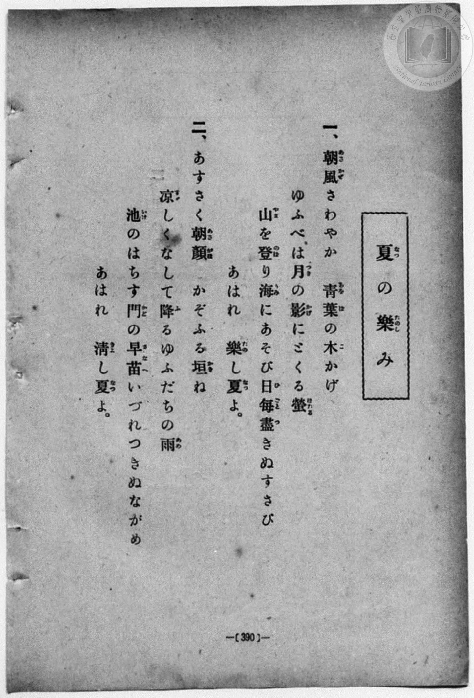
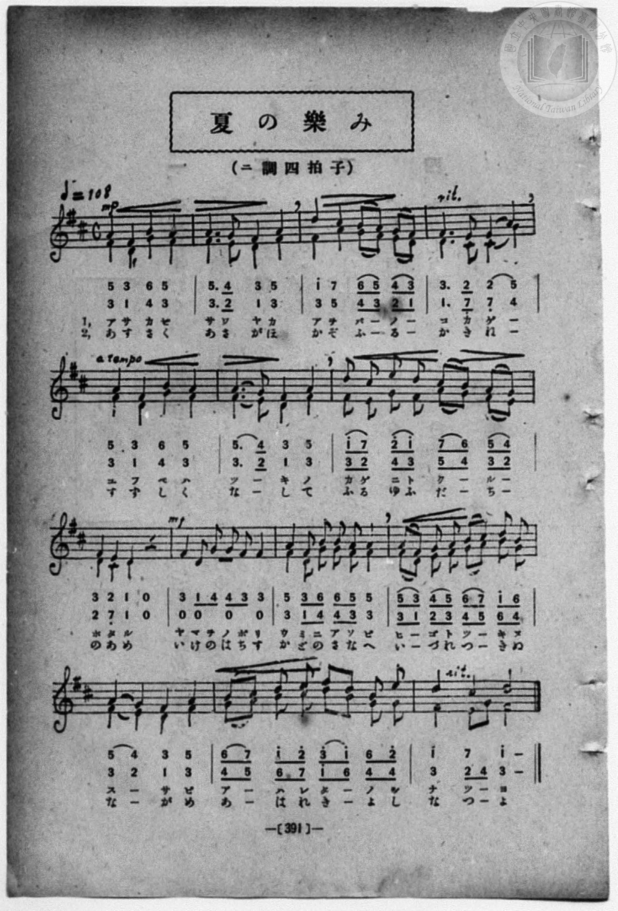

# 夏の樂み（二部）

> Re:Shōka 使用 AI 協助辨識與重建樂譜，可能會有錯誤。歡迎回報。

- **鋼琴伴奏版**：<br><audio controls src="natsu_no_tanoshimi.mp3"></audio>
- **NEUTRINO 歌聲合成版**：<br><audio controls src="natsu_no_tanoshimi_neutrino.mp3"></audio>

- book: 新編 小學校・公學校 唱歌教材集（高等科一・二學年用）
- 一條慎三郎 編《新編 小學校・公學校 唱歌教材集》（大正十二年十二月，索書號 0725-41）

## 說明

> [!NOTE]
> **原書資訊與歌詞全文**（對應 `P399.jpg`–`P400.jpg`，原書 pp. 390–391，高等科一・二學年第 25 首）：
> - **曲名**：夏の樂み
> - **調性與拍號**：ニ調四拍子（D 大調 4/4 拍），速度 ♩= 108（二部合唱，全 14 小節）
> - **譜面特徵**：第 9 小節（「山を登り」／「池のはちす」）由上聲部獨唱，第 10 小節（「海にあそび」／「門の早苗」）下聲部以模進呼應進入，末二小節（「あはれ樂し夏よ」）匯合收束。
>
> **一、**
> 朝風（あさかぜ）さわやか　青葉（あをば）の木（こ）かげ
> ゆふべは月（つき）の影（かげ）にとくる螢（ほたる）
> 山（やま）を登（のぼ）り海（うみ）にあそび日毎（ひごと）盡（つ）きぬすさび
> あはれ　樂（たの）し夏（なつ）よ。
>
> **二、**
> あすさく朝顏（あさがほ）　かぞふる垣（かき）ね
> 涼（すず）しくなして降（ふ）るゆふだちの雨（あめ）
> 池（いけ）のはちす門（かど）の早苗（さなへ）いづれつきぬながめ
> あはれ　清（きよ）し夏（なつ）よ。


## 歌詞

```text
（TMD 檔案未包含歌詞註解）
```

## ABC

```abc
X:1
T:夏の樂み（二部）
M:4/4
L:1/16
Q:1/4=108
K:D
V:V1 name="Alto" snm="Alt"
V:V2 name="Vocal" snm="Voc"
[V:V1]
!mp! F4 D4 G4 F4 | F6 E2 D4 F4 | F4 A4 G2 F2 E2 D2 | D6 C2 C4 G4 |
w: 1.~あ さ か ぜ | さ わ や か | あ を ば _ の _ | こ か げ _
w: 2.~あ す さ く | あ さ が ほ | か ぞ ふ _ る _ | か き ね _
F4 D4 G4 F4 | F6 E2 D4 F4 | F2 E2 G2 F2 A2 G2 F2 E2 | E4 C4 D4 z4 |
w: 1.~ゆ ふ べ は | つ _ き の | か げ に と く _ る _ | ほ た る
w: 2.~す ず し く | な _ し て | ふ る ゆ ふ だ _ ち _ | の あ め
z4 z4 z4 z4 | !mf! F4 D2 G2 G2 F2 F4 | F2 D2 E2 F2 G2 A2 B2 G2 | F4 E4 D4 F4 |
w: 1.~う み に あ そ び | ひ _ ご と つ _ き ぬ | す _ さ び
w: 2.~か ど の さ な へ | い _ づ れ つ _ き ぬ | な _ が め
G2 A2 B2 c2 d2 B2 G2 G2 | F4 E2 G2 F8 |
w: 1.~あ _ は れ た _ の し | な つ _ よ
w: 2.~あ _ は れ き _ よ し | な つ _ よ
[V:V2]
!mp! A4 F4 B4 A4 | A6 G2 F4 A4 | d4 c4 B2 A2 G2 F2 | F6 E2 E4 A4 |
w: 1.~あ さ か ぜ | さ わ や か | あ を ば _ の _ | こ か げ _
w: 2.~あ す さ く | あ さ が ほ | か ぞ ふ _ る _ | か き ね _
A4 F4 B4 A4 | A6 G2 F4 A4 | d2 c2 e2 d2 c2 B2 A2 G2 | F4 E4 D4 z4 |
w: 1.~ゆ ふ べ は | つ _ き の | か げ に と く _ る _ | ほ た る
w: 2.~す ず し く | な _ し て | ふ る ゆ ふ だ _ ち _ | の あ め
!mf! F4 D2 G2 G2 F2 F4 | A4 F2 B2 B2 A2 A4 | A2 F2 G2 A2 B2 c2 d2 B2 | A4 G4 F4 A4 |
w: 1.~や ま を の ぼ り | う み に あ そ び | ひ _ ご と つ _ き ぬ | す _ さ び
w: 2.~い け の は ち す | か ど の さ な へ | い _ づ れ つ _ き ぬ | な _ が め
B2 c2 d2 e2 f2 d2 B2 e2 | d4 c4 d8 |
w: 1.~あ _ は れ た _ の し | な つ よ
w: 2.~あ _ は れ き _ よ し | な つ よ
```

## TMD 檔案連結

- [主旋律 TMD 檔案](natsu_no_tanoshimi.tmd) [[在 TMD Studio 編輯](https://tmdlang.github.io/Tmd-TS/#tmd=s7IKdvYPcrWy4qpTUCpJTLdSSM7PyUlNLsnMz7MqzsjPTozPrsyvSsyML84ojTe0NDJWgqssy88pzU21ys4vyY83jDdCSBTnlxYlp1oVJ2fk5-fEl6RWlCTl52ejy8cXJKanWgUYW1oiZAqK8stS8xLzgLoLijLzSlJTwNoRClLLMlNSQdLFyYl58WWpRZlpmakpSG5KLSoGOx1iRUlRYl5xclFmAcg_CFX5RSUZ-elFiQUZlVYZmcUl-UWZyYk58dmJeYkIRSUZqUDfFacmFufnFaML5yWWlBalIpuYmZ6ZZ1WaB3JeCdRRWloKT5f0P25c92xF0-PG_e_3dDzZ1fOyecX7PZ0KWlpcirYKhgYWXPa2Ci5cNib6JnYg00AhZaXwbNqG59tXKDzd0P907Y5nCxY-bt79tHUNhK3wdMrGZ2t7nk2d-WzuhJez24DGvlw94_nazufLJz7Z0QBUCrQFqPTpzi3Pp4DsArsSKPNs0dxnrX1PdnS-bO5TABr_uKGLFHseN3QDrXq6ZPmztYuf9jaCLNm5BcJ4Nqfj_Z6e51sWPZu948XM-QoG5kamuiaGYLu59LUUbKkFuBQUFOwUohX9_ENcYyEcLa2nffNB9m5uf7Gi60VHO9DNL1bOe9q64tm0di0tkJM39D5r71RIACU1vayC9IRHDZMTAkwMDMAcoMMhBigUFOgpGFsaAGWNLYFu78EZqmvWKBiZKrxcNg3owfd7ZkHcoQt0ybPZm55O6AVZOgs54hEKXqza_6xhOciR3b3AgAKrfNzcDRR-Ons2UOzp2glAB7sAk81yoJgCMFEoAEXB1vS8bJj_dNcyhUczV4LTDTw1PZ3QAYwpkDdaVygYmoAi8_n6BqAeJGvXznk5d9Hzzp1P920F2wnygiVcZcfjhp6nGzc-bpr0fObux01djxuAVvYDBZ9tXAD0xOPG9Y8bFz5unAkW73w-ZeOTHV0vGjcB7X7euwJiN8hAQwMUE59t3f64cfXjRmAIzH3cuBlu6MtpDaCQmb7yRfd0iIlPdnRDjHuye-mzFQtfNmx6OnEPMMpAjNalQNOfzVkNCn0kw8HGrn_c1AMO4emg0G4CioNMe9qzHhgkz6ZsezZ3_uOGJnAowJIKKCYbGoF5D8x_Nmfuy0XAHNIBNm3q48bux41zgCaA2E1AA1tAIg0NL-dOejERGANgZU2THjduAKtZ92wORO9kMBeodxLE2MdNbY8btz5u3Al0IThnANUsedwIchtQ19O9wPACioDUg0WAQbTicSPQuu4X8xaBpXY_bpwP5MKjEBg3IHGQe_aBtIDjCawSGDd7wCJdwNAGiwCtBhY0EGOhIf9s-tJn6_vAspseN04BWgeKxdkLIQ4DK-593LgGFMGgQNgM9QUshIEhAAxksOL5QBvB6kEBDhZZBTUBFPhoQb0LqBMe1GDTIOb3g4J9IUQ7JNiBsQn0TifQInCwzAOFXlP303mLYQEFCbq10FjbBvQyUBxo2iyIY0ChB3IJkLHs5UygYqDsVrCrumFxAUzHwBS87uVsWHQ3NcKDF5jKwYLA4J0IiSN4igemVZgbVkIjHZxuwYJAlwMt3QEWB-pdCgorcESDAxMo1QO0BUtg7mgFa-8FBhqBwKS8wIQCBS19Li6_xJLiUr_8kMS8_OKMzNxMq7B8YK3nUGNQUw2yTMHGQgscewrYSmwFYA4H5p4XC3vgmV9BA1bY6CjAilNNLDqBdoNMrVGozi2oVTAFlkjGQGwGxCB2DZjUVTABi0JEDOOAlDlYkSlYogYsqatgBIRQRWAzfQxrQGEL5AOjA0x2g8k5YGMgYkB-Uz8Qt8Dl4XqaJoHFNoDJdVCZyRA9QJXAHApmw20zQtg2E8nOfiQzIaLAuAezdkNlIK6aBya3gm2GuQNEg0R7gXgt3Db80bCrBzUajEmLBiJjwFzBKA5CQ2IBKcSb2hA-adwJJtdD_bME6geQj5BDFRKawGIJiFdAwwwaCkhhCwnVWWByOkrYroKbCxFfBhXfCjYF5CIwu3EBWHYhEaG4o5OixAwKK1BiNARiA7BjqnPTasHChsDQAgUmiA0LbjNwKMKC2xgobwoUMQcFsBlKYgYlGWBJCw8eiNmw5LsPnGhBwQos-YHsLmgwQCJkPzSAm4B4LhBvhspuAstOgQY9KIogCW4NSuCDogqWMRoRNjdCbJ4ItXU9OHghUYVI2iuhsqCkvwqId6DoXQo0sQfDZrzRA2wPUZzITaAJHRLq0NAGJmpjcLo2AzGRyhowAymzg2MD5EtYpgaRsBCFFALAsAD7CxxbYP9PhydWqG-bOlBNBYc0IjGDiwlwaGOaCs5AQP34Ta3FUrA75pTkk1GuQ1th5JXrkISPCHREkQ0SRYhAIsYYLA4MfbAa83gQgugdLdgR8UBimicuCozAwQ-pV42Ga6lOblIGlejgpIgo1kEkMsZZ0BsD-Ubwoh2lwsRRqmMaTcuSHJttNC69KUnJsMoVErgo9SUo1GGKIK2WIVlu69opoBfdCkAxZS4A)]
- [鋼琴伴奏 TMD 檔案](natsu_no_tanoshimi_piano.tmd) [[在 TMD Studio 編輯](https://tmdlang.github.io/Tmd-TS/#tmd=s7IKdvYPcrWy4qpTUCpJTLdSSM7PyUlNLsnMz7MqzsjPTozPrsyvSsyML84ojTe0NDJWgqssy88pzU21ys4vyY83jDdCSBTnlxYlp1oVJ2fk5-fEl6RWlCTl52ejy8cXJKanWgUYW1oiZAqK8stS8xLzgLoLijLzSlJTwNoRClLLMlNSQdLFyYl58WWpRZlpmakpSG5KLSoGOx1iRUlRYl5xclFmAcg_CFX5RSUZ-elFiQUZlVYZmcUl-UWZyYk58dmJeYkIRYlFQM3pqbmpeSVWBZmJefnxicnJ-bkFiXmZIDGEwpIMoCKr4tTE4vy8YnThvMSS0qJUJS4tLYWnS_ofN657tqLpceP-93s6nuzqedm84v2eTiD75eyZzzq7X3bveT5hy5M9W54u7QeKK2hpcSnaKhgaWHDZ2yq4cNmY6JvYgYwHhaaVwrNpG55vX6HwdEP_07U7ni1Y-Lh599PWNRC2wtMpG5-t7Xk2deazuRNezm4DWbF6xvO1nc-XT3yyowGoFGg7UOnTnVueTwG5AexsoMyzRXOftfY92dH5srlPAWj844YuUux53NANtOrpkuXP1i5-2tsIsmTnFgjj2ZyO93t6nm9Z9Gz2jhcz5ysYmBuZ6poYgu3m8swrKcq3CgCFcpCHQ41BTTWXAhDYWGjZgRk1CtW5BbUKptrGCroKJtpGQNJY2xBIQkRqFMy0TRTMtU0VDOO0zRSM4rTNFYzjtA3jIHyQJFDMBKgOyAdpMAcaYQ4UgHINQGZw1aK4wwfZHSao7jCMV4g2jIVRNQomQIYJhA-kahRM44Es03iwiAHEZL_EkuJSv_wQoMnFGZm5mRBLDPH4FeRHIDYD-RLsRxAJ9D1YFCIC9CDQL2BFpmCJGrCkroIREEIVgc30MaxReNzYBOQ_bpwKJrvB5BywMRAxIL-pH4hb4PJwPU2TwGIbwOQ6qMxkiB6gyseNIHkQhNpmhLBtJpKd_UhmQkQfN_aAWbuhMhBXzQOTW8E2w9wBokGivUC8Fm4bNMCIDCtzYCqA0JDwQgqbpjaEnY07weR6qM1LoLaB7Eb2P8TfjxtXA_EKqO-g7kUKBYj_Z4HJ6SihsApuLkR8GVR8K9gUkIvA7MYFYNmFyP4F-QoUwaAcAE67wCSTVgsWNgT6C-RtSLaABAwwBwBZsIAxBsqbAkXMQUFhhpJAQNHwuHE-3CMQs2FJYh84IYAC4HHjHiC7C-pgSNDthwZFExDPBeLNUNlNYNkp0EACBSYkEtegBBMoUGGJrRFhcyPE5olQW9eDAwISqIjkshIqC0pOq4B4B4repUATezBsRko4JtDEAwkfaLgAE4oxOK2AShPknAZmICV1cLiB3ANL0iAS5ndIFgC6GuwCcLiCXTodngCg7mrqQDUVHCaIBALOJOBwwTQVnCiB-vGbirMEMsJdAkGSEyKAEIULSBQhAglEY7A4MKTAaszjQQiid0QUQcQFlhE4oCBltdHQLX9AZQ84ehEFEIhExjiLJGMg3wheCKEUwjjKH0yjaVnmYLON4nIGucCGBANKGQwKH5giSJ01jEoYfA06Y2CTDRgq0GYdqPqGiAADA0wDAwTUSgPLI2TAZbApsI0H0QSSgCkDlj9gxaD0CWrjgQiQKkRTCGY0GZYaAa0ENj6BVQOIB3IAsvUw440gLUyIzQRraIRjQGbBzEN2EEgOZD6IDZIH2WsGcgCIg-onkDKYz2BGoGgBtnvBbWJg3QY3AuwjeLBC_AhsPkO4BOKWiEYyqG0MbiSD-NA2MUTADNZKhiuBt5vhDJj_iDPMKBeLVrTGOCQisJmHzXxoyx7ZGSjW4mv5Q0NO104B3K1QADLQQzHaB2gKVnEjsLgyFwA)]

## 分析

```text
================================================================================
📊 TMD Song Profile: [ 夏の樂み（二部） ]
================================================================================
⏱  Duration:       0:31 (31.1s), 14 measures total
🎼 Key & Tempo:    首調基準 D, != 108.0 BPM, <4/4>
   - 分析範圍：      由實際發聲的音符與和弦推測調性；播放脈絡另行呈現
🎤 人聲音域:    D4 (MIDI 62) – F#5 (MIDI 78) [跨度: 16 個半音 / 1.3 個八度, 難度: moderate]
   - 最低音:  D4 in [NatsuNoTanoshimi #1 @ m.8, 0:16]
   - 最高音: F#5 in [NatsuNoTanoshimi #1 @ m.13, 0:27]
   - 適合: soprano, mezzo-soprano, tenor, baritone
🏛  結構:      NatsuNoTanoshimi (31.1s)
⚡ 編曲密度:        Peak 2 軌道同時演奏
🗝  調性診斷：       F# 調性不明確（流行色彩大調，未偵測到可信轉調）
   - 風格氣質:    流行大調（略帶和弦色彩音與裝飾副屬和弦）
   - 轉調歷程:    全曲維持單一推測調性（未偵測到可信轉調）
   - 核心骨幹音:  F#, A, D, G, E
   - 調性數值:    F# 調性不明確 [相關度: 0.82, 穩定度: Ambiguous, 自然音純度: 87.7%]
   - 候選調性 (K-S): F# 小調 (0.82), D 大調 (0.79), B 小調 (0.56)
   - 五度圈歷程:   +6
   - 各段落調性細節:
     • [NatsuNoTanoshimi #1]: F# 調性不明確 (r: 0.82, 自然音純度: 87.7%, 調外音: G)

  [ 五度圈游移軌跡 ]
               C  
         F            G  
      Bb               D  
      Eb               A  
         Ab           E  
            Db       B  
              [F#]*
     (* = active key center)

  [ 十二半音累積音高分佈 ]
     C  :                            0.0%
     C# : █████                      6.6%
     D  : █████████████             16.5%
     D# :                            0.0%
     E  : ███████                    9.0%
     F  :                            0.0%
     F# : ████████████████████████  30.7%
     G  : ██████████                12.3%
     G# :                            0.0%
     A  : ██████████████            17.9%
     A# :                            0.0%
     B  : ██████                     7.1%
--------------------------------------------------------------------------------
Assignment 軌道音域：
  - Alto          : C#4 – D5 (13 個半音 / 1.1 個八度, 67 個音符)
  - Vocal         : D4 – F#5 (16 個半音 / 1.3 個八度, 72 個音符)
================================================================================
```


## 原書掃描頁






