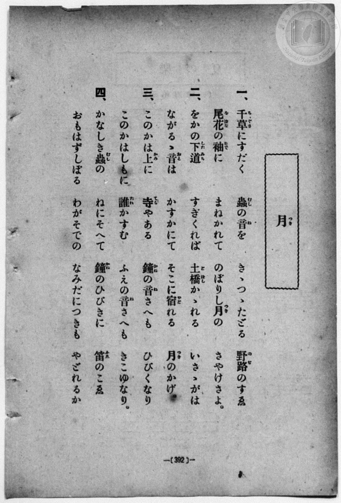
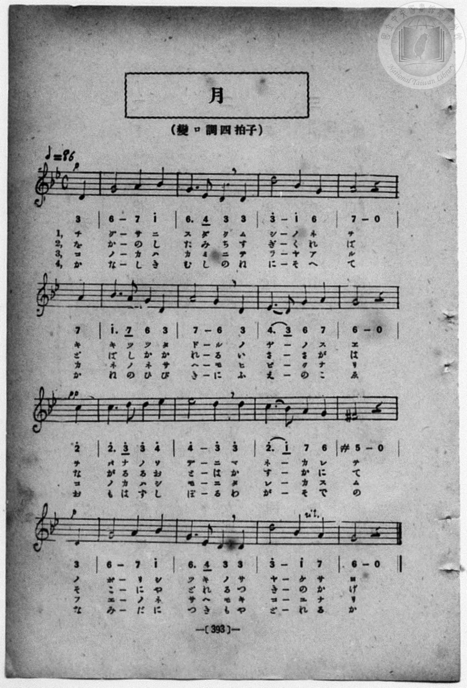

# 月

> Re:Shōka 使用 AI 協助辨識與重建樂譜，可能會有錯誤。歡迎回報。

- **鋼琴伴奏版**：<br><audio controls src="tsuki.mp3"></audio>
- **NEUTRINO 歌聲合成版**：<br><audio controls src="tsuki_neutrino.mp3"></audio>

- book: 新編 小學校・公學校 唱歌教材集（高等科一・二學年用）
- 一條慎三郎 編《新編 小學校・公學校 唱歌教材集》（大正十二年十二月，索書號 0725-41）

## 說明

> [!NOTE]
> **原書資訊與歌詞全文**（對應 `P401.jpg`–`P402.jpg`，原書 pp. 392–393，高等科一・二學年第 26 首）：
> - **曲名**：月（つき）
> - **調性與拍號**：變ロ調四拍子（關係小調為ト短調／G 小調，2 降記號，4/4 拍，弱起 1 拍），速度 ♩= 86
> - **調式特徵**：以關係大調（B♭ 大調）記簡譜（`3_ 6_ 7_ 1` 對應 D4–G4–A4–B♭4），第 12 小節出現和聲小音階升七級導音 `#5`（F♯4），終止於主音 `6_`（G4）。
>
> **一、**
> 千草（ちぐさ）にすだく　蟲（むし）の音（ね）を　きゝつゝたどる　野路（のぢ）のすゑ
> 尾花（をばな）の袖（そで）に　まねかれて　のぼりし月（つき）の　さやけさよ。
>
> **二、**
> をかの下道（したみち）　すぎくれば　土橋（どばし）かゝれる　いさゝがは
> ながるゝ音（おと）は　かすかにて　そこに宿（やど）れる　月（つき）のかげ。
>
> **三、**
> このかは上（かみ）に　寺（てら）やある　鐘（かね）の音（ね）さへも　ひびくなり
> このかはしもに　誰（たれ）かすむ　ふえの音（ね）さへも　きこゆなり。
>
> **四、**
> かなしき蟲（むし）の　ねにそへて　鐘（かね）のひびきに　笛（ふえ）のこゑ
> おもはずしぼる　わがそでの　なみだにつきも　やどれるか


## 歌詞

```text
（TMD 檔案未包含歌詞註解）
```

## ABC

```abc
X:1
T:月
M:4/4
L:1/16
Q:1/4=86
K:Gm
V:V1 name="Piano" snm="Pia"
[V:V1]
!p! z4 z4 z4 D4 | G8 A4 B4 | G6 E2 D4 D4 | d8 B4 G4 |
w: 1.~ち | ぐ さ に | す だ く む | し の ね
w: 2.~を | か の し | た み ち す | ぎ く れ
w: 3.~こ | の か は | か み に て | ら や あ
w: 4.~か | な し き | む し の ね | に そ へ
A8 z4 A4 | B6 A2 G4 D4 | A8 G4 D4 | E6 D2 G4 A4 |
w: 1.~を き | き つ つ た | ど る の | ぢ _ の す
w: 2.~ば ど | ば し か か | れ る い | さ _ さ が
w: 3.~る か | ね の ね さ | へ も ひ | び _ く な
w: 4.~て か | ね の ひ び | き に ふ | え _ の こ
!pp! G8 z4 c4 | c6 d2 d4 e4 | e8 d4 d4 | c6 B2 A4 G4 |
w: 1.~ゑ を | ば な の そ | で に ま | ね _ か れ
w: 2.~は な | が る る お | と は か | す _ か に
w: 3.~り こ | の か は し | も に た | れ _ か す
w: 4.~ゑ お | も は ず し | ぼ る わ | が _ そ で
!p! ^F8 z4 D4 | G8 A4 B4 | G6 E2 D4 D4 | d8 B4 A4 |
w: 1.~て の | ぼ り し | つ き の さ | や け さ
w: 2.~て そ | こ に や | ど れ る つ | き の か
w: 3.~む ふ | え の ね | さ へ も き | こ ゆ な
w: 4.~の な | み だ に | つ き も や | ど れ る
G8 z4 z4 |
w: 1.~よ
w: 2.~げ
w: 3.~り
w: 4.~か
```

## TMD 檔案連結

- [主旋律 TMD 檔案](tsuki.tmd) [[在 TMD Studio 編輯](https://tmdlang.github.io/Tmd-TS/#tmd=s7IKdvYPcrWy4qpTUCpJTLdSSM7PyUlNLsnMz7MqzsjPTozPrsyvSsyML84ojTe0NDJWgqssy88pzU21ys4vyY83jDdCSBTnlxYlp1oVJ2fk5-fEl6RWlCTl52ejy8cXJKanWgWYGBgiZAqK8stS8xLzgLoLijLzSlJTwNoRClLLMlNSQdLFyYl58WWpRZlpmakpSG5KLSoGOx1iRUlRYl5xclFmAcg_CFX5RSUZ-elFiQUZlVYZmcUl-UWZyYk58dmJeYkIRSUZqUDf5SWWlBaloosWpyYW5-cVI5uYmZ6ZZ5WbmpmVieRjLS2FZ3M6FLS0uBRtFSzMuOxtFZx0uLJTK20V3HO5bEz0TexARoAUWyk8m7bh-fYVCk839D9du-PZgoWPm3c_bV0DYSs8nbLx2dqeZ1NnPps74eXstvd7Ol6unvF8befz5ROf7GgAKn2yqweo9OnOLc-nrHi_pxPsNKDMs0Vzn7X2PdnR-bK5TwFo_OOGLlLsedzQDbTq6ZLlz9YuftrbCLJk5xYIA-ix93t6nm9Z9Gz2jhcz5ysYmBuZ6poYgu3m0tdSsKUW4FJQULBTiFb08w9xjYVwtLSe9s0H2bu5_cWKrhcd7UA3v1g572nrimfT2rW0QE7e0PusvVMhAZS-9LIK0hMeNUwGcYzAHKDDIQYoFBToKRhbGgFljS2NgcI4Q3XNGgUjM4WXy6YBPfh-zyyIO3SBLnk2e9PTCb0gS2eBg6TjceOSx429QGUINS9W7X_WsBzkzu5eYFiBFb9Y1_W4eS1Q5uns2UDhp2sngCJ1-pwn-5uAUQMUf96063Fzx_P5IDXv9_S7g2IMzOwxUng5s_fFihlAo4A8YCpSABoA8tOejS-2blcwhHCBzux52TD_6a5lCo9mrgSnP2QHPd3T_7xz59N9W8GuebJ7KdTuJcvBlnQ4PZq5VgHG6wTa9nzDwhdr5wBlEozjFcziFczjFQwTgI4CB7SLCTAI3UGEI4gAaTaBOAEUcoZGIMc_X9_wtH3X8_59Tyf1vGjcBBR5OX_zy1l9T3vbn-xofr5l1tMNfUARhQRlU2AMdbg9mrkeZsbWpmdrFz2btufJjt1gFWbxIBXuIOnHDU1gf8FSBijiGhqBWQ7Mf9rb_KIXaAQwVhY-bpzwuHEqSEvj6seNMx83Lnjc2P-4oeHF_E0gBU0Njxung2XXAe0Aa1kL4jZNAqoBxujjprmgqAWR8x83rnzc1A0Uf9ne92L7erDidY8bF0G0gwxvmgh1wIZ9L7o2gs2f9Lhxw-PGVRA1LxYBUxJQF9C05VAngWzZB7T0cWP346aex43LwCJA0_Y8buoCug0teYGkQAqmPm5qedw4EczowAiNXT1IoQF2QzdQ45Md3S8bJ4NNmw72zn5g-IADE2ggMGT6QCEDcsMGoMjTOfOfrQSVAyBfg7wACSWgI-eC1IDD4XEj0A1ABwC9A9S1Hmpd4yoQF6igaS4sSIEeAZVPQDVgXUDHAK0DksAYgfgXaMJkIPfpOlAiBHttJTgWoBZhCQSQdmAcoScDoGcQHgeZCVG5_smOLrAJQDYoZUNC_un6XWDBZY-bgKkFaB3Q3iZoFE-YAVMPTg9oyQPo68Ydj5uawI7f9LhxMyjogB5v6sK0GhTaQJVgG1-s2gA2ZD7Qa9DwBCUbYOIFmrP1cSMoReG2qBdkbFMbxCJ0vwNLFBS_A00GRgQwonsxkzrYNGCSA4Y_MOR3QGIB08swrwHtBTn--ZrZYAUgd8IUAN0DTfOgWAZ5E-jfWWB7gQkYnEiagCEDTB6gNA-zGugwYNoD5kSgA0BxCvUgON6hkd7YDTKW8ooEChS09Lm4QopLszOtAjIT8_IdanQNa6pBVijYWGiBA1EBW_2lAClegaU4sEgDljIvFvYoaMCqFE0s6oH2gMyqUTAAlrkwXF1QqwAsP3UVasCSPoao0sBsiJAzQpNrmoSQM0bXNxkhZ4Iu1w2Wg7oGWHTrgiGwANcFVhZAKZiYSTzEbRAHKhhDFYLUgFXUQPSAIMhgMAfhD2D5CpUEplUwuRqsB5iuoaILgLgf7JMGqMx0uI51YHItRBzsU5g1wFSBEiYQ_yDrApkCEp8PFd0PDUeIzSCZPrgOiP09UPENKPasRNgDDF-I6RBdIBuBCRqqC2I_xB6QH4G5BuruTpiOphaweBNUHOZi5PiAxRUwE8DtAfkE6l9oKEFE0cIHbCtEbi6Y3AEVB7kD3R7cKRqUkHf1EJ-QQQkBHO3g1ABNJfAkgSwITEkgIUhLAZZSEEkPkhOAWcEIERLgFATyOcjlS8AYxALFKUgGFDeQkIXEBSg8QOKL4CEBCSFojDdNRA4J5JwDTkGQeIeELMQ8cFhBUwayPaB4BOkApWjktA1LQaA0gQhxUEwipyBQfEHcBmFDdINkQDEGsQeURoDlK1R8M9wecEqFmAhU1YViD2puR7UHZBLEHESIwnIjsMiGineghRvYRPRwawTZSigF7egkPgWB4huYLMBFiwnYRhAJEYNgmBpDSKKBljum6qhJB6MQRUTpKriXQFkDJLMcLQj2QcUhgQbP3vBCATUTgRMaUtKBJBBQ8oAlEXAgAekVcPNAiQKepKDFH6IYgRWLqPaAXYtR-ID0wMyDFnPgBIPsH2gWQSRdqD2wrAApRmD2gBMAIulATQPZAayuke1p3AMzD-LPJlCCRIQAovABhS9ycYmcFfAmHWBDhfikQ169ha3kAWHklIPwJygmEf4HFUCQ4hiWoqCZF1y4Q-RA2QUhDstUaLaA0w0ogyHFGtgMRMEGij1YegLZi5p1IbbD0hNy5YhkCzjVoGdrUBpHFF-gYgdW4IBMR3FXUxtYHFuBg2QLuLjZD7dlAdxHaCEGsQXNl7BcBvEpclWOsKWWi0vXTgHcQFMAMpS5AA)]
- [鋼琴伴奏 TMD 檔案](tsuki_piano.tmd) [[在 TMD Studio 編輯](https://tmdlang.github.io/Tmd-TS/#tmd=s7IKdvYPcrWy4qpTUCpJTLdSSM7PyUlNLsnMz7MqzsjPTozPrsyvSsyML84ojTe0NDJWgqssy88pzU21ys4vyY83jDdCSBTnlxYlp1oVJ2fk5-fEl6RWlCTl52ejy8cXJKanWgWYGBgiZAqK8stS8xLzgLoLijLzSlJTwNoRClLLMlNSQdLFyYl58WWpRZlpmakpSG5KLSoGOx1iRUlRYl5xclFmAcg_CFX5RSUZ-elFiQUZlVYZmcUl-UWZyYk58dmJeYkIRYlFQM3pqbmpeSVWBZmJefnxicnJ-bkFiXmZIDGEwpIMoCKrvMSS0qJUdNHi1MTi_LxiJS4tLYVnczre7-l4OXvms87ul917nk_Y8mTPlqdL-9_v6VTQ0uJStFWwMOOyt1Vw0uHKTq20VXDP5bIx0TexAxkJCkArhWfTNjzfvkLh6Yb-p2t3PFuw8HHz7qetayBshadTNj5b2_Ns6sxncye8nN0Gsmr1jOdrO58vn_hkRwNQ6ZNdPUClT3dueT5lBdBOsFOBMs8WzX3W2vdkR-fL5j4FoPGPG7pIsedxQzfQqqdLlj9bu_hpbyPIkp1bIAywh3ueb1n0bPaOFzPnKxiYG5nqmhiC7eYKKS7NzrQKAAVskIdDja5hTTWXAhDYWGjZgRn6Wgq26EDh6Z6NL7Zuf9HR_nzNGqDbXyzsUdAAJiEjvayCdE0s6rX0wWbVKBgo6MJxdUGtgnE8kFEDlvQxRJV-3LgQIWeEJtc0CSFnjK5vMkLOBF2uGywHdY0ZyHYQNAcxDEFSMDGTeIjbIA5UMIYqBKkBq6iB6AFBkMFgDsIfjxsnQCUfN04Fk6vBeh43zoSKLgDifrBPGqAy0-E61oHJtRBxsE9h1jxu7EUJE4h_kHWBTAGJz4eK7oeGI8RmkEwfXAfE_h6o-AYUe1Yi7AGGL8R0iC6QjY8b10N1QeyH2APy4-PGZVB3d8J0NLWAxZug4jAXI8cHLK4eN66C2wPyCdS_0FCCiKKFD9hWiNxcMLkDKg5yB7o9uFM0KCHv6iE-IYMSAjjawakBmkrgSQJZEJiSQEJAHlgUklIQSQ-SE4BZwQgREuAUBPI5yOVLwBjEAsUpSAYUN5CQhcQFKDxA4ovgIQEJIWiMN01EDgnknANOQZB4h4QsxDxwWEFTBrI9oHgE6QClaOS0DUtBoDSBCHFQTCKnIFB8QdwGYUN0g2RAMQaxB5RGHjdugopvhtsDTqkQE4GqulDsQc3tqPaATIKYgwhRWG583LgVKt6BFm5gE9HDrRFkK6EUtKOT-BQEim9gsgAXLSZgG0EkRAyCYWoMIYkGWu6YqqMmHYxCFBGlq-BeAmUNkMxytCDYBxWHBBo8e8MLBdRMBE5oSEkHkkBAyQOWRMCBBKRXwM0DJQp4koIWf4hiBFYsotoDdi1G4QPSAzMPWsyBEwyyf6BZBJF0ofbAsgKkGIHZA04AiKQDNQ1kx-PGWcj2NO6BmQfxZxMoQSJCAFH4gMIXubhEzgp4k87T2bOJTzrk1VvYSh4QRk45CH-CYhLhf1ABBCmOYSkKmnnBhTtEDpRdEOKwTIVmCzjdgDIYUqyBzUAUbKDYg6UnkL2oWRdiOyw9IVeOSLaAUw16tgalcUTxBSp2YAUOyHQUdzW1gcWxFThItoCLm_1wWxbAfYQWYhBb0HwJy2UQnyJX5QhbalHaZz4o7TMTaPsM1MABQVBBYAB1GSiS4xWizeJzY4EJAcbCEDVGF0WwgCkHoiIWbDimsViVIgsagdhGSHahWgVyMIqLTUFSpkBVhkDaEKTYBCRigiyCMBOHS6kRCDicCzIWGB-6dgrgKIn2AboIwTFC5hgjc0zAHGUuAA)]

## 分析

```text
================================================================================
📊 TMD Song Profile: [ 月 ]
================================================================================
⏱  Duration:       0:44 (44.7s), 16 measures total
🎼 Key & Tempo:    首調基準 B,, != 86.0 BPM, <4/4>
   - 分析範圍：      由實際發聲的音符與和弦推測調性；播放脈絡另行呈現
🎤 人聲音域:    D4 (MIDI 62) – D#5 (MIDI 75) [跨度: 13 個半音 / 1.1 個八度, 難度: moderate]
   - 最低音:  D4 in [Tsuki #1 @ m.1, 0:02]
   - 最高音: D#5 in [Tsuki #1 @ m.10, 0:27]
   - 適合: soprano, mezzo-soprano, contralto, tenor, baritone, bass
🏛  結構:      Tsuki (44.7s)
⚡ 編曲密度:        Peak 1 軌道同時演奏
🗝  調性診斷：       G 小調（純淨自然小調，未偵測到可信轉調）
   - 風格氣質:    純淨自然小調（陰鬱抒情、旋律集中，無明顯調外色彩）
   - 轉調歷程:    全曲維持單一推測調性（未偵測到可信轉調）
   - 核心骨幹音:  D, G, A, A#, D#
   - 調性數值:    G 小調 [相關度: 0.82, 穩定度: Moderate, 自然音純度: 96.7%]
   - 候選調性 (K-S): G 小調 (0.82), G 大調 (0.70), D 大調 (0.65)
   - 五度圈歷程:   +1
   - 各段落調性細節:
     • [Tsuki #1]: G 小調 (r: 0.80, 自然音純度: 96.6%, 調外音: F#)

  [ 五度圈游移軌跡 ]
               C  
         F           [G ]*
      Bb               D  
      Eb               A  
         Ab           E  
            Db       B  
               F# 
     (* = active key center)

  [ 十二半音累積音高分佈 ]
     C  : ██████                     6.7%
     C# :                            0.0%
     D  : ████████████████████████  26.7%
     D# : ████████                   9.2%
     E  :                            0.0%
     F  :                            0.0%
     F# : ███                        3.3%
     G  : ████████████████████████  26.7%
     G# :                            0.0%
     A  : ████████████████          17.5%
     A# : █████████                 10.0%
     B  :                            0.0%
--------------------------------------------------------------------------------
Assignment 軌道音域：
  - Piano         : D4 – D#5 (13 個半音 / 1.1 個八度, 50 個音符)
================================================================================
```


## 原書掃描頁






