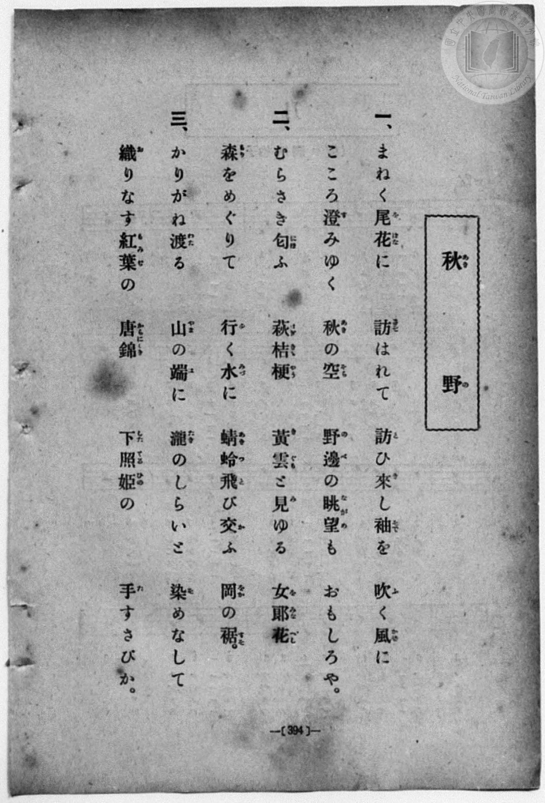
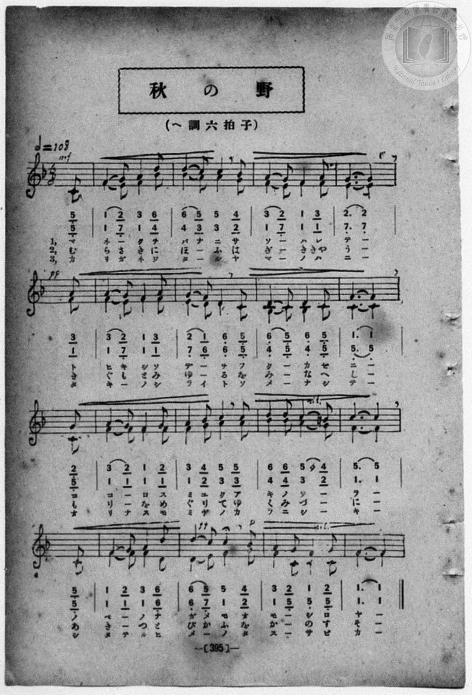

# 秋の野（二部）

> Re:Shōka 使用 AI 協助辨識與重建樂譜，可能會有錯誤。歡迎回報。

<audio controls src="aki_no_no.mp3"></audio>

- book: 新編 小學校・公學校 唱歌教材集（高等科一・二學年用）
- 一條慎三郎 編《新編 小學校・公學校 唱歌教材集》（大正十二年十二月，索書號 0725-41）

## 說明

> [!NOTE]
> **原書資訊與歌詞全文**（對應 `P403.jpg`–`P404.jpg`，原書 pp. 394–395，高等科一・二學年第 27 首）：
> - **曲名**：秋の野
> - **調性與拍號**：ヘ調六拍子（F 大調 6/8 拍，弱起 1 拍），速度 ♪= 108（二部合唱，全 16 小節）
> - **曲目辨析**：本曲並非《新定兒童唱歌》尋常科第四學年用之同名曲〈秋の野〉（佐々木信綱作詞、内田粂太郎作曲，「共にたをらん糸萩・野菊…」），而係「まねく尾花に誘はれて…」之ヘ調六拍子二部合唱曲。
>
> **一、**
> まねく尾花（をばな）に　誘（さそ）はれて　訪（と）ひ來（き）し袖（そで）を　吹（ふ）く風（かぜ）に
> こころ澄（す）みゆく　秋（あき）の空（そら）　野邊（のべ）の眺望（ながめ）も　おもしろや。
>
> **二、**
> むらさき匂（にほ）ふ　萩桔梗（はぎききやう）　黄雲（きぐも）と見（み）ゆる　女郎花（をみなへし）
> 森（もり）をめぐりて　行（ゆ）く水（みづ）に　蜻蛉（あきつ）飛（と）び交（か）ふ　岡（をか）の裾（すそ）。
>
> **三、**
> かりがね渡（わた）る　山（やま）の端（は）に　瀧（たき）のしらいと　染（そ）めなして
> 織（お）りなす紅葉（もみぢ）の　唐錦（からにしき）　下照姫（したてるひめ）の　手（た）すさびか。


## 歌詞

```text
（TMD 檔案未包含歌詞註解）
```

## ABC

```abc
X:1
T:秋の野（二部）
M:6/8
L:1/16
Q:3/8=72
K:F
V:V1 name="Alto" snm="Alt"
V:V2 name="Vocal" snm="Voc"
[V:V1]
!mf! z2 z2 z2 z2 z2 C2 | F4 E2 F4 B2 | B4 A2 A4 G2 | F4 E2 F4 F2 |
w: ま | ね _ く を | ば な に さ | そ _ は れ
!pp! E10 F2 | F4 E2 F4 F2 | E4 D2 D4 C2 | B,4 C2 B,4 C2 |
w: て と | ひ き し そ | で _ を ふ | く _ か ぜ
C10 C2 | F4 F2 F4 F2 | F4 G2 A4 A2 | B4 B2 A4 G2 |
w: に こ | こ _ ろ す | み ゆ く あ | き の そ _
F10 C2 | F4 F2 F4 D2 | !ff! !p! D4 E2 F4 G2 | F4 C2 C4 C2 |
w: ら の | べ _ の な | が め も お | も _ し ろ
F10 z2 | !mf! z2 z2 z2 z2 z2 C2 | F4 E2 F4 B2 | B4 A2 A4 G2 |
w: や | む | ら さ き に | ほ _ ふ は
F4 E2 F4 F2 | !pp! E10 F2 | F4 E2 F4 F2 | E4 D2 D4 C2 |
w: ぎ _ き きや | う き | ぐ も と み | ゆ _ る を
B,4 C2 B,4 C2 | C10 C2 | F4 F2 F4 F2 | F4 G2 A4 A2 |
w: み _ な へ | し も | り _ を め | ぐ り て ゆ
B4 B2 A4 G2 | F10 C2 | F4 F2 F4 D2 | !ff! !p! D4 E2 F4 G2 |
w: く み づ _ | に あ | き _ つ と | び か ふ を
F4 C2 C4 C2 | F10 z2 | !mf! z2 z2 z2 z2 z2 C2 | F4 E2 F4 B2 |
w: か _ の す | そ | か | り が ね わ
B4 A2 A4 G2 | F4 E2 F4 F2 | !pp! E10 F2 | F4 E2 F4 F2 |
w: た _ る や | ま _ の は | に た | き _ の し
E4 D2 D4 C2 | B,4 C2 B,4 C2 | C10 C2 | F4 F2 F4 F2 |
w: ら い と そ | め _ な し | て お | り な す も
F4 G2 A4 A2 | B4 B2 A4 G2 | F10 C2 | F4 F2 F4 D2 |
w: み ぢ の か | ら に し _ | き し | た て る ひ
!ff! !p! D4 E2 F4 G2 | F4 C2 C4 C2 | F10 z2 |
w: め _ の た | す _ さ び | か
[V:V2]
!mf! z2 z2 z2 z2 z2 C2 | F4 G2 A4 d2 | d4 c2 c4 B2 | A4 G2 F4 A2 |
w: ま | ね _ く を | ば な に さ | そ _ は れ
!pp! G10 A2 | A4 G2 F4 A2 | G4 F2 D4 C2 | D4 C2 D4 C2 |
w: て と | ひ き し そ | で _ を ふ | く _ か ぜ
F10 G2 | A4 G2 F4 G2 | A4 B2 c4 c2 | d4 d2 c4 =B2 |
w: に こ | こ _ ろ す | み ゆ く あ | き の そ _
c10 C2 | F4 G2 A4 d2 | !ff! !p! d4 c2 c4 B2 | A4 G2 F4 G2 |
w: ら の | べ _ の な | が め も お | も _ し ろ
F10 z2 | !mf! z2 z2 z2 z2 z2 C2 | F4 G2 A4 d2 | d4 c2 c4 B2 |
w: や | む | ら さ き に | ほ _ ふ は
A4 G2 F4 A2 | !pp! G10 A2 | A4 G2 F4 A2 | G4 F2 D4 C2 |
w: ぎ _ き きや | う き | ぐ も と み | ゆ _ る を
D4 C2 D4 C2 | F10 G2 | A4 G2 F4 G2 | A4 B2 c4 c2 |
w: み _ な へ | し も | り _ を め | ぐ り て ゆ
d4 d2 c4 =B2 | c10 C2 | F4 G2 A4 d2 | !ff! !p! d4 c2 c4 B2 |
w: く み づ _ | に あ | き _ つ と | び か ふ を
A4 G2 F4 G2 | F10 z2 | !mf! z2 z2 z2 z2 z2 C2 | F4 G2 A4 d2 |
w: か _ の す | そ | か | り が ね わ
d4 c2 c4 B2 | A4 G2 F4 A2 | !pp! G10 A2 | A4 G2 F4 A2 |
w: た _ る や | ま _ の は | に た | き _ の し
G4 F2 D4 C2 | D4 C2 D4 C2 | F10 G2 | A4 G2 F4 G2 |
w: ら い と そ | め _ な し | て お | り な す も
A4 B2 c4 c2 | d4 d2 c4 =B2 | c10 C2 | F4 G2 A4 d2 |
w: み ぢ の か | ら に し _ | き し | た て る ひ
!ff! !p! d4 c2 c4 B2 | A4 G2 F4 G2 | F10 z2 |
w: め _ の た | す _ さ び | か
```

## TMD 檔案連結

- [主旋律 TMD 檔案](aki_no_no.tmd) [[在 TMD Studio 編輯](https://tmdlang.github.io/Tmd-TS/#tmd=s7IKdvYPcrWy4qpTUCpJTLdSSM7PyUlNLsnMz7MqzsjPTozPrsyvSsyML84ojTe0NDJWgqssy88pzU21ys4vyY83jDdCSBTnlxYlp1oVJ2fk5-fEl6RWlCTl52ejy8cXJKanWgWYGCAZWVCUX5aal5gH1F1QlJlXkpoC1o5QkFqWmZIKki5OTsyLL0stykzLTE1BclNqUTHY6RArSooS84qTizILQP5BqMovKsnITy9KLMiotMrILC7JL8pMTsyJz07MS0QoKslIBfquODWxOD-vGF04L7GktChViUtLS-H58u7Hjetetve939PxZFfPy-YV7_d0KmhpcSnaKhgaWHDZ2yq4cdmY6VvYgcwAhYSVwrNpG55vX6HwdEP_07U7ni1Y-Lh599PWNRC2wtMpG5-t7Xk2deazuRNezm4DGvty9YznazufL5_4ZEcDUCnQFqDSpzu3PJ8CsgvsNqDMs0Vzn7X2PdnR-bK5TwFo_OOGLlLsedzQDbTq6ZLlz9YuftrbCLJk5xYI49mcjvd7ep5vWfRs9o4XM-crGJgbmeqaGILt5tLXUrClFuBSUFCwU4hW9PMPcY2FcLS0nvbNB9m7uf3Fiq4XHe1AN79YOe9p64pn09q1tEBO3tD7rL1TIQGUlPSyCtITHjVMBnFMwBygwyEGKBQU6CkYW5oAZY0tTYHCOEN1zRoFI3OFl8umAT34fs8siDt0gS55NnvT0wm9IEtnwWMdIfti1f5nDctBLuzuBYYSWNnj5hlA4aeta4FiT9dOALrWTQEYxEAxBWCKUACKgty3Z-OLrdsVDCFcoJU9LxvmP921TOHRzFXgNARPWU8ndABjDaSldYWCoRkoYp-vbwDqQXHj89nrXuxb8WzeBLATns1ZAxR7smPZy7nzIEni6bpZT1snPV-9FJICgBH_dEP30x07gEEB9PvT2bPhqevJzu6nE3qAfgaa8LihA-7pxw1AV3Y82TvhcUPrszkrnuxf-Hzbxid75wAj5nFD49O21udTNjzf1PR0ySpgWgSKA7UDHf24AejujY8bVz9unP-4adLjps7HTZOfb97xYsJKYPgDjX3R3_WoYdnjBmgovGjoebK_CajrceO-x41rHzf2P92w70UXyIQXq2Y8blz_uAkotQyiBehUtMBGDjKw-5vAoQRLVqBYb2gE5lMwH80KoO9ALmzc8LhxFdAxIDc3NAAtBYk3Tn3cOBcsCHUASGoFUBlQCpQfHzduerIPlG0fN4I88rhx-otFwKQE5M593LgcJAI0uaHh6YSdYMGtYDX9LxcB9QK5wBCeA7ER5rDJINTU-2xfC1jBTLDs_sdNbUBdQHOAkQIWb4JZt-75yl1Q65qAwdgJVAMM25dNXWDBdY8bgfaClc3Z9WzObLDgqseNPY-bGsFuAwZ4w-PGLhCjcTrQ3sdNLRhBtwsYl4iga2oARSUoWHqf9jSBDQRG8W6wLVtBgTNh5bOFU54tmg6WWv-4sQ-oEoSAJjcCAwrswt0tL0GJBBRojxsnAG0Ha1_xYhnEd_vBbmt73NQNCrqlm4HpCima9oO9sAPoYHheeLZ4HVi26THI4-Awb2oEm9wFjbKFPWAFYAc09j_bsAVi0ePGpYgYn7P7xWxQUocE7-PGJUCpl4shgQaJ681PdgEFQREH9-_TTQthDoMIrnuxeB8k7qApByMpAoWQkmI32JHApLX22Q6IUf3ALAP2Bdj7GyEeB4Ye0FhwVK5eDwlbuMufNwBTGlBkPjxVgGMTyADqAlYNDc_mT4YkErCxwJABBuB0YMhA3PB85xSwLCTogI4Bys58vqX1xURwaIDSBjCgFkFNBjppyoSXPcugCRhkCzABAE0DW93Q8GRH9_PW5U-XrwYrAIoDXbUM5JfGTdBUBzbkWSckrsE-BYUVMEVtBhkICS7KqxcoUNDS5-JyzM70y_fLtwrLB1b9DjUGNdUgOxRsLLTA0aKArVpTABaPwGIDmHKe7Oh60bgJWLwoaEBLb20FY2hxDGSCqhATKPdpZ6-CKaho11GAVUqaWIwGuglkbY2CARxW56bVKpjGA8UMgUW7EdACXQUzIM8MSJsCoS7QjhqwqBFYhTGQZwSkIbC6oKAWJAQ21scQ2WBgugEqBSYvsEJg4geRTZPAYhvAIquAeDWYNRUsOheqcj1YZQ9YbBncKmCKgtljhGJPUwNIZVMn1CRgggCzVoP174bq3Qo1GSTWBxWDqAOVEGDhNiSremFWGaN6qRtsVRdYTQ_Uc8CMA9Y_H6K3qRtMQszcBzVvHZL1IC_D7JkPtAd_StjVg5oSkGP92ZzVwCjHTBUWZKYKzFg2VDCLByUEUPqAsRAiIJUQaISUBIAZDhqGwGwIZs0F-3s5NHwmQSMEJAZKFCAeOMwa52CEz2SkKAeWq2D9TeCkAJLdD44NSLzBwh2SwPZD9a8CkzvAYiC3QM0FmoGIX0hCQMTSdKTk1AK3C-yHpkYUc8EqUZJoF8H43NGJGZ-w-MIVn4ZGFEcoMILAPBNwljaFZnAzSAZXB3JBDAgERS1SZE6GBhkkt8yEBy8o4KG5uhEYnPD8tA6ek2HBCAucdciRCc5E8OQADFhEBHdBAxVkAyyRgOwEVpowc1ESCUpkQjMnqGyZCYtqmIsbF8EjGZKRIZG8Gp44EIkBYjIwgvFHJ7Adixmd8OiCxycswxIZbdhK4uo0UDkNZFYDS1zUIhkUt4isaIASezvhYQ8JFZBYDzTEQWEDTbRQNsTPkNgGibVgmgrOiLAMswRMAstlILkZGq7QshaaEUGZEmE_JPVAUgeKqeBsCCpAQTEPzcrAYgQ5y0FMABaY0JgF8aaCyc1INsFMrUVUvo45Jflk1L3d9K57zePBFChuTYC0MTSGUSQNgVwgE-ZTcPULFButfmlc_cITAy2rX2zxDKxsEfWtCZQFo4GlNiItoBXbo3UwwToYJVJpVgdDohMWqYiiHdTEAuVzE5R8jjUuR6tgIqpglNikShUMiTVg9oO2fYEZElwLg0RBtTAszoCxBc6HaG3i0YoYWhHr2ilA6-JoH8NYBWSuESrXGMxV5gIA)]
- [鋼琴伴奏 TMD 檔案](aki_no_no_piano.tmd) [[在 TMD Studio 編輯](https://tmdlang.github.io/Tmd-TS/#tmd=s7IKdvYPcrWy4qpTUCpJTLdSSM7PyUlNLsnMz7MqzsjPTozPrsyvSsyML84ojTe0NDJWgqssy88pzU21ys4vyY83jDdCSBTnlxYlp1oVJ2fk5-fEl6RWlCTl52ejy8cXJKanWgWYGCAZWVCUX5aal5gH1F1QlJlXkpoC1o5QkFqWmZIKki5OTsyLL0stykzLTE1BclNqUTHY6RArSooS84qTizILQP5BqMovKsnITy9KLMiotMrILC7JL8pMTsyJz07MS0QoSiwCak5PzU3NK7EqyEzMy49PTE7Ozy1IzMsEiSEUlmQAFVkVpyYW5-cVowvnJZaUFqUqcWlpKTxf3v24cd3L9r73ezqe7Op52bzi_Z5OIPvl7JnPOrtfdu95PmHLkz1bni7tB4oraGlxKdoqGBpYcNnbKrhx2ZjpW9iBzAYFpZXCs2kbnm9fofB0Q__TtTueLVj4uHn309Y1ELbC0ykbn63teTZ15rO5E17ObgNZsXrG87Wdz5dPfLKjAagUaDtQ6dOdW55PAbkB7GagzLNFc5-19j3Z0fmyuU8BaPzjhi5S7Hnc0A206umS5c_WLn7a2wiyZOcWCOPZnI73e3qeb1n0bPaOFzPnKxiYG5nqmhiC7ebyzCspyrcKAAVxkIdDjUFNNZcCENhYaNmBGTUKBnBYnZtWq2AaDxQzVNBVMNQ2AmJjIMssXtsMKAimdBXM47VNgRKmQKaRtglIMViRaTxQPZAAaQWzIaZAoIFCDVctimN8iHIMUJ-CYbxCtGEsGAOZugomIAcagVim8fFIQiCerkK0aXwsMhNTP9QtjtmZfvl--VZh-cDUSVLAGCmAAwUUIiBHACHQBUAeSBQYZEDSGORCuOerCwpqQUJgY30MkQ1-3LgPqPRx41qwwseN_SCyaRJYbANYZBUQrwazpoJF50JVrger7AGLLYNb9bhxBcweIxR7mhpAKps6oSY9buwFs1aD9e-G6t0KNRkk1gcVg6jrfdzUAhZuQ7KqF2aVMaqXusFWdYHV9EA997ipH6x_PkRvUzeYhJi5D2reOiTrQV6G2TMfaA80SjCD2BCYLMFJAZxAISyECCIFAtMjPPwfN26CeuBx43Qway7Y0uVQx02ChgZIDBQjIB7YwY1zMBw3GSm8HzdOAOtvAscDSHY_OCgggQbzNCR290P1rwKTO8BiILdAzQWagQhcSCwggmg6Uly2wO0C-6GpEcVcsEqU9NGFLTBBmRXEMwGnZVNoyjaDpGx1UN6CmwAKVqSAnAx1LiSZzIR7DeRpaHJuBHoFnpDWwZMwzAswh61DDkhw6oFHBdBTiMDtgnoIZAMsgkB2Pm5cCjMXJYJQAhKaKkGZaiYsmGEublwED2BICoYE8Gp4xCAiAmIyMHBhQYmtWKhOAxUaQGY1MPujlg-YhSMiRHfCwwPiUpBYDzQUQO6FRiKUDXEHJAZAYi2YpoITJiwBLQGTwEICSG6G-hWa8aEJE5RIEfZDYhQSYyimgpMlKDeDYgOatIHZCjkJQkwA5l5oaIN4U8HkZiSbYKYiFcmOOSX5JJXI5sB6AEiBAtkESBtDgxpF0hDIBTJhVoILZaDYaKFMcaGMLZCBRTCiFAZWz2AWjAbV1XCj0AqU0ZIZGqKG8ABFFC6gSg-UwE1QEjjWcBwtmNFCEpgcoS0EYAIFl80gUVDZDAtHYAiC0yVay2G0eEYrnsnpTAA7DbDehAm4MwEigQka2I0AYdSuBEQxKOaAXFCBAuTC3AIpt0HisBjGowXYY0FuH5oAOzDwogjOBJVG4F4LLB-B-i4ohoN7QlAaJgZyL8TlIBLmHxAJ9w-o4QTpJ6HlUCL6V5AECtYMTqIkdrRQooqkrhZ6rwpcZgO56F0qiDoziKhZfC5IGCQCVoHUCQPHFyxZotsA6pPBOm4go0zALKAUyF4oE8IAqcHelcNmLlw1xAoku8DeiTYhoouIzVzUrickjiCeBLbwyOiD6topgLvECkAGNMqifYBqkLlGqFxjMFeZCwA)]

## 分析

```text
================================================================================
📊 TMD Song Profile: [ 秋の野（二部） ]
================================================================================
⏱  Duration:       1:25 (85.0s), 51 measures total
🎼 Key & Tempo:    首調基準 F, != 108.0 BPM, <6/8>
   - 分析範圍：      由實際發聲的音符與和弦推測調性；播放脈絡另行呈現
🎤 人聲音域:    C4 (MIDI 60) – D5 (MIDI 74) [跨度: 14 個半音 / 1.2 個八度, 難度: moderate]
   - 最低音:  C4 in [AkiNoNo[L1] #1 @ m.1, 0:01]
   - 最高音: D5 in [AkiNoNo[L1] #1 @ m.2, 0:03]
   - 適合: soprano, mezzo-soprano, contralto, tenor, baritone, bass
🏛  結構:      AkiNoNo[L1] (28.3s) -> AkiNoNo[L2] (28.3s) -> AkiNoNo[L3] (28.3s)
⚡ 編曲密度:        Peak 2 軌道同時演奏
🗝  調性診斷：       F 大調（純淨自然大調，未偵測到可信轉調）
   - 風格氣質:    純淨自然大調（陽光明朗、易唱易記，無明顯調外色彩）
   - 轉調歷程:    全曲維持單一推測調性（未偵測到可信轉調）
   - 核心骨幹音:  F, C, A, D, G
   - 調性數值:    F 大調 [相關度: 0.97, 穩定度: High, 自然音純度: 99.5%]
   - 候選調性 (K-S): F 大調 (0.97), D 小調 (0.67), C 大調 (0.62)
   - 五度圈歷程:   -1 -> -1 -> -1
   - 各段落調性細節:
     • [AkiNoNo[L1] #1]: F 大調 (r: 0.97, 自然音純度: 99.5%, 調外音: B)
     • [AkiNoNo[L2] #1]: F 大調 (r: 0.97, 自然音純度: 99.5%, 調外音: B)
     • [AkiNoNo[L3] #1]: F 大調 (r: 0.97, 自然音純度: 99.5%, 調外音: B)

  [ 五度圈游移軌跡 ]
               C  
        [F ]*          G  
      Bb               D  
      Eb               A  
         Ab           E  
            Db       B  
               F# 
     (* = active key center)

  [ 十二半音累積音高分佈 ]
     C  : █████████████             18.7%
     C# :                            0.0%
     D  : ████████                  10.9%
     D# :                            0.0%
     E  : ████                       5.7%
     F  : ████████████████████████  33.9%
     F# :                            0.0%
     G  : ███████                   10.4%
     G# :                            0.0%
     A  : █████████                 13.0%
     A# : █████                      6.8%
     B  :                            0.5%
--------------------------------------------------------------------------------
Assignment 軌道音域：
  - Alto          : A#3 – A#4 (12 個半音 / 1.0 個八度, 168 個音符)
  - Vocal         : C4 – D5 (14 個半音 / 1.2 個八度, 168 個音符)
================================================================================
```


## 原書掃描頁






