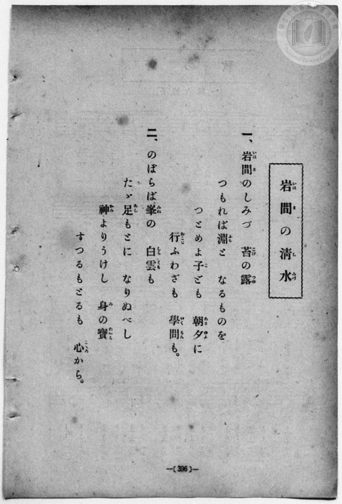
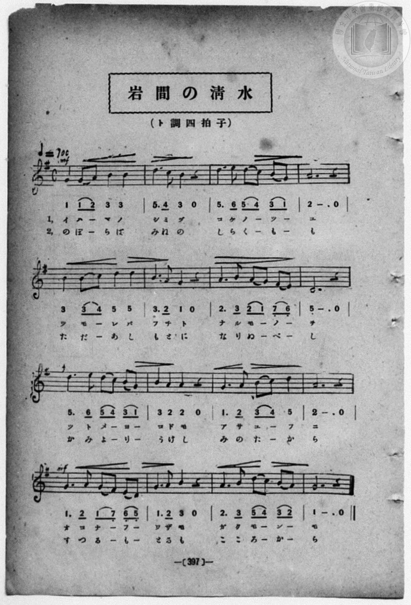

# 岩間の清水

> Re:Shōka 使用 AI 協助辨識與重建樂譜，可能會有錯誤。歡迎回報。

<audio controls src="iwama_shimizu.mp3"></audio>

- book: 新編 小學校・公學校 唱歌教材集（高等科一・二學年用）
- 一條慎三郎 編《新編 小學校・公學校 唱歌教材集》（大正十二年十二月，索書號 0725-41）

## 說明

> [!NOTE]
> **原書資訊與歌詞全文**（對應 `P405.jpg`–`P406.jpg`，原書 pp. 396–397，高等科一・二學年第 28 首）：
> - **曲名**：岩間の清水（いはまのしみづ）
> - **調性與拍號**：ト調四拍子（G 大調 4/4 拍），速度 ♩= 100（全 16 小節）
> - **版本對照**：歌詞頁（`P405.jpg`）第二節末句誤植濁點作「すつるもどるも」，樂譜頁（`P406.jpg`）第 14 小節作「とるも」（「捨つるも取るも」）。
>
> **一、**
> 岩間（いはま）のしみづ　苔（こけ）の露（つゆ）
> つもれば淵（ふち）と　なるものを
> つとめよ子（こ）ども　朝夕（あさゆふ）に
> 行（おこな）ふわざも　學問（がくもん）も。
>
> **二、**
> のぼらば峯（みね）の　白雲（しらくも）も
> たゞ足（あし）もとに　なりぬべし
> 神（かみ）よりうけし　身（み）の寶（たから）
> すつるもとるも　心（こころ）から。


## 歌詞

```text
（TMD 檔案未包含歌詞註解）
```

## ABC

```abc
X:1
T:岩間の清水
M:4/4
L:1/16
Q:1/4=100
K:G
V:V1 name="Piano" snm="Pia"
[V:V1]
!mf! G4 G2 A2 B4 B4 | d6 c2 B4 z4 | d6 e2 d2 c2 B2 G2 | A12 z4 |
w: 1.~い は _ ま の | し み づ | こ け の _ つ _ | ゆ
w: 2.~の ぼ _ ら ば | み ね の | し ら く _ も _ | も
B4 B2 c2 d4 d4 | B6 A2 G4 z4 | A6 B2 A2 G2 F2 E2 | D12 z4 |
w: 1.~つ も _ れ ば | ふ ち と | な る も _ の _ | を
w: 2.~た だ _ あ し | も と に | な り ぬ _ べ _ | し
!f! d6 e2 d2 c2 B2 G2 | B4 A4 A4 z4 | G6 A2 B2 c2 d4 | A12 z4 |
w: 1.~つ と め _ よ _ | こ ど も | あ さ ゆ _ ふ | に
w: 2.~か み よ _ り _ | う け し | み の た _ か | ら
!mf! G6 A2 G2 F2 E2 D2 | G6 A2 B4 z4 | A6 B2 d2 c2 B2 A2 | G12 z4 |
w: 1.~お こ な _ ふ _ | わ ざ も | が く も _ ん _ | も
w: 2.~す つ る _ も _ | と る も | こ こ ろ _ か _ | ら
!mf! G4 G2 A2 B4 B4 | d6 c2 B4 z4 | d6 e2 d2 c2 B2 G2 | A12 z4 |
w: 1.~い は _ ま の | し み づ | こ け の _ つ _ | ゆ
w: 2.~の ぼ _ ら ば | み ね の | し ら く _ も _ | も
B4 B2 c2 d4 d4 | B6 A2 G4 z4 | A6 B2 A2 G2 F2 E2 | D12 z4 |
w: 1.~つ も _ れ ば | ふ ち と | な る も _ の _ | を
w: 2.~た だ _ あ し | も と に | な り ぬ _ べ _ | し
!f! d6 e2 d2 c2 B2 G2 | B4 A4 A4 z4 | G6 A2 B2 c2 d4 | A12 z4 |
w: 1.~つ と め _ よ _ | こ ど も | あ さ ゆ _ ふ | に
w: 2.~か み よ _ り _ | う け し | み の た _ か | ら
!mf! G6 A2 G2 F2 E2 D2 | G6 A2 B4 z4 | A6 B2 d2 c2 B2 A2 | G12 z4 |
w: 1.~お こ な _ ふ _ | わ ざ も | が く も _ ん _ | も
w: 2.~す つ る _ も _ | と る も | こ こ ろ _ か _ | ら
```

## TMD 檔案連結

- [主旋律 TMD 檔案](iwama_shimizu.tmd) [[在 TMD Studio 編輯](https://tmdlang.github.io/Tmd-TS/#tmd=s7IKdvYPcrWy4qpTUCpJTLdSSM7PyUlNLsnMz7MqzsjPTozPrsyvSsyML84ojTe0NDJWgqssy88pzU21ys4vyY83jDdCSBTnlxYlp1oVJ2fk5-fEl6RWlCTl52ejy8cXJKanWgWYGJgiZAqK8stS8xLzgLoLijLzSlJTwNoRClLLMlNSQdLFyYl58WWpRZlpmakpSG5KLSoGOx1iRUlRYl5xclFmAcg_CFX5RSUZ-elFiQUZlVYZmcUl-UWZyYk58dmJeYkIRSUZqUDf5SWWlBaloovm5hcl5ihxaWkpPN208uW0yY8b1z3b0fpswxYFLS0uRVsFQwMDLntbBXcuGxN9EzuQZlAIWCk8m7bh-fYVCk839D9du-PZgoWPm3c_bV0DYSs8nbLx2dqeZ1NnPps74eXstvd7Ol6unvF8befz5ROf7GgAKn2yqweo9OnOLc-nrHi_pxPsKKDMs0Vzn7X2PdnR-bK5TwFo_OOGLlLsedzQDbTq6ZLlz9YuftrbCLJk5xYI49mcjvd7ep5vWfRs9o4XM-crGJgbmeqaGILt5tLXUrClFuBSUFCwU4hW9PMPcY2FcLS0nvbNB9m7uf3Fiq4XHe1AN79YOe9p64pn09q1tEBO3tD7rL1TIQGUhPSyCtITHjVMBnHMwBygwyEGKBQU6CkYW5oBZY0tzYHCOEN1zRoFIwuFl8umAT34fs8siDt0gS55NnvT0wm9IEtnocU30BmPG1seN65_3LgPKPi4cfrjxv2PG5cCTUBof7Fq_7OG5SAvdPcCgxFszuPmDqDw09mzgWJP104AmuOuAIwDoJgCMMkoAEXBjuh52TD_6a5lCo9mrgSnKpC3W1coGJqB4vb5-gYUe553djybswYYLM9bl4MtgQTZywWNQG2IYALqAXoV6G2g_mdzVj_tX_pi1ZJnS3qf7W98uXvek71zHjf0PG6c-bhxyeOm7sdNTY8bV0IZDUBH9Txb0fRi7RyEobDgBhmqYGgCdRjMmBVIWjuAIs96V8ANfto_DUm283FDE9gvsPgHRU9DIzBDgfmQgEcOb5AWpCB_3NDwonsKWAEwfiZCZF_O2QQWAdoIzFDQsAJzmx43AZ234dn2rWAFWx83LgRrAWafhseNq2BeX_e4aRJCF8g7jY-bOiAxBrQIrAUYPEAvAMNy7tMlU8HiQI1TgTYCjQUrWA0x4cXCHrBsF9iFq8BSWx839T9uBIYDyARQOpzaD1YDdFs_2JFgK0CyaIGzqwcpcMDhsOdxE9DADU83rwebAAyTtdAgamh4PnPvy9mQoJgOVgYyHGIyzIT5j5vmvdi2Geb-6VB7gV5uXA0LE6DL1zxu3AmUheh6vnQeWH030Dqw-g6wGqDHJ4IsAsbIrtUQx0Bc8nT9NjB3PkhLEzB9w2MEObnB00zD0_3NsAid_LgJnEjAGqGhQXnBAwUKWvpcXJ7libmJwRmZuZlVpVYBmYl5-Q41BjXVIIsUbCy0wEGvgK3UUwBlpx0NwOhV0IClfx0FWNbQxKIBaB3IsBqF6ty0WgVDYO41VDBSMAbSIFyjYAokdRVMwDwDJBEzIA0SNQSKGIFFIBCsBmykj2ENMDRbgHxgJgGT-8DkOrApwEgBqwdGCBAvhZsODF6o-ESoWmB0QGSa2rDbYwTSBVG5B0Q2dYLZG6Dm7YeatxaqCmYP1H6gamAaBLOaoPaAaFR78Af4rh5yAhwSxibg8ARhiIguMDRBsQBxJSRkjcFi5vEKZvGg8I_HE9ygoIJ4AFiooATDVmgwLATiFUjBsAoaDN0wfbAIapqEJ7jng1UuAJMQXaDgRAQeyA5gbsViTxeQvQasYidKRBAf3Ds6yUrfwOSNmXRBQQ4KZBCGuBQU-CA-LGrwJ29QeEN929QI9l8H1FegZAwskOHxAQsHWPhMhSZoSMyAZEChhSu8u6G6gJkFbAMoHCG6IGZMhMcBzB5Ysl8Hjy2QGaAYAmUPEsIb2DKgqDyBpGhI6gWmXeQQRk_mkHgxgqvBHuYgn4P8MxmaquAh2ATKxiD-NLQwB-UEkHg_PG-AYgd7VkeE-UyoriXg3IFUQIDzD3KeQS-6gC5r6iUQ5rVcXLp2CsglvQIWvjIXAA)]
- [鋼琴伴奏 TMD 檔案](iwama_shimizu_piano.tmd) [[在 TMD Studio 編輯](https://tmdlang.github.io/Tmd-TS/#tmd=s7IKdvYPcrWy4qpTUCpJTLdSSM7PyUlNLsnMz7MqzsjPTozPrsyvSsyML84ojTe0NDJWgqssy88pzU21ys4vyY83jDdCSBTnlxYlp1oVJ2fk5-fEl6RWlCTl52ejy8cXJKanWgWYGJgiZAqK8stS8xLzgLoLijLzSlJTwNoRClLLMlNSQdLFyYl58WWpRZlpmakpSG5KLSoGOx1iRUlRYl5xclFmAcg_CFX5RSUZ-elFiQUZlVYZmcUl-UWZyYk58dmJeYkIRYlFQM3pqbmpeSVWBZmJefnxicnJ-bkFiXmZIDGEwpIMoCKrvMSS0qJUdNHc_KLEHCUuLS2Fp5tWvpw2-XHjumc7Wp9t2PJ-T8fL2TOfdXa_7N7zfMKWJ3u2PF3a_35Pp4KWFpeirYKhgQGXva2CO5eNib6JHchQUBBaKTybtuH59hUKTzf0P12749mChY-bdz9tXQNhKzydsvHZ2p5nU2c-mzvh5ew2kBWrZzxf2_l8-cQnOxqASp_s6gEqfbpzy_MpK4B2gR0LlHm2aO6z1r4nOzpfNvcpAI1_3NBFij2PG7qBVj1dsvzZ2sVPextBluzcAmE8m9Pxfk_P8y2Lns3e8WLmfAUDcyNTXRNDsN1cnnklRflWAaCgDfJwqDGoqeZSAAIbCy07MKNGoTo3rVbBUEEXCI2AtHm8glm8gmk8UAYmaAwkDYC4BsgGiRgrmCqYAEkjuBoIBKvhqkWx1AfZUhM0S-MVog1jgXYBadP4WJBpEBEgZQDkwSVwqQDbVZ6YmxickZmbWVWKx5_6Wgq26EDh-Zo1wJh5sbBHQcMEFA3P1zfoKAAzi5leVkG6JhYNWvrogWYIDR8QBroYHA6gsIGFGETEDBpihvAwRA4xkJE-hjUKjxtbgPzHjevB5D4wuQ5syuPG6WD1jxv3A_FSuOmPGydDxSdC1T5uXAKRaWrDbo8RSBdE5R4Q2dQJZm-Amrcfat5aqCqYPVD7gaofN_aDWU1Qe0A0qj34A3xXDzkBDgljE3B4gjBEBJJk0VMnIhmD0hCe4AYFFcQDj5t6UIJhKzQYFgLxCqRgWAUNhm6YPlgENU3CE9zzwSoXgEmILlBwIgIPZMfjxtVY7OkCsteAVexEiQjig3tHJ1npG5i8MZMuKMhBgQzCEJciighI1OBP3qDwhvq2qRHsvw6or0DJ-HHjSnh8wMIBFj5ToQkaEjMgGVBo4QrvbqguYGYB2wAKR4guiBkT4XEAsweW7NfBYwtkBiiGQNmDhPB-Ons2ReUJlQphRJiDfA7yz2RoqoKHYBMoG4P409DCHJQTQOL98LwBih3sWR0R5jOhupaAcwdSAQHOP8h5Br3oArqsqZdAmGMt6ImoW6AUUl0CrVtAEibY5EEMUNUCMYuQMUZArlFuLITGYw4oPxGyErdlaGZRre7UtVMAV9UKIAZS8Eb7AJVhiAH9BxRT5gIA)]

## 分析

```text
================================================================================
📊 TMD Song Profile: [ 岩間の清水 ]
================================================================================
⏱  Duration:       1:16 (76.8s), 32 measures total
🎼 Key & Tempo:    首調基準 G, != 100.0 BPM, <4/4>
   - 分析範圍：      由實際發聲的音符與和弦推測調性；播放脈絡另行呈現
🎤 人聲音域:    D4 (MIDI 62) – E5 (MIDI 76) [跨度: 14 個半音 / 1.2 個八度, 難度: moderate]
   - 最低音:  D4 in [IwamaShimizu #1 @ m.8, 0:16]
   - 最高音: E5 in [IwamaShimizu #1 @ m.3, 0:05]
   - 適合: soprano, mezzo-soprano, contralto, tenor, baritone, bass
🏛  結構:      IwamaShimizu (38.4s) -> IwamaShimizu (38.4s)
⚡ 編曲密度:        Peak 1 軌道同時演奏
🗝  調性診斷：       G 調性不明確（純淨自然大調，未偵測到可信轉調）
   - 風格氣質:    純淨自然大調（陽光明朗、易唱易記，無明顯調外色彩）
   - 轉調歷程:    全曲維持單一推測調性（未偵測到可信轉調）
   - 核心骨幹音:  A, D, G, B, C
   - 調性數值:    G 調性不明確 [相關度: 0.78, 穩定度: Ambiguous, 自然音純度: 100.0%]
   - 候選調性 (K-S): G 大調 (0.78), D 大調 (0.78), B 小調 (0.58)
   - 五度圈歷程:   +1 -> +1
   - 各段落調性細節:
     • [IwamaShimizu #1]: G 調性不明確 (r: 0.78, 自然音純度: 100.0%)
     • [IwamaShimizu #2]: G 調性不明確 (r: 0.78, 自然音純度: 100.0%)

  [ 五度圈游移軌跡 ]
               C  
         F           [G ]*
      Bb               D  
      Eb               A  
         Ab           E  
            Db       B  
               F# 
     (* = active key center)

  [ 十二半音累積音高分佈 ]
     C  : █████                      5.4%
     C# :                            0.0%
     D  : █████████████████████     22.3%
     D# :                            0.0%
     E  : ███                        3.6%
     F  :                            0.0%
     F# : ██                         1.8%
     G  : ████████████████████      21.4%
     G# :                            0.0%
     A  : ████████████████████████  25.9%
     A# :                            0.0%
     B  : ██████████████████        19.6%
--------------------------------------------------------------------------------
Assignment 軌道音域：
  - Piano         : D4 – E5 (14 個半音 / 1.2 個八度, 122 個音符)
================================================================================
```


## 原書掃描頁






