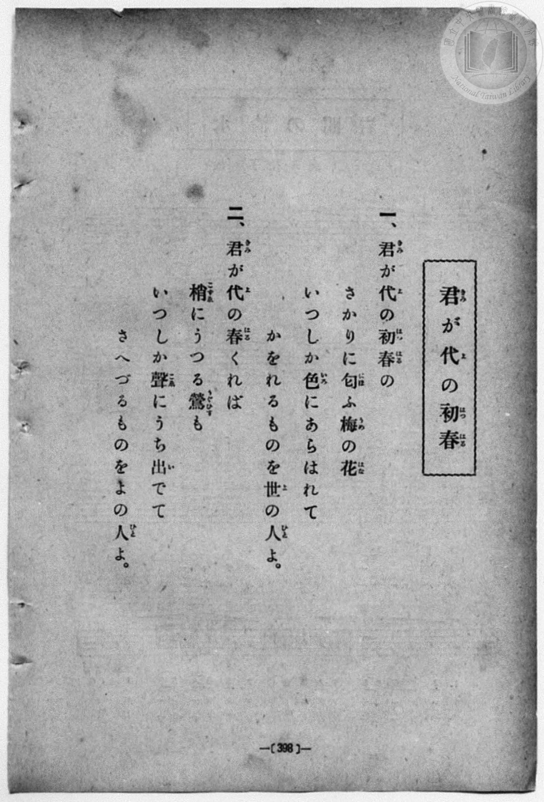
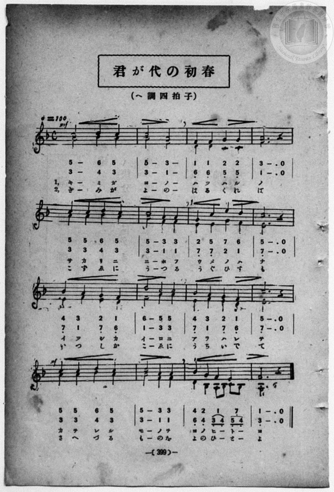

# 君が代の初春（二部）

> Re:Shōka 使用 AI 協助辨識與重建樂譜，可能會有錯誤。歡迎回報。

- **鋼琴伴奏版**：<br><audio controls src="kimigayo_no_hatsuharu.mp3"></audio>
- **NEUTRINO 歌聲合成版**：<br><audio controls src="kimigayo_no_hatsuharu_neutrino.mp3"></audio>

- book: 新編 小學校・公學校 唱歌教材集（高等科一・二學年用）
- 一條慎三郎 編《新編 小學校・公學校 唱歌教材集》（大正十二年十二月，索書號 0725-41）

## 說明

> [!NOTE]
> **原書資訊與歌詞全文**（對應 `P407.jpg`–`P408.jpg`，原書 pp. 398–399，高等科一・二學年第 29 首）：
> - **曲名**：君が代の初春
> - **調性與拍號**：ヘ調四拍子（F 大調 4/4 拍），速度 ♩= 100（二部合唱，全 16 小節）
> - **曲目辨析**：本曲與《新定兒童唱歌》尋常科第六學年用之〈君が代の初春〉同詞，惟本冊所收為全新譜曲之ヘ調四拍子二部合唱曲（起音上聲部 `5 - 6 5 | 5 - 3 -`、下聲部 `3 - 4 3 | 3 - 1 -`），第 15 小節下聲部作八分音符圓滑線進行（`6_ 4_ 3_ 4_ 5_ 4_`），終止於三度和聲（`1` / `3_`）。
>
> **一、**
> 君（きみ）が代（よ）の初春（はつはる）の
> さかりに匂（にほ）ふ梅（うめ）の花（はな）
> いつしか色（いろ）にあらはれて
> かをれるものを世（よ）の人（ひと）よ。
>
> **二、**
> 君（きみ）が代（よ）の春（はる）くれば
> 梢（こずゑ）にうつる鶯（うぐひす）も
> いつしか聲（こゑ）にうち出（い）でて
> さへづるものをよの人（ひと）よ。


## 歌詞

```text
（TMD 檔案未包含歌詞註解）
```

## ABC

<div class="abc-score" data-abc-src="kimigayo_no_hatsuharu.abc" aria-label="五線譜載入中"></div>

[下載 ABC 原始檔](kimigayo_no_hatsuharu.abc)

## TMD 檔案連結

- [主旋律 TMD 檔案](kimigayo_no_hatsuharu.tmd) [[在 TMD Studio 編輯](https://tmdlang.github.io/Tmd-TS/#tmd=s7IKdvYPcrWy4qpTUCpJTLdSSM7PyUlNLsnMz7MqzsjPTozPrsyvSsyML84ojTe0NDJWgqssy88pzU21ys4vyY83jDdCSBTnlxYlp1oVJ2fk5-fEl6RWlCTl52ejy8cXJKanWgWYGJgjZAqK8stS8xLzgLoLijLzSlJTwNoRClLLMlNSQdLFyYl58WWpRZlpmakpSG5KLSoGOx1iRUlRYl5xclFmAcg_CFX5RSUZ-elFiQUZlVYZmcUl-UWZyYk58dmJeYkIRSUZqUDfZeYWAC1JzEEXT04tSs3Nz0ORARqTnplnlZuamZWJ5G0tLYWnE2Y_bux5snvx48Z1TzvmPpux9P2ejie7el42r3i_p1NBS4tL0VbB0MCAy95WwY3LxkTfxA5kKki_lcKzaRueb1-h8HRD_9O1O54tWPi4effT1jUQtsLTKRufre15NnXms7kTXs5uAxr7cvWM52s7ny-f-GRHA1Ap0Bag0qc7tzyfArIL7FqgzLNFc5-19j3Z0fmyuU8BaPzjhi5S7Hnc0A206umS5c_WLn7a2wiyZOcWCOPZnI73e3qeb1n0bPaOFzPnKxiYG5nqmhiC7ebS11KwpRbgUlBQsFOIVvTzD3GNhXC0tJ72zQfZu7n9xYquFx3tQDe_WDnvaeuKZ9PatbRATt7Q-6y9UyEBlO70sgrSEx41TAZxLMAcoMMhBigUFOgpGFtaAGWNLS2BwjhDdc0aBSNLhZfLpgE9-H7PLIg7dIEueTZ709MJvSBLZ2FGP0LZi1X7nzUsBzm1uxcYXGD1j5tnAIWfzp4NFHu6dgLQ2W4KwLAGiikAk4YCUBRsWc_LhvlPdy1TeDRzJTj1wNPU0wkdwPgCeaZ1hYKhGShKn69vAOpBcd3z2ete7FvxbN4EsJ3P5qwBigHdAUkJT9fNeto66fnqpZCIB8b30w3dT3fsAIYA0MtPW9fCE9WTnd2PGzowvfi4ofPpBFDoA93xrHk-0PynbV3POhueTdn2vGkXOEo2vFg7B2gpyARUHyN7A6gA6LEXW7e_nL_5yY6uF42bgFIKCaZAb5gpmCrUALGugrGCbsLjhsYnO7ph8kARBROgeA1ITsEQKA8JM1CEGZpCgwSu_sneOU9bVz_taANa8nzNsqdzJj_bPfH59lkvGza9WNgDtD_BLF7BJF7BGEyagkiYeVubnq1d9GzaHmBeAkbG00k9QBNBGgwTFPSBzgCre9zQBA56WCoFJaKGRmC2B_OBYQfU8Lix93HjfpBicDiCRJqAOQnIRRQZjxvXP25cAiKbgPkPJAUx4XHj1MeN3Y-buh43rn7a0wRWufpx426wmq3PFrWCRdoeNzVCdL3oAqYOiGmr4MnicWML2PDpQKNedIL8ABJpAqU1sGlNj5uADKDVPY8bl8G0AC2dBBJpAjKagCYDuU92APMCwvFPdu0CG7XpcSOoAAKKY4TGLmD6Ij40EEEBDYR-sJM2QLQ_W7QILDv5ceOsx00TYY5vA3mtqfvltvXQoGicAHbSTLCTIO5BDQFwLILMQTFk4dN2iHdawILLkYICGAU7HjcuRQ4KkGfxhADlZSAUKGjpc3F5Z-ZmpidW5vvleySWFJdmJBaVWoXlAys2hxqDmmqQfQo2FlrgUFfAVg4rALMGMGEC0zsim2mYQHOKjgKskNTEohNoPcjUGoXq3LRacIYEQTMgBrEhWRQEQVkRBGtAGRKMjaAYkk1h0AAkAjbSx7AGGLS9UHFgkgCTPWAdwICEi6-DmwxMGGCRJWASzG7qhsrAVKHZYUSmHWBzgekPzIaqb9yAYQf-EN_VQ1GIg4IWUhZiC2wQrgEHMEjUHKoOoQZbYE8FewrstaYuMHs11GsgGhIUu8HkVqh4G1htIzyQIMEDklmFJ8Ang1XOAuudiGIPyDyIPeBIhEcf2J7GCWByE5icCZFpaiIx0Hd0UpbMgancBBq8oMAFpeQacNCCICxKarCowRfwLQgvN06HRwJMBhwgTaBUiggokLeBpTI8yBGpcBmegMdtDyhKIPZgRgiw7AOTEN3LcdqDN-CBNTx1yhdCSR4U8rBQN48HC4GYuIIektonwYMQnubgKQuassFqYMUCLLVD0uIKJBlcQQ_JWzvA5FKq21OLvRJwzCnJJ6MOgDWlyIojWGkOywGI8h0WDcD8AooXMAFsUEEJ_NEESv2QQBq29QC5oQ5L-tgDHFL4gDMCmEAUSGAurvAeQVUB2akdmNjBYQgvacApGpGOEWUSVmV4w38E1QgUlzaEEj84vIGdN6AKRCcOpBJfBAybekHXTgFL1aAAFFbmAgA)]
- [鋼琴伴奏 TMD 檔案](kimigayo_no_hatsuharu_piano.tmd) [[在 TMD Studio 編輯](https://tmdlang.github.io/Tmd-TS/#tmd=s7IKdvYPcrWy4qpTUCpJTLdSSM7PyUlNLsnMz7MqzsjPTozPrsyvSsyML84ojTe0NDJWgqssy88pzU21ys4vyY83jDdCSBTnlxYlp1oVJ2fk5-fEl6RWlCTl52ejy8cXJKanWgWYGJgjZAqK8stS8xLzgLoLijLzSlJTwNoRClLLMlNSQdLFyYl58WWpRZlpmakpSG5KLSoGOx1iRUlRYl5xclFmAcg_CFX5RSUZ-elFiQUZlVYZmcUl-UWZyYk58dmJeYkIRYlFQM3pqbmpeSVWBZmJefnxicnJ-bkFiXmZIDGEwpIMoCKrzNwCoGsSc9DFk1OLUnPz88AyWloKTyfMftzY82T34seN6552zH02Y-n7PR1PdvW8bF7xfk8nkP1y9sxnnd0vu_c8n7DlyZ4tT5f2A8UVtLS4FG0VDA0MuOxtFdy4bEz0TexAFoEC1krh2bQNz7evUHi6of_p2h3PFix83Lz7aesaCFvh6ZSNz9b2PJs689ncCS9nt4GsWD3j-drO58snPtnRAFQKtB2o9OnOLc-ngNwA9gBQ5tmiuc9a-57s6HzZ3KcANP5xQxcp9jxu6AZa9XTJ8mdrFz_tbQRZsnMLhPFsTsf7PT3Ptyx6NnvHi5nzFQzMjUx1TQzBdnN55pUU5VsFgAI8yMOhxqCmmksBCGwstOzAjBqF6ty0WgVjbVMFXShpom0GZ9dAaRA01DaGkzUKZvHaJiDF8dpGINXx2oYgtqGCaby2eTyICSSBukFCEO0gaADSylWL4iwfZGeZoDrLMF4h2jAWaBqYqoHxoVQNUALIMorPjQVaC2SZxqMqMoBY5p2Zm5meWJnvl--RWFJcmpFYVAqx2hB3gMA8DQoKSEDAREDeB0GgRaDgAGJQAIAw0LsYfgUZ6WNYo_C4sRcq_rhxP5jsAet43NQBF18HN_lx43qwyBIwCWY3dUNlYKrQ7DAi0w6wuY8b-8FsqPrGDRh2QMMGFAggjD1YICkDFBQgUXOoOoQabMEyFWw92BFNXWD2aqgjQDTE0bvB5FaoeBtYbSPcOxCPgGRW4QmayWCVs8B6J6LYAzIPYg84uOEBDbancQKY3AQmZ0JkmppwBU81MOWAcgUoIEDBAEodwKwCVQoLPGC6xVCDL4haEI5rnA4PLpgM2OlNoJhHeAnkwMdNnfDAQcTsMjxBhNseUOBB7MEMuseNC8EkRPdynPag5y5CyQgURrDwAZYlsAyHK5AgKWgS3LPweITHFjS1gNXAMgUsBUHidwWSDK5AgqTXHWByKdXtwVdaGeEpvqGGwNIVoiSCBRmowAZSYMIUTuAPUlCagnhoCJdYsASFPWggmQ-cvMAEIkOCubhCZtgVWmDfwnMaOJUg0gYiT2JVhjekhl_ZRUyCAocMsNUCahiBaGBmA5Kg5hCeoBr-JRjhFigI4m9_giC49QkKaSgFbHOCGx0QCphw4SpR_Q8zjZR2rjnEUCAFkjfSBrVqDME6wXLY621YpgI3kSEmQc2BuhjkRlizANlNYDNxa8Jn4UA043HGNMWNehNgUx5nmx5iGCFz4NrBDDNQLwFNEGEWKLrAUkCdyMpBhpugm4mmBpeR1OvA6NopgDtMCkAGliCP9gGqxiVlBJZS5gIA)]

## 分析

```text
================================================================================
📊 TMD Song Profile: [ 君が代の初春（二部） ]
================================================================================
⏱  Duration:       0:38 (38.4s), 16 measures total
🎼 Key & Tempo:    首調基準 F, != 100.0 BPM, <4/4>
   - 分析範圍：      由實際發聲的音符與和弦推測調性；播放脈絡另行呈現
🎤 人聲音域:    E4 (MIDI 64) – E5 (MIDI 76) [跨度: 12 個半音 / 1.0 個八度, 難度: easy]
   - 最低音:  E4 in [KimigayoNoHatsuharu #1 @ m.15, 0:35]
   - 最高音: E5 in [KimigayoNoHatsuharu #1 @ m.7, 0:15]
   - 適合: soprano, mezzo-soprano, contralto, tenor, baritone, bass
🏛  結構:      KimigayoNoHatsuharu (38.4s)
⚡ 編曲密度:        Peak 2 軌道同時演奏
🗝  調性診斷：       A 小調（流行色彩小調，未偵測到可信轉調）
   - 風格氣質:    流行小調（略帶和弦色彩音與裝飾副屬和弦）
   - 轉調歷程:    全曲維持單一推測調性（未偵測到可信轉調）
   - 核心骨幹音:  A, C, F, E, D
   - 調性數值:    A 小調 [相關度: 0.90, 穩定度: Moderate, 自然音純度: 93.3%]
   - 候選調性 (K-S): A 小調 (0.90), F 大調 (0.82), C 大調 (0.67)
   - 五度圈歷程:   +3
   - 各段落調性細節:
     • [KimigayoNoHatsuharu #1]: A 小調 (r: 0.90, 自然音純度: 93.3%, 調外音: A#)

  [ 五度圈游移軌跡 ]
               C  
         F            G  
      Bb               D  
      Eb              [A ]*
         Ab           E  
            Db       B  
               F# 
     (* = active key center)

  [ 十二半音累積音高分佈 ]
     C  : ████████████████████      22.1%
     C# :                            0.0%
     D  : ████████                   9.2%
     D# :                            0.0%
     E  : ███████████               11.7%
     F  : █████████████████         18.3%
     F# :                            0.0%
     G  : █████                      5.8%
     G# :                            0.0%
     A  : ████████████████████████  26.2%
     A# : ██████                     6.7%
     B  :                            0.0%
--------------------------------------------------------------------------------
Assignment 軌道音域：
  - Alto          : A3 – A#4 (13 個半音 / 1.1 個八度, 48 個音符)
  - Vocal         : E4 – E5 (12 個半音 / 1.0 個八度, 46 個音符)
================================================================================
```


## 原書掃描頁






