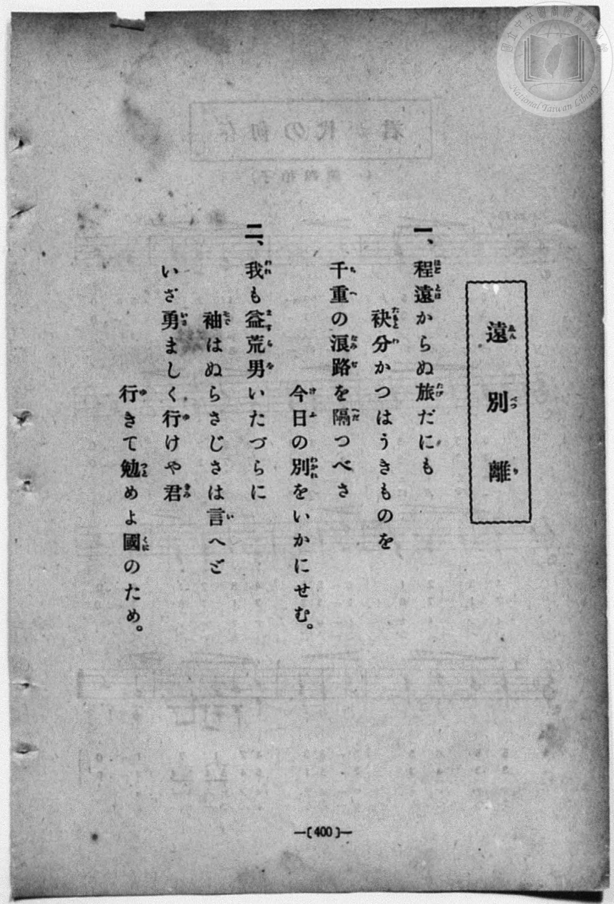
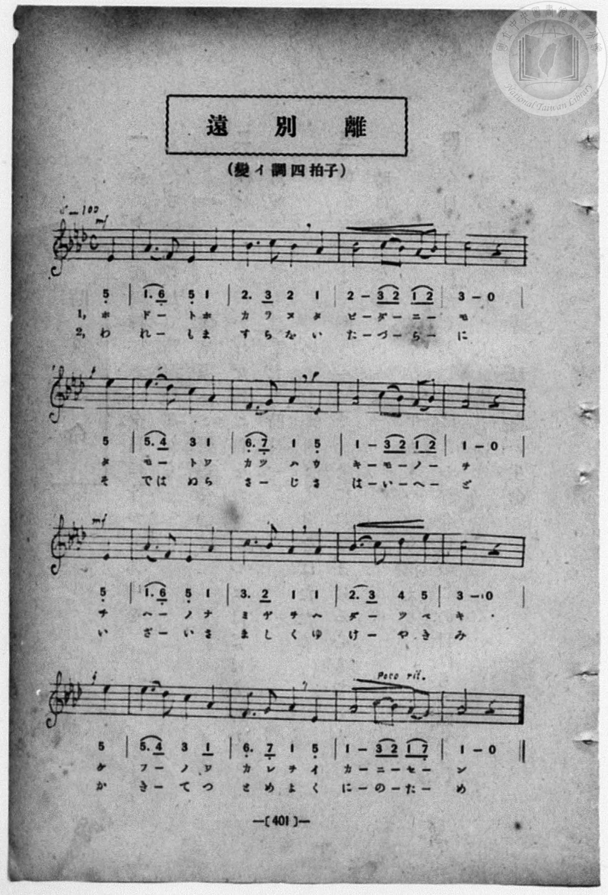

# 遠別離

> Re:Shōka 使用 AI 協助辨識與重建樂譜，可能會有錯誤。歡迎回報。

<audio controls src="enbetsuri.mp3"></audio>

- book: 新編 小學校・公學校 唱歌教材集（高等科一・二學年用）
- 一條慎三郎 編《新編 小學校・公學校 唱歌教材集》（大正十二年十二月，索書號 0725-41）

## 說明

> [!NOTE]
> **原書資訊與歌詞全文**（對應 `P409.jpg`–`P410.jpg`，原書 pp. 400–401，高等科一・二學年第 30 首）：
> - **曲名**：遠別離（ゑんべつり）
> - **調性與拍號**：變イ調四拍子（A♭ 大調 4/4 拍，弱起 1 拍），速度 ♩= 100（全 16 小節）
> - **版本對照**：先前版本依手抄《唱歌帳》（2020.006.0843・P199）轉錄，將每樂句第 3–4 小節誤併為 3 小節（全曲僅 12 小節）；對照本書原印五線譜與簡譜（`P410.jpg`），每行均為規整之 4 小節（全曲 16 小節，弱起 1 拍）。歌詞頁（`P409.jpg`）第一節末作「いかにせむ」，譜面頁（`P410.jpg`）作「イ カ ー ニ ー セ ー ン」；譜面頁第 12 小節末拍弱起第二節誤植「か」（歌詞頁作「行（ゆ）きて」）。
>
> **一、**
> 程遠（ほどとほ）からぬ旅（たび）だにも　袂分（たもとわ）かつはうきものを
> 千重（ちへ）の浪路（なみぢ）を隔（へだ）つべき　今日（けふ）の別（わかれ）をいかにせむ。
>
> **二、**
> 我（われ）も益荒男（ますらを）いたづらに　袖（そで）はぬらさじさは言（い）へど
> いざ勇（いさ）ましく行（ゆ）けや君（きみ）　行（ゆ）きて勉（つと）めよ國（くに）のため。


## 歌詞

```text
（TMD 檔案未包含歌詞註解）
```

## ABC

```abc
X:1
T:遠別離
M:4/4
L:1/16
Q:1/4=100
K:Ab
V:V1 name="Piano" snm="Pia"
[V:V1]
!mf! z4 z4 z4 E4 | A6 F2 E4 A4 | B6 c2 B4 A4 | B8 c2 B2 A2 B2 |
w: 1.~ほ | ど _ と ほ | か ら ぬ た | び だ _ に _
w: 2.~わ | れ _ も ま | す ら を い | た づ _ ら _
!f! c8 z4 e4 | e6 d2 c4 A4 | !p! F6 G2 A4 E4 | A8 c2 B2 A2 B2 |
w: 1.~も た | も _ と わ | か つ は う | き も _ の _
w: 2.~に そ | で は ぬ ら | さ _ じ さ | は い _ へ _
!mf! A8 z4 E4 | A6 F2 E4 A4 | c6 B2 A4 A4 | B6 c2 d4 e4 |
w: 1.~を ち | へ _ の な | み ぢ を へ | だ _ つ べ
w: 2.~ど い | ざ _ い さ | ま し く ゆ | け _ や き
!f! c8 z4 e4 | e6 d2 c4 A4 | F6 G2 A4 E4 | A8 c2 B2 A2 G2 |
w: 1.~き け | ふ _ の わ | か れ を い | か に _ せ _
w: 2.~み ゆ | き _ て つ | と め よ く | に の _ た _
!mf! A8 z4 E4 | A6 F2 E4 A4 | B6 c2 B4 A4 | B8 c2 B2 A2 B2 |
w: 1.~ん ほ | ど _ と ほ | か ら ぬ た | び だ _ に _
w: 2.~め わ | れ _ も ま | す ら を い | た づ _ ら _
!f! c8 z4 e4 | e6 d2 c4 A4 | !p! F6 G2 A4 E4 | A8 c2 B2 A2 B2 |
w: 1.~も た | も _ と わ | か つ は う | き も _ の _
w: 2.~に そ | で は ぬ ら | さ _ じ さ | は い _ へ _
!mf! A8 z4 E4 | A6 F2 E4 A4 | c6 B2 A4 A4 | B6 c2 d4 e4 |
w: 1.~を ち | へ _ の な | み ぢ を へ | だ _ つ べ
w: 2.~ど い | ざ _ い さ | ま し く ゆ | け _ や き
!f! c8 z4 e4 | e6 d2 c4 A4 | F6 G2 A4 E4 | A8 c2 B2 A2 G2 |
w: 1.~き け | ふ _ の わ | か れ を い | か に _ せ _
w: 2.~み ゆ | き _ て つ | と め よ く | に の _ た _
A8 z4 z4 |
w: 1.~ん
w: 2.~め
```

## TMD 檔案連結

- [主旋律 TMD 檔案](enbetsuri.tmd) [[在 TMD Studio 編輯](https://tmdlang.github.io/Tmd-TS/#tmd=s7IKdvYPcrWy4qpTUCpJTLdSSM7PyUlNLsnMz7MqzsjPTozPrsyvSsyML84ojTe0NDJWgqssy88pzU21ys4vyY83jDdCSBTnlxYlp1oVJ2fk5-fEl6RWlCTl52ejy8cXJKanWgWYGFgiZAqK8stS8xLzgLoLijLzSlJTwNoRClLLMlNSQdLFyYl58WWpRZlpmakpSG5KLSoGOx1iRUlRYl5xclFmAcg_CFX5RSUZ-elFiQUZlVYZmcUl-UWZyYk58dmJeYkIRSUZqUDfJacWpebm52Um5qDLFCSWFGXml2QW5ypxaWkpvGxc8LRj6cvZixS0tLgUbRUMDQy47G0VHHW4bEz0TexAmkGhYKXwbNqG59tXKDzd0P907Y5nCxY-bt79tHUNhK3wdMrGZ2t7nk2d-WzuhJez297v6Xi5esbztZ3Pl098sqMBqPTJrh6g0qc7tzyfsuL9nk6wo4AyzxbNfdba92RH58vmPgWg8Y8bukix53FDN9Cqp0uWP1u7-GlvI8iSnVsgjGdzOt7v6Xm-ZdGz2TtezJyvYGBuZKprYgi2m0tfS8GWWoBLQUHBTiFa0c8_xDUWwtHSeto3H2Tv5vYXK7pedLQD3fxi5bynrSueTWvX0gI5eUPvs_ZOhQRQMtLLKkhPeNQwGcgxNABzgA6HGKBQUKCnYGJgAJQ1MQC6vQdnqK5Zo2BsoPBy2TSgB9_vmQVxhy7QJc9mb3o6oRdk6Sx4VAMd8Lhp4uOmyY8bdz5uXPK4qQuoC6Hlxar9zxqWg5zd3QsMOrDeF-u6HjctAco8nT0bKPx07QSgIY6PZq5VAIY-UFgBmFgUgBIgp-_Z-GLrdgVDCBfomp6XDfOf7lqm8GjmSnD6Avm_dYWCoRkokp-vb0Cx_Hlnx7M5a4Dh87x1Odjmp60dTzt7IcJP9s191tn9rKsFmE4gSeHpjs2QRGBkYGSgZ2BgpmdgYWIMDJoAQ0tLoMEv9na-7GkBuWpD-7P1_c9WND3tXwoOLVCYQh3wYtWSJ3u3Pm_apWAMdxLIiaCwa25VMDRCOPT9ntkQtwFdA4wgYDQ97d3wZNeU59tnvVg7BxhmzzcsBDKA-pGjExQIQNtfLOx5OrcdaM-LZf3Ppm55srNbAeYEuIXIwYIelI8bmiAp6eWCRogN0NQDlAP6CZgmgNqezVn9ZO-cxw09jxtbHjd2P25c_bhx9uOmhscNoMgBuu3l3EVw_QgXQvU0LVF43LRa4XHzHiDuhtBNu6F8YFADzZgNNwMUjvDAAdoLShhgF4Mcs6sHErLPlvSCHdMN1twB9wDEQmCQgFMjsMjofNzY-7hxGVgZyKvgNAHLUKD03tAILKLA_OcruoGJGaSxcffjxpWPG1cAGWATuh83Ack1z6a3gmXnP27cDBZfAAqHpqbHDQ0vFjU97QCVUCBZoAhQb1M_VC8wLzSuf9zYBnIJSGrd46ZJEBuf9ja_bAe5_3HjwseNO8Dq1z3buurF9vVgwVWPG_c_bgTmrE6glpezpoAFdwDtBasEGgvMaMBwaHiyu-vZ9KVg2YmPG7dCzAHmSnAg9IPdDwwQkCEY0YcWILt6kALkWcdEqAlQ7U3PZ3e96J30fMp2sF37HjfOBIVM0ySwjUCTgSGzFBxWq8FhAiw3gMrmPm5cDlYADIQ1YNmpjxtngMn1L1aAEilQL1gB0GsrIVaDTZv2tLsdIgtUDFYAtHH640ZQkkeKX2CZ0_J0wmywSmBc7wdHdANmGnjaDcwxQDXAcAPVFo-bGh83dTydA8rnQDOBboaEGzgGG6EhQ3lJDgUKWvpcXK55SaklxaVFmVYBmYl5-Q41uoY11SBrFGwstMCRoICtElGApH9QOQDOj0CvKWjAspkmFvVAu0Bm1SgYAEs_GK7OTatVMI0HsmrAsj6GqPLAxI6QM0KTa-oHy0GNNQRydBXM4iHGgXg1CkZgMWMwjSwCETME4hogCyICdg7INSiOAUY-VB4YQQgHAeluiGhTJ5C9BiwzHyqzGa5jAZhcDRFvakKyCaoa7jFgaobpAqsDJiuoaTMR9jRNAsu0QGVAJkDsWQpVAREH2YewZy4ikLDGI6QEIz76QOGjCyzNQeEGCVNgmIOEzOPB_OoCWIxCowQ5sGEiuOIeEUjQ4IbEMSK4G4GlduN6MKsNKtOLFnDroMENCixEMCxEDe7G5VDz1sOiDx58U-EumAEmQXyQOMhWiDgoAoAFA1QclkAg9oAjh0Bw7-gkPrixJWtIkgWFKXpCNwGS4ARMMFmDXA_xDSi8gMU61Df7oaKL4MkN5k9QYobFAYjciRb-EP9PRAvnaWihBgtNUPIG8acDMSiOgYUiVAZkAiQ-ITpA5iNcBsv7YNX4wxnYgKNessaapIFyqGkahJFDeStqKKOnZmCmR8_UEBlYsQGsESHiTZOx2wIOY3gOaFwGJkHxAxIH5SCQLY1A3AGWgdkPKyJgsQ8tuoAq0W2p5eLStVOAVxIK6BxlLgA)]
- [鋼琴伴奏 TMD 檔案](enbetsuri_piano.tmd) [[在 TMD Studio 編輯](https://tmdlang.github.io/Tmd-TS/#tmd=s7IKdvYPcrWy4qpTUCpJTLdSSM7PyUlNLsnMz7MqzsjPTozPrsyvSsyML84ojTe0NDJWgqssy88pzU21ys4vyY83jDdCSBTnlxYlp1oVJ2fk5-fEl6RWlCTl52ejy8cXJKanWgWYGFgiZAqK8stS8xLzgLoLijLzSlJTwNoRClLLMlNSQdLFyYl58WWpRZlpmakpSG5KLSoGOx1iRUlRYl5xclFmAcg_CFX5RSUZ-elFiQUZlVYZmcUl-UWZyYk58dmJeYkIRYlFQM3pqbmpeSVWBZmJefnxicnJ-bkFiXmZIDGEwpIMoCKr5NSi1Nz8vMzEHHSZgsSSosz8ksziXCUuLS2Fl40LnnYsfTl70fs9HS9nz3zW2f2ye8_zCVue7NnydGn_-z2dClpaXIq2CoYGBlz2tgqOOlw2JvomdiBDQcFopfBs2obn21coPN3Q_3TtjmcLFj5u3v20dQ2ErfB0ysZna3ueTZ35bO6El7PbQHasnvF8befz5ROf7GgAKn2yqweo9OnOLc-nrABaBnYsUObZornPWvue7Oh82dynADT-cUMXKfY8bugGWvV0yfJnaxc_7W0EWbJzC4TxbE7H-z09z7csejZ7x4uZ8xUMzI1MdU0MwXZzueYlpZYUlxZlWgWAgjjIw6FG17CmmksBCGwstOzADH0tBVt0oPB0z8YXW7e_6Gh_vmYN0P0vFvYoaASYGBroZRWka2JRr6UPNqtGwUBBF46rc9NqFUzjgawasKyPIar848bdCDkjNLmmfrAc1FhDIEdXwSweYhyIV6NgBBYzBtPIIhAxQyCuAbIgImDngFyD4pjHjSuh8o8bVyAcBKS7IaJNnUD2GrDMfKjMZriOBWByNUS8qQnJJqhquMceN_XAdIHVPW7cBzVtJsKepklgmRaoDMgEiD1LoSog4iD7EPbMRQQS1ngERd-uHuKjDxQ-ugom4HCDhCkwzEFC5vFgfnUBLEahUYIc2DARXHGPCCRocEPiGBHcjUuAeD2Y1QaV6UULuHXQ4AYFFiIYFqIGd-NyqHnrYdEHD76pcBfMAJMgPkgcZCtEHBQBjxt3QMVhCQRiDzhyCAT3jk7igxtbsoYkWVCYoid0EyAJTsAEkzXI9RDfgMLrceMqqG_2Q0UXwZMbzJ-gxAyLAxC5Ey38If6fiBbO09BCDRaaoOQN4k8HYlAcP26CxSfIBEh8QnSAzEe4DJb3warxh_PT2bOpl6yxJmmgHGqaBmHkUN6KGsroqRmY6dEzNUQGVmw8bpwNEW-ajN0WcBjDc0DjMjAJih-QOCgHgWxpBOIOsAzMflgRAYt9aNEFVIluSy1GHeGDUkeYQOsIUNkMguBcbQB1HjBw4uMVog3jYxEMYFCDmKZAJpiBTQzEQNILNJWgoSYgpglUDFQGQcXhSnAYTNi5cKZZPIgFJHOp72LiXAsyEBghunYK8DiJ9jGMVUAVMAILKHMBAA)]

## 分析

```text
================================================================================
📊 TMD Song Profile: [ 遠別離 ]
================================================================================
⏱  Duration:       1:16 (76.8s), 32 measures total
🎼 Key & Tempo:    首調基準 A,, != 100.0 BPM, <4/4>
   - 分析範圍：      由實際發聲的音符與和弦推測調性；播放脈絡另行呈現
🎤 人聲音域:    D#4 (MIDI 63) – D#5 (MIDI 75) [跨度: 12 個半音 / 1.0 個八度, 難度: easy]
   - 最低音:  D#4 in [Enbetsuri #1 @ m.1, 0:01]
   - 最高音: D#5 in [Enbetsuri #1 @ m.5, 0:11]
   - 適合: soprano, mezzo-soprano, contralto, tenor, baritone, bass
🏛  結構:      Enbetsuri (38.4s) -> Enbetsuri (38.4s)
⚡ 編曲密度:        Peak 1 軌道同時演奏
🗝  調性診斷：       G# 大調（純淨自然大調，未偵測到可信轉調）
   - 風格氣質:    純淨自然大調（陽光明朗、易唱易記，無明顯調外色彩）
   - 轉調歷程:    全曲維持單一推測調性（未偵測到可信轉調）
   - 核心骨幹音:  G#, D#, C, A#, F
   - 調性數值:    G# 大調 [相關度: 0.93, 穩定度: High, 自然音純度: 100.0%]
   - 候選調性 (K-S): G# 大調 (0.93), D# 大調 (0.64), F 小調 (0.57)
   - 五度圈歷程:   -4 -> -4
   - 各段落調性細節:
     • [Enbetsuri #1]: G# 大調 (r: 0.93, 自然音純度: 100.0%)
     • [Enbetsuri #2]: G# 大調 (r: 0.93, 自然音純度: 100.0%)

  [ 五度圈游移軌跡 ]
               C  
         F            G  
      Bb               D  
      Eb               A  
        [Ab]*          E  
            Db       B  
               F# 
     (* = active key center)

  [ 十二半音累積音高分佈 ]
     C  : ███████████               16.7%
     C# : ██                         3.3%
     D  :                            0.0%
     D# : █████████████             20.0%
     E  :                            0.0%
     F  : ████                       6.7%
     F# :                            0.0%
     G  : ██                         2.5%
     G# : ████████████████████████  35.8%
     A  :                            0.0%
     A# : ██████████                15.0%
     B  :                            0.0%
--------------------------------------------------------------------------------
Assignment 軌道音域：
  - Piano         : D#4 – D#5 (12 個半音 / 1.0 個八度, 118 個音符)
================================================================================
```


## 原書掃描頁






