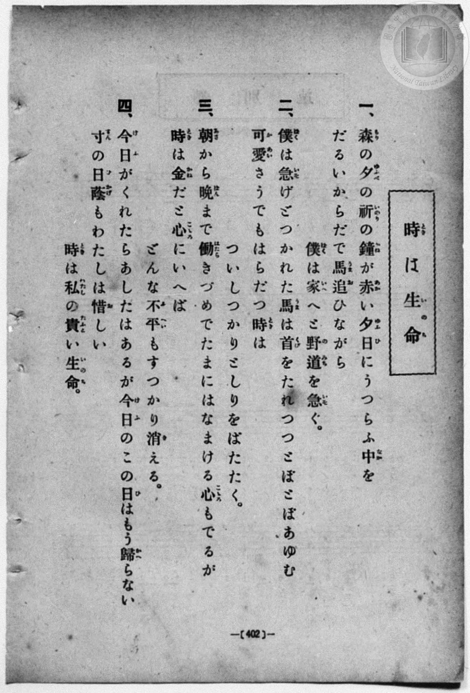
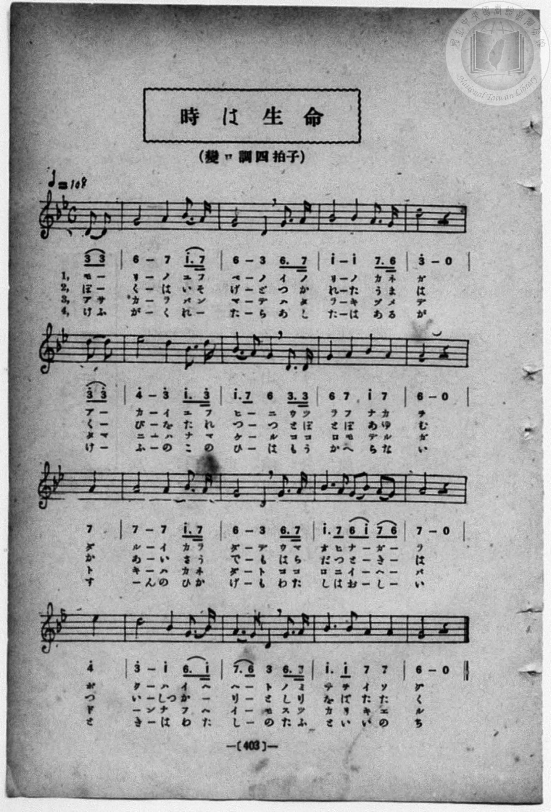

# 時は生命

> Re:Shōka 使用 AI 協助辨識與重建樂譜，可能會有錯誤。歡迎回報。

- **鋼琴伴奏版**：<br><audio controls src="toki_wa_inochi.mp3"></audio>
- **NEUTRINO 歌聲合成版**：<br><audio controls src="toki_wa_inochi_neutrino.mp3"></audio>

- book: 新編 小學校・公學校 唱歌教材集（高等科一・二學年用）
- 一條慎三郎 編《新編 小學校・公學校 唱歌教材集》（大正十二年十二月，索書號 0725-41）

## 說明

> [!NOTE]
> **原書資訊與歌詞全文**（對應 `P411.jpg`–`P412.jpg`，原書 p. 402–403，高等科一・二學年第 31 首）：
> - **調性與拍號**：變ロ調四拍子（關係小調 G 自然小調 4/4 拍，以 `6_` 即 G4 為主音），速度 ♩= 108，弱起拍（第 4 拍八分音符雙音 `3_ 3_` 起唱）。
> - **音高與版面校勘**：原書簡譜以 B♭3 為 `1`，故 B♭4–E♭5 標為高音點 `1^`–`4^`；TMD 於 `?= B,` 下以 B♭4 為中音 `1`，故依五線譜實際音高（D4–E♭5）記為 `3_`–`4`。另外 `P411.jpg` 歌詞第二節作「可愛（かわい）さうでも」，`P412.jpg` 譜下則印作「あーいさう」；第四節 `P411.jpg` 作「惜（を）しい」，`P412.jpg` 譜下印作「おーしー」。
>
> **一、**
> 森（もり）の夕（ゆふべ）の祈（いのり）の鐘（かね）が赤（あか）い夕日（ゆふひ）にうつらふ中（なか）を
> だるいからだで馬追（うまお）ひながら　僕（ぼく）は家（いへ）へと野道（のみち）を急（いそ）ぐ。
>
> **二、**
> 僕（ぼく）は急（いそ）げどつかれた馬（うま）は首（くび）をたれつつとぼとぼあゆむ
> 可愛（かわい）さうでもはらだつ時（とき）は　ついしつかりとしりをばたたく。
>
> **三、**
> 朝（あさ）から晩（ばん）まで働（はたら）きづめでたまにはなまける心（こゝろ）もでるが
> 時（とき）は金（かね）だと心（こゝろ）にいへば　どんな不平（ふへい）もすつかり消（き）える。
>
> **四、**
> 今日（けふ）がくれたらあしたはあるが今日（けふ）のこの日（ひ）はもう歸（かへ）らない
> 寸（すん）の日蔭（ひかげ）もわたしは惜（を）しい　時（とき）は私（わたし）の貴（たふと）い生命（いのち）。


## 歌詞

```text
（TMD 檔案未包含歌詞註解）
```

## ABC

<div class="abc-score" data-abc-src="toki_wa_inochi.abc" aria-label="五線譜載入中"></div>

[下載 ABC 原始檔](toki_wa_inochi.abc)

## TMD 檔案連結

- [主旋律 TMD 檔案](toki_wa_inochi.tmd) [[在 TMD Studio 編輯](https://tmdlang.github.io/Tmd-TS/#tmd=s7IKdvYPcrWy4qpTUCpJTLdSSM7PyUlNLsnMz7MqzsjPTozPrsyvSsyML84ojTe0NDJWgqssy88pzU21ys4vyY83jDdCSBTnlxYlp1oVJ2fk5-fEl6RWlCTl52ejy8cXJKanWgWYGBoiZAqK8stS8xLzgLoLijLzSlJTwNoRClLLMlNSQdLFyYl58WWpRZlpmakpSG5KLSoGOx1iRUlRYl5xclFmAcg_CFX5RSUZ-elFiQUZlVYZmcUl-UWZyYk58dmJeYkIRSUZqUDfpSRm5lTG52SmpaLLlGUWlZQiiQINSc_MsyrNA7mwBOouLS2FZzObHjeufz5l_tOJexW0tLgUbRUMDSy47G0VnHS4slMrbRXcc7lsTPRN7EBGgULKSuHZtA3Pt69QeLqh_-naHc8WLHzcvPtp6xoIW-HplI3P1vY8mzrz2dwJL2e3vd_T8XL1jOdrO58vn_hkRwNQ6ZNdPUClT3dueT5lxfs9nWAnAmWeLZr7rLXvyY7Ol819CkDjHzd0kWLP44ZuoFVPlyx_tnbx095GkCU7t0AYz-Z0vN_T83zLomezd7yYOV_BwNzIVNfEEGw3l76Wgi21AJeCgoKdQrSin3-IayyEo6X1tG8-yN7N7S9WdL3oaAe6-cXKeU9bVzyb1q6lBXLyht5n7Z0KCaCkppdVkJ7wqGEyiGME5gAdDjFAoUBPwcTACChpYmAMFMUZqGvWKBgbKrxcNg3ov_d7ZkGcoQt0yItV-581LAc5obsXGAwgy2e9WNf1uHktUObp7NlA4adrJ4Dia_qcJ_ubgKEOFFdwV3jRvup5yzYoF5gQFIAKgQ54snupQoJZfILC097NCu4mCs-bdj3Zsfvl_M1ge3teNsx_umuZwqOZK8EJCuSPPRtfbN0O1twBciXYoKetq592tAF1PV-z7OXsmUCGQoJxvIIx0FygYmAcA0173NCE8AVQBdDrQF887-x4OXcRMCU87Z4B9gsknJ5vWPhi7RyQ45wezVxrDHKWQoIhKByfTW0Fi5kAw9AVSJsqPFsxEygNNA5k6O55QHVx4NA3iQOqnx3i6wJM6XsUEsB5IUHhyY5umLFQ364FOxdm-JN9c5_smvJ8-yyg_U_XL3s5azbErUDvusDtBHrnxYoZYEcB_Qi2LAHov6f9y54umYaUCBQg6QQYTsCYfb6-4cneOY8bep72r3_WMhto4OPG7sdN_Y8bW0DB0zj1cWPb48blj5uaHjeAogaRfBRAYbGj-2ln-9PeDRAzHjc2PW7eA9QK1QfSMRtoDzAFAO1BdgJE_bPmOSALmyaBrZoO0ojDEoQNwEQFtGE6iGzohUUfLEOAEmxDI7CoAfOfLV4HNr7pcVMX2IZ1T5dMBYsAvbT1ceNOiODzpcA8DPQ20NXr4CpfTgAFLigsGteCRXpebF0CFgGWacDiACjSAjTt2fSlSAZuAouvBgfZksdNQPZWYEyCda2C6mqaBHHb48YFj5uAhgMtBQY3UOUCYCi_XLbmxf69YPVAE_YBPQs2cBNYew9IWUPD02awFxqBgdAPll3_dN02mPt3gEV2PG5c8bK972XjZLD4useN-x83LoTY_qwB7GCQ4rlgxRMwwnBXD1IYYlqHYcKkx40rQf4FeQQYQfOBvoB7AaIFXGIARYCpCpSFgc4AKgMrBuoCohVg8yEkMLLaHjc1QG0nmCgb18NCbwmwugGrBJoDTEQge4HBBTYf6FRg4oK4sAusYDqIAXLGBpBLQKgfMy0BgxuRluYAPQuJfWCAAA0HxdqzmSvBghseNwGDGigIjLLlT5tBpRDIdpAfgeUVULz3cePSx02NIDeD7AIqAyYSoAJgtALZE4Ep4en-ZrCuyY-b5j5uArsf5DugH4GJpAfqBgwPvmyfiJpKgeGwAotRIOtAyQPkVFCYrAQ6GGj7kx29T3cCYwSoGJh6gbLg4AXZOxMeXM-2QXIHxBxgUu9GDyhg7kYKqCe7u6CZAuivxq2QvAMKXnDaAEcW0HxgdADDARgCwOgGeRCbLmC6BTpyHUwckrmA0Q3U3vZsLTCpQzwOTvMgY4GB2QJNNushsjNh8QIy5MUUSE4E5iagLnCRAyoZgIkK6BKge9ZjK40aMMP8-fJGsDKoRoj5LzZtASsDigBDEtT2AGqHtHwQZQskD0JCj_IWARQoaOlzcYXkZ2eGJ3rm5SdnZFoFZCbm5TvU6BrWVINsUrAxNNMCR5YCtgaJAqTuBNbBoCJaA157QqpIHQVYUayJRSvQapCxNQoGwPoTBNFpYHULJWrAKn0MaxRAPBBEpx83L4KyoGqN8Kht3IOq1hiP2iaQuY-btiJUm-AzeSKYhKjGHWqg2nNHw4uFPQoaJqBWJDDwiAwrM5hVMGgOEzCEcbEoAgciCEJlwKogGhAQxoeaCFRao2CMpgYeNVCMiJjHzavQ1D4GNpdhrGVQeirQzMfNM3GrbFoCFyFgZtNqqEgvSGXTGjSVqBEIgoiEASxQ0M1tXA9ntUDpuSBzGydhqFwJZ0Hd2tgNdkEPhsr5cFYblN4HNhNmF4Zb4e5CJEyYP5HDAO6C5glQejM4tOZhqGyHsyAmP27aD1YJMwGusmktXGUrlF4IVgkzAcOtQJNAqkB2IjIGsDBGNxnuJ0QIgdTBwgbhgk64jiYoPR27SqS4gqpsAscAht2o2RJsM4FMuauHnExpgmYvLNdAcpQxWl4D5y94FoVmTSCFlG_RMjWSAJbMDcuTCDWITImZeKAZDDNTYiT05m64HpjKFpTEA9IJY3XB1cJsBKnchGYmorRuQHUrOFNuxnArzE2wRABKQiCVMD_AVcJFgNUnlN4DVgnhIZf5sEQDMg2SLcFubYK5CMOtwOyN4lZQpoSHDSK04MkcGhagrAEydyOGSlgIPW6C-BhEg8xcC1cBK7KQMzBSuOIu7Jo7UN0KzpKg2gg1tNbBWZPhIiCV6PGFlNWaYJmyDawSnjYad8BVIDIwrNgGqYQUp1jc2girBgjWlJ3kZEp4doBB6tSUiNwLEkXwsFgIy5iw4gG5ssSTL-EV20pwqkBPl0hpAp4vISkNubKE5GfkfAlLM9iKf0T6mYPqVnC-hOUXuNnwOAV2Z6A0JFUsx_AVPK9BUxIolYBULkAxD-R35Lzai3ArnsoSFmLIleVadBcg8iVqgwFLuMLyDq58CVEFSvnIpegMhFuh1TEWtzbD8gZSvmyC5D3kcEDkS0hOhDYtMBshiHBtglbswBISpHI6inmgsAOOA8D5MFn8-RIWDwTyJbDnRk6-RG9SwjIXNMMZoucksDjBbAnPjFBZmD9x1pYwGrmyRE9qyIkH1i6dAY5oWKQjVMITD7SF-rgZHCHNjSiqQNGKnNX3wh36uGkDmpnonQvkLIkeeZAhCjgHXmMBjYXFPkIpIp9B0gNIDUglcioD9vXBJKIJC2Nhaz7jcCo4R2KkckSZBG0_QAMVHiwIlfB6sGknVATcAkFp1UA6CUgN2CZ4-sVSzuJwKbie7EW3H6n2w53LIOKInAttqQBrXeT2B0QMFG3IpSdMF0jlQoIureXi0rVTQO6tKwD5ylwA)]
- [鋼琴伴奏 TMD 檔案](toki_wa_inochi_piano.tmd) [[在 TMD Studio 編輯](https://tmdlang.github.io/Tmd-TS/#tmd=s7IKdvYPcrWy4qpTUCpJTLdSSM7PyUlNLsnMz7MqzsjPTozPrsyvSsyML84ojTe0NDJWgqssy88pzU21ys4vyY83jDdCSBTnlxYlp1oVJ2fk5-fEl6RWlCTl52ejy8cXJKanWgWYGBoiZAqK8stS8xLzgLoLijLzSlJTwNoRClLLMlNSQdLFyYl58WWpRZlpmakpSG5KLSoGOx1iRUlRYl5xclFmAcg_CFX5RSUZ-elFiQUZlVYZmcUl-UWZyYk58dmJeYkIRYlFQM3pqbmpeSVWBZmJefnxicnJ-bkFiXmZIDGEwpIMoCKrlMTMnMr4nMy0VHSZssyiklKgqJaWwrOZTY8b1z-fMv_pxL3v93S8nD3zWWf3y-49zydsebJny9Ol_e_3dCpoaXEp2ioYGlhw2dsqOOlwZadW2iq453LZmOib2IHMBoWmlcKzaRueb1-h8HRD_9O1O54tWPi4effT1jUQtsLTKRufre15NnXms7kTXs5uA9m1esbztZ3Pl098sqMBqPTJrh6g0qc7tzyfsgJoKdjNQJlni-Y-a-17sqPzZXOfAtD4xw1dpNjzuKEbaNXTJcufrV38tLcRZMnOLRDGszkd7_f0PN-y6NnsHS9mzlcwMDcy1TUxBNvNFZKfnRme6JmXn5yRaRUACuwgD4caXcOaai4FILAxNNOyA7NqFAwUdMEQnTaOhxE1YJU-hjUKIB4IotOPmxdBWVC1RnjUNu5BVWuMR20TyNzHTVsRqk3wmTwRTEJUQ71nBpOFQXOYgCGMi0UR2N8gCJUBq4JoQEAYH2oiUGmNgjGaGnhoQjEiLB83r0JT-xiYRGCsZVB6KtDMx80zcatsWgIXIWBm02qoSC9IZdMaNJWoYQ6CiLh83NiPbm7jejirBUrPBZnbOAlD5Uo4C-rWxm6wC3owVM6Hs9qg9D6wmTC7MNwKdxciLcH8iRwGcBc0T4DSm8GhNQ9DZTucBTH5cdN-sEqYCXCVTWvhKluh9EKwSpgJGG4FmgRSBbITkZYfN2KGAsxPiBACqYOFDcIFnXAdTVB6OnaVSHEFVdkEjgEMu1FzEthmWD4yQVMKS-iQTGCMlj3AWQKeq6C5CUghZTW0fIgkgCU_wrIRQg0iH2HGNzRPYOYjjLTZ3A3XA1PZghLfIJ0wVhdcLcxGkMpNaGYiysQGVLeC89FmDLfC3ASLN1Csg1TC_ABXCRd53LgCSu8Bq4TwkEtWWDyDTIPkJLBbm2AuwnArMEeiuBWUj-BhgwgteMqEhgUoNYPM3YihEhZCj5sgPgbRIDPXwlXAShnkPIcUrrjLp-YOVLeCcxGozEcNrXVw1mS4CEglenwh5Y4mWD5qA6uEp43GHXAViDwHK2lBKiElIBa3NsJKbng-gqdgGKROfYTIcCBRBA-LhbC8BMvRyFUSnqwErz5WgiMSPSkhRSM8K0ESB3KVBMmCyFkJFs3YCllElM9BdSs4K8GSONxseDQ8boRkWlhELsfwFTx7QCMfFLEglQtQzAP5HTl79SLciqdKgoUYcpW0Ft0FiKyEWi1jCVdYcseVlSCqQIkVueCbgXArtNLD4tZmWHJGykpNkOyCHA6IrATJPNAKHLOqR4RrE7T6BBZqIJXTUcwDhd3jRngagMviz0qweIBnJfS2Fiw_QPOIIXriB4sTzEnw_AOVhTkNZ50Eo5GrJPTUgRzfsAbbDHDcwOIJoRIe39Cm2-NmcBg2N6KoAsUEcu7cC3fo46YNaGaiN5SRcxF6eANjA7mmgdcLQGNhEYZQisgakCgEqQGpRE4YjxtBzkFu28FY2NqVOJwKzkQYCRNRjEBraWigwoMFoRJe2zTthIqA63mUtgOk9YzUsmuCJzksRSMOl4Jro150-5HqGNwZAyKOyGzQ9gCwbkOu5SFioGhDLvBgukAqFxJ0aS22HqIPSg_RBKmDCIEQD4IyQrxCtFl8bqyCKZBlDMTIYiA-iAfMVEAhQ4giiABIKtoYpghhoAlI3CQ-FqYDrBWmDWIqxAaQGFQK3RkI00C8aFOgaQRdB7MCogiuD-QchHFQNyE7BVkfhlfBRiBbCQk6YIjr2ikgB3q0D1AHhpgRFjFjLGImYDFlLgA)]

## 分析

```text
================================================================================
📊 TMD Song Profile: [ 時は生命 ]
================================================================================
⏱  Duration:       0:35 (35.6s), 16 measures total
🎼 Key & Tempo:    首調基準 B,, != 108.0 BPM, <4/4>
   - 分析範圍：      由實際發聲的音符與和弦推測調性；播放脈絡另行呈現
🎤 人聲音域:    D4 (MIDI 62) – D#5 (MIDI 75) [跨度: 13 個半音 / 1.1 個八度, 難度: moderate]
   - 最低音:  D4 in [TokiWaInochi #1 @ m.1, 0:01]
   - 最高音: D#5 in [TokiWaInochi #1 @ m.6, 0:11]
   - 適合: soprano, mezzo-soprano, contralto, tenor, baritone, bass
🏛  結構:      TokiWaInochi (35.6s)
⚡ 編曲密度:        Peak 1 軌道同時演奏
🗝  調性診斷：       G 小調（純淨自然小調，未偵測到可信轉調）
   - 風格氣質:    純淨自然小調（陰鬱抒情、旋律集中，無明顯調外色彩）
   - 轉調歷程:    全曲維持單一推測調性（未偵測到可信轉調）
   - 核心骨幹音:  G, A, A#, D, D#
   - 調性數值:    G 小調 [相關度: 0.81, 穩定度: High, 自然音純度: 100.0%]
   - 候選調性 (K-S): G 小調 (0.81), D 大調 (0.51), G 大調 (0.48)
   - 五度圈歷程:   +1
   - 各段落調性細節:
     • [TokiWaInochi #1]: G 小調 (r: 0.78, 自然音純度: 100.0%)

  [ 五度圈游移軌跡 ]
               C  
         F           [G ]*
      Bb               D  
      Eb               A  
         Ab           E  
            Db       B  
               F# 
     (* = active key center)

  [ 十二半音累積音高分佈 ]
     C  :                            0.0%
     C# :                            0.0%
     D  : ████████████████          18.7%
     D# : ████                       5.0%
     E  :                            0.0%
     F  :                            0.0%
     F# :                            0.0%
     G  : ████████████████████████  27.9%
     G# :                            0.0%
     A  : ███████████████████████   26.7%
     A# : ███████████████████       21.7%
     B  :                            0.0%
--------------------------------------------------------------------------------
Assignment 軌道音域：
  - Piano         : D4 – D#5 (13 個半音 / 1.1 個八度, 62 個音符)
================================================================================
```


## 原書掃描頁






