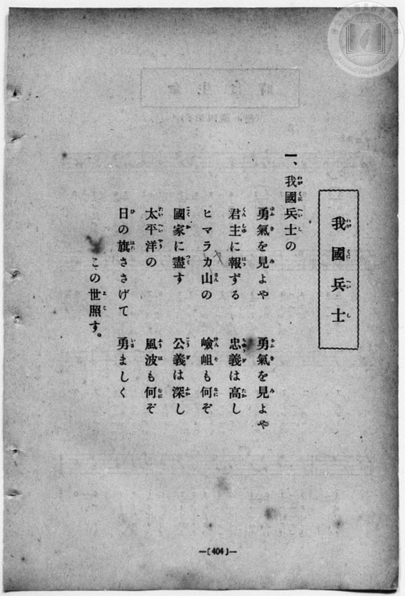
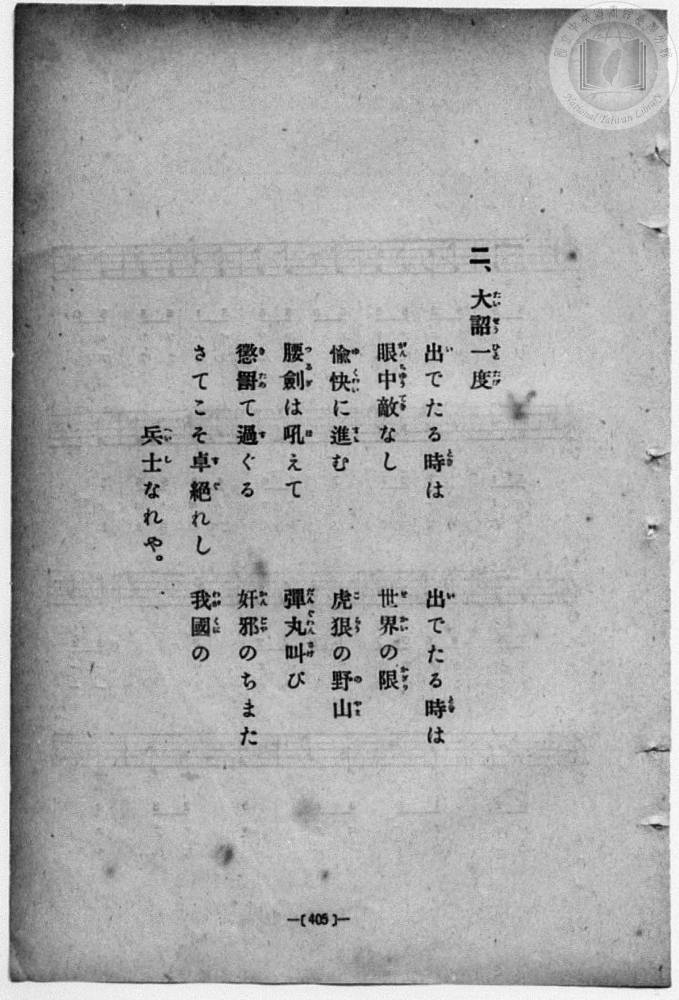
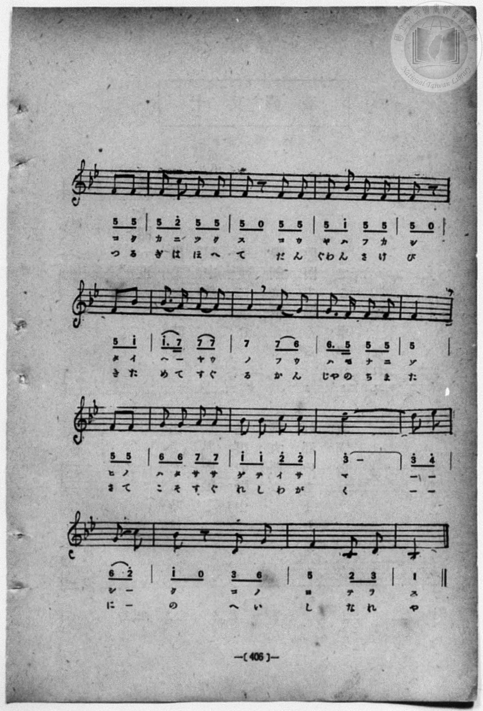
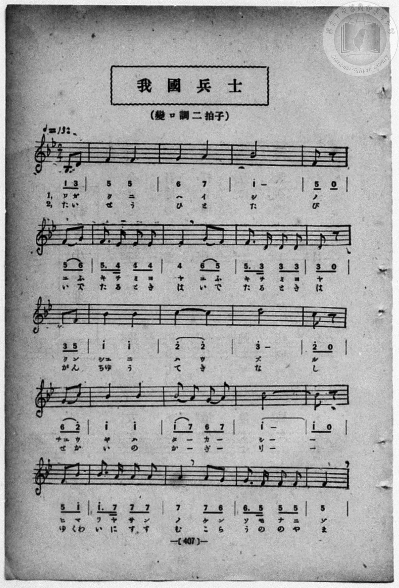

# 我國兵士

> Re:Shōka 使用 AI 協助辨識與重建樂譜，可能會有錯誤。歡迎回報。

- **鋼琴伴奏版**：<br><audio controls src="wagakuni_heishi.mp3"></audio>
- **NEUTRINO 歌聲合成版**：<br><audio controls src="wagakuni_heishi_neutrino.mp3"></audio>

- book: 新編 小學校・公學校 唱歌教材集（高等科一・二學年用）
- 一條慎三郎 編《新編 小學校・公學校 唱歌教材集》（大正十二年十二月，索書號 0725-41）
- 日治時期公學校《唱歌帳》（典藏號 2020.006.0843・P159–P160，原載《小公唱材集》第 407 頁，大正 14 年 1 月 5 日抄）

## 說明

> [!NOTE]
> **原書資訊與歌詞全文**（對應 `P413.jpg`–`P416.jpg`，原書 p. 404–407，高等科一・二學年第 32 首）：
> - **調性與拍號**：變ロ調二拍子（B♭ 大調 2/4 拍），速度 ♩= 132，弱起拍（第 2 拍八分音符雙音 `1_ 3_` 起唱）。
> - **跨頁版面順序**：`P413.jpg`（原書 p. 404）為第一節歌詞、`P414.jpg`（原書 p. 405）為第二節歌詞；樂譜則依縱排右開跨頁習慣，自右頁 `P416.jpg`（原書 p. 407）起印，接續至左頁 `P415.jpg`（原書 p. 406）收束（故臺史博典藏《唱歌帳》P159 抄本亦標註「小公唱材集 407 頁ヨリ」）。
> - **音高與版本校勘**：
>   1. 原書簡譜以 B♭3 為 `1`，故 B♭4–E♭5 標為高音點 `1^`–`4^`；TMD 於 `?= B,` 下以 B♭4 為中音 `1`，故依五線譜實際音高（B♭3–E♭5）修正為 `1_`–`4`。
>   2. 原譜每行皆以第 1 拍（1 拍）收尾、下一行以第 2 拍（1 拍弱起）起頭，兩端合併恰為完整之 2/4 小節。先前《唱歌帳》手抄本於第 20、28 小節（`P416.jpg` 末行與 `P415.jpg` 第二行末尾四分音符 `5_`）誤補八分休止符，且漏抄第 6–8 小節「勇氣を見よや／出でたる時は」重句歌詞，並將「君主（くんしゆ）」記為「君主（キミ）」、「太平洋（たいへいやう）」記為「タイヘイカウ」，本檔悉依原書印本修正並補齊雙段歌詞。
>   3. `P413.jpg` 第一節歌詞「ヒマラヤ山」原印作「ヒマラカ山」（上有手寫改字「ヤ」，`P416.jpg` 譜下則印作「ヒマラヤサン」）；`P414.jpg` 第二節歌詞作「腰劍（つるぎ）は吼（ほ）えて」，`P415.jpg` 譜下印作「つるぎはほへて」。
>
> **一、**
> 我國（わがくに）兵士（へいし）の
> 勇氣（ゆうき）を見（み）よや　勇氣（ゆうき）を見（み）よや
> 君主（くんしゆ）に報（ほう）ずる　忠義（ちゆうぎ）は高（たか）し
> ヒマラヤ山（さん）の　嶮岨（けんそ）も何（なに）ぞ
> 國家（こくか）に盡（つく）す　公義（こうぎ）は深（ふか）し
> 太平洋（たいへいやう）の　風波（ふうは）も何（なに）ぞ
> 日（ひ）の旗（はた）ささげて　勇（いさ）ましく
> この世（よ）照（てら）す。
>
> **二、**
> 大詔（たいせう）一度（ひとたび）
> 出（い）でたる時（とき）は　出（い）でたる時（とき）は
> 眼中（がんちゆう）敵（てき）なし　世界（せかい）の限（かぎり）
> 愉快（ゆくわい）に進（すす）む　虎狼（こらう）の野山（のやま）
> 腰劍（つるぎ）は吼（ほ）えて　彈丸（だんぐわん）叫（さけ）び
> 懲罰（きた）めて過（す）ぐる　奸邪（かんじや）のちまた
> さてこそ卓絶（すぐ）れし　我國（わがくに）の
> 兵士（へいし）なれや。


## 歌詞

```text
（TMD 檔案未包含歌詞註解）
```

## ABC

<div class="abc-score" data-abc-src="wagakuni_heishi.abc" aria-label="五線譜載入中"></div>

[下載 ABC 原始檔](wagakuni_heishi.abc)

## TMD 檔案連結

- [主旋律 TMD 檔案](wagakuni_heishi.tmd) [[在 TMD Studio 編輯](https://tmdlang.github.io/Tmd-TS/#tmd=s7IKdvYPcrWy4qpTUCpJTLdSSM7PyUlNLsnMz7MqzsjPTozPrsyvSsyML84ojTe0NDJWgqssy88pzU21ys4vyY83jDdCSBTnlxYlp1oVJ2fk5-fEl6RWlCTl52ejy8cXJKanWgWYGCIZWVCUX5aal5gH1F1QlJlXkpoC1o5QkFqWmZIKki5OTsyLL0stykzLTE1BclNqUTHY6RArSooS84qTizILQP5BqMovKsnITy9KLMiotMrILC7JL8pMTsyJz07MS0QoKslIBfouNzMnsySxqBJZc2Z6Zp5VbmpmViaS57S0FJ51THw6p_tp69ani1craGlxKdoqGBobcdnbKjjpcNkY6ZvYgQwBKbdSeDZtw_PtKxSebuh_unbHswULHzfvftq6BsJWeDpl47O1Pc-mznw2d8LL2W3v93S8XD3j-drO58snPtnRAFT6ZFcPUOnTnVueT1nxfk8n2HFAmWeL5j5r7Xuyo_Nlc58C0PjHDV2k2PO4oRto1dMly5-tXfy0txFkyc4tEMazOR3v9_Q837Lo2ewdL2bOVzAwNzLVNTGE2f1s-tJnm3Y_m9n0bM58uPFA2yEWPN2xGWp0644X0_tB-o0MjAz0DAzM9AwsTIyBbgowNLV81DA5wNDMAGjP0775L_Z0gvQDnQ00DmgKzIHP16xRMDEwV3i5oBGkEOxWBUMTBaBLFQwVgM5UMFUAuaarBew2Ln0tBVtqAS4FBQU7hWhFP_8Q11gIR0sL6FZQmGxuf7Gi60VHO9C7L1bOe9q64tm0di0tkJ839D5r71RIACV0vayC9ASgN0EcMzAH4lmgAQoFekB_mQAlgb4DiuKMcKD_jY0UXi6bBvTf-z2zIM7QBTrkxar9zxqWg5zQ3QsMYpDls16s63rcvBYoA4rC7t6naycAXeT0aOZaBWDIAYUVgIlSASgBNqvnZcP8p7uWKTyauRKccEFu27PxxdbtYAUdIJuNQIqftq5-2tH2cv7m52uWvZw9E8hQSDCMVzCOT1AAKgZGFtC0xw1NSC7bvgIYXc87O17OXfRyQdvTXf1gxyGCBBRMyKEANOB50y6ghUDPP1_fAAnTxw2NIB0m2HSYInTs6oHreL9n9rMVTS_Wznna2f5k39znOzY-65v0tH_zy2ndUCftn_SsdTHQny_aV4HEFzSC4wkWNShWACOlE-S93g1A9c_6lj7fBdS1-en2ZTBdpth0mQF1PZuy7dnc-UCJZ1NbX7Tvetq_6WnvLEhWQMsioFygAEy6z-YA_bHs2YqZL1bsftzQg5YLYOn_cfOKx82rHjeAYg8lvIExAkw-wJQADHKgUcCs-LR7BjjIIWoUFAz1FCCufL5hITB8nuxeqgBKFcYKwEAERiYoWQIdCxYDJUlXIA3MVitmAqWBJoPM3z0PqC4OnJhN4oDqZ4f4ugALtT0KCeDiLkHhyY5umLEmIGOf7FgLSSlQw4ER8mTXlOfbZ4HiZ_2yl7NmQ5wNTaDGMGuBnnuyfx0wl0OcFg-xMgHuYQUFI7BngMY8W9__YmHP81ltQItBqRVYHoBTLpQGRcTTDfuA6Qjkth0NQLVQheBkDVMISfOQ2H65YC0oF7SufL56_dMJHU_2bn3WuAHokKfrgF7Y8mRnNzgDAeMHmOaALnra2vG0sxctUp91dkOiFBg6YMsMgC4wsoDqAtqKSHLA8ms10FXAmENKUQqQVA0UB8oC3f909mx49lNIMI0Hhmfni1VLXiyeA8mYT_ZMfLZ2EVAS6PInO6Y829MPtB5ksRkw5GDWglJVd_uzDYsfN016saz7cVPH4yZgidn_tH3X48bljxvnP27qBhbnjxvXA9PXy_bep_1LYXkKaOiypxvaQSZMmP1kx26gDx439j9umvy4cfrjJmBlBUyMvS9WzAAGE4qaprWPm4G5ACQLDACQ1JJVT3dufrYFVDOAbGxsedy4A0Q2ARno5jxu2v-4acnj5hkgsmn146Zl4IQPDJM1z1ZNedbUCUxPkCQNzKGg_ANOM0CnAsPl5d4uYDn1bN1WWEECTzrGekgFMzigUQqcnsfNkx43z3vcvPJx85KnGzcCrQTaAbTgyd45KLJNqyGyQJ882dH1bE4nMNKfrl_9bMrOp2ung1UugTgXKa5B-W5HN7BowmIeUHnT1sfNwOQDKZpnI0o-aHKAuxKi9UXrhqddIOsfNwK1dj9u7AOFXyMw0e4BCwJjAMgFMqDBhpS8oO6AOwJmACjuG3eDowSkCRZqsHoPVC81NAJbOWA-pOkDjub-x41AQ4DkaqCdkMYQ2AngqG2cDnbIOoguSBIE62oDRvnjRnBRBk6RYC37wVxQ0nzc0EC8YqjhuFJn4-qnC4B1FChUoOmscRbIy0Ar9i94vm8lWGohzBZoQEJKJnAyBVoHFJkOsQUthYDVTAVaB_EmyMxt655uAjbSgOITwc6YC3Zn05O9U8GCqyAB9bhxHtTZwBbkum1gKaBiYDBCrFv9fPZCaPQ29oNFZoIMb10DczBQMcK1z7ZDXLIVzbWEsxzYzS8XrXi2eRHMBKCx6_G7GdjgAotvgpjwbDowloFcYPoBZ3hggIDQJHBCAsUjWBZoI9A0oOw-UNQ09kPDE-SRdU92AJs3wKgENjo7n7cuB6tf9rgJmBMgHkdLirt6kJIiqGWzcgqSB2dDvAZMsMDWDcSdjxtXgGU3A8Whutp3QVwFtgJRAoIFgYrBiQ1UGjYQqRJi7PM5e4AVH1gKWIQBvQZNV6DaaOpWqL-gWoChCiwrGoB-fz61BywFdDkwJ0IsWvdyJqjxBhbpe9zUBXf5s5bOp_vBWQxkMjCpA9MMRMvqlw3AGAFqmQlE4BgEZtmGFzP7nndDSoXJwCCFx_vL9j5YAl4HTg_74FaQUro0PN0LLAN3gMUXgL08AeQkcI542g8pCoCJYSJYy2aoF9o3Pd8LbFcBpXqhaaapEWjaS5BFIPeDFQPNAWfSpTteNq2CBgXIfGCVAA0iUPCCktN8WFoCWgQMXlCme9o7-flWSLYChgYwJIFWAIspUIDjKrsQxRT2QmwVyARQ0QROjZR3L6BAQUufiys4Py_dKiAzMS_foUbXsKYaZIOCjaGZFjjRK2Dr1ShAGi4K2tB6DNhgUNCAVTc60EasJhZ9QPtAZtYoGABbjyAIbMzrApvzQKJGwRREgSCcUaNgBmOaI8QMoSwYhOoEGQlmgPXUgC3yMaxRgGl83LweRDatAWt53ATiQcS74QYBK32YaNMShGjTdgwrHwO7vbpgsx83L4OJQuw0QrKzcT6YbIHoaZwNF29DmNS4CS66AkkUpBPNzsbNMDvBJgKLBLCtuOMJ3p4jMXqgMWASD0JgGmQ_mAJBcAiD1cCVAuMQHI3QuARToBgBMyBK4TECbJ9B_Nu8CYjBIdQM8jkoVGGhjhSqBNWDQwQcn8B2DEo8wEIRmJ2hoQvM9tCwhMc_clgS1AEJ_R6wislEhP6OTtJDH5bAYXQNsNcAYcFoYABDWYjUAZIDhTg4ckAc5ADfjghP1PQOT5FNyOG9C8P0x82rYb5vBnYHQYohWpADG1TjwEMVOYXD7QaHJUx0FaYtjdNhtoDzCrDcBVuBN4yBvRRqhDGIBS5lwAEIZmEra0Ai8KIGxEEO5nUwfzb3I4XmfphoEygMYaKYZQqIhITwJDA5D2E6OHhB6RQSijB7QKKw2ARWlUimd-E2HRxHkOobbAGB4mMKuYELDEJwKEKDEl6CIwIZXr4DAxMcnqhlCpSPXno0r4T4F5j3gV0XMAuc66FlMiSkNyKLN-2F6lgExKCQgeQBkMw-uA6QWkgpghnmwFoaiGeCWSASpLMBHu6gcgDYvIHGByTdg-IIEk_AehsqA7erEVRqgUoYwmm7dS0s-MF9KGjwmyEqXsLlOKgswAhdeBJGFgTFG26V6IkdlJghAfm4GVyEQgIPSO8E0pCkBglUcDkBzR6QrPG4eSpYBmQGLDNAdIAyC6TyRY4GUMRCCmBgExBM7oAGKshsSIGxAKwTXCgDeaCmIFwA2DwDkxOhkoh6tBdMgsp8giV5M-6YANexA5kl4M0WcIUID3FEhoCGN0wcUjzhzRDQQghkAlJMNDVCZIHhDssQE6A6EQUROE3AYwLUaIZKgPLEQjALZA1yKwcWQ5AqhUCeWA0cXnqycy6enNEJVAGpF_DGCjisEeU9UqEPwqCMA65IsdS2IBETmGa02haSwqEpGVxAgUlQGIGaeo-bwQUwOI3DZcCFPWaBDSmaYFUFco6AJOu5YBI1HsCNE3BFCs0C4OYKSA-sUsJiB7CAg9mBlGLhLTho2oSnQiMQA9rWA7fhQRDWqEcuJOBtJkhRAElO0PYbJJmBAwNcpsOKDhCEmYnsZVDxAcm1oMyPaFWDvArxBKhFAQkAkFmw-hJhVi0Xl66dAqjHowCklbkA)]
- [鋼琴伴奏 TMD 檔案](wagakuni_heishi_piano.tmd) [[在 TMD Studio 編輯](https://tmdlang.github.io/Tmd-TS/#tmd=s7IKdvYPcrWy4qpTUCpJTLdSSM7PyUlNLsnMz7MqzsjPTozPrsyvSsyML84ojTe0NDJWgqssy88pzU21ys4vyY83jDdCSBTnlxYlp1oVJ2fk5-fEl6RWlCTl52ejy8cXJKanWgWYGCIZWVCUX5aal5gH1F1QlJlXkpoC1o5QkFqWmZIKki5OTsyLL0stykzLTE1BclNqUTHY6RArSooS84qTizILQP5BqMovKsnITy9KLMiotMrILC7JL8pMTsyJz07MS0QoSiwCak5PzU3NK7EqyEzMy49PTE7Ozy1IzMsEiSEUlmQAFVnlZuZkliQWVSpxaWkpPOuY-HRO99PWrU8Xr36_p-Pl7JnPOrtfdu95PmHLkz1bni7tf7-nU0FLi0vRVsHQ2IjL3lbBSYfLxkjfxA5kKii0rBSeTdvwfPsKhacb-p-u3fFswcLHzbuftq6BsBWeTtn4bG3Ps6kzn82d8HJ2G8iO1TOer-18vnzikx0NQKVPdvUAlT7dueX5lBVAy8CuBco8WzT3WWvfkx2dL5v7FIDGP27oIsWexw3dQKueLln-bO3ip72NIEt2boEwns3peL-n5_mWRc9m73gxc76CgbmRqa6JIczuZ9OXPtu0-9nMpmdz5sONB9oOseDpjs1Qo1t3vJjeD9JvZGBkoGdgYKZnYGFiDHRTgKGp5aOGyQGGZgZAe572zX-xpxOkH-hsoHFAU2AOfL5mjYKJgbnCywWNYMu5PPNKivKtAkBRGOThUGNQU82lAAQ2hmZadmBWjYJpvIIuhDCDEzUK5iAKTBgCsRFYzBjKAys2gqgzBFEgaACla7hqUaz1QbbWAm6rYXy8QrRhfKyCCYhhAmSAXAJkmgKZQEPBcmDjwSy4FJJOEMMAYl9wfl46wpe6hli8CXMf2MHGEMeDPQKCcEYNxP8gCPY8RAzkaWQI1QkyEhFwNWCLfAxrFGAaHzevB5FNa8BaHjeBeBDxbrhBj5tnwESbliBEm7ZjWPkYmGp1wWY_bl4GD2ywnUZIdjbOB5MtED2Ns-HibQiTGjfBRVcgiYJ0otnZuBlmJ9jEx43LwbYiJx1dYBSCEJgGaQJTIAgOFrAauFJgwIPDHhoBYAoUjGAGRCk8GB83rYU4snkTEIO91QxyLigoYEGFFBQE1YO9AY6Ex80gbyECD-b1x03d0CB53NgLDQB4pCEHAEEdkCDrAauYjBxksKQEo2vAeQsEYTQkn6HGA0gOFEzgEAVnRqRQ2o4IBNSUBY_7JuRA2oVh-uPm1TAnNzdCDINoQQ6hhY-bYCkINS3B7QYHAEx0FaYtjdNhtoBT5eNGkFvxBAyIBc6EYF-DWdiyIkgEnhNBHOSwWQdzXHM_UhDsh4k2gTwOE8XMciASEiyTwOQ8hOngMAGlCIjXYfaARGFR8LgRlGFhpnfhNh0csI8b-x83gRyJFiJAfyPKYmi5DBWHF9bQMgsYAojCHL10Q89czSshjgRmjcdNW8EscKaAljOQ4NmILN60F6pjERCDvANJbSCZfXAdILWQTIYZUI8bVwPxTDALRIJ0NsADC5RNHjd1QgMRksJAAQsJ3MdNsBINblcjKFODMiB6iQTKIBgBAU8iyILw2gyrSvTEBEosED8_bgYXBhB_AumdQBoSlRD_gzMPNPlBkt7j5qlgGZAZsMQG0QFKjJCyHznEQHEAKUoeN-4Gkzug_geZDclFC8A6wcULkDcBknwgAo8bwdY1ToRKIorxXjAJKr3oldDgFRy4FIYHDiKZQYMGJg7JqXiTGTQ_gkxACrSmRogsMIhgyWwCVCciT4KjDx5oMyDpCpbSFoJZIGuQ60NYYEKKRGigIRpLyKEGCkpYgwnRaELN9yARE5hmtMIcklagaQKcK8EkyAugOvtxM7ioAKcWuAy4WMIsWiD5EVaoIactSAKZCyZRgwlcYYHLaWhiAldhID2w4hOLHcBcDbMDKUHBa3Vo0oEnEnDDEVr_Y2k9IrIbvB6FZCpIbEPrdEgqAAcGuCCDZUIQhJmJ7GVQRoSkf1A2QjSPQF6FeAJUYUECAGQWrGRHmIXSygQ1ahGtTESrFuQNEEZrpUIbs_CmLrbWrDFCHUjaAEpCPAERA4Yckk44E6oQbBSIjWQjpIkMayijtbyR1KGYRdBlIH8YATEhE4HuBSkFMZEUga3A7TwCHgVKQQISmHTQPIrSKUAYhu4vROhi61DQy2V40wJOMYSRIP3Y4sEAmN-gUlD34TIQnE5ByVrXTgHcX1MAMkBJPNrHMBbBNgKzlbkA)]

## 分析

```text
================================================================================
📊 TMD Song Profile: [ 我國兵士 ]
================================================================================
⏱  Duration:       0:31 (31.8s), 35 measures total
🎼 Key & Tempo:    首調基準 B,, != 132.0 BPM, <2/4>
   - 分析範圍：      由實際發聲的音符與和弦推測調性；播放脈絡另行呈現
🎤 人聲音域:    A#3 (MIDI 58) – D#5 (MIDI 75) [跨度: 17 個半音 / 1.4 個八度, 難度: challenging]
   - 最低音:  A#3 in [Song #1 @ m.1, 0:00]
   - 最高音: D#5 in [Song #1 @ m.33, 0:29]
   - 適合: soprano, mezzo-soprano, contralto, tenor, baritone, bass
🏛  結構:      Song (31.8s)
⚡ 編曲密度:        Peak 1 軌道同時演奏
🗝  調性診斷：       A# 調性不明確（純淨自然大調，未偵測到可信轉調）
   - 風格氣質:    純淨自然大調（陽光明朗、易唱易記，無明顯調外色彩）
   - 轉調歷程:    全曲維持單一推測調性（未偵測到可信轉調）
   - 核心骨幹音:  F, A#, A, D, G
   - 調性數值:    A# 調性不明確 [相關度: 0.87, 穩定度: Ambiguous, 自然音純度: 100.0%]
   - 候選調性 (K-S): A# 大調 (0.87), F 大調 (0.85), D 小調 (0.71)
   - 五度圈歷程:   -1
   - 各段落調性細節:
     • [Song #1]: F 調性不明確 (r: 0.86, 自然音純度: 95.8%, 調外音: D#)

  [ 五度圈游移軌跡 ]
               C  
        [F ]*          G  
      Bb               D  
      Eb               A  
         Ab           E  
            Db       B  
               F# 
     (* = active key center)

  [ 十二半音累積音高分佈 ]
     C  : ███████                    8.3%
     C# :                            0.0%
     D  : ██████████                12.4%
     D# : ███                        4.1%
     E  :                            0.0%
     F  : ████████████████████████  28.6%
     F# :                            0.0%
     G  : █████████                 11.3%
     G# :                            0.0%
     A  : ███████████               12.8%
     A# : ███████████████████       22.6%
     B  :                            0.0%
--------------------------------------------------------------------------------
Assignment 軌道音域：
  - Piano         : A#3 – D#5 (17 個半音 / 1.4 個八度, 104 個音符)
================================================================================
```


## 原書掃描頁










