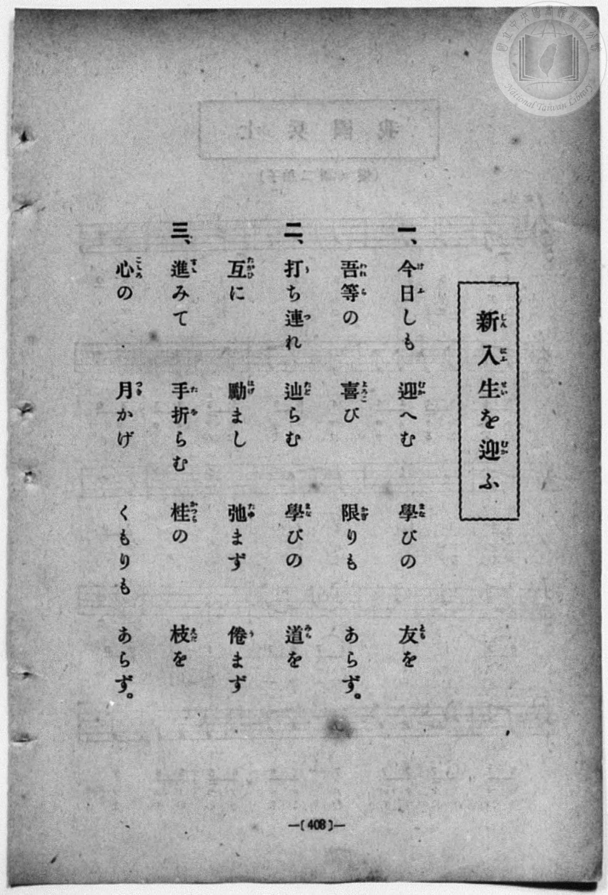
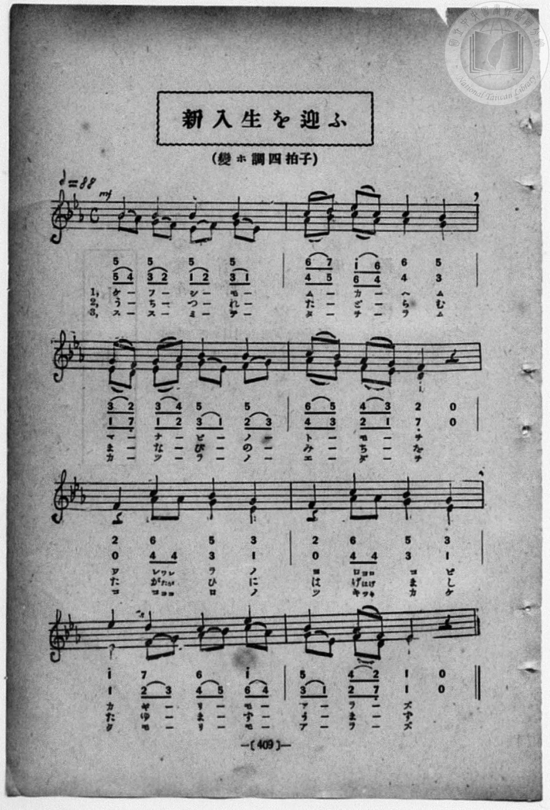

# 新入生を迎ふ（二部）

> Re:Shōka 使用 AI 協助辨識與重建樂譜，可能會有錯誤。歡迎回報。

- **鋼琴伴奏版**：<br><audio controls src="shinnyusei_o_mukau.mp3"></audio>
- **NEUTRINO 歌聲合成版**：<br><audio controls src="shinnyusei_o_mukau_neutrino.mp3"></audio>

- book: 新編 小學校・公學校 唱歌教材集（高等科一・二學年用）
- 一條慎三郎 編《新編 小學校・公學校 唱歌教材集》（大正十二年十二月，索書號 0725-41）

## 說明

> [!NOTE]
> **原書資訊與歌詞全文**（對應 `P417.jpg`–`P418.jpg`，原書 p. 408–409，高等科一・二學年第 33 首）：
> - **調性與拍號**：變ホ調四拍子・二部合唱（E♭ 大調 4/4 拍），速度 ♩= 88，力度 `mf`。
> - **二部對位與追唱設計**：全曲共 8 小節，高聲部（Soprano）與低聲部（Alto）大量運用一對二流動八分音符圓滑線對位；尤以第 5、6 小節最具巧思——高聲部於第 1 拍以四分音符先唱出首字（「ワーレラノ」「ヨーロコビ」），低聲部則於第 1 拍休止後，在第 2 拍以兩個八分音符 `4 4` 緊追唱出前二字（譜下小字註記「ワレ」「たが」「ココ」與「ヨロ」「はげ」「ツキ」），第 3、4 拍再與高聲部齊一收束。
>
> **一、**
> 今日（けふ）しも　迎（むか）へむ　學（まな）びの　友（とも）を
> 吾等（われら）の　喜（よろこ）び　限（かぎ）りも　あらず。
>
> **二、**
> 打（う）ち連（つ）れ　辿（たど）らむ　學（まな）びの　道（みち）を
> 互（たがひ）に　勵（はげ）まし　弛（たゆ）まず　倦（う）まず
>
> **三、**
> 進（すす）みて　手折（たを）らむ　桂（かつら）の　枝（えだ）を
> 心（こころ）の　月（つき）かげ　くもりも　あらず。


## 歌詞

```text
（TMD 檔案未包含歌詞註解）
```

## ABC

```abc
X:1
T:新入生を迎ふ（二部）
M:4/4
L:1/16
Q:1/4=88
K:Eb
V:V1 name="Alto" snm="Alt"
V:V2 name="Soprano" snm="Sop"
[V:V1]
!mf! B2 A2 G2 F2 E2 F2 G2 E2 | A2 B2 c2 A2 A4 G4 | E2 D2 E2 F2 G2 E2 F2 G2 | A2 G2 F2 E2 D4 z4 |
w: 1.~ケ _ フ _ シ _ モ _ | ム _ カ _ ヘ ム | マ _ ナ _ ビ _ ノ _ | ト _ モ _ ヲ
w: 2.~う _ ち _ つ _ れ _ | た _ ど _ ら む | ま _ な _ び _ の _ | み _ ち _ を
w: 3.~ス _ ス _ ミ _ テ _ | タ _ ヲ _ ラ ム | カ _ ツ _ ラ _ ノ _ | エ _ ダ _ ヲ
z4 A2 A2 G4 E4 | z4 A2 A2 G4 E4 | E4 F2 G2 A2 B2 c2 A2 | G2 E2 F2 D2 E4 z4 |
w: 1.~ワ レ ラ ノ | ヨ ロ コ ビ | カ ギ _ リ _ モ _ | ア _ ラ _ ズ
w: 2.~た が ひ に | は げ ま し | た ゆ _ ま _ ず _ | う _ ま _ ず
w: 3.~コ コ ロ ノ | ツ キ カ ゲ | ク モ _ リ _ モ _ | ア _ ラ _ ズ
[V:V2]
!mf! B4 B4 B4 B4 | c2 d2 e2 c2 c4 B4 | G2 F2 G2 A2 B4 B4 | c2 B2 A2 G2 F4 z4 |
w: 1.~ケ フ シ モ | ム _ カ _ ヘ ム | マ _ ナ _ ビ ノ | ト _ モ _ ヲ
w: 2.~う ち つ れ | た _ ど _ ら む | ま _ な _ び の | み _ ち _ を
w: 3.~ス ス ミ テ | タ _ ヲ _ ラ ム | カ _ ツ _ ラ ノ | エ _ ダ _ ヲ
F4 c4 B4 G4 | F4 c4 B4 G4 | e4 d4 c4 e4 | B4 A2 F2 E4 z4 |
w: 1.~ワ レ ラ ノ | ヨ ロ コ ビ | カ ギ リ モ | ア ラ _ ズ
w: 2.~た が ひ に | は げ ま し | た ゆ ま ず | う ま _ ず
w: 3.~コ コ ロ ノ | ツ キ カ ゲ | ク モ リ モ | ア ラ _ ズ
```

## TMD 檔案連結

- [主旋律 TMD 檔案](shinnyusei_o_mukau.tmd) [[在 TMD Studio 編輯](https://tmdlang.github.io/Tmd-TS/#tmd=s7IKdvYPcrWy4qpTUCpJTLdSSM7PyUlNLsnMz7MqzsjPTozPrsyvSsyML84ojTe0NDJWgqssy88pzU21ys4vyY83jDdCSBTnlxYlp1oVJ2fk5-fEl6RWlCTl52ejy8cXJKanWgWYGJojZAqK8stS8xLzgLoLijLzSlJTwNoRClLLMlNSQdLFyYl58WWpRZlpmakpSG5KLSoGOx1iRUlRYl5xclFmAcg_CFX5RSUZ-elFiQUZlVYZmcUl-UWZyYk58dmJeYkIRSUZqUDfQT2Rk5mWii6VVpSZmpdSnJFZgGxyZnpmnlVpHsiZJVDHaWkpPJu24Wnr0udT5j9umvRif9_jxq3v93Q82dXzsnnF-z2dClpaXIq2ChYWXPa2Cq46XDYm-iZ2IDNB4WYF0vx8-wqFpxv6n67d8WzBwsfNu5-2roGwFZ5O2fhsbc-zqTOfzZ3wcnYb0NiXq2c8X9v5fPnEJzsagEqBtgCVPt255fkUkF1gtwJlni2a-6y178mOzpfNfQpA4x83dJFiz-OGbqBVT5csf7Z28dPeRpAlO7dAGM_mdLzf0_N8y6Jns3e8mDlfwcDcyFTXxBBsN5e-loIttQCXgoKCnUK0op9_iGsshKOl9bRvPsjeze0vVnS96GgHuvnFynlPW1c8m9aupQVy8obeZ-2dCgmghKeXVZCe8KhhMohjAeYAHQ4xQKFAT8HEwAIoaWJgCRTFGahr1igYGyu8XDYN6L_3e2ZBnKELdMiLVfufNSwHOaG7FxgMIMtnvVjX9bh5NlDm6ezZQOGnaydAzAImg6cTOoBBDHSg66OZaxWAAQtUpQBMBwpAdWCje142zH-6a5nCo5krQUkF5NKu2SCBhNy0hMcNTQiboQZu6H2ytxdo_4v9e4Emv1ix9sWKDrArQKExe9PT1o0KFqDIfr6-AeLBF42bwOmxIzi_AJhx8oHWArU_2dsHl3DMKQGJAl33sr3_ZWM3MEkBwwNkEzDatzY-7Z76tHX10462l_M3P1-z7Omcyc92T3y-fRbEKe_3zH66YcmT3UtBYWb6uKHRDGr7szkNT1u3P92-_FnD3EcNU4AI7phn0_aAVBuCQgGoExhsCNNbQQH2tH0XMOyfrp0OdN3jhp7HzesfN-953LzmcfPKx819jxt6wYIrwIJrHzdtftw8GSgICVC4z552tqNYtGfis7WLnu7rAYXxnBUgcSOYA1pXPm3oRvakQoKJgkkCMAd1QcIZ6KCnnaDwgLjpxdo5T3Z0g7PU9Bcrdr9YMQPmyjVQxzXOf9zYA2UD3QdEDaBYg7l7LUzZ-seNk2D-aXncBBKHeAOcBIHBCU4qT9tAmuHh93JvFyivT9n2bO58WBqB5RRQSm5oBBY9YP6T3V3Ppi8FhWLjRHDx1Pm4cfrjpqbHDQ3AAgsk3tTwuBGY6YHiO0DshgZgDgCr3_e4cRVYfPPjxnUg8X5Q2fC4cQVQO0i8aRLEiqcT9gHzENio_sdNQN8C2UBdYC3T5oDFgaj3ceNkqGkNDS9nTgAb1f24EegGoFFdECc9bmwCan_cOAvDU7uAYQn31LNOoFFA7cBiEah44cuGxWDuErBRQIUNL_btB4sA42AlWBCI8HntJchtQPH9QNOQvfZk1ySYOcCo2gTWshpkTjeooIdEHlgQaOB0kPie2VD1TRC3AcWBfml42rAMycEgQbQo60Ty3csGoEVAxTOBCKwe6KplQEOedXY_65oBMx9sL8xfzxYCYwQSnkuQw__ZvLlgcSBagBJl-5vB4pNBqAmU4KDqQWU8KCQfN0IEgQYCUycwXoAxC4waHNFEeZkPBQpa-lxcwRmZeXmVpcWpmf6-pdmJpVbQcsuhxqCmGmSdgo2FFjjsFLBVOwrAjAPMAy8W9ihoGEGLIh0FWFWgiUUD0FKQYTUK1blptQqmwMIWGdcomCmYKxjGASkzmBBYvY9hjcLjpo1A_uPmqSCyaTuYvQis6XHzArDYarDYDDAJEoHqNQKqaGwDiTYuBJNLwKp7IHob54PFVoLFOsFkA0KvMcjenWBRMNkMVt0MMg0ksx_M2wQmwSZA7cUfYrt6yAkxY2ARaqxgghJYpkA-SFxXwQA1rJrngV3TBSYng8k-aFh1wEMO4vJ4tJDaBw6PVWByM5hcBw0psG8hYdg0CVUnOJwg4d-CFBpQO5tWgHmgcEW2k0C66iQnlEBhAUs7xmDbMUSQQmk92EVrMF3cDHHxWrBfwaEADkXkcIKkG1AqAhZXYBLkf5AM2NRGUAjBQnM6WkiBTYSaC7YDbi849Jog9oLDswlkNoGwAlbq5IQVMKPpAvMbJHjAnBpwKJkAw8wQM01B3QNKDY-bwekDlv-aIKkJkod2YUlT4LBqguRBSIjMgoYVuhh6moLEEMR8YuysxVKogdpcdCvRIBnSEJxZDYHCoAxrBiRNMJPfCC_QDBXM4-EBBSJBgQUJPKDEaJEGCydQOIDSDyj1gLIlFhF4KIFcASrWQIUaqoshMivABQ72Ig2sAph6QIUaapEGkQGaCizUsBdpYBVAU8EYpUiD2NsCLtToUKQBTYZVk6BcB6o2QYkLnNKGbImma6eAXqgpAMWUuQA)]
- [鋼琴伴奏 TMD 檔案](shinnyusei_o_mukau_piano.tmd) [[在 TMD Studio 編輯](https://tmdlang.github.io/Tmd-TS/#tmd=s7IKdvYPcrWy4qpTUCpJTLdSSM7PyUlNLsnMz7MqzsjPTozPrsyvSsyML84ojTe0NDJWgqssy88pzU21ys4vyY83jDdCSBTnlxYlp1oVJ2fk5-fEl6RWlCTl52ejy8cXJKanWgWYGJojZAqK8stS8xLzgLoLijLzSlJTwNoRClLLMlNSQdLFyYl58WWpRZlpmakpSG5KLSoGOx1iRUlRYl5xclFmAcg_CFX5RSUZ-elFiQUZlVYZmcUl-UWZyYk58dmJeYkIRYlFQM3pqbmpeSVWBZmJefnxicnJ-bkFiXmZIDGEwpIMoCKYb3My01LRpdKKMlPzUoozMguUuLS0FJ5N2_C0denzKfMfN016sb_vcePW93s6nuzqedm84v2eTiD75eyZzzq7X3bveT5hy5M9W54u7QeKK2hpcSnaKlhYcNnbKrjqcNmY6JvYgSwCha0VyNDn21coPN3Q_3TtjmcLFj5u3v20dQ2ErfB0ysZna3ueTZ35bO6El7PbQFasnvF8befz5ROf7GgAKgXaDlT6dOeW51NAbgB7ACjzbNHcZ619T3Z0vmzuUwAa_7ihixR7Hjd0A616umT5s7WLn_Y2gizZuQXCeDan4_2enudbFj2bvePFzPkKBuZGpromhmC7uYIzMvPyKkuLUzP9fUuzE0utAkDBb-hQY1BTzaUABDYWWnZgRo1CdW5arYKpgi4KrlEwUzBXMIwDUmYwIbB6H8MahcdNG4H8x81TQWTTdjB7EVjT4-YFYLHVYLEZYBIkAtVrBFTR2AYSbVwIJpeAVfdA9DbOB4utBIt1gskGhF5jkL07waJgshmsuhlkGkhmP5i3CUyCTYDaC_WksYIREJug-M8UyAeJ6yoYoHqveR7YgC4wORlM9kG91wH3LMSyeDTP7QN7YRWY3Awm10E9B3YgxNtNk1B1gr0GCbIWJA9A7WxaAeaBggLZTqjHQM6HxZAxWAOGCJLH1oMNWYNpSTPEkrVg54EdDvY4stcgsQOKq8eN4HBuBDkZJAM2tRHkKVgATEfzHNhEqLlgO-D2gj3cBLEXHARNILPh3gOmQF1gQoT4CMypAXvMBOhNQ8yYgxoBCvPHzeBYgCXMJkicQRLXLiwxB_ZeEyRxQjwxC-o9dDH0mIMEKsR8YuysxZU_jfDlT0haNQSnY0OgMCgtmwFJE8xoHnrZ01DBPB7uNxAJ8h_Ev0CJIZ1BQU4HxRIojkApFosI3GMgjaBMCsqiqJZAZFaAsw_2DApWAYwjUBZFzaAQGaCpwCyKPYOCVQBNBWOUDAqxtwWcRbFnUCAHVrSCkiOoqAVFITg-h1n-DPLAmkHBBa22qYIREBtCaRAfxAamY21gTaNtrmCmDSy-QBwQhmiAORMYitrGwBDTBqZ3IMNIG5g20MyCmAOxxQShHDmAISU_zAaI-SCFsDoBqwzcfnDZagR0pzEQQ9wMrPohbgYSwGiFu8gE6lS47TgDzAc5wEzgAWYYr2AaD0wfYAT0WTwIQXkYSkAUSA2cYwBXBOJBJcAGofFRjYLYAlEENRpkEtDtunYK6M6P9jGMVcAqboRD3BgsrswFAA)]

## 分析

```text
================================================================================
📊 TMD Song Profile: [ 新入生を迎ふ（二部） ]
================================================================================
⏱  Duration:       0:21 (21.8s), 8 measures total
🎼 Key & Tempo:    首調基準 E,, != 88.0 BPM, <4/4>
   - 分析範圍：      由實際發聲的音符與和弦推測調性；播放脈絡另行呈現
🎤 人聲音域:    D4 (MIDI 62) – C5 (MIDI 72) [跨度: 10 個半音 / 0.8 個八度, 難度: easy]
   - 最低音:  D4 in [ShinnyuseiOMukau #1 @ m.3, 0:05]
   - 最高音: C5 in [ShinnyuseiOMukau #1 @ m.2, 0:03]
   - 適合: soprano, mezzo-soprano, contralto, tenor, baritone, bass
🏛  結構:      ShinnyuseiOMukau (21.8s)
⚡ 編曲密度:        Peak 2 軌道同時演奏
🗝  調性診斷：       D# 大調（純淨自然大調，未偵測到可信轉調）
   - 風格氣質:    純淨自然大調（陽光明朗、易唱易記，無明顯調外色彩）
   - 轉調歷程:    全曲維持單一推測調性（未偵測到可信轉調）
   - 核心骨幹音:  A#, D#, G, F, G#
   - 調性數值:    D# 大調 [相關度: 0.93, 穩定度: High, 自然音純度: 100.0%]
   - 候選調性 (K-S): D# 大調 (0.93), A# 大調 (0.72), C 小調 (0.65)
   - 五度圈歷程:   -3
   - 各段落調性細節:
     • [ShinnyuseiOMukau #1]: D# 大調 (r: 0.93, 自然音純度: 100.0%)

  [ 五度圈游移軌跡 ]
               C  
         F            G  
      Bb               D  
     [Eb]*              A  
         Ab           E  
            Db       B  
               F# 
     (* = active key center)

  [ 十二半音累積音高分佈 ]
     C  : █████████████             11.2%
     C# :                            0.0%
     D  : ███████                    6.0%
     D# : ██████████████████████    19.0%
     E  :                            0.0%
     F  : ███████████████           12.9%
     F# :                            0.0%
     G  : ████████████████████      17.2%
     G# : ███████████████           12.9%
     A  :                            0.0%
     A# : ████████████████████████  20.7%
     B  :                            0.0%
--------------------------------------------------------------------------------
Assignment 軌道音域：
  - Alto          : D4 – C5 (10 個半音 / 0.8 個八度, 47 個音符)
  - Soprano       : D#4 – D#5 (12 個半音 / 1.0 個八度, 37 個音符)
================================================================================
```


## 原書掃描頁






