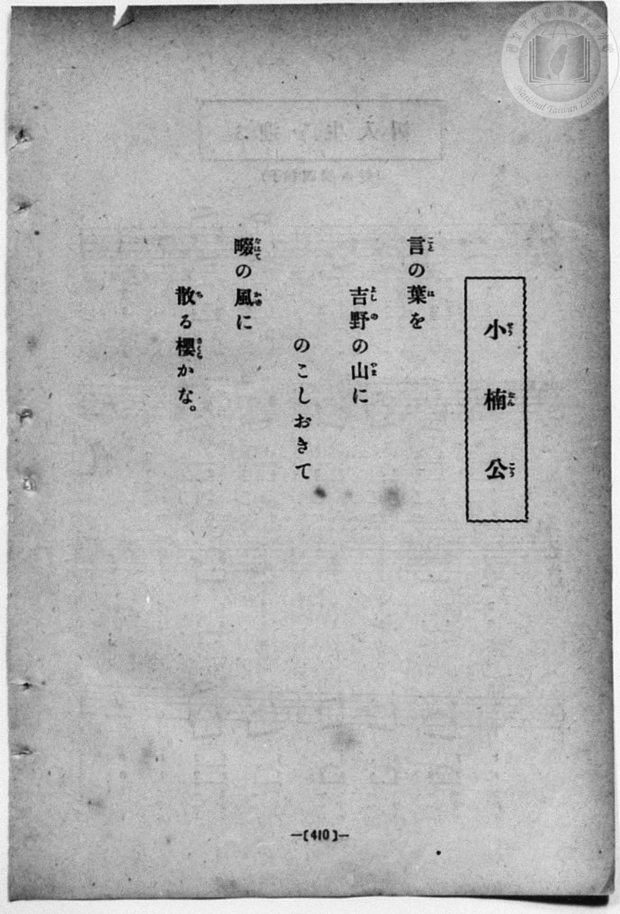
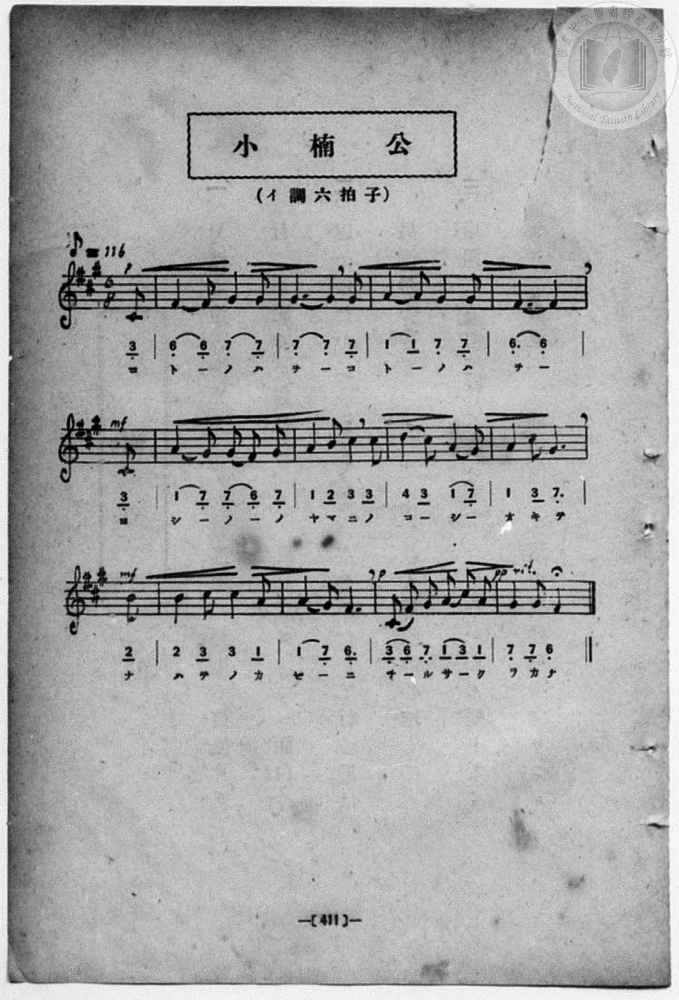

# 小楠公

> Re:Shōka 使用 AI 協助辨識與重建樂譜，可能會有錯誤。歡迎回報。

<audio controls src="sho_nanko.mp3"></audio>

- 一條慎三郎 編《新編 小學校・公學校 唱歌教材集》（大正十二年十二月，索書號 0725-41）
- 臺灣教育會公認《新定兒童唱歌》尋常科第六學年用（2020.006.0847.0006）

## 說明

原書資訊與歌詞全文（對應 P031.jpg，書頁 p. 8，第一學期第 7 首）：
調性與拍號：嬰へ短調八分之六拍子（F# 小調 6/8 拍，弱起 1 拍），♪=116


## 歌詞

```text
言の葉を
吉野の山に
のこしおきて
なはての風に
散る櫻かな
```

## ABC

```abc
X:1
T:小楠公
M:6/8
L:1/16
Q:3/8=39
K:F#m
V:V1 name="Piano" snm="Pia"
[V:V1]
!p! z2 z2 z2 z2 z2 C2 | F4 F2 G4 G2 | A6 F4 F2 | G4 G2 A4 B2 |
w: こ | と _ の は | を _ こ | と _ の は
!mf! G10 C2 | F4 G2 A4 B2 | c4 d2 c4 B2 | c4 d2 c4 F2 |
w: を よ | し _ の _ | の や ま に | の こ _ し
!mf! A4 G2 F4 c2 | d4 d2 c4 A2 | !p! B4 G2 F4 C2 | F4 A2 G4 B2 |
w: お き て な | は て の か | ぜ _ に ち | _ る さ く
!pp! A4 G2 F4 z2 |
w: ら か な
```

## TMD 檔案連結

- [主旋律 TMD 檔案](sho_nanko.tmd) [[在 TMD Studio 編輯](https://tmdlang.github.io/Tmd-TS/#tmd=s7IKdvYPcrWy4qpTUCpJTLdSSM7PyUlNLsnMz7MqzsjPTozPrsyvSsyML84ojTe0NDJWgqssy88pzU21ys4vyY83jDdCSBTnlxYlp1oVJ2fk5-fEl6RWlCTl52ejy8cXJKanWgWYGFoiZAqK8stS8xLzgLoLijLzSlJTwNoRClLLMlNSQdKpKZkl-UWZiTlI7kktKgY7G2J8SVFiXnFyUWYByC8IVSUZqUBHZ2QWA7VXogvnZuZkliSCxLW0FJ5u6H-2dMHT1jUKWlpcirYKphZc9rYKjlzZqZW2Cm7KuVw2ZvoWdiATnuxoeLZo7rPWvic7Ol829yk8377icUPXs2kbgAyQMU_X7ni2YOHj5t1AwyBshadTNj5b2_Ns6sxncye8nN32uKH7_Z6Op0uWP1u7-Glv45NdPU93boEwns3peL-n5_mWRc9m73gxc76CgbmRqa6J4fs9nWDXv2jf9bxxMdCgF02bns1pBtrwYlUvxPan62Y9bZ30fPVSiGVAO55u6H66Y8fz5ROfr1nztHUt0C1Aa55PWQG028jAyEDPwMBMz8DCxBzIMDAD28Clr6VgSy3ApaCg8LRvPsgjm9tfrOh60dEOdNeLlfOetq54Nq0dFAIbep-1dyoEGBgb6mUVpAM9DlT8ckGjQoGeggUoGNasAQY2KAznzAeyFcwVXi6bBnTo-z2zQIa_WLX_WcNykLHdvcCwAoo-XbPhceOO5_PXAqWetq5-2tH2ZGc30OtABU_XTgDa6KYMiiGgrAIwNhWAwkBbnu7Z-GLrdgVDCBdoeM-jmatsDQ3NuMCWrGh43LjuxcTOx02TwD6a0PmyvQ8o9HTjxseNq0FCQM7jxsmPG6c_bux63Nj7uHEZRHTV48b1QA5Q-uWiFVC1z6YuftzU_Wz17seN3UAVICHKQxoKFLT0ubiCM_L9EvOy860CMhPz8h1qDGqqQZYo2Fho2YEZ2KJYARLSLxb2KGhAg0NbwQQUVM_XN-jAI0gTi06gnSBTaxQM4LC6oFbBOB4oZBavoAsizEE0kKgBBrIuRAhM1MBlQOJGMD4EVuemQYwBm-9ToxAPh8DQBqp93LgCrBAYvmByPUisaRLcACJVNXUArcAfMrt6wCFDYoCAfYnkN2MgbQImUXnggAApAqoF64H4HOFxYMpC8oIu2FNgzzS1AFn7wDKrEaJAb0NUTweLdYHZvUC8DMxaRdC7OzrJ8a4J3EOGQJ4Rsn9Q0oMhJJJBYVBdAJRB9rkBsqfXg527DO6tbrB35kA9txpMLgSKQWKxG8ibChbrB8dwJ1QPyMO6wDRTw1XLxaVrpwDLHwpAtjIXAA)]
- [鋼琴伴奏 TMD 檔案](sho_nanko_piano.tmd) [[在 TMD Studio 編輯](https://tmdlang.github.io/Tmd-TS/#tmd=s7IKdvYPcrWy4qpTUCpJTLdSSM7PyUlNLsnMz7MqzsjPTozPrsyvSsyML84ojTe0NDJWgqssy88pzU21ys4vyY83jDdCSBTnlxYlp1oVJ2fk5-fEl6RWlCTl52ejy8cXJKanWgWYGFoiZAqK8stS8xLzgLoLijLzSlJTwNoRClLLMlNSQdKpKZkl-UWZiTlI7kktKgY7G2J8SVFiXnFyUWYByC9KXFpaCk839D9buuBp65r3ezpezp75rLP7Zfee5xO2PNmz5enS_vd7OhW0tLgUbRVMLbjsbRUcubJTK20V3JRzuWzM9C3sQPY82dHwbNHcZ619T3Z0vmzuU3i-fcXjhq5n0zYAGSDjn67d8WzBwsfNu4GWQNgKT6dsfLa259nUmc_mTng5u-1xQzfQ9qdLlj9bu_hpb-OTXT1Pd26BMJ7N6Xi_p-f5lkXPZu94MXO-goG5kamuiSHQXWA_vmjf9bxxMdCgF02bns1pBtrwYlUvxPan62Y9bZ30fPVSiGVAO55u6H66Y8fz5ROfr1nztHUt0C1Aa55PWQG028jAyEDPwMBMz8DCxBzIMDAD28AVnJHvl5iXnW8VkJmYlx_k4VBjUFPNpQAENhZadmCGvpaCLTpQANoADJYXC3sUNAIMjA31sgrSNbEo09IHG1GjYACH1QW1CsbxQCGzeAVdEGEOooFEjYIhkAEWAhM1cBmQuBGMD4HVuWkQY8Dm-9QoxMPh48bJQLWPG1eAFT5uXAcm14PEmibBDSBSVVMH0Ar8wbCrh_hgAPsNyUfGQNoETKLywN4HKQKqBeuB-Bfh3ceN05Ecrgv2CtgLTS1A1j6wzGqEKNCzENXTwWJdYHYvEC8Ds1YR9OSOTuI9aQL3hiGQZ4TsC5S4N4REKMjn1QVAGWT_GiB7dT3YkcvgnukGe2IO1EurweRCoBgkxrqBvKlgsX5wbHZC9YC8qQtMHzVctejp3gdbukdPtEAnAd0GSYLGUBohAqOBsYhTBJ5wYb7Dpt0QwoBScD4u89HMM0LTDeaDdEBV4_QHOAZQjQaZCgwqXTsFWGgpANnKXAA)]

## 分析

```text
================================================================================
📊 TMD Song Profile: [ 小楠公 ]
================================================================================
⏱  Duration:       0:40 (40.3s), 13 measures total
🎼 Key & Tempo:    首調基準 A, != 58.0 BPM, <6/8>
   - 分析範圍：      由實際發聲的音符與和弦推測調性；播放脈絡另行呈現
🎤 人聲音域:    C#4 (MIDI 61) – D5 (MIDI 74) [跨度: 13 個半音 / 1.1 個八度, 難度: moderate]
   - 最低音:  C#4 in [ShoNanko #1 @ m.1, 0:02]
   - 最高音: D5 in [ShoNanko #1 @ m.7, 0:19]
   - 適合: soprano, mezzo-soprano, contralto, tenor, baritone, bass
🏛  結構:      ShoNanko (40.3s)
⚡ 編曲密度:        Peak 1 軌道同時演奏
🗝  調性診斷：       F# 小調（純淨自然小調，未偵測到可信轉調）
   - 風格氣質:    純淨自然小調（陰鬱抒情、旋律集中，無明顯調外色彩）
   - 轉調歷程:    全曲維持單一推測調性（未偵測到可信轉調）
   - 核心骨幹音:  F#, G#, C#, A, B
   - 調性數值:    F# 小調 [相關度: 0.81, 穩定度: High, 自然音純度: 100.0%]
   - 候選調性 (K-S): F# 小調 (0.81), F# 大調 (0.53), C# 小調 (0.50)
   - 五度圈歷程:   +6
   - 各段落調性細節:
     • [ShoNanko #1]: F# 小調 (r: 0.81, 自然音純度: 100.0%)

  [ 五度圈游移軌跡 ]
               C  
         F            G  
      Bb               D  
      Eb               A  
         Ab           E  
            Db       B  
              [F#]*
     (* = active key center)

  [ 十二半音累積音高分佈 ]
     C  :                            0.0%
     C# : ████████████████████      19.4%
     D  : ███████                    6.9%
     D# :                            0.0%
     E  :                            0.0%
     F  :                            0.0%
     F# : ████████████████████████  23.6%
     G  :                            0.0%
     G# : ████████████████████████  23.6%
     A  : ██████████████████        18.1%
     A# :                            0.0%
     B  : ████████                   8.3%
--------------------------------------------------------------------------------
Assignment 軌道音域：
  - Piano         : C#4 – D5 (13 個半音 / 1.1 個八度, 45 個音符)
================================================================================
```


## 原書掃描頁






