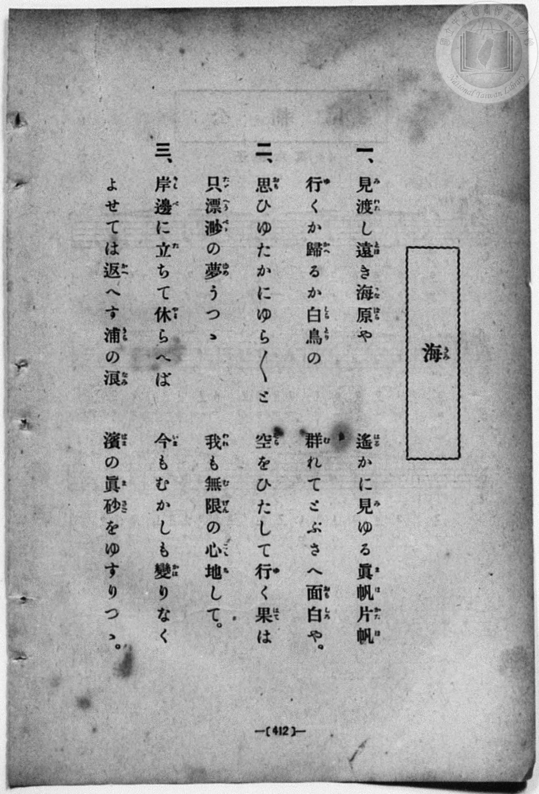
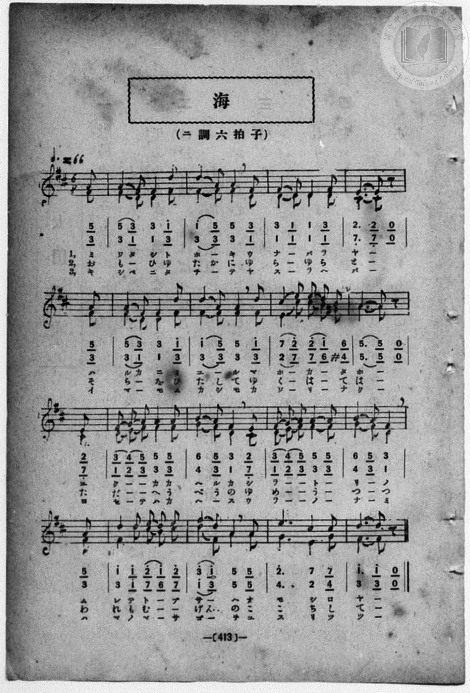

# 海（二部）

> Re:Shōka 使用 AI 協助辨識與重建樂譜，可能會有錯誤。歡迎回報。

<audio controls src="umi.mp3"></audio>

- book: 新編 小學校・公學校 唱歌教材集（高等科一・二學年用）
- 一條慎三郎 編《新編 小學校・公學校 唱歌教材集》（大正十二年十二月，索書號 0725-41）

## 說明

> [!NOTE]
> **原書資訊與歌詞全文**（對應 `P421.jpg`–`P422.jpg`，原書 p. 412–413，高等科一・二學年第 35 首）：
> - **調性與拍號**：ニ調六拍子・二部合唱（D 大調 6/8 拍），速度 ♩.= 66，弱起 1 拍（第 6 拍八分音符高聲部 `5`、低聲部 `3` 起唱）。
> - **歌曲辨析與和聲特色**：本曲與文部省《尋常小學唱歌》第一學年〈海〉（「松原遠く消ゆるところ」）及《新定兒童唱歌》第五學年〈海〉（「波の彼方ゆ夜は明けて」）皆為同名異曲。全曲以溫潤的 6/8 拍搖曳節奏描繪遼闊海景，第 7 小節低聲部引入臨時升記號 `#4`（G♯4），與高聲部 `6`（B4）共同導向第 8 小節屬音 `5`（A4）半終止；第 13–14 小節雙聲部更展開三度與反向進行的優美聲部交織。
> - **原書假名註記**：`P421.jpg` 第三節作「返（か）へす」（多出送假名「へ」），`P422.jpg` 譜下對應印作「カヘーヘス」。
>
> **一、**
> 見渡（みわた）し遠（とほ）き海原（うなばら）や　遙（はる）かに見（み）ゆる眞帆（まほ）片帆（かたほ）
> 行（ゆ）くか歸（かへ）るか白鳥（しらとり）の　群（む）れてとぶさへ面白（おもしろ）や。
>
> **二、**
> 思（おも）ひゆたかにゆら／＼と　空（そら）をひたして行（ゆ）く果（はて）は
> 只（ただ）漂渺（へうべう）の夢（ゆめ）うつつ　我（われ）も無限（むげん）の心地（ここち）して。
>
> **三、**
> 岸邊（きしべ）に立（た）ちて休（やす）らへば　今（いま）もむかしも變（かは）りなく
> よせては返（か）へす浦（うら）の浪（なみ）　濱（はま）の眞砂（まさご）をゆすりつつ。


## 歌詞

```text
（TMD 檔案未包含歌詞註解）
```

## ABC

```abc
X:1
T:海（二部）
M:6/8
L:1/16
Q:3/8=44
K:D
V:V1 name="Alto" snm="Alt"
V:V2 name="Soprano" snm="Sop"
[V:V1]
z2 z2 z2 z2 z2 F2 | F4 D2 D4 F2 | F4 F2 F4 D2 | D4 D2 D4 D2 |
w: 1.~ミ | ワ タ シ ト | ホ _ キ ウ | ナ _ バ ラ
w: 2.~お | も _ ひ ゆ | た か に ゆ | ら _ ゆ ら
w: 3.~キ | シ ベ ニ タ | チ _ テ ヤ | ス _ ラ ヘ
C6 C2 z2 F2 | F4 D2 D4 F2 | F4 F2 F4 F2 | E4 c2 c2 B2 ^G2 |
w: 1.~ヤ _ ハ | ル カ ニ ミ | ユ _ ル マ | ホ _ カ _ タ
w: 2.~と _ そ | ら _ を ひ | た し て ゆ | く _ は _ て
w: 3.~バ _ イ | マ _ モ ム | カ シ モ カ | ハ _ リ _ ナ
A6 A2 z2 C2 | D2 E2 F2 F4 F2 | G4 F2 D4 C2 | D2 E2 F2 F4 F2 |
w: 1.~ホ _ ユ | ク _ _ カ カ | ヘ ル カ シ | ラ _ _ ト _
w: 2.~は _ た | だ _ _ へ う | べ う の ゆ | め _ _ う _
w: 3.~ク _ ヨ | セ _ テ ハ カ | ヘ _ ス ウ | ラ _ _ ノ _
G4 F2 D4 F2 | F4 d2 c2 B2 c2 | d4 F2 A4 A2 | G6 E4 G2 |
w: 1.~リ _ ノ ム | レ テ ト _ ブ | サ _ ヘ オ | モ シ ロ
w: 2.~つ _ つ わ | れ も む _ げ | ん _ の こ | こ ち し
w: 3.~ナ _ ミ ハ | マ ノ マ _ サ | ゴ _ ヲ ユ | ス リ ツ
F6 F2 z2 z2 | z2 z2 z2 z2 z2 F2 | F4 D2 D4 F2 | F4 F2 F4 D2 |
w: 1.~ヤ _ | ミ | ワ タ シ ト | ホ _ キ ウ
w: 2.~て _ | お | も _ ひ ゆ | た か に ゆ
w: 3.~ツ _ | キ | シ ベ ニ タ | チ _ テ ヤ
D4 D2 D4 D2 | C6 C2 z2 F2 | F4 D2 D4 F2 | F4 F2 F4 F2 |
w: 1.~ナ _ バ ラ | ヤ _ ハ | ル カ ニ ミ | ユ _ ル マ
w: 2.~ら _ ゆ ら | と _ そ | ら _ を ひ | た し て ゆ
w: 3.~ス _ ラ ヘ | バ _ イ | マ _ モ ム | カ シ モ カ
E4 c2 c2 B2 ^G2 | A6 A2 z2 C2 | D2 E2 F2 F4 F2 | G4 F2 D4 C2 |
w: 1.~ホ _ カ _ タ | ホ _ ユ | ク _ _ カ カ | ヘ ル カ シ
w: 2.~く _ は _ て | は _ た | だ _ _ へ う | べ う の ゆ
w: 3.~ハ _ リ _ ナ | ク _ ヨ | セ _ テ ハ カ | ヘ _ ス ウ
D2 E2 F2 F4 F2 | G4 F2 D4 F2 | F4 d2 c2 B2 c2 | d4 F2 A4 A2 |
w: 1.~ラ _ _ ト _ | リ _ ノ ム | レ テ ト _ ブ | サ _ ヘ オ
w: 2.~め _ _ う _ | つ _ つ わ | れ も む _ げ | ん _ の こ
w: 3.~ラ _ _ ノ _ | ナ _ ミ ハ | マ ノ マ _ サ | ゴ _ ヲ ユ
G6 E4 G2 | F6 F2 z2 z2 |
w: 1.~モ シ ロ | ヤ _
w: 2.~こ ち し | て _
w: 3.~ス リ ツ | ツ _
[V:V2]
z2 z2 z2 z2 z2 A2 | A4 F2 F4 d2 | d4 A2 A4 F2 | F4 D2 D4 F2 |
w: 1.~ミ | ワ タ シ ト | ホ _ キ ウ | ナ _ バ ラ
w: 2.~お | も _ ひ ゆ | た か に ゆ | ら _ ゆ ら
w: 3.~キ | シ ベ ニ タ | チ _ テ ヤ | ス _ ラ ヘ
E6 E2 z2 A2 | A4 F2 F4 d2 | d4 A2 A4 d2 | c4 e2 e2 d2 B2 |
w: 1.~ヤ _ ハ | ル カ ニ ミ | ユ _ ル マ | ホ _ カ _ タ
w: 2.~と _ そ | ら _ を ひ | た し て ゆ | く _ は _ て
w: 3.~バ _ イ | マ _ モ ム | カ シ モ カ | ハ _ リ _ ナ
A6 A2 z2 E2 | F2 G2 A2 A4 A2 | B4 A2 F4 E2 | F2 G2 A2 A4 A2 |
w: 1.~ホ _ ユ | ク _ _ カ カ | ヘ ル カ シ | ラ _ _ ト _
w: 2.~は _ た | だ _ _ へ う | べ う の ゆ | め _ _ う _
w: 3.~ク _ ヨ | セ _ テ ハ カ | ヘ _ ス ウ | ラ _ _ ノ _
B4 A2 F4 A2 | d4 d2 e2 d2 e2 | f4 d2 A4 A2 | e6 c4 c2 |
w: 1.~リ _ ノ ム | レ テ ト _ ブ | サ _ ヘ オ | モ シ ロ
w: 2.~つ _ つ わ | れ も む _ げ | ん _ の こ | こ ち し
w: 3.~ナ _ ミ ハ | マ ノ マ _ サ | ゴ _ ヲ ユ | ス リ ツ
d6 d2 z2 z2 | z2 z2 z2 z2 z2 A2 | A4 F2 F4 d2 | d4 A2 A4 F2 |
w: 1.~ヤ _ | ミ | ワ タ シ ト | ホ _ キ ウ
w: 2.~て _ | お | も _ ひ ゆ | た か に ゆ
w: 3.~ツ _ | キ | シ ベ ニ タ | チ _ テ ヤ
F4 D2 D4 F2 | E6 E2 z2 A2 | A4 F2 F4 d2 | d4 A2 A4 d2 |
w: 1.~ナ _ バ ラ | ヤ _ ハ | ル カ ニ ミ | ユ _ ル マ
w: 2.~ら _ ゆ ら | と _ そ | ら _ を ひ | た し て ゆ
w: 3.~ス _ ラ ヘ | バ _ イ | マ _ モ ム | カ シ モ カ
c4 e2 e2 d2 B2 | A6 A2 z2 E2 | F2 G2 A2 A4 A2 | B4 A2 F4 E2 |
w: 1.~ホ _ カ _ タ | ホ _ ユ | ク _ _ カ カ | ヘ ル カ シ
w: 2.~く _ は _ て | は _ た | だ _ _ へ う | べ う の ゆ
w: 3.~ハ _ リ _ ナ | ク _ ヨ | セ _ テ ハ カ | ヘ _ ス ウ
F2 G2 A2 A4 A2 | B4 A2 F4 A2 | d4 d2 e2 d2 e2 | f4 d2 A4 A2 |
w: 1.~ラ _ _ ト _ | リ _ ノ ム | レ テ ト _ ブ | サ _ ヘ オ
w: 2.~め _ _ う _ | つ _ つ わ | れ も む _ げ | ん _ の こ
w: 3.~ラ _ _ ノ _ | ナ _ ミ ハ | マ ノ マ _ サ | ゴ _ ヲ ユ
e6 c4 c2 | d6 d2 z2 z2 |
w: 1.~モ シ ロ | ヤ _
w: 2.~こ ち し | て _
w: 3.~ス リ ツ | ツ _
```

## TMD 檔案連結

- [主旋律 TMD 檔案](umi.tmd) [[在 TMD Studio 編輯](https://tmdlang.github.io/Tmd-TS/#tmd=s7IKdvYPcrWy4qpTUCpJTLdSSM7PyUlNLsnMz7MqzsjPTozPrsyvSsyML84ojTe0NDJWgqssy88pzU21ys4vyY83jDdCSBTnlxYlp1oVJ2fk5-fEl6RWlCTl52ejy8cXJKanWgWYGBkiZAqK8stS8xLzgLoLijLzSlJTwNoRClLLMlNSQdLFyYl58WWpRZlpmakpSG5KLSoGOx1iRUlRYl5xclFmAcg_CFX5RSUZ-elFiQUZlVYZmcUl-UWZyYk58dmJeYkIRSUZqUDflSeWpBahC-YllpQWpSpxaWkpPNu6_f2ejie7el42r3i_p1NBS4tL0VbBzIzL3lbBhcvGTN_CDqQZFABWCs-mbXi-fYXC0w39T9fueLZg4ePm3U9b10DYCk-nbHy2tufZ1JnP5k54ObsNaOrL1TOer-18vnzikx0NQKVAS4BKn-7c8nwKyCqwo4AyzxbNfdba92RH58vmPgWg8Y8bukix53FDN9Cqp0uWP1u7-GlvI8iSnVsgjGdzOt7v6Xm-ZdGz2TtezJyvYGBuZKprYgi2m0tfS8GWWoBLQUHBTiFa0c8_xDUWwtHSeto3H2Tv5vYXK7pedLQD3fxi5bynrSueTWvX0gI5eUPvs_ZOhQRQCtLLKkhPeNQwGcQxAnOADocYoFCgp2BiaASUNDE0BoriDNQ1axSMTRVeLpsG9N_7PbMgztAFOuTFqv3PGpaDnNDdCwwGkOWzHjd3A4Wftq4Fij1dOwFiEDAJPJ3QAQxfoOtcFIBBClSiAEwBCkBFYEN7XjbMf7prmcKjmSv1QIkE5Mg9G19s3a5gCFHTAXKFGYj9tHX10462l_M3P1-zDOjkF42bgKYrJJgmPG5ofLK3D8Y3TlAAagdb2fm4oQnhaFAUz970Yt-KZ_MmAJ3-dFIPUMvzzp0vOjeBPfBszhqQPNBT09qBJj2f0whMN083dD_dsQOSbCDJBJg6gE4CBhUkkB43dAAT_OMGoF86Hjf0PJu7DxjILxsXPG7sf7at43FT2-Om7seNKx43Tn7c1Pu4AeTrp_1dkBT5dN2sp62Tnq9eimLyrinYTd686HHjuqd79zybthNo7NMlcx43rn82o-9x48THjcsgJj-f1fa8adfTCT1PJ_Q-n7oB6B1gCIASyOxNT3YvfbZr9bO9S57PaoHFwLMJ057N3vx8fcPTpf3P-vuf71z1snHPy-ldQGufzVwPSujAsDcHZRqgGngQP90z9Wnr0hftK57NbHraC0yLM0A5IUHZBJjCOtwfzVxvAolZYEgiRZMZSNYJJPW0dSPIhRv6nk6YCLLAAmrB041rgJELilCgSkewyt6u51ubnq1d9H7PbJBKQ2NgmjU0gap_OXsmxPBns7c83Tj15bRuYI4HpiVQ3Pb3Ag1_2bDpxcIeoH-ftqx6vg_q-ie7ljzfOQUlYUByxdPGdmCovVixG-ghcHpAZCMFcIR3ggNhDjAqXuyfAoqTRmAx0fm4ccfjxpng4AcWGbOetu962dAIMQuoEiQLjhlgeCByosKLtXOe7OiGZNenvRsgpj5uWv24ecbj5j0gsmknUB_MlbD8D8qfDY3A8hTMf7Gs-9mOhWCH7H_c1P-4cT7YOdOBiQ8sCExzu8EivcD4BPoRLNj2uHHV48YNj5uALup83NTyuKHhZeNMsNR6YEoFqwem19VAwyEmg5WBEvHzOfOe7gCVwY8b90FMft7ZDhMBapkPEYS6bWEPSLwJKAs0EOi27mdrd8BUAhlAM4GM7ucz977cvBQsPh3oJJCbm7rAWtYBHfZ83xKwIQ1g9cCwXAb21LbHjVOBhrycuwioHay363FTE9gEUEiDPYUWbruAeQsebs8a5sJ1ge3aBPIgyP0gj4M9Cwyc_vd79oCsAzpj5S6w-rmwQJsE0gJSPx3oJDSfPps3BxqYjcvAIushlj7tXwUWB-oCxk7nsz1Nz3ZAjAUmH6DtO4EkxONPlwCTO6TgaASLAGWXgFBDw7OOiWCpfmBogF3S9Lxl4cuZEyCh9Lhx0uOmyVBD9jc_nbMBbP5kMAKmE1DaAJcU6IkKWEzCA-fpph0vQVEA1NgLVr8TrHH189WQ9ABJYwuB5jzZA3FMCzD5gx0DyQobgO58shtiAlBqH8SdYOcBgxcYR00v1kFkgVxgGQOU7QKnyX6IAx43AaVmg-N6PWY-e7YVGKrgZAyJi8Z1z7ZCAhZoAjitAkNpP6i2AUcB2PbGdcCk-3wBMK4hSReYeIDGguMRFO8zwQ6AhDA4ZCivvKFAQUufiys0N9MqOL8A2OrKd6gxqFGoBlmhYGOhBY4ABWxtBgVIDQgp5RQ04BUgpFrTUYCVI5pYtAKtBBlbo2AAh6YKNWAxH8MahXg4fNw8HyZuhCLe2AUTN0YRb1oLFMftZkidCMwNChqwAppIl5oCC2FjINRVMIwDcoGELlAMIloDEQdCCM8ISOsCSVRfPW5eDxR93LQfiLeDWM0dQLWPm2eDVYNcDiKXgcW6IGLNE8DkSrDYErCYLjhU-pFCBZhYIaobN4FNaAOpbpwPFukG4tUI0aZOqF1tYLITrHIFwtzGuUihCnPlTCDuhroc5I5GqNvAZgBdBVK5Eyq2EkzOAKsDuR1qbhNQFYFY2dVD3VgB881B0RAHQkCuGVQ9SIUBMHaQYwYSRqthPgWlOiC5DOorsGzzPJTYguiAhAhEDBIzwPhDihlYeE-Cxg8iZqYDMch8WHz1Q-MQnEaAMiAxEBsWM_B8AIoZoFsgLlsEJheA4wDiou0wUSAfpBJqbvMqMAnMNUAZJHOBjR6C-aWTnJgxVjCBxgQwDwDDHkSD4gkY7jjlUHIL1JUwf0F8MwMaHwjfgkRBqQ6Sn0A0SATkW5BIHyx8EHHSuAAa0jvAJCT0QekXxAYWw4g4aYKmdKA41NxGSB6E0MAaDiW37AbbBTQDHObILgbxwDZAczfMvSDXQdwLy-_gtAHO3Xjj5Ons2eTECTh7AAlIfgCSwKiACsEiAygIcgko45jDdIAVgMpo5ByzBu5bUKg_bp4GDrGtUH-A46lpFdhvoNQIiSuQDLB8RinL4lHySw9YZRMQN4DDeRLY1MnQUAfHTeNkcEzAxBaCyelgMUh-RTEVnltAoQ1lAV0JMnUL1K3gUhOUb5HKMUhuaQG7tQXF1FpIZemYUzJQNSWwhhnUNSVqXQjiQUtoUHqCy4F45vGQxBaP5qvRmpL6NSWuWIG1V8yB0EzBRB2lkgTGzGgtScta0hAY9oh4MAHToDgCBTxOSZSsMlpNUr2ahDYnQfkBXgcaw2tIUDyAmjG6QBZELUh2tHqEV4-6dgrAGlIBQSlzAQA)]
- [鋼琴伴奏 TMD 檔案](umi_piano.tmd) [[在 TMD Studio 編輯](https://tmdlang.github.io/Tmd-TS/#tmd=s7IKdvYPcrWy4qpTUCpJTLdSSM7PyUlNLsnMz7MqzsjPTozPrsyvSsyML84ojTe0NDJWgqssy88pzU21ys4vyY83jDdCSBTnlxYlp1oVJ2fk5-fEl6RWlCTl52ejy8cXJKanWgWYGBkiZAqK8stS8xLzgLoLijLzSlJTwNoRClLLMlNSQdLFyYl58WWpRZlpmakpSG5KLSoGOx1iRUlRYl5xclFmAcg_CFX5RSUZ-elFiQUZlVYZmcUl-UWZyYk58dmJeYkIRYlFQM3pqbmpeSVWBZmJefnxicnJ-bkFiXmZIDGEwpIMoCKr8sSS1CJ0wbzEktKiVCUuLS2FZ1u3v9_T8WRXz8vmFe_3dALZL2fPfNbZ_bJ7z_MJW57s2fJ0aT9QXEFLi0vRVsHMjMveVsGFy8ZM38IOZCgoBK0Unk3b8Hz7CoWnG_qfrt3xbMHCx827n7augbAVnk7Z-Gxtz7OpM5_NnfBydhvIhtUznq_tfL584pMdDUClQMuBSp_u3PJ8CsgJYMcCZZ4tmvuste_Jjs6XzX0KQOMfN3SRYs_jhm6gVU-XLH-2dvHT3kaQJTu3QBjP5nS839PzfMuiZ7N3vJg5X8HA3MhU18QQbDdXaG6mVXB-ATCQ8x1qDGoUqrkUgMDGQssOzKhRMIBDU4UasJiPYY1CPBw-bp4PEzdCEW_sgokbo4g3rQWKQw03VdBVMAZCXQXDOCAXSOgCxSCiNRBxIITwjIC0LpBEdcjj5vVA0cdN-4F4O4jV3AFU-7h5Nlg1yDIQuQws1gURa54AJleCxZaAxXTBHulH8sjjpiaI6sZNYBPaQKob54NFuoF4NUK0qRNqVxuY7ASrXIEwt3EuUkDAXDkTiLuhLge5oxHqNrAZQFeBVO6Eiq0EkzPA6kBuh5rbBFRFOCDBfHNQyMWBEJBrBlUPUmEADFDkwIR4azXMcaC4BZLLoA4ByzbPQwlgiA6IJyBikMAEBjlSYMKCaBI0SBGBOR2IQebDgrgfGuzgaAXKgMRAbFhgwlMbKDCBboG4bBGYXAAONoiLtsNEgXyQSqi5zavAJDBtAmWQzG1egQhMYwUTaOABUxowuEA0KGiBQYVTDiVNQg2GOQXigBnQIEQ4ECQKiltIqgXRIBGQA0EifTAvIYKxcQE0cHaASUiAgVIJiP24cR0iGJug6QkoDjW3EZLSIfTjJnhaB6fJ3WC7gGaAgwnZxSAe2AZoHoK5F-Q6iHthuQocneA8BA1GcCIEEpBUBySBoQcVgoUfUBCkGZQ8zWE6wApA5Q1yulwDdyAooB43TwN7civUanDQNq0COwcU55DgBckAyxqUTB6Pkip7wCqbgLgBHDSTwKZOhgYUODgbJ4MDDya2EExOB4tBcgWKqfA0CQogKAvoSpCpW6BuBRcnoNyBlMEhabIF7NYWFFNrISW0Y04JweIZWEZSu3hGLYBBPGgZA4oruByIZx4Pich4NIeMFs94AxJWr5kDoZmCiTpKyQwMzNGiGa1oNgQGFyLoTMA0KFhBYYVTEiVBjpbN8AQZB0518ILXGF4sg4IOVN3pAlkQtSDZ0TIZpUwOAPVGgjwIFsvasKYBMCSBbGC4awOTJRADw1Qb3DoDUyAesCkBVwGMFLAaaBkLFjGP14a0gsEM8syGihtpgytdbWANDCbMQMIm6tqojUOwPTAbQOYaaZugmAVOLUBNEDbEZogmopWjegLWaEA4CswCJVFtcOsBrASeUEFy4LQK9o4JkIQbAlUKSbXIceZDMM5g6Rxoa7yCaTwoDqA0cSKm8fEKRmAeiEWqeRCdRiDaDESDzANSwFYnIbNMQJQJVABkNUFFQAE006B2EfYWhIWiDh7WunYKwOCO9jGMVYAxjRBMYzBTmQsA)]

## 分析

```text
================================================================================
📊 TMD Song Profile: [ 海（二部） ]
================================================================================
⏱  Duration:       1:32 (92.7s), 34 measures total
🎼 Key & Tempo:    首調基準 D, != 66.0 BPM, <6/8>
   - 分析範圍：      由實際發聲的音符與和弦推測調性；播放脈絡另行呈現
🎤 人聲音域:    C#4 (MIDI 61) – D5 (MIDI 74) [跨度: 13 個半音 / 1.1 個八度, 難度: moderate]
   - 最低音:  C#4 in [Umi #1 @ m.5, 0:10]
   - 最高音: D5 in [Umi #1 @ m.14, 0:36]
   - 適合: soprano, mezzo-soprano, contralto, tenor, baritone, bass
🏛  結構:      Umi (46.4s) -> Umi (46.4s)
⚡ 編曲密度:        Peak 2 軌道同時演奏
🗝  調性診斷：       F# 調性不明確（流行色彩大調，未偵測到可信轉調）
   - 風格氣質:    流行大調（略帶和弦色彩音與裝飾副屬和弦）
   - 轉調歷程:    全曲維持單一推測調性（未偵測到可信轉調）
   - 核心骨幹音:  F#, D, A, E, C#
   - 調性數值:    F# 調性不明確 [相關度: 0.85, 穩定度: Ambiguous, 自然音純度: 94.6%]
   - 候選調性 (K-S): F# 小調 (0.85), D 大調 (0.83), A 大調 (0.63)
   - 五度圈歷程:   +6 -> +6
   - 各段落調性細節:
     • [Umi #1]: F# 調性不明確 (r: 0.85, 自然音純度: 94.6%, 調外音: G)
     • [Umi #2]: F# 調性不明確 (r: 0.85, 自然音純度: 94.6%, 調外音: G)

  [ 五度圈游移軌跡 ]
               C  
         F            G  
      Bb               D  
      Eb               A  
         Ab           E  
            Db       B  
              [F#]*
     (* = active key center)

  [ 十二半音累積音高分佈 ]
     C  :                            0.0%
     C# : ███████                    8.1%
     D  : ██████████████████        22.6%
     D# :                            0.0%
     E  : ████████                  10.2%
     F  :                            0.0%
     F# : ████████████████████████  29.6%
     G  : ████                       5.4%
     G# :                            0.5%
     A  : ████████████████          19.9%
     A# :                            0.0%
     B  : ███                        3.8%
--------------------------------------------------------------------------------
Assignment 軌道音域：
  - Alto          : C#4 – D5 (13 個半音 / 1.1 個八度, 128 個音符)
  - Soprano       : D4 – F#5 (16 個半音 / 1.3 個八度, 128 個音符)
================================================================================
```


## 原書掃描頁






