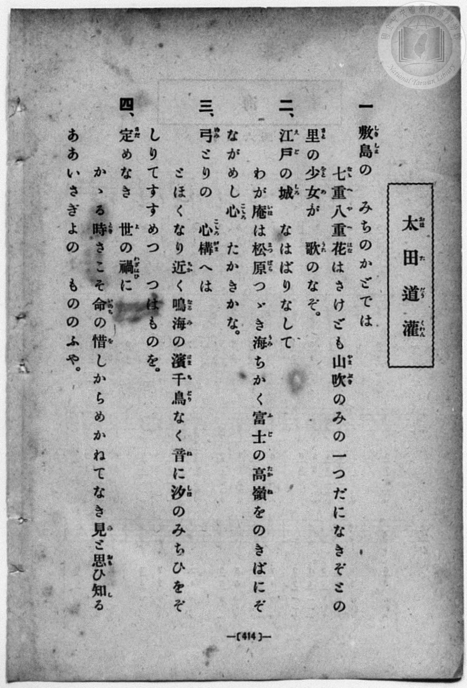
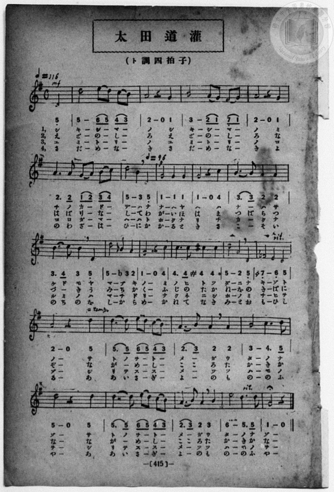

# 太田道灌

> Re:Shōka 使用 AI 協助辨識與重建樂譜，可能會有錯誤。歡迎回報。

- **鋼琴伴奏版**：<br><audio controls src="ota_dokan.mp3"></audio>
- **NEUTRINO 歌聲合成版**：<br><audio controls src="ota_dokan_neutrino.mp3"></audio>

- book: 新編 小學校・公學校 唱歌教材集（高等科一・二學年用）
- 一條慎三郎 編《新編 小學校・公學校 唱歌教材集》（大正十二年十二月，索書號 0725-41）
- lyricist: 旗野十一郎
- composer: 小山作之助

## 說明

> [!NOTE]
> **原書資訊與歌詞全文**（對應 `P423.jpg`–`P424.jpg`，原書 pp. 414–415，高等科一・二學年第 36 首）：
> - **曲名**：太田道灌（おほただうくわん）
> - **調性與拍號**：ト調四拍子（G 大調 4/4 拍，弱起第 4 拍進入），速度 ♩= 116（第 6 小節第 4 拍轉 ♩= 96，第 15 小節 `rit.`，第 16 小節第 4 拍 `a tempo` 回 ♩= 116，第 23 小節後半 `rit.`，末小節附延長記號）
> - **作詞・作曲**：旗野十一郎 作詞、小山作之助 作曲（原載明治三十三年《幼年唱歌》初編下卷）。
> - **版本對照與校勘**：
>   1. 先前檔案誤植臺灣教育會《新定兒童唱歌》高等科女子用（`P082`–`P083`）之同名異曲旋律；本書（`P424.jpg`）採用小山作之助原曲，首句與末句皆有疊句反覆（全曲弱起 + 24 小節）。
>   2. 第 11 小節第 3 拍記降記號 `b3`（`3,`，B♭4，同主音小調借用音）；第 13 小節第 3–4 拍記升記號 `#4 4`（`4'`，C♯5）；第 15 小節第 1–2 拍五線譜第一間與簡譜均印有還原記號 `♮7_`（`7,_`，F♮4）。
>   3. 第 9 小節 `| 3. 3 2 2 |` 於第一、三、四節上方有圓滑線（唱「ナーハサ」「カークナ」「コーソイ」），第二節則分唱二字（「つばらつ」）；第 17、21 小節 `| 5. 5 (6 5) (4 3) |` 首拍 `5. 5` 於第二節連唱「がー」，第一、三、四節則分唱「トノ」「リテ」「あい」。
>
> **一、**
> 敷島（しきしま）の　みちのかどでは
> 七重八重（ななへやへ）花（はな）はさけども山吹（やまぶき）の
> みの一つだになきぞとの
> 里（さと）の少女（をとめ）が　歌（うた）のなぞ。
>
> **二、**
> 江戸（えど）の城（しろ）　なはばりなして
> わが庵（いほ）は松原（まつばら）つゞき海（うみ）ちかく
> 富士（ふじ）の高嶺（たかね）をのきばにぞ
> ながめし心（こころ）　たかきかな。
>
> **三、**
> 弓（ゆみ）とりの　心構（こころがま）へは
> とほくなり近く（ちかく）鳴海（なるみ）の濱千鳥（はまちどり）
> なく音（ね）に汐（しほ）のみちひをぞ
> しりてすゝめつ　つはものを。
>
> **四、**
> 定（さだ）めなき　世（よ）の禍（わざはひ）に
> かゝる時（とき）さこそ命（いのち）の惜（を）しからめ
> かねてなき身（み）と思（おも）ひ知（し）る
> ああいさぎよの　もののふや。


## 歌詞

```text
（TMD 檔案未包含歌詞註解）
```

## ABC

```abc
X:1
T:太田道灌
M:4/4
L:1/16
Q:1/4=116
K:G
V:V1 name="Piano" snm="Pia"
[V:V1]
!mf! z4 z4 z4 D4 | d8 e2 d2 c2 B2 | A8 z4 G4 | B8 A2 G2 F2 G2 |
w: 1.~シ | キ シ _ マ _ | ノ シ | キ シ _ マ _
w: 2.~え | ど の _ し _ | ろ え | ど の _ し _
w: 3.~ユ | ミ ト _ リ _ | ノ ユ | ミ ト _ リ _
w: 4.~さ | だ め _ な _ | き さ | だ め _ な _
A8 z4 G4 | A6 A2 G2 A2 B2 c2 | [Q:1/4=96] d8 B4 D4 | G8 G4 G4 |
w: 1.~ノ ミ | チ ノ カ _ ド _ | デ ハ ナ | ナ ヘ ヤ
w: 2.~ろ な | は ば り _ な _ | し て わ | が い ほ
w: 3.~ノ コ | コ ロ ガ _ マ _ | ヘ ハ ト | ホ ク ナ
w: 4.~き よ | の わ ざ _ は _ | ひ に か | か る と
G8 z4 c4 | B6 B2 A4 A4 | B6 c2 B4 D4 | d8 _B4 A4 |
w: 1.~ヘ ハ | ナ _ ハ サ | ケ ド モ ヤ | マ ブ キ
w: 2.~は ま | つ ば ら つ | づ き う み | ち か く
w: 3.~リ チ | カ _ ク ナ | ル ミ ノ ハ | マ チ ド
w: 4.~き さ | こ _ そ い | の ち の を | し か ら
G8 z4 c4 | c6 c2 ^c4 c4 | d8 A4 D4 | =F8 E4 D4 |
w: 1.~ノ ミ | ノ ヒ ト ツ | ダ ニ ナ | キ ゾ ト
w: 2.~ふ じ | の た か ね | を の き | ば に ぞ
w: 3.~リ ナ | ク ネ ニ シ | ホ ノ ミ | チ ヒ ヲ
w: 4.~め か | ね て な き | み と お | も ひ し
[Q:1/4=116] A8 z4 d4 | d6 d2 e2 d2 c2 B2 | A6 B2 A4 A4 | B8 c6 d2 |
w: 1.~ノ サ | ト ノ ヲ _ ト _ | メ _ ガ ウ | タ ノ _
w: 2.~ぞ な | が _ め _ し _ | こ _ ろ た | か き _
w: 3.~ゾ シ | リ テ ス _ ス _ | メ _ ツ ツ | ハ モ _
w: 4.~る あ | あ い さ _ ぎ _ | よ _ の も | の の _
d8 z4 d4 | d6 d2 e2 d2 c2 B2 | A6 B2 A4 B4 | e8 d6 d2 |
w: 1.~ゾ サ | ト ノ ヲ _ ト _ | メ _ ガ ウ | タ ノ _
w: 2.~な な | が _ め _ し _ | こ _ ろ た | か き _
w: 3.~ヲ シ | リ テ ス _ ス _ | メ _ ツ ツ | ハ モ _
w: 4.~や あ | あ い さ _ ぎ _ | よ _ の も | の の _
!mf! G8 z4 D4 | d8 e2 d2 c2 B2 | A8 z4 G4 | B8 A2 G2 F2 G2 |
w: 1.~ゾ シ | キ シ _ マ _ | ノ シ | キ シ _ マ _
w: 2.~な え | ど の _ し _ | ろ え | ど の _ し _
w: 3.~ヲ ユ | ミ ト _ リ _ | ノ ユ | ミ ト _ リ _
w: 4.~や さ | だ め _ な _ | き さ | だ め _ な _
A8 z4 G4 | A6 A2 G2 A2 B2 c2 | [Q:1/4=96] d8 B4 D4 | G8 G4 G4 |
w: 1.~ノ ミ | チ ノ カ _ ド _ | デ ハ ナ | ナ ヘ ヤ
w: 2.~ろ な | は ば り _ な _ | し て わ | が い ほ
w: 3.~ノ コ | コ ロ ガ _ マ _ | ヘ ハ ト | ホ ク ナ
w: 4.~き よ | の わ ざ _ は _ | ひ に か | か る と
G8 z4 c4 | B6 B2 A4 A4 | B6 c2 B4 D4 | d8 _B4 A4 |
w: 1.~ヘ ハ | ナ _ ハ サ | ケ ド モ ヤ | マ ブ キ
w: 2.~は ま | つ ば ら つ | づ き う み | ち か く
w: 3.~リ チ | カ _ ク ナ | ル ミ ノ ハ | マ チ ド
w: 4.~き さ | こ _ そ い | の ち の を | し か ら
G8 z4 c4 | c6 c2 ^c4 c4 | d8 A4 D4 | =F8 E4 D4 |
w: 1.~ノ ミ | ノ ヒ ト ツ | ダ ニ ナ | キ ゾ ト
w: 2.~ふ じ | の た か ね | を の き | ば に ぞ
w: 3.~リ ナ | ク ネ ニ シ | ホ ノ ミ | チ ヒ ヲ
w: 4.~め か | ね て な き | み と お | も ひ し
[Q:1/4=116] A8 z4 d4 | d6 d2 e2 d2 c2 B2 | A6 B2 A4 A4 | B8 c6 d2 |
w: 1.~ノ サ | ト ノ ヲ _ ト _ | メ _ ガ ウ | タ ノ _
w: 2.~ぞ な | が _ め _ し _ | こ _ ろ た | か き _
w: 3.~ゾ シ | リ テ ス _ ス _ | メ _ ツ ツ | ハ モ _
w: 4.~る あ | あ い さ _ ぎ _ | よ _ の も | の の _
d8 z4 d4 | d6 d2 e2 d2 c2 B2 | A6 B2 A4 B4 | e8 d6 d2 |
w: 1.~ゾ サ | ト ノ ヲ _ ト _ | メ _ ガ ウ | タ ノ _
w: 2.~な な | が _ め _ し _ | こ _ ろ た | か き _
w: 3.~ヲ シ | リ テ ス _ ス _ | メ _ ツ ツ | ハ モ _
w: 4.~や あ | あ い さ _ ぎ _ | よ _ の も | の の _
G8 z4 z4 |
w: 1.~ゾ
w: 2.~な
w: 3.~ヲ
w: 4.~や
```

## TMD 檔案連結

- [主旋律 TMD 檔案](ota_dokan.tmd) [[在 TMD Studio 編輯](https://tmdlang.github.io/Tmd-TS/#tmd=s7IKdvYPcrWy4qpTUCpJTLdSSM7PyUlNLsnMz7MqzsjPTozPrsyvSsyML84ojTe0NDJWgqssy88pzU21ys4vyY83jDdCSBTnlxYlp1oVJ2fk5-fEl6RWlCTl52ejy8cXJKanWgWYIBtZUJRflpqXmAfUXVCUmVeSmgLWjlCQWpaZkgqSLk5OzIsvSy3KTMtMTUFyU2pRMdjpECtKihLzipOLMgtA_kGoyi8qychPL0osyKi0ysgsLskvykxOzInPTsxLRCgqyUgF-g4iXYmsNzM9M88qNzUzKxPJb1paCk-XrHo-ZcPLxsnPG3sUtLS4FG0VDA3NuOxtFdy5bEz0TexAZoBUWyk8m7bh-fYVCk839D9du-PZgoWPm3c_bV0DYSs8nbLx2dqeZ1NnPps74eXstvd7Ol6unvF8befz5ROf7GgAKn2yqweo9OnOLc-nrHi_pxPsNqDMs0Vzn7X2PdnR-bK5TwFo_OOGLlLsedzQDbTq6ZLlz9YuftrbCLJk5xYI49mcjvd7ep5vWfRs9o4XM-crGJgbmeqaGMLszqkEhh8wnID-mj79ZXsfSNOOBqArwLLJ-bkF-cWpRVZgZ2zc-GTvnCc7u592rVTi4tLXUrClFuBSUFCwU4hW9PMPcY2FcLS0nvbNB7l5c_uLFV0vOtqB_n2xct7T1hXPprVraYG8u6H3WXunQgIoGeplFaQnPGqYDOKYgDlAT0MMUCgo0FMwMTQBypoYmgKFccbImjUKxmYKL5dNAwbO-z2zIO7QBbrk2exNTyf0giydhZxQgG543Nj1uHH348b5jxsXPG5se9zY_7gJiCYDTUBof7Fq_7OG5SAvdPcCowBszuPmDqDw09mzgWJP104AGuUOTITLgWIKwOSmABQFeWDPxhdbt4PcBRZ52bDpaetSsON6XjbMf7prmcKjmSvBKRWoH6TMDBRPz9c3wLW82NsJUWMJVNIDEjY0hapRSCjKLNEDhRNYGEOrQkKiQkkqMP4TFJ7OnodkE1i9kTFU_dN9PU97uxCGPZuzGiLxcmbL093bXk7d_mLFDKCvUUIEmI6AcQkK_L1zgIELDhG09KcAVdPQiJb0QBJAPaAE0Df_xZ7OZzP6nm3aDcw6YK2dwIgEZp6nO_eAcgA4lwAzx9OOucC89GRH99Pe7UCHPG5oQrjleWfHszlrgInpeSs4jhYsfNo9A-wiiBoFBUM9haetHU87e5-tmvJsITDeljxb0vuifdfzxsXAHPiiadOzOc2QDPt03aynrZOer14Ktxme2J4u3QyMZ3Cu70gIMLAwgiRXAwtjYKh1grw2oQeYyJ5P3QD03LPp3U_3AbP0bKDLgEkYrAWRsDuf9S0EGoQWLuDUDgyWHmACftq_FOQVYFT0L30-q-3ZnM7n07qA7Kf9vS-WgUolUDYCJmpw-lLQVjAygcYmcuAoKBjpKYDThiFS2jAGJ6sVM17OBJGgEiUhCeSFjgRjHVD8Oz2audYElHYn9DzZsfvl_M1AraCU3jAf6GQgF5x8Z4ONhSUhsLGg7Ak1-mkvMMtDjFY2UTABG26iDjLc-dHM9cAsDDcBlpbBHKAJRiATnuya8nz7rBdr5wBFQWlp2mRgWDzfsBAo8nRu-9PeDcDgeNnUAko9UFsezVxnHg-2xlwHRPe4AUWAnkAOC2NIWFjCc08NSMhYwQgIaxKAtcIeiHXABAtMhaBkO3s2UN2THcB0sRNo49M5k5_tngh0GCj0p2x83NDzuLnrcfOex83A8mLr44ZekEjTapBI03qQFFRkM1hk7-OmJUARSN4HWbSrB5T3OtufdrQBTQOXYdNB5RFQS-OSx40bHjd1ghhQLZDQMge6yggWlyAPmOopmCpomCmYaipomCgYa4I8Akw94MwPkoN7C2zby4bFUIc3At2-B2w22C0Ynoa7C-zLjsfNfVDfNK963AysrMDsxqbHjS1gNiSMYcU-xDhgHQzmP5u6_enmbeCSdvrjxl4wuQ8UM43rHjc0PG7c_7hxIYjd2P24ceXjxuWPG9dDND7Z0fyyvfdp62ogCda-Cox2PG5qAZJAE150bQSLrweKgw0EMqY-bpwIMqepCZiznk7YCVIAUr_vceM2oO0QeyHmg61eB3IsKLyBhf9qsPlAF8573LgCruxlO6SaAJoMqu-B4k83gMoCsMmTQCqbGsHiwMKiAVhkgBUD6xFQeQn2F9BMYCGIFkS7gKoRQbRx_rMOUBnxuBGIVkJtmd8HDbQmsLNBYQU0CuhHYNIA1llANjAkl0H9AqyzGnue7toK1gL0725IgDybuw-YS8CCwBCAJiuw1JLHTUBv9j7bCixOIQ7eDxYHxgUwIvohxj5d3_N08Wqwgq2PG2dAHAYsEJ9u2wUWBFaaQMVrQeKgoAB6Fhh6G8AhOQ8WyEB3AjNBI9C1T_c3g3VNBiGEpyCGADUCyVWYaQmUKGEB9XQPsF4GBjvctcDABwYFKCEBDX-2HNSGgpsPshea0nbAExU4ZoHVPTC4VgH1vtgPTC39YF1QjwPVv9y8BRYsQDVAQYhd657t3_i0t_nlZmAFDkl1wCAF6gImti543Qj2bz-4lASqAYdM4-pnG0HNA3B8QeIFGFCQZL8JHG7wsALGNdA7yx43znzcNBccaMACAJI-1wOTNEgjUD1aEAFzLHIQrQOVT-DkugAcL0BDwKm6AViSAdtFwNADNidBbni-DJytQClnGtg7wKoH5FqYY7rBbuh-NrMJbCAw3CDZB2gyMITnPp24F5bYgN5ZCA2i5jmQfAHmAv0LNATkBoSZjWvBHgQ56cUuSNKCRuWzhrnQ9lgT0EagyKbn8yFBDSwXgYZ0wwwBhgO45AG5pA_oHWhJAgkfENoKyvKQUKK8ZQsFClr6XFz-JYkuwF5ZnlVAZmJevkONrmGNQjXIGgUbCy1whChga1QD0y2omgZVYuDC9sXCHlBxDSnGdRRgDQNNLDqBtoJMrVEwADZ1YLg6N61WwTQeyKoBy_oAnYEs_7hpO0LOCE2usQMhZ4wm17wMIWeCrm8qWA7qHFMgBwSBVQ-wsWkMFDGCioAUG4KUAkUhIkZAvnk8kMCiCO7-x01roXIQ1z9ungc2BFj1IOmB-oxY1c3zUcIBmFdhuhrXgcnpUNN6kXVBQoho1atQwhNiJ1hXM8gcYI2J1WXgkCZWddNmhB3AeAFmbbjvGxFuANKoLgPHGLGqmyDpAncihjQjwGkX1mojMu1CYh2UDIyAicIEKfmAkkg1sKtuaQZL0OBkAYIgGpKOYCIgZ5qARSApC9R0AxmLkoyaQV4EBWQf0EurwaxOaJC2w4O6H0x2QcVBNER8BphcAhUH8RARBtKDqhpsStNWhP3gJLYeItu4ASgHUosIblDygciBIh9Y8ELFe-DiLWByN1QcYhIsMvdBRUGug5kP8hlEBCkBghMLyH1rgew1YBYsc8B8BAsBaEJvng0TbwLZiQgZkMsRIQAKWZD5oFDFUI2UOEGZBeI_YM0CdiFIHUhmE9yn4Jhp7IaKg2iIHhALWBdAxbEn58lwU-bCQ41Qwt3RCU64sD4ykQkXks5A5ZsuLHnCU64OkACnPSzpE0SC2CbqIApEIDSC9EDNAvZVoIJmIAZaif64aSPEm8AE_Lh5EZgFS5qgCIXIgQMYXBriKP3goo-bJ8FLGXCQAekGuDnggIdFPFLpCkp20ISClMiXQiOgF4jbwKz9EJ2NC2E6wZEKbAtBxUHZBBGVoISIlFQa58PVQ33SNAluDqTsBSUFkI4NcHFIEgInbaTSF5I4QX6H-BuRcRFhBi4F4cUCaiKHhQA0GzcDfQgJG1jNg8gsUPNhoQwpeCDhDCJBiR1LtgCGENRPYD-iFgwQm6AuA5fWiDCDZRZI3IAKEUjRgggbUBxA5EAZCNiSgprTBBcHuQlaj-HPMMBGJTmtFOT6HVSuA4ebgAU72BmQ9G-K0WJAKsXhLQZI_jFFKddRK0RwqQtNmJCogAQ4okyDJ0RIGdgErXCb4IEEjT6k0guctGHJBKlyRy6joVUotCmAKIvAjQJQQkYr0cCRA408pDIalK0QvoElLUhSBPawgWI7wTIgEsU34KyLyMCgxA0RhxQQID8hJTpweYrwDSghgFwHSRCgkhNSqgLb0dDQgYQnPNuBkw4i8SKyI6TWI9BYmEJOYwFWToJcTEzKAaWZGqAcRBdMLWqpDMLIBStq6FM5LaGZj2Q3OH2hFDfUTV9opiPZDC4aYbUvTdIcmvlIdoPTIUgvzdIhmvkQu2u5uHTtFGA9NgU0tjIXAA)]
- [鋼琴伴奏 TMD 檔案](ota_dokan_piano.tmd) [[在 TMD Studio 編輯](https://tmdlang.github.io/Tmd-TS/#tmd=s7IKdvYPcrWy4qpTUCpJTLdSSM7PyUlNLsnMz7MqzsjPTozPrsyvSsyML84ojTe0NDJWgqssy88pzU21ys4vyY83jDdCSBTnlxYlp1oVJ2fk5-fEl6RWlCTl52ejy8cXJKanWgWYIBtZUJRflpqXmAfUXVCUmVeSmgLWjlCQWpaZkgqSLk5OzIsvSy3KTMtMTUFyU2pRMdjpECtKihLzipOLMgtA_kGoyi8qychPL0osyKi0ysgsLskvykxOzInPTsxLRChKLAJqTk_NTc0rsSrITMzLj09MTs7PLUjMywSJIRSWZAAVQc2pVOLS0lJ4umTV8ykbXjZOft7Y835Px8vZM591dr_s3vN8wpYne7Y8Xdr_fk-ngpYWl6KtgqGhGZe9rYI7l42JvokdyExQWFkpPJu24fn2FQpPN_Q_Xbvj2YKFj5t3P21dA2ErPJ2y8dnanmdTZz6bO-Hl7DaQFatnPF_b-Xz5xCc7GoBKn-zqASp9unPL8ykrgHaB3QqUebZo7rPWvic7Ol829ykAjX_c0EWKPY8buoFWPV2y_NnaxU97G0GW7NwCYTyb0_F-T8_zLYuezd7xYuZ8BQNzI1NdE0OY3TmVwBAGBhDQX9Onv2zvA2na0QB0BVgWFKr5xalFVmBnbNz4ZO-cJzu7n3atVOLi8i9JdAGmwjyrAFAUBHk41Oga1ihUcykAgY2Flh2Yoa-lYIsOFJ7u2fhi6_YXHe3P16wBWvZiYY-ChgnIhufrG3QUgOnORC-rIF0Ti04tfbCpNQoGCrpwXJ2bVqtgGg9k1YBlfYDOQJZ_3LQdIWeEJtfYgZAzRpNrXoaQM0HXNxUsB3WOKZADgmZAlomCMVDECCoCUmwIUgoUhYgYAfnm8UACiyK4-x83rYXKQVz_uHke2JDHwOSB0AP1GbGqm-ejhMPjxpUwXY3rwOR0qGm9yLogIUS06lUo4QmxE6yrGWTO42awPIbLwCFNrOqmzQg7gPHyuHEB3PeNCDcAaVSXgWOMWNVNkHSBOxGD0u6uHnDaNSUt7UJiHZQMjICJwgQp-YCSSDWw6LE0gyVocLIAQRANSUcwEZAzTcAikJRlDDYYhJGSUTPIi6CA7AN6aTWY1QkN0nZ4UPeDyS6oOIiGiM8Ak0ug4iAeIsJAelBVg01p2oqwH5zE1kNkGzcA5UBqEcENSj4QOVDkP26CmtjYAxdvAZO7oeIQk2CRuQ8qCnIdzHyQzyAiSAkQnFhA7lsLZK8Bs2CZA-YjWAhAE3rzbJh4E8hORMiAXI4IAVDIgswHhSqGaqTECcosEP89bpwGdiFIHUhmE9yn4Jhp7IaKg2iIHhDrceMKqDj25DwZbspceKgRSrg7OsEJ14y0hAtJZ6DyTReWPOEpVwdIgNMelvQJIkFsE3UQBSIQGkF6oGaZ64BoEDQDMdBK9MdNGyHeBCbgx82LwCxY0gRFKEQOHMDg0hBH6QcXfdw8CV7KgIMMSDfAzQEHPCzikUpXULKDJhSkRL4UGgG9QNwGZu2H6GxcCNMJjtTHjbBEDsomiKgEJUSkpNI4H64e6pOmSXBzIGUvKCmAdGyAi0OSEDhpI5W-kMQJ8jvE34iMiwgzcCkILxZQEzksBKDZuBnoQ0jYwGoeRGaBmg8LZUjBAwlnEAlK7FiyBTCEoH4C-xG1YIDYBHUZuLRGhBkss0DiBlSIQIoWRNiA4gAiB8pAjxthfmmCi4PcBK3H8GeYp7Nnk9NKQa7fQeU6sEkJLNjBzoCkf1OMFgNSKQ5vMUDyjylKuY5aIYJLXWjChEQFJMARZRo8IULKwCZohdsEDyRo9CGVXuCkDUsmSJU7chkNrUKhTQFEWQRuFIASMlqJBo4caOQhldGgbIXwDSxpQZLi4-Y2oNhOsAyIRPENOOsiMjAocUPEIQUEyE9IiQ5cniJ8A0oIINdBEgSo5ISUqo8bwfqgjQCkbAdOOojEi8iOkFqPQGNhCjmNBVg5CXIxMSkHlGZqgHIQXTC1qKUyCCMXrKihT-W0hGY-kt3g9IVS3FA3faGZjmQzuGiE1b40SXNo5iPZDU6HIL00S4do5kPsrkXvsPlg77ChdnMQ7gYqzC2oVTCMB9XLxmDSJB7YiwEjIAeYLoFco3hg1wZMgXhQ_SiaUFXh0QVL_xjyyLqRTQayEa1nTIuR2Vg0EnQp1D04NMIU66C6E8qFawO2cFD1QcPQBEwaATlmEB0gCl-QolkAUg52E4pb0cwDcZHqIUwfE4xQXEGP4gvcMYctlImxEyaJYg1UDiiB5Bx4yMITva6dAizdR_sYxiqg8I3Q-MZofBMwX5kLAA)]

## 分析

```text
================================================================================
📊 TMD Song Profile: [ 太田道灌 ]
================================================================================
⏱  Duration:       1:47 (107.9s), 48 measures total
🎼 Key & Tempo:    首調基準 G, != 116.0 BPM, <4/4>
   - 分析範圍：      由實際發聲的音符與和弦推測調性；播放脈絡另行呈現
🎤 人聲音域:    D4 (MIDI 62) – E5 (MIDI 76) [跨度: 14 個半音 / 1.2 個八度, 難度: moderate]
   - 最低音:  D4 in [OtaDokan #1 @ m.1, 0:01]
   - 最高音: E5 in [OtaDokan #1 @ m.2, 0:03]
   - 適合: soprano, mezzo-soprano, contralto, tenor, baritone, bass
🏛  結構:      OtaDokan (54.0s) -> OtaDokan (54.0s)
⚡ 編曲密度:        Peak 1 軌道同時演奏
🗝  調性診斷：       D 大調（流行色彩大調，未偵測到可信轉調）
   - 風格氣質:    流行大調（略帶和弦色彩音與裝飾副屬和弦）
   - 轉調歷程:    全曲維持單一推測調性（未偵測到可信轉調）
   - 核心骨幹音:  D, A, G, B, C
   - 調性數值:    D 大調 [相關度: 0.82, 穩定度: Moderate, 自然音純度: 87.6%]
   - 候選調性 (K-S): D 大調 (0.82), G 大調 (0.76), D 小調 (0.60)
   - 五度圈歷程:   +2 -> +2
   - 各段落調性細節:
     • [OtaDokan #1]: D 大調 (r: 0.83, 自然音純度: 87.4%, 調外音: C, F, A#)
     • [OtaDokan #2]: D 大調 (r: 0.82, 自然音純度: 87.6%, 調外音: C, F, A#)

  [ 五度圈游移軌跡 ]
               C  
         F            G  
      Bb              [D ]*
      Eb               A  
         Ab           E  
            Db       B  
               F# 
     (* = active key center)

  [ 十二半音累積音高分佈 ]
     C  : ████████                   9.0%
     C# : ██                         2.2%
     D  : ████████████████████████  28.1%
     D# :                            0.0%
     E  : ████                       5.1%
     F  : ██                         2.2%
     F# :                            0.6%
     G  : █████████████             15.2%
     G# :                            0.0%
     A  : ██████████████████        21.3%
     A# : █                          1.1%
     B  : █████████████             15.2%
--------------------------------------------------------------------------------
Assignment 軌道音域：
  - Piano         : D4 – E5 (14 個半音 / 1.2 個八度, 166 個音符)
================================================================================
```


## 原書掃描頁






