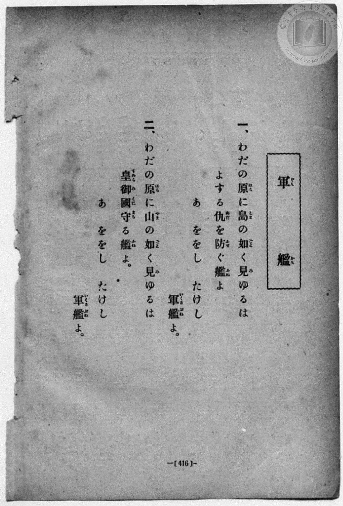
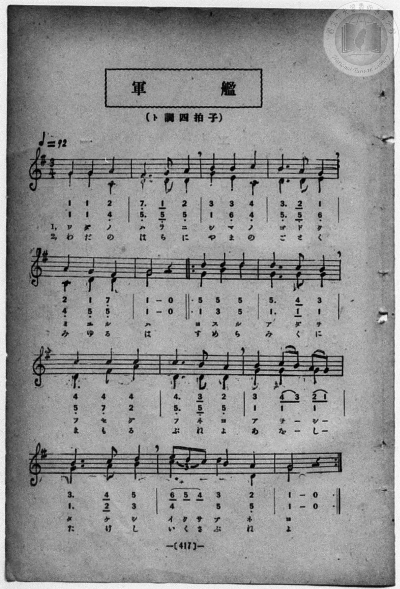

# 軍艦（二部）

> Re:Shōka 使用 AI 協助辨識與重建樂譜，可能會有錯誤。歡迎回報。

- **鋼琴伴奏版**：<br><audio controls src="gunkan.mp3"></audio>
- **NEUTRINO 歌聲合成版**：<br><audio controls src="gunkan_neutrino.mp3"></audio>

- book: 新編 小學校・公學校 唱歌教材集（高等科一・二學年用）
- 一條慎三郎 編《新編 小學校・公學校 唱歌教材集》（大正十二年十二月，索書號 0725-41）
- lyricist: 加藤義清
- composer: 鳥居忱

## 說明

> [!NOTE]
> **原書資訊與歌詞全文**（對應 `P425.jpg`–`P426.jpg`，原書 pp. 416–417，高等科一・二學年第 37 首）：
> - **曲名**：軍艦（ぐんかん）（二部合唱）
> - **調性與拍號**：ト調三拍子（G 大調 3/4 拍，二部合唱），速度 ♩= 92（註：譜面標題下誤植為「（ト調四拍子）」，惟五線譜拍號明記 `3/4` 且全曲每小節均為 3 拍）
> - **作詞・作曲**：加藤義清 作詞、鳥居忱 作曲（原載明治二十六年《小學唱歌》卷四・明治三十四年《教育唱歌集》）。
> - **版本對照與校勘**：
>   1. 先前檔案誤植臺灣教育會《新定兒童唱歌》尋常科第五學年用（`P053.jpg`）之單聲部改編譜（僅取低聲部音域改寫且全曲僅 13 小節）；本書（`P426.jpg`）為完整二部合唱原譜（全 14 小節）。
>   2. 第 7 至 14 小節（「よする仇を防ぐ艦よ あゝををしたけし軍艦よ」）前後設有反覆記號 `||: ... :||`，對應原曲後半段之復唱結構。
>   3. 第 13 小節第一拍「イ ク サ」（「い く さ」），高聲部（Soprano）為八分音符三連音 `(6 5 4)%(--)`，低聲部（Alto）則記四分音符 `4`；第 11 小節歌詞頁作「あゝををし」，譜面頁配詞作「ア ヲ ー シ ー」／「あ を ー し ー」。
>
> **一、**
> わだの原（はら）に島（しま）の如（ごと）く見（み）ゆるは
> よする仇（あだ）を防（ふせ）ぐ艦（ふね）よ
> あゝををし　たけし軍艦（いくさぶね）よ。
>
> **二、**
> わだの原（はら）に山（やま）の如（ごと）く見（み）ゆるは
> 皇御國（すめらみくに）守（まも）る艦（ふね）よ
> あゝををし　たけし軍艦（いくさぶね）よ。


## 歌詞

```text
（TMD 檔案未包含歌詞註解）
```

## ABC

<div class="abc-score" data-abc-src="gunkan.abc" aria-label="五線譜載入中"></div>

[下載 ABC 原始檔](gunkan.abc)

## TMD 檔案連結

- [主旋律 TMD 檔案](gunkan.tmd) [[在 TMD Studio 編輯](https://tmdlang.github.io/Tmd-TS/#tmd=s7IKdvYPcrWy4qpTUCpJTLdSSM7PyUlNLsnMz7MqzsjPTozPrsyvSsyML84ojTe0NDJWgqssy88pzU21ys4vyY83jDdCSBTnlxYlp1oVJ2fk5-fEl6RWlCTl52ejy8cXJKanWgWYGJkiZAqK8stS8xLzgLoLijLzSlJTwNoRClLLMlNSQdLFyYl58WWpRZlpmakpSG5KLSoGOx1iRUlRYl5xclFmAcg_CFX5RSUZ-elFiQUZlVYZmcUl-UWZyYk58dmJeYkIRSUZqUDf5WbmZJYkFlWii5cnlqQWIZuYmZ6ZZ5WbmpmVicXHUOny1GKgrrz43NSc_BSgkVpaCi92977oXPZ-T8eTXT0vm1e839OpoKXFpWirYGnEZW-r4M5lY6xvYgcyCGSilcKzaRueb1-h8HRD_9O1O54tWPi4effT1jUQtsLTKRufre15NnXms7kTXs5uA5r6cvWM52s7ny-f-GRHA1Ap0BKg0qc7tzyfArIK7ECgzLNFc5-19j3Z0fmyuU8BaPzjhi5S7Hnc0A206umS5c_WLn7a2wiyZOcWCOPZnI73e3qeb1n0bPaOFzPnKxiYG5nqmhjC7M6pBIY8MAKsFJ52LXgxfcnzfSuf7WgFSyXn5xbkF6cWWSm83Lz06cbWp_s3KnFx6Wsp2FILcCkoKNgpRCv6-Ye4xkI4WlpP--aDnLq5_cWKrhcd7UBvvlg572nrimfT2rW0QL7c0PusvVMhAZRu9bIK0hMeNUwGcczAHKBfIQYoFBToKZgYmgFlTQzNgcI4I2LNGgVjc4WXy6YBw-T9nlkQd-gCXfJs9qanE3pBls6CJ5LHjRMeN01-3NgNJMHqocnm6YQOYJwARRDaX6za_6xhOcgL3b3AkAeb87i5AygMjGeg2NO1E4Da3RWA0QYUUwCmMgWgKNClaCaC3N4w_-muZQqPZq4EJUugrhcrdoNctXbOy7mLnq2Y-XJhz5Md3S9WLXm2pPd5067HDT0gp4Ltejp7NsyuzscNIOOfNc9_smvK8-0g7RCnPZvR92LFDIUEoBMSFJ7smAIK7dmbnq3vBya-5-sbns5tBxqqYAxxHpIPn-ydA4wbUGDunQPUAPYhcjJSgCpoaISnIJAQUCkoHvvmv9jTCbT62SZwZPQ2Pm1dC4wPYNKHpHlIGgcm7ae924G-AFoDVbyjE6R49myIYmAmeNG0CaIYlhWAPm1COPN5Z8ezOWuA6eZ5Kzg6Fix82j0D7FiIGgUFQz2Fp60dTzt7n62a8mwhMNhAAfmifdfzxsUQ45_NaYZkyafrZj1tnfR89VKE6zZ0P92xA5iugAkJGK5IubsjIcDA1BiaLDuf7Ox-Om3di8ZNwLh9NmUnMG8Dwx8UDs2tT_unPdnbB5F6OX_z0_nzgQqerl8NjwqgGgVDY1BZAIwOcJKYDfQRMJWDLUGk_U5gPD1dBywXtiCnIVBIQ6xqXaFgaIIwBh5KCgpGegqgjGCu8KJ9M7KaDmBaetwETPYzHzd1P9nd_rhp0ssZm4C5AJgdgOIKjxubHjfNBYqCUOP0x43zHzdOBDIgGQakE5TmOoFB-3Rfz4sVa5_N6Xza3_tiWRswwYGKo4SaGisFPT09BauaGnDmBeducBbeBNTxtLfr2bqtoKDbtxLok-dbJzxb3o3kbGOIs-FhA4oDYGna3Qt29hKFx03rgXgr2BFgrzS2AJ3cD8RTIQ6DFAyQoAcqCc4vAFZY-dCQbF39tKMNGCHP1ywDFc0Ni4FshQQNMwVTBRNNVQ1dXU2Qk-FRB9TvmFMC0vy0E1h6zQAlUZh-hQQToNrZYMcaQh0LKdpeLmgE5gmw21CDEpxZIVkcqOZlay9QMVRl0yKFx82bgHgP0HfbQTRYdT_EFKDYJIhc43SoHCzIYIUsqAxsaATWc2D-46b-x40LHjeuA4Y7uIxb_7gJGDKdjxtXP928DSwCjNl9YJF1T5c1gUWmPG4E1WDA0HyxDFT7PG7cD-I2tQETCtAEmMmIpANW0wS0CKwMlIzAIlsfN84GmwNKUjCRtWA1HVBD0AOmAS2ZgXW1AF0CitbGbXDtGL7eBcywRPl6I7Dg7XjcBDSTHF8_n9X-dN_Cp3MgCoDebwSaDFQJduFqUPpYB6yUgVL7HjcBjQVq76aV3ymvpKFAQUufi8u9NA_YRLOC5hKHGoOaapAlCjYWWuBAVsDWOgDlUGB6e7GwR0EDVrDoKMBKLU0sGoBWgQyrUTAElt8gbATENQrm8UAKJADhGgNJEDaB80AKQcprwNp9DGuAqX89kP-4uQFM9oFVPm7uB6t93LwSiLshYsBcBBKZh6yuaQtUHbCYA5YjcHONQHIgM4DJB0yug6hvBKkB8ps6gezVUDNawCr2oaibAlHXuAJcFoHMxR94u3pwBB60RDGHSrzYul0BVJ5CSli8IQsKQlBQgcMUEtAgaADmmQJJGIbwQKEMCmHkkJ0PDptlYBLqW2jIwsx53LwCHB47kdUAyy5IqDaAyzCUUG3cD1bfBiahMQMNVbiZjTPBso3QkIaIgfSBQhRUsoPtIRCiOzrBIQqrNohMjqCUBsMQHigFIlIjKIxAKRA5lKaC3bkbTG6AhgpIDBQCvdAQgoUKJDwgaRE5VMCpp6kJJVS2Qn28FlTGQsUgKiaBxacTDgVg_YQjFGA1FSzFPZuzGlRBE5OwIPnQBJp2kOtKsBQksFCSGyKwmqDR2LQRFggKGki1uCYwgKZBAw6RvNDMAQcYKGmCAmEiLCCA5iBqfqA5jduggQcJfFAAIsyphRd0oOqcfqWcCSQvmkKKOSAFZkHkzUBMDAVg0RFT2uHPm6CgAIcMUqghig0QD5T-IMkSImeIUVmMvCINHFjgSgCSM7EmPhge8uUawWwICgZwPQcu3XEmJ7xFFrDEAmYgYHkF9jm5BRa8UQcWJ1Bc6dopQEosBSBLmQsA)]
- [鋼琴伴奏 TMD 檔案](gunkan_piano.tmd) [[在 TMD Studio 編輯](https://tmdlang.github.io/Tmd-TS/#tmd=s7IKdvYPcrWy4qpTUCpJTLdSSM7PyUlNLsnMz7MqzsjPTozPrsyvSsyML84ojTe0NDJWgqssy88pzU21ys4vyY83jDdCSBTnlxYlp1oVJ2fk5-fEl6RWlCTl52ejy8cXJKanWgWYGJkiZAqK8stS8xLzgLoLijLzSlJTwNoRClLLMlNSQdLFyYl58WWpRZlpmakpSG5KLSoGOx1iRUlRYl5xclFmAcg_CFX5RSUZ-elFiQUZlVYZmcUl-UWZyYk58dmJeYkIRYlFQM3pqbmpeSVWBZmJefnxicnJ-bkFiXmZIDGEwpIMoCKr3MyczJLEokp08fLEktQiJS4tLYUXu3tfdC57v6fjya6el80r3u_pBLJfzp75rLP7Zfee5xO2PNmz5enSfqC4gpYWl6KtgqURl72tgjuXjbG-iR3IWFAwWik8m7bh-fYVCk839D9du-PZgoWPm3c_bV0DYSs8nbLx2dqeZ1NnPps74eXsNpANq2c8X9v5fPnEJzsagEqBlgOVPt255fkUkBPAzgXKPFs091lr35MdnS-b-xSAxj9u6CLFnscN3UCrni5Z_mzt4qe9jSBLdm6BMJ7N6Xi_p-f5lkXPZu94MXO-goG5kamuiSHM7pxKYOAD48BK4WnXghfTlzzft_LZjlawFCi084tTi6wUXm5e-nRj69P9G5W4uNxL84ARZRUAihJDhxqDmmouBSCwsdCyAzNqFAwVdMHYCIhrFMzjgRRIAMI1BpIgbALngRSClNeAtfsY1ig8bl4P5D9ubgCTfWCVj5v7wWofN68E4m6IWNN2sMg8ZHVNW6DqOoBskDlQc41AciAzHjcuAJPrIOobQWqA_KZOIHs11IwWsIp9KOqmQNQ1rgBikDk1XFD_gjwG8gDYpxDvg6ABmGcKJGEYwgP5HeRvZP_OB7t4GZiEugHqX5g5j5tXgF25E1lN0yKoXxuAeBOqXxv3g9W3gUloeEH9CjezcSZYthHqf4gYSB_In_2w8ID5ExRlMAzhgaISEa0gb4GiEtljU8FG7waTG6AeAYmBHN0L9RTMIxAvQCIV2SPgaGhqQvHIVqgj1wLFOqBiEBWTwOLTkR0OSWUm0DjQMAMyTDRVNXR1NcFSEB-gRBvCB03Q4GjaCHOZgsbjpiXgtPW4aasm0NXToL5BRBOaOWBfgKIY5LKJMNcBzWlsgYbzVKA5jdugPoKECMhXCHNqUTOeEd6MZwJJiKaQnAekwCyIvBmIiaEALDpkMyDYO2DPIHkUkcxBPFA8Q6IfImeIUeQMiSwI9h-4nIEkWqxRDMODLh9Cgt4IUvqBCxCckYY3AwLzHzBlAXMf2LHkZj9g7gOGMDDvgcVJyHxBHgRynzYscrShlR-QZQgioCWNNigAzOLBFFA1pDwFSkPKKbA6oCwiCkEpHKwXbA6YwlrXGGqDkrgxmIQmdjAb6C6gJRBrYSYCzQDZaw6hjBCOgJTrYNeguRhkiDGQRJTxMBmIARCLgeWaiTZyEQv1GMIwfGHrgxy2JoiwjQcho3iwE0GJHYLBEmZAhgmYAxMGicAcaISuHIgM4CwgQmbCwwZZD4aFqIqRDAK5AotdID_q2ilAvBntYxirgMQzAvOUuQA)]

## 分析

```text
================================================================================
📊 TMD Song Profile: [ 軍艦（二部） ]
================================================================================
⏱  Duration:       0:27 (27.4s), 14 measures total
🎼 Key & Tempo:    首調基準 G, != 92.0 BPM, <3/4>
   - 分析範圍：      由實際發聲的音符與和弦推測調性；播放脈絡另行呈現
🎤 人聲音域:    C4 (MIDI 60) – D5 (MIDI 74) [跨度: 14 個半音 / 1.2 個八度, 難度: moderate]
   - 最低音:  C4 in [Gunkan #1 @ m.1, 0:01]
   - 最高音: D5 in [Gunkan #1 @ m.7, 0:13]
   - 適合: soprano, mezzo-soprano, contralto, tenor, baritone, bass
🏛  結構:      Gunkan (27.4s)
⚡ 編曲密度:        Peak 2 軌道同時演奏
🗝  調性診斷：       G 大調（純淨自然大調，未偵測到可信轉調）
   - 風格氣質:    純淨自然大調（陽光明朗、易唱易記，無明顯調外色彩）
   - 轉調歷程:    全曲維持單一推測調性（未偵測到可信轉調）
   - 核心骨幹音:  G, D, C, B, A
   - 調性數值:    G 大調 [相關度: 0.97, 穩定度: High, 自然音純度: 100.0%]
   - 候選調性 (K-S): G 大調 (0.97), D 大調 (0.62), G 小調 (0.58)
   - 五度圈歷程:   +1
   - 各段落調性細節:
     • [Gunkan #1]: G 大調 (r: 0.97, 自然音純度: 100.0%)

  [ 五度圈游移軌跡 ]
               C  
         F           [G ]*
      Bb               D  
      Eb               A  
         Ab           E  
            Db       B  
               F# 
     (* = active key center)

  [ 十二半音累積音高分佈 ]
     C  : ███████████               14.2%
     C# :                            0.0%
     D  : ███████████████████       24.8%
     D# :                            0.0%
     E  : ██                         2.9%
     F  :                            0.0%
     F# : ███                        4.4%
     G  : ████████████████████████  30.6%
     G# :                            0.0%
     A  : ███████                    9.4%
     A# :                            0.0%
     B  : ███████████               13.7%
--------------------------------------------------------------------------------
Assignment 軌道音域：
  - Alto          : C4 – D5 (14 個半音 / 1.2 個八度, 38 個音符)
  - Soprano       : F#4 – E5 (10 個半音 / 0.8 個八度, 42 個音符)
================================================================================
```


## 原書掃描頁






