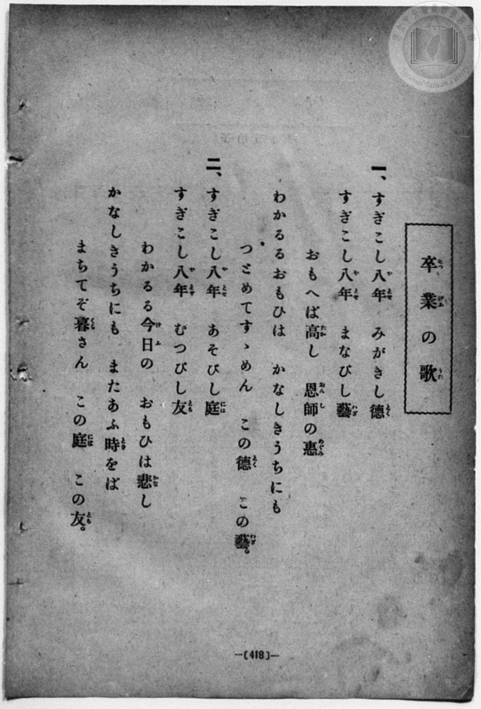
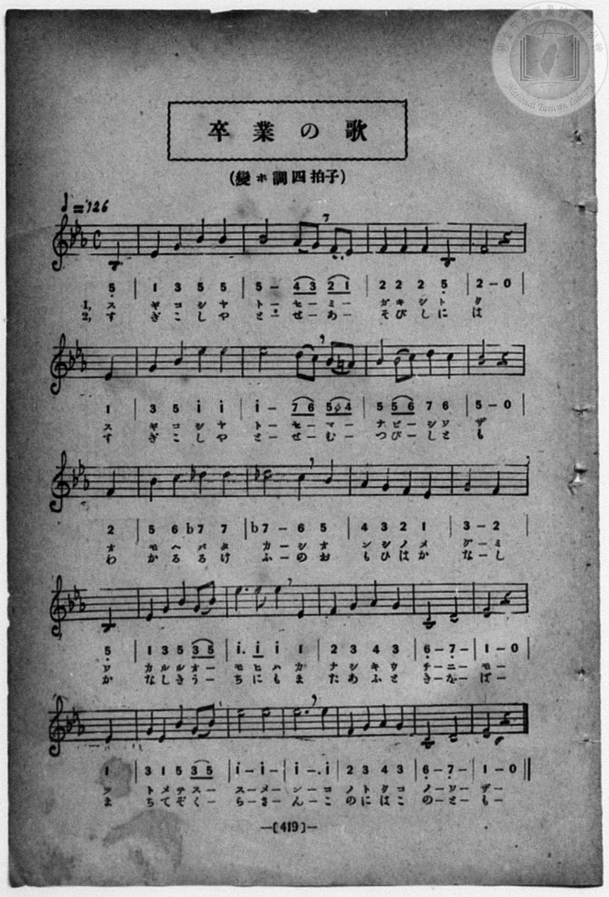

# 卒業の歌

> Re:Shōka 使用 AI 協助辨識與重建樂譜，可能會有錯誤。歡迎回報。

- **NEUTRINO 歌聲合成版**：<br><audio controls src="sotsugyo_no_uta_neutrino.mp3"></audio>
- **鋼琴伴奏版**：<br><audio controls src="sotsugyo_no_uta.mp3"></audio>


- book: 新編 小學校・公學校 唱歌教材集（高等科一・二學年用）
- 一條慎三郎 編《新編 小學校・公學校 唱歌教材集》（大正十二年十二月，索書號 0725-41）
- lyricist: 蘆田惠之助

## 說明

> [!NOTE]
> **原書資訊與歌詞全文**（對應 `P427.jpg`–`P428.jpg`，原書 pp. 418–419，高等科一・二學年第 38 首）：
> - **曲名**：卒業の歌（そつぎふのうた）
> - **調性與拍號**：變ホ調四拍子（E♭ 大調 4/4 拍，弱起第 4 拍進入），速度 ♩= 126
> - **作詞**：蘆田惠之助 作詞（原載田村虎藏編《檢定唱歌集》）。
> - **版本對照與校勘**：
>   1. 先前檔案誤植臺灣教育會《新定兒童唱歌》高等科女子用（`P109`–`P110`，♩= 84，採用 Schulz 曲調 `5_ | 1 2 3 4 | 5 - 6 5 4 3 |`）之同名異曲旋律；本書（`P428.jpg`）為 ♩= 126 之明朗進行曲風旋律（`5_ | 1 3 5 5 | 5 - (4 3) (2 1) |`）。
>   2. 原譜五線譜與簡譜將每行起首之第 4 拍弱起音獨立排於每行左端小節線前，並將上行末尾記為 3 拍（如 `| 2 - 0 |` + 下行首 `1 |`），合併後恰為完整 4/4 拍小節（全曲弱起 + 23 小節）。
>   3. 第 6 小節第 4 拍記還原記號 `(5 ♮4)`（`4'`，A♮4，屬調 B♭ 大調導音）；第 9–10 小節記降記號 `b7`（`7,`，D♭5，下屬調 A♭ 大調色彩）。
>
> **一、**
> すぎこし八年（やとせ）　みがきし德（とく）
> すぎこし八年（やとせ）　まなびし藝（わざ）
> おもへば高（たか）し　恩師（おんし）の惠（めぐみ）
> わかるるおもひは　かなしきうちにも
> つとめてすゝめん　この德（とく）　この藝（わざ）。
>
> **二、**
> すぎこし八年（やとせ）　あそびし庭（には）
> すぎこし八年（やとせ）　むつびし友（とも）
> わかるる今日（けふ）の　おもひは悲（かな）し
> かなしきうちにも　またあふ時（とき）をば
> まちてぞ暮（くら）さん　この庭（には）　この友（とも）。


## 歌詞

```text
（TMD 檔案未包含歌詞註解）
```

## ABC

```abc
X:1
T:卒業の歌
M:4/4
L:1/16
Q:1/4=126
K:Eb
V:V1 name="Piano" snm="Pia"
[V:V1]
z4 z4 z4 B,4 | E4 G4 B4 B4 | B8 A2 G2 F2 E2 | F4 F4 F4 B,4 |
w: 1.~ス | ギ コ シ ヤ | ト セ _ ミ _ | ガ キ シ ト
w: 2.~す | ぎ こ し や | と せ _ あ _ | そ び し に
F8 z4 E4 | G4 B4 e4 e4 | e8 d2 c2 B2 =A2 | B4 B2 c2 d4 c4 |
w: 1.~ク ス | ギ コ シ ヤ | ト セ _ マ _ | ナ ビ _ シ ワ
w: 2.~は す | ぎ こ し や | と せ _ む _ | つ び _ し と
B8 z4 F4 | B4 c4 _d4 d4 | _d8 c4 B4 | A4 G4 F4 E4 |
w: 1.~ザ オ | モ ヘ バ タ | カ シ オ | ン シ ノ メ
w: 2.~も わ | か る る け | ふ の お | も ひ は か
G8 F4 B,4 | E4 G4 B4 G2 B2 | e6 e2 e4 E4 | F4 G4 A4 G4 |
w: 1.~グ ミ ワ | カ ル ル オ _ | モ ヒ ハ カ | ナ シ キ ウ
w: 2.~な し か | な し き う _ | ち に も ま | た あ ふ と
C8 D8 | E8 z4 E4 | G4 E4 B4 G2 B2 | e8 e8 |
w: 1.~チ ニ | モ ツ | ト メ テ ス _ | ス メ
w: 2.~き を | ば ま | ち て ぞ く _ | ら さ
e12 e4 | F4 G4 A4 G4 | C8 D8 | E8 z4 B,4 |
w: 1.~ン コ | ノ ト ク コ | ノ ワ | ザ ス
w: 2.~ん こ | の に は こ | の と | も す
E4 G4 B4 B4 | B8 A2 G2 F2 E2 | F4 F4 F4 B,4 | F8 z4 E4 |
w: 1.~ギ コ シ ヤ | ト セ _ ミ _ | ガ キ シ ト | ク ス
w: 2.~ぎ こ し や | と せ _ あ _ | そ び し に | は す
G4 B4 e4 e4 | e8 d2 c2 B2 =A2 | B4 B2 c2 d4 c4 | B8 z4 F4 |
w: 1.~ギ コ シ ヤ | ト セ _ マ _ | ナ ビ _ シ ワ | ザ オ
w: 2.~ぎ こ し や | と せ _ む _ | つ び _ し と | も わ
B4 c4 _d4 d4 | _d8 c4 B4 | A4 G4 F4 E4 | G8 F4 B,4 |
w: 1.~モ ヘ バ タ | カ シ オ | ン シ ノ メ | グ ミ ワ
w: 2.~か る る け | ふ の お | も ひ は か | な し か
E4 G4 B4 G2 B2 | e6 e2 e4 E4 | F4 G4 A4 G4 | C8 D8 |
w: 1.~カ ル ル オ _ | モ ヒ ハ カ | ナ シ キ ウ | チ ニ
w: 2.~な し き う _ | ち に も ま | た あ ふ と | き を
E8 z4 E4 | G4 E4 B4 G2 B2 | e8 e8 | e12 e4 |
w: 1.~モ ツ | ト メ テ ス _ | ス メ | ン コ
w: 2.~ば ま | ち て ぞ く _ | ら さ | ん こ
F4 G4 A4 G4 | C8 D8 | E8 z4 z4 |
w: 1.~ノ ト ク コ | ノ ワ | ザ
w: 2.~の に は こ | の と | も
```

## TMD 檔案連結

- [主旋律 TMD 檔案](sotsugyo_no_uta.tmd) [[在 TMD Studio 編輯](https://tmdlang.github.io/Tmd-TS/#tmd=s7IKdvYPcrWy4qpTUCpJTLdSSM7PyUlNLsnMz7MqzsjPTozPrsyvSsyML84ojTe0NDJWgqssy88pzU21ys4vyY83jDdCSBTnlxYlp1oVJ2fk5-fEl6RWlCTl52ejy8cXJKanWgWYGJkjZAqK8stS8xLzgLoLijLzSlJTwNoRClLLMlNSQdLFyYl58WWpRZlpmakpSG5KLSoGOx1iRUlRYl5xclFmAcg_CFX5RSUZ-elFiQUZlVYZmcUl-UWZyYk58dmJeYkIRSUZqUDfQT2Rk5mWii6VllpcklmWmIMunpxalJqbn5eJLAO0IT0zzyo3NTMrE0uIQKXLgSamFuXF56bm5KdUKnFpaSk87Z30bOnax43rnq3tUdDS4lK0VTA0MuOyt1Vw1eGyMdE3sQMZAjLNSuHZtA3Pt69QeLqh_-naHc8WLHzcvPtp6xoIW-HplI1AI55Nnfls7oSXs9ve7-l4uXrG87Wdz5dPfLKjAaj0ya4eoNKnO7c8n7Li_Z5OsOOAMs8WzX3W2vdkR-fL5j4FoPGPG7pIsedxQzfQqqdLlj9bu_hpbyPIkp1bIIxnczre7-l5vmXRs9k7Xsycr2BgbmSqa2IIszunEhgrwMixUngxo-35lA3Pmhc82dn9tGulEheXvpaCLbUAl4KCgp1CtKKff4hrLISjpfW0bz7IVZvbX6zoetHRDvTRi5XznraueDatXUsL5KENvc_aOxUSQMlXL6sgPeFRw2QQxwLMAXoLYoBCQYGegomhBVDWxNASKIwzzNesUTC2UHi5bBrQ--_3zIK4QxfokmezNz2d0AuydBZyWgC64XHj3MeNSx439j1u3AoUfNzY9rhxPlA7Qu-LVfufNSwHub-7FxjCYENerOt63DwbKPN09myg8NO1E4BGuT6auVYBGElAYQVgmlIASoD8sGfji63bQU4Di7xs2PS0dSnYfT0vG-Y_3bVM4dHMlZD0CLfyyd45wJCC2IQabQoQKVDg9c1_sacTJDd34ouZfS-m90PT1apFT9fNgiQgWNLpfNzQhDD9eWfHszlrgIH_vBXsrQULn3bPAFsGUaOgYKin8LS142ln77NVU54t7HixasmzJb0v2nc9b1wMTJMvmjY9m9MMScIgq1onPV-9FGIh0DZ45DxduhkYLuB80JEQYGhgCYleQ0MDUNSCPW1hAmQ961sIVKQQnJxRmlOlAIwpUPglmMYr1CgYKhgpGAPDrUbBFOhyMyBpAuTXAPV3goJjQg8wUp9P3QDU82x699N9QJ_OBvoMmGTAViISUufzpl3wYFYAan02o-_ZnOnAuHixsAeo--WiFTADOmA2GwNtM4XarAG0VlNBw0jBUBNiOzw8FRSMgGEFjIq1c57smvJ8-ywgAximzzcsBDKebmh_tr4faAUwAQATJdBeeDKApIqX8zc_713xfHX3s75Jz6btgSh-un3Z89XrgeXC8_UNQAOBsQAMpCc7lgFNe7KjC-TgOaufbtj3YsUMkK-MIcms4-myJoWEGmB46SoYAN2ooK3wZEc3UDHQXoUEQ4irQalxQseTvVuf7ut51rgBqP3pOmAhswWWWiF2ggwD5lFgjgG7EWiSkTGomAJLIfvcWE8B5B8zqCTcb0CXvWxqAQXKihmgIilBwxQY-OtMNIFu6EgwUQdFvyNIAOSejWtA0e2EyDpPN_QBgwXs2tkgIy2BqcbQAGoHyOiZIAvA5iaZg0001wGZ6AI0whQcUt1QQ4F2wAx90bnp6d6VSM6HFVGgEqShEVglgPmPG2eCS4LJjxunP21dDSxSQCVEU8vjxhWPG2eDtTc8btz_uLHncWMvSM2-7eAiBCjbDy8ziDNk3-PGVY8bNwPVvJg-F6yg_3EjqNyCGdL1uKnpceOOx40bgDkKbMv8x43gvNw4HWjCs8aVT3esBosDVYLsAkutA5YUYNMaHzdOADoVYSDI_O7HTWAENXzT48b1YMcARYCOmQ72FLD8W_i4cTVQAcwlwNJxBdjAZSCvNc0FsYE2gjQC7V2HFghwcTR_YYT8LmBpQWLIA90MLK1BgfZ011qwpauBXiAt5JuA5gB9BDakH5Thwb5rwhpQT3Z3PZsOLKyBaiYC6wdICINdggjAZ02bwApAYQiJHZhjsIcqLPaBsQk0YeuzmUCrIaEHzMadj5smAWMcZgJQGVAXMNjnPZu1Dqys_3ETMGMAbZmKEgWooYEQR_UgNAoor-2hQEFLn4srOL-kuDS9Mt8vP7Qk0SogMzEv36FG17BGoRpkl4KNhRY4yhWwtTYUIEUMqMBcswaYFYHlFaisheR1HQVYCa6JRSfQapCpNcDSDlTiQTCw6NZVqAFL-ABdgCz1uGknQs4ITa5xJlgOaqIhkGMMMg2KIXUACIJqH2AlABQBlbMwDLEVzARBkIkgIxDueNy0DuyCzWByO4hsXgLW87i5A6rrcdNusPh8iHjTGrDYWiQdIJUgmfVI9qD7Cpj8wf6ZDCang1W0QPQ1roDZ1DgbTDZBxeeCeWC3QXQ0robKoNiEHEZY4xIUhbt6yIlCWGAbxsEIYCSAKBA0h9T76tBoMAVyzYG0GUrEgFwICn_ywnweVLwLzAOHHVQHKARAZm1DCfNV5IZ5UwNUHOQS1DAHqQTZBIoVhE39RIT5jk5ywhzSoAIGrw6MqIFQIAiSgKR8EyAJih5Q4IITNZgHgoiUjwjz5kXgUJsBJieAfbAf6i9QmoKEOThkIWEIVIUcP-BwbF4I1bEBpgOcJ6BxgRTq3WCdSGTjRGjoboWHOjgNNILiFRa2wEIbTIJMg5gB0gFyDUQHJDbA4vjDHdjyB4e7KWnhjly4gJqY8JQOpCDpH-wkUOiClMHCv0bBDBTW4AwBY0AMw1XkgAL8cTMSCQ9yUCSBRCcBMSiBQdTCMwA0giBFzzKoTCM8MkBBA7EdZhI0sTaDEz1SBIHsgwVoL5hsgwY3KIohBQ0sUvZBZcBRDS6aINEIzxhgEyAJaBLCBY2wRAIposCmECqipoCjDdZqJaGIAoUwRrRBCyxofMCYcHFyYhKEkTMVqLiCZIvHzaAQhBb6UBoSK5AQRWQpGIQUgCBRSOYCmwWuQlBlIKbACnz0Ig_JReCYBbulEZQ2gE0TMAkuqIC6OmFmNU5FMgtUNMJdBC4oQaZAMic4bUKzI7IMRC2sAEUvGiEuquXi0rVTQGmBKGATUOYCAA)]
- [鋼琴伴奏 TMD 檔案](sotsugyo_no_uta_piano.tmd) [[在 TMD Studio 編輯](https://tmdlang.github.io/Tmd-TS/#tmd=s7IKdvYPcrWy4qpTUCpJTLdSSM7PyUlNLsnMz7MqzsjPTozPrsyvSsyML84ojTe0NDJWgqssy88pzU21ys4vyY83jDdCSBTnlxYlp1oVJ2fk5-fEl6RWlCTl52ejy8cXJKanWgWYGJkjZAqK8stS8xLzgLoLijLzSlJTwNoRClLLMlNSQdLFyYl58WWpRZlpmakpSG5KLSoGOx1iRUlRYl5xclFmAcg_CFX5RSUZ-elFiQUZlVYZmcUl-UWZyYk58dmJeYkIRYlFQM3pqbmpeSVWBZmJefnxicnJ-bkFiXmZIDGEwpIMoCKYb3My01LRpdJSi0syyxJz0MWTU4tSc_PzMkEyWloKT3snPVu69nHjumdre97v6Xg5e-azzu6X3XueT9jyZM-Wp0v73-_pVNDS4lK0VTA0MuOyt1Vw1eGyMdE3sQOZCwpiK4Vn0zY8375C4emG_qdrdzxbsPBx8-6nrWsgbIWnUzYCjX42deazuRNezm4D2bF6xvO1nc-XT3yyowGo9MmuHqDSpzu3PJ-yAmgZ2L1AmWeL5j5r7Xuyo_Nlc58C0PjHDV2k2PO4oRto1dMly5-tXfy0txFkyc4tEMazOR3v9_Q837Lo2ewdL2bOVzAwNzLVNTGE2Z1TCYwYYPxYKbyY0fZ8yoZnzQue7Ox-2rVSiYsrOL-kuDS9Mt8vP7Qk0SoAFEFBHg41uoY1CtVcCkBgY6FlB2bUKBgo6MKxaTyQqAFL-ADVIks9btqJkDNCk2ucCZaDmmgI5BiDTIPiGjAJgiZAcSOgfA2Q1IVjiK1gJgiCTAQZgXDH46Z1YBdsBpPbQWTzErCex80dUF2Pm3aDxedDxJvWgMXWIukAqQTJrEeyB91Xjxv7wP6ZDCang1W0QPQ1roDZ1DgbTDZBxeeCeWC3QXQ0robKoNiEGkaw8DGMgxHAcANRIGiuYAaUNFGHhpwpkGsOpM1QwhJkKCjIyAumeVDxLjAP7F2oDpCjQWZtQwmmVeQGU1MDVBzkEtRgAqkE2QQKSIRN_cjBBPIsyNvmOjCiBkKBIEgCkr5MgCQoREHhAU46YB4IItIXIpiaF4E9OgNMTgBbuh_qFFDMQYIJHBgQbwNVIQcp2OvNC6E6NsB0gFMeNPiQAqobrBOJbJwIDZCt8IACR1sjKCpgwfG4cROYBJkGMQOkA-QaiA5IAILFseU6YyAJT09ACpLKwKaAAgSkDBZkNQpmoOABJzsYA2IYrrwICqPHzUgkPJRA4QoSnQTEoGiEqIUnM2iYQvLkMqhMIzz8QL6B2A4zCZokmsFJCylMQfbBwqAXTLZBQwgUK5AcCAvHfVAZcOyA8ywk5OHJD2wCJM4nIVzQCItXSN4Fm4Kcd0GBghHS0JwMDUIYEy5OTuCDMHLSBeVjSOJ73AzyNLQAg9KQgIQEAiLhwiCkZACJQpIw2CxwcYgqAzEFVnihlwVILgJHBtgtjaDofNwIKlUeN4JzMFBXJ8ysxqlIZoHKDLiLwCUIyBRIFgAnJ2iiR5aBqIWVLOhlBsRFtVirPR_Uas8EqdqDQIhXgIEeDyonICSMZxIPFgEWQ0CGEUgITKHw8ZtgBFRhBsRwLRgCqGYgCYIsB5ZsECfAXQJlgBTAXQbl43cJjAe1AZuBYK_BVRNnHLr7SDIeGGW6dgoosRbtYxirgCloBBZU5gIA)]

## 分析

```text
================================================================================
📊 TMD Song Profile: [ 卒業の歌 ]
================================================================================
⏱  Duration:       1:27 (87.6s), 46 measures total
🎼 Key & Tempo:    首調基準 E,, != 126.0 BPM, <4/4>
   - 分析範圍：      由實際發聲的音符與和弦推測調性；播放脈絡另行呈現
🎤 人聲音域:    A#3 (MIDI 58) – D#5 (MIDI 75) [跨度: 17 個半音 / 1.4 個八度, 難度: challenging]
   - 最低音:  A#3 in [SotsugyoNoUta #1 @ m.1, 0:01]
   - 最高音: D#5 in [SotsugyoNoUta #1 @ m.6, 0:10]
   - 適合: soprano, mezzo-soprano, contralto, tenor, baritone, bass
🏛  結構:      SotsugyoNoUta (43.8s) -> SotsugyoNoUta (43.8s)
⚡ 編曲密度:        Peak 1 軌道同時演奏
🗝  調性診斷：       D# 大調（流行色彩大調，未偵測到可信轉調）
   - 風格氣質:    流行大調（略帶和弦色彩音與裝飾副屬和弦）
   - 轉調歷程:    全曲維持單一推測調性（未偵測到可信轉調）
   - 核心骨幹音:  D#, A#, G, F, C
   - 調性數值:    D# 大調 [相關度: 0.94, 穩定度: High, 自然音純度: 94.9%]
   - 候選調性 (K-S): D# 大調 (0.94), A# 大調 (0.68), C 小調 (0.60)
   - 五度圈歷程:   -3 -> -3
   - 各段落調性細節:
     • [SotsugyoNoUta #1]: D# 大調 (r: 0.94, 自然音純度: 94.8%, 調外音: C#, A)
     • [SotsugyoNoUta #2]: D# 大調 (r: 0.94, 自然音純度: 94.9%, 調外音: C#, A)

  [ 五度圈游移軌跡 ]
               C  
         F            G  
      Bb               D  
     [Eb]*              A  
         Ab           E  
            Db       B  
               F# 
     (* = active key center)

  [ 十二半音累積音高分佈 ]
     C  : ███████                    9.1%
     C# : ████                       4.5%
     D  : █████                      6.2%
     D# : ████████████████████████  30.1%
     E  :                            0.0%
     F  : ██████████                11.9%
     F# :                            0.0%
     G  : ███████████               14.2%
     G# : ███                        4.0%
     A  :                            0.6%
     A# : ███████████████           19.3%
     B  :                            0.0%
--------------------------------------------------------------------------------
Assignment 軌道音域：
  - Piano         : A#3 – D#5 (17 個半音 / 1.4 個八度, 158 個音符)
================================================================================
```


## 原書掃描頁






