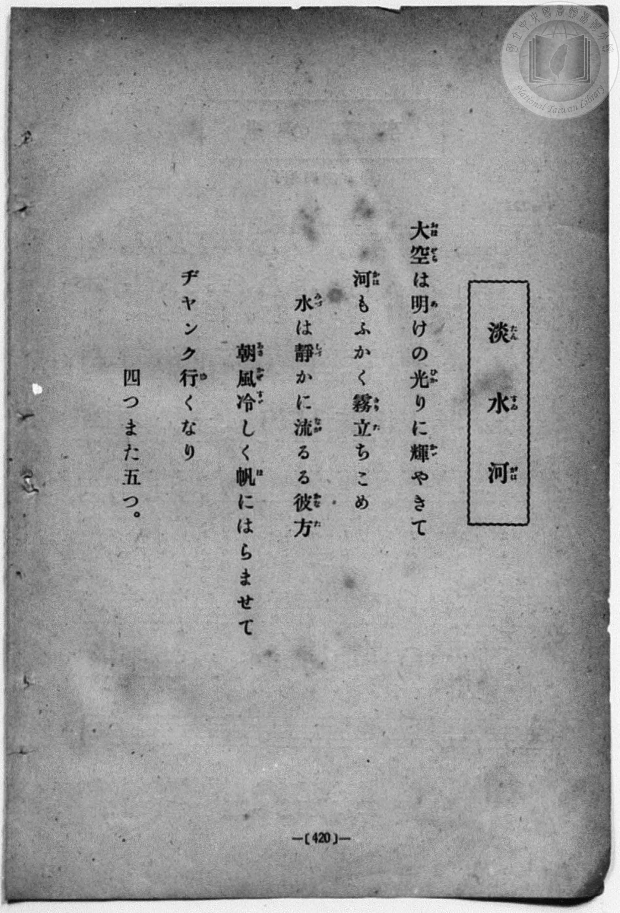
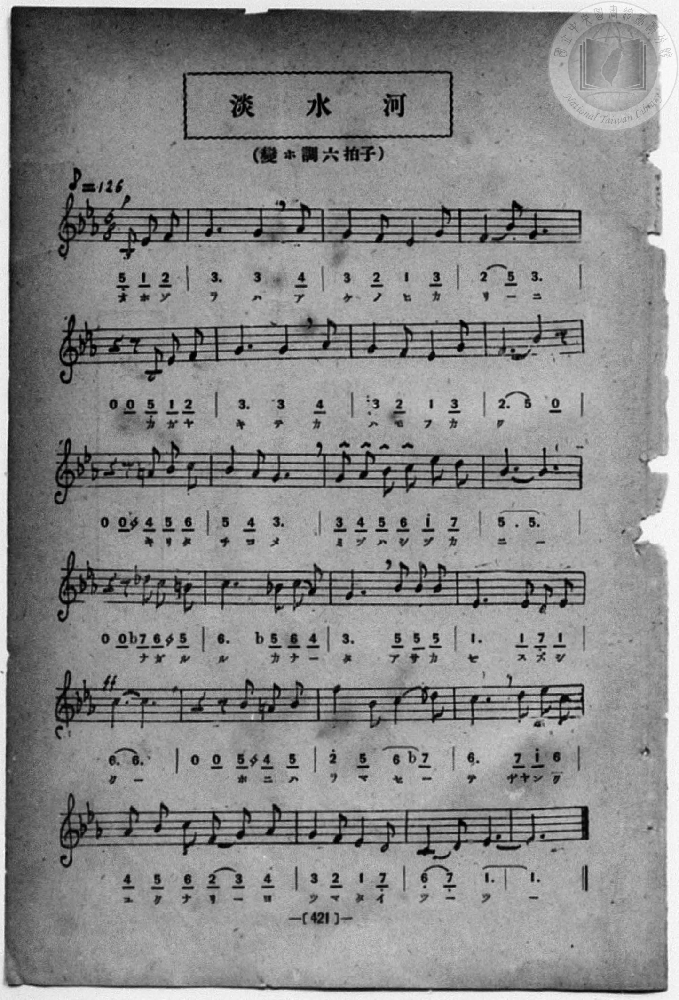

# 淡水河

> Re:Shōka 使用 AI 協助辨識與重建樂譜，可能會有錯誤。歡迎回報。

<audio controls src="tansuigawa.mp3"></audio>

- 一條慎三郎 編《新編 小學校・公學校 唱歌教材集》（大正十二年十二月，索書號 0725-41）
- 臺灣教育會公認《新定兒童唱歌》高等科女子用（2020.006.0849）

## 說明

原書資訊與歌詞全文（對應 P100.jpg，書頁 p. 23，高二第二學期第 9 首）：
調性與拍號：變ホ長調（3 降記號）、6/8 拍（♪=126，折合附點四分音符 ♩.=63）


## 跨冊／重複收錄參照

> 同曲（《新定兒童唱歌》、《新編 小學校・公學校 唱歌教材集》共同收錄教材）

- **[同曲]** 《新定兒童唱歌》高等科女子用（2020.006.0849）：[**〈淡水河〉**](../../../shintei_jido_shoka/koto_girls_2020.006.0849/2_2_09_tansuigawa/index.md)（`E,` / `6/8` — [原始 TMD](../../../shintei_jido_shoka/koto_girls_2020.006.0849/2_2_09_tansuigawa/tansuigawa.tmd)）
- 總表：[跨冊重複與同名歌曲總索引](../../../duplicate_songs.md)

## 歌詞

```text
大空（おほぞら）は　明（あ）けの光（ひかり）に
輝（かが）やきて　河（かは）もふかく
霧（きり）たちこめ　水（みづ）は靜（しづ）かに
流（なが）るゝ彼方（かなた）　朝風（あさかぜ）冷（すず）しく
帆（ほ）にはらませて　ヂャンク行（ゆ）くなり
四（よ）つまた五（いつ）つ
```

## ABC

```abc
X:1
T:淡水河
M:6/8
L:1/16
Q:3/8=42
K:Eb
V:V1 name="Piano" snm="Pia"
[V:V1]
!p! B,4 E2 E4 F2 | G6 G4 G2 | G4 F2 G4 A2 | B4 c2 B6 |
z4 z2 E2 F2 G2 | A6 G4 G2 | F4 E2 D4 E2 | C10 z2 |
z4 z2 =A2 B2 c2 | G4 F2 E6 | G2 A2 B2 c2 d2 e2 | d12 |
z4 z2 d2 c2 B2 | A4 G2 ^F2 G2 A2 | E6 G2 A2 B2 | F6 E2 F2 G2 |
!ff! c12 | z4 z2 =A2 B2 c2 | B4 E2 c4 A2 | G6 B2 c2 d2 |
E2 F2 G2 A2 G2 F2 | E4 G2 F4 E2 | C6 C4 D2 | E12 |
```

## TMD 檔案連結

- [主旋律 TMD 檔案](tansuigawa.tmd) [[在 TMD Studio 編輯](https://tmdlang.github.io/Tmd-TS/#tmd=s7IKdvYPcrWy4qpTUCpJTLdSSM7PyUlNLsnMz7MqzsjPTozPrsyvSsyML84ojTe0NDJWgqssy88pzU21ys4vyY83jDdCSBTnlxYlp1oVJ2fk5-fEl6RWlCTl52ejy8cXJKanWgWYGFkiZAqK8stS8xLzgLoLijLzSlJTwNoRClLLMlNSQdKpKZkl-UWZiTlI7kktKgY7G2J8SVFiXnFyUWYByC8IVSUZqUBHlyeWpBahCxbkJCanKnFpaSk8277w2YYtzzZtVtDS4lK0VTAz5rK3VXDV4bIx07ewA2l7sqPh2aK5z1r7nuzofNncp_B8-4rHDV3Ppm0AMhSebuh_unbHswULHzfvftq6BsJWeDpl47O1Pc-mznw2d8LL2W2PG7rf7-l4umT5s7WLn_Y2PtnV83TnFgjj2ZyO93t6nm9Z9Gz2jhcz5ysYmBuZ6poYvt_TCXbyi_ZdzxsXAw160bTp2ZxmoA0vVvVCbH-6btbT1knPVy-FWAa04-XqGc_Xdj5fPvHp0s1P1054PmUF0FYjAyMDPQMDMz0DCxNLsLFc-loKttQCXAoKCk_75oNcv7n9xYquFx3tQMe8WDnvaeuKZ9PaQd7e0PusvVMhwNDAQC-rIB3oW6DilwsaFQr0FIyMgVygs4EB8XzNGlC4AMNvznwgW8FS4eWyaUD3vt8zC2THi1X7nzUsB5ne3QsMJ6Doi3Vdj5tnv5y6HSgFtMZY4eXM3hcrZoAlOx83NAKjTwGoGCj1aOYqW0MjM5DNXTOeTuh4ObPl5e55T2fPftrR9nL-5udrlik8mrlSz9YM6JpOLrCPlix_vnIXUOvjxq7HjbsfN8573AR0SefjxvWPGxqezegDSzWBRSY-blz3tBUoCxTZ9Lix-3FTF1h8NdjZe-aCJbofN_aARJtaHjf2Pm5cBjJl02aY1HqwVNPjxq1gbj9I58s5y8HSvTDz5j9uXPi4cfLjpkaQ5g1bwLL7Hzcuhbjr5dw5YJHpMBGgQWAnPNvaCJZYBXMC0IVzn-7d82zaTpj9QClIoDU8mzP35SJQsgH67nHjVLAs0NzOp23bwYIzHzfOApsOtAbszKc72sASuyF-BgVQE5Cx73HjbIg3Hzc3PW5e_Lh58-Om9S8WAl3Q8bgJqAWoph9kcVMX2JTZs8ESwLwAlFgC1j__ya4pYKOBQbYEIg5SSnmShQIFLX0uLt_EzDyrgMzEvHyHGoMahWqQDQo2Flp2YAYwo4CS5Y4GsMNnPW5apQBMcgqPm_Yp1ABZK4G4H8hbBOI1bQTy-oB4EpC9GiwPUr0HiLtBVoHMA1pQUKtgGq-gq2AIhLoKRkAhYyCtCyaNoTwjMGkC5JkCaTMwqatQA06ZMDft6oG5aTXQvjVAW5aAXbEWyGqDuwDouuZFQDwVJtK0HuwmuHsMgAYbAJ0CsrIGaCWyU4zAzjSHuLZGwQzEgEADNMfs6IQ5BmQ90NtN-8HWNwJZm4H0QjBvPhC3QoNsO4QNdWY3NkeZqAM9bgYPElBwAQMByDMBi5srGMYBueZwR6GFEDBJQR3V3AW26HEzxDJQeIF4QFFQ7ECcCozDx01b4aEEEt8JxLvATkVzmDk4SiChZaxgpA52Ug3UgRDnQQIPFG7ggEWNuSmwwILEBchNwDQFDoR-eLqaB7R5N1weGKPgbASkgOEJ1IhIUGlptUD3IAUCevCBUo8hWAnIlZDUBglA1PBqXQsLr2XQdAIKIVgaXgF2RwvUZfuBGJzewCIQN0JYcIdBvG4CCiFo4IBYKEkJTAHTFyzsYLFYy8Wla6cAypoKQFqZiwsA)]
- [鋼琴伴奏 TMD 檔案](tansuigawa_piano.tmd) [[在 TMD Studio 編輯](https://tmdlang.github.io/Tmd-TS/#tmd=s7IKdvYPcrWy4qpTUCpJTLdSSM7PyUlNLsnMz7MqzsjPTozPrsyvSsyML84ojTe0NDJWgqssy88pzU21ys4vyY83jDdCSBTnlxYlp1oVJ2fk5-fEl6RWlCTl52ejy8cXJKanWgWYGFkiZAqK8stS8xLzgLoLijLzSlJTwNoRClLLMlNSQdKpKZkl-UWZiTlI7kktKgY7G2J8SVFiXnFyUWYByC9KXFpaCs-2L3y2YcuzTZvf7-l4OXvms87ul917nk_Y8mTPlqdL-9_v6VTQ0uJStFUwM-ayt1Vw1eGyMdO3sAOZ_2RHw7NFc5-19j3Z0fmyuU_h-fYVjxu6nk3bAGQoPN3Q_3TtjmcLFj5u3v20dQ2ErfB0ysZna3ueTZ35bO6El7PbHjd0A219umT5s7WLn_Y2PtnV83TnFgjj2ZyO93t6nm9Z9Gz2jhcz5ysYmBuZ6poYAt0D9tuL9l3PGxcDDXrRtOnZnGagDS9W9UJsf7pu1tPWSc9XL4VYBrTj5eoZz9d2Pl8-8enSzU_XTng-ZQXQViMDIwM9AwMzPQMLE0uwsVy-iZl5VgGZiXn5QR4ONQY1CtVcCkBgY6FlB2boayk8X7MG6O0XC3sUtPTBYkBFBbUKpvEKugqGQKirYAQUMgbSumDSGMozApMmQJ4pkDYDk7oKNVzI5u7qQTHXAKjAAGgkSGsNUCuykUZg68whttYomIEYEGiAZuiOTiyGmqgDHWAGdxrI2UDHAHkmYHFzBcM4INccbiiaS5_Ono3FUHOwtyAuNVYwUgcbVwM1HGI0xOEgN4M9her7KaihmpZWCzQQyQXobgcFoSFYCcgaSJBDXI_q2Na1KAZD7DYBORHqOhALJRzBFDBwYY6HBUEtchLxITGJGMaDUolxPIIBNB6LmGl8vIJRPNB6bKJALoKFN_VgM9oEYqYJYZOBQQDTDGIRTFZAbcBAM1EHGwBlIRuNzc8I1xDhPfQkh93VCCORRfGEMr7wREuPucD0iDAf2fFGQDYolICmIDFx-BQuiMuj6MmVWEOI8Dw8FevaKYASsgKQVubiAgA)]

## 分析

```text
================================================================================
📊 TMD Song Profile: [ 淡水河 ]
================================================================================
⏱  Duration:       1:08 (68.6s), 24 measures total
🎼 Key & Tempo:    首調基準 E,, != 63.0 BPM, <6/8>
   - 分析範圍：      由實際發聲的音符與和弦推測調性；播放脈絡另行呈現
🎤 人聲音域:    A#3 (MIDI 58) – D#5 (MIDI 75) [跨度: 17 個半音 / 1.4 個八度, 難度: challenging]
   - 最低音:  A#3 in [Main #1 @ m.1, 0:00]
   - 最高音: D#5 in [Main #1 @ m.11, 0:30]
   - 適合: soprano, mezzo-soprano, contralto, tenor, baritone, bass
🏛  結構:      Main (68.6s)
⚡ 編曲密度:        Peak 1 軌道同時演奏
🗝  調性診斷：       C 小調（純淨自然小調，未偵測到可信轉調）
   - 風格氣質:    純淨自然小調（陰鬱抒情、旋律集中，無明顯調外色彩）
   - 轉調歷程:    全曲維持單一推測調性（未偵測到可信轉調）
   - 核心骨幹音:  G, D#, C, A#, F
   - 調性數值:    C 小調 [相關度: 0.89, 穩定度: Moderate, 自然音純度: 97.7%]
   - 候選調性 (K-S): C 小調 (0.89), D# 大調 (0.81), G 小調 (0.68)
   - 五度圈歷程:   +0
   - 各段落調性細節:
     • [Main #1]: C 小調 (r: 0.89, 自然音純度: 97.7%, 調外音: F#, A)

  [ 五度圈游移軌跡 ]
              [C ]*
         F            G  
      Bb               D  
      Eb               A  
         Ab           E  
            Db       B  
               F# 
     (* = active key center)

  [ 十二半音累積音高分佈 ]
     C  : █████████████████████     18.3%
     C# :                            0.0%
     D  : ███████████                9.2%
     D# : ██████████████████████    19.1%
     E  :                            0.0%
     F  : ████████████              10.7%
     F# : █                          0.8%
     G  : ████████████████████████  20.6%
     G# : ██████████                 8.4%
     A  : ██                         1.5%
     A# : █████████████             11.5%
     B  :                            0.0%
--------------------------------------------------------------------------------
Assignment 軌道音域：
  - Piano         : A#3 – D#5 (17 個半音 / 1.4 個八度, 80 個音符)
================================================================================
```


## 原書掃描頁






