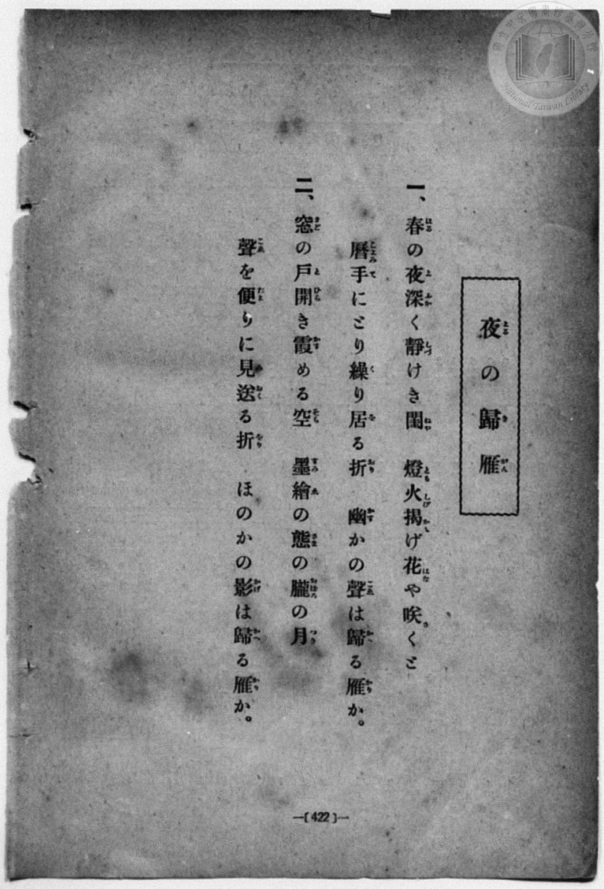
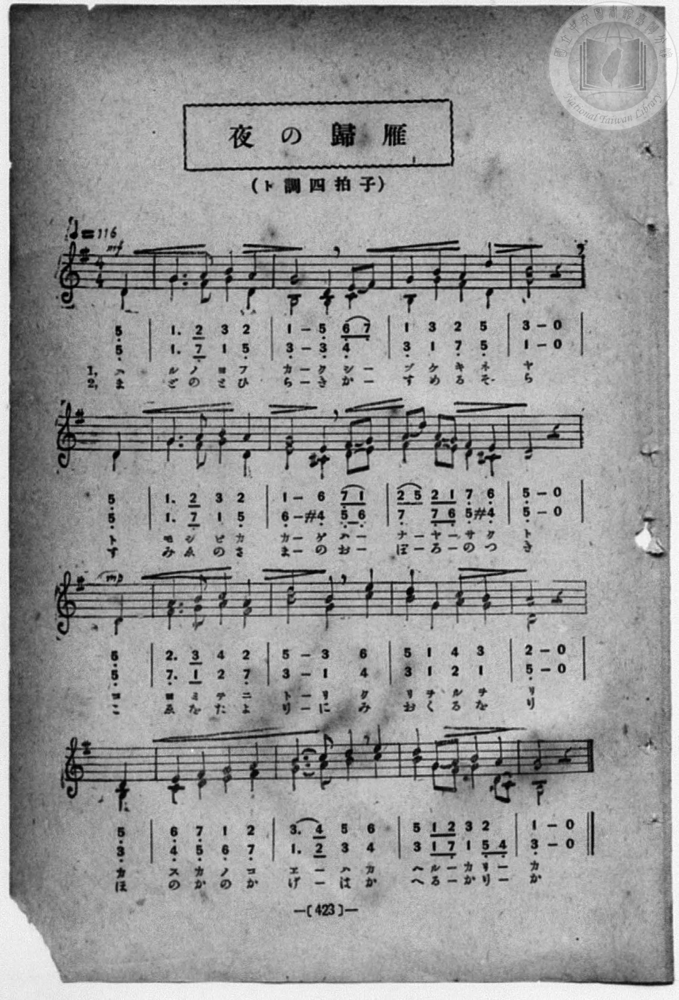

# 夜の歸雁（二部）

> Re:Shōka 使用 AI 協助辨識與重建樂譜，可能會有錯誤。歡迎回報。

- **鋼琴伴奏版**：<br><audio controls src="yoru_no_kigan.mp3"></audio>
- **NEUTRINO 歌聲合成版**：<br><audio controls src="yoru_no_kigan_neutrino.mp3"></audio>

- book: 新編 小學校・公學校 唱歌教材集（高等科一・二學年用）
- 一條慎三郎 編《新編 小學校・公學校 唱歌教材集》（大正十二年十二月，索書號 0725-41）

## 說明

> [!NOTE]
> **原書資訊與歌詞全文**（對應 `P431.jpg`–`P432.jpg`，原書 pp. 422–423，高等科一・二學年第 40 首）：
> - **曲名**：夜の歸雁（よるのきがん）（二部合唱）
> - **調性與拍號**：ト調四拍子（G 大調 4/4 拍，弱起第 4 拍進入，二部合唱），速度 ♩= 116（首起 `mf`，第 8 小節第 4 拍轉 `mp`）
> - **版本對照與校勘**：
>   1. 先前檔案轉錄自學生手抄《唱歌帖》（`2020.006.0843`・`P200.jpg`），因手抄譜漏記休止符並將每行末尾 3 拍小節與下行弱起 1 拍拆成兩個全音符小節（誤作 20 小節），且多處將低八度點誤作降記號（如 `7,_`、`5,_`、`2,_`）並錯抄聲部音高。
>   2. 對照本書原印五線譜與簡譜（`P432.jpg`），每行均以第 4 拍弱起開始、第 3 拍休止收尾（合併為規整之弱起 + 16 小節）。
>   3. 第 2 小節第 4 拍高聲部為八分音符圓滑線 `6_ 7_`、低聲部為四分音符 `4_`；第 6–7 小節低聲部記有升記號 `#4_`（`4'_`，C♯4），導向屬音 `5_`（D4）半終止；第 15 小節第 4 拍高聲部為四分音符 `2`，低聲部為八分音符圓滑線 `5_ 4_`（「リー」／「りー」）。
>   4. 歌詞頁（`P431.jpg`）第一節作「幽（かす）かの聲（こゑ）は」，譜面頁（`P432.jpg`）配詞作「カ ス カ ノ コ エ ー ハ」。
>
> **一、**
> 春（はる）の夜深（よふか）く靜（しづ）けき閨（ねや）　燈火（ともしび）揭（かか）げ花（はな）や咲（さ）くと
> 曆（こよみ）手（て）にとり繰（く）り居（を）る折（をり）　幽（かす）かの聲（こゑ）は歸（かへ）る雁（かり）か。
>
> **二、**
> 窓（まど）の戸開（とひら）き霞（かす）める空（そら）　墨繪（すみゑ）の態（さま）の朧（おぼろ）の月（つき）
> 聲（こゑ）を便（たよ）りに見送（みおく）る折（をり）　ほのかの影（かげ）は歸（かへ）る雁（かり）か。


## 歌詞

```text
（TMD 檔案未包含歌詞註解）
```

## ABC

```abc
X:1
T:夜の歸雁（二部）
M:4/4
L:1/16
Q:1/4=116
K:G
V:V1 name="Alto" snm="Alt"
V:V2 name="Soprano" snm="Sop"
[V:V1]
!mf! z4 z4 z4 D4 | G6 F2 G4 D4 | B,8 B,4 C4 | B,4 G4 F4 D4 |
w: 1.~ハ | ル ノ ヨ フ | カ ク シ | ヅ ケ キ ネ
w: 2.~ま | ど の と ひ | ら き か | す め る そ
G8 z4 D4 | G6 F2 G4 D4 | E8 ^C4 D2 E2 | F4 F2 E2 D4 ^C4 |
w: 1.~ヤ ト | モ シ ビ カ | カ ゲ ハ _ | ナ ヤ _ サ ク
w: 2.~ら す | み ゑ の さ | ま の お _ | ぼ ろ _ の つ
!mp! D8 z4 D4 | F6 G2 A4 F4 | B8 G4 c4 | B4 G4 A4 G4 |
w: 1.~ト コ | ヨ ミ テ ニ | ト リ ク | リ ヲ ル ヲ
w: 2.~き こ | ゑ を た よ | り に み | お く る を
D8 z4 B,4 | C4 D4 E4 F4 | G6 A2 B4 c4 | B4 G2 F2 G4 D2 C2 |
w: 1.~リ カ | ス カ ノ コ | エ _ ハ カ | ヘ ル _ カ リ _
w: 2.~り ほ | の か の か | げ _ は か | へ る _ か り _
B,8 z4 z4 |
w: 1.~カ
w: 2.~か
[V:V2]
!mf! z4 z4 z4 D4 | G6 A2 B4 A4 | G8 D4 E2 F2 | G4 B4 A4 d4 |
w: 1.~ハ | ル ノ ヨ フ | カ ク シ _ | ヅ ケ キ ネ
w: 2.~ま | ど の と ひ | ら き か _ | す め る そ
B8 z4 D4 | G6 A2 B4 A4 | G8 E4 F2 G2 | A2 d2 A2 G2 F4 E4 |
w: 1.~ヤ ト | モ シ ビ カ | カ ゲ ハ _ | ナ _ ヤ _ サ ク
w: 2.~ら す | み ゑ の さ | ま の お _ | ぼ _ ろ _ の つ
!mp! D8 z4 D4 | A6 B2 c4 A4 | d8 B4 e4 | d4 G4 c4 B4 |
w: 1.~ト コ | ヨ ミ テ ニ | ト リ ク | リ ヲ ル ヲ
w: 2.~き こ | ゑ を た よ | り に み | お く る を
A8 z4 D4 | E4 F4 G4 A4 | B6 c2 d4 e4 | d4 G2 A2 B4 A4 |
w: 1.~リ カ | ス カ ノ コ | エ _ ハ カ | ヘ ル _ カ リ
w: 2.~り ほ | の か の か | げ _ は か | へ る _ か り
G8 z4 z4 |
w: 1.~カ
w: 2.~か
```

## TMD 檔案連結

- [主旋律 TMD 檔案](yoru_no_kigan.tmd) [[在 TMD Studio 編輯](https://tmdlang.github.io/Tmd-TS/#tmd=s7IKdvYPcrWy4qpTUCpJTLdSSM7PyUlNLsnMz7MqzsjPTozPrsyvSsyML84ojTe0NDJWgqssy88pzU21ys4vyY83jDdCSBTnlxYlp1oVJ2fk5-fEl6RWlCTl52ejy8cXJKanWgWYGBsiZAqK8stS8xLzgLoLijLzSlJTwNoRClLLMlNSQdLFyYl58WWpRZlpmakpSG5KLSoGOx1iRUlRYl5xclFmAcg_CFX5RSUZ-elFiQUZlVYZmcUl-UWZyYk58dmJeYkIRSUZqUDf5SWWlBaloosWpyYW5-cVowsn5mXmJuYg25OZnplnVZoHcnQJ1KlaWgpPl8x53Lju2dodL2c3vt_T8WRXz8vmFe_3dCpoaXEp2ioYGppx2dsquHPZmOib2IFMA4WflcKzaRueb1-h8HRD_9O1O54tWPi4effT1jUQtsLTKRufre15NnXms7kTXs5uAxr7cvWM52s7ny-f-GRHA1Ap0Bag0qc7tzyfArIL7EqgzLNFc5-19j3Z0fmyuU8BaPzjhi5S7Hnc0A206umS5c_WLn7a2wiyZOcWCOPZnI73e3qeb1n0bPaOFzPnKxiYG5nqmhiC7ebS11KwpRbgUlBQsFOIVvTzD3GNhXC0tJ72zQfZu7n9xYquFx3tQDe_WDnvaeuKZ9PatbRATt7Q-6y9UyEBlAD1sgrSEx41TAZxjMAcoMMhBigUFOgpmBgZAWVNjIyBwjhDdc0aBRMDhZfLpgE9-H7PLIg7dIEueTZ709MJvSBLZ6FF_OMmIOoGijxu7H3c2PO4aTJYLzRBPJ3QAQxsoAjCqBer9j9rWA7yTncvMEjBZj5u7gAKP509Gyj2dO0EoHZ3YAJbDhRTACYfBaAoyDN7Nr7Yuh3sRpDIy4ZNT1uXAsXRbAL5r2H-013LFB7NXAlOiKB0tGwaUK9CQm4aKFhAZliA0sbz9Q1w817sBYZkbgFQHsmxzzs7ns1ZAwzn561gJy9Y-LR7BtjJEDUKCoZ6Ck9bO5529j5bNeXZwg6gKS97Wl60rwKG6PMp8591dj_ragGmR0iSe7pjGiSxJRgZGBnoGRiY6RlYmBgnACMhIcDIwAAabyA_PJ29AKL5xdo5z_b0v1gx48meic_WLnq-ZtmTHcuebmh_tr7_xUJgAl39dMM-BWOQDyAeAjrzyY5uoBQkvBQMQVLPutuedUx42rryaUM3MAG9nL8ZaA5EPdA1L1YtebJ3joKRATRMIC54smPK0yWzXsycCrTsyd6-p62rgYH6cvc8iOqXM3uBbgJGICgdLmtSSDDXiU943NCYYAqljYA00CCgY1_2rAf5o3ETMJqANgNT3-OGJlj4GQHDDxy8wHAGplVgin3au-HJrinPt88C-hzomecbFgIZoDBDStkg90EC4Onc9ie7l8JjEeLpl9O6ny7vBroCJA4OG0jgPZuyDRhaIBdP6Hiyd-vzpl0vlvU_m7rlyc5uaGhpKxiaIUIByZ3Gegogw4zQkw3QNxCfAQ0DBVFHGzRw50x-tnsi0BcKCWbxCubgMAGGIkLt7NlwtQoJJqCwmg0y1AyYS82hlsDVA0P62ZzOp73AggAU5AoJymANHQkm6iC6x_nRzPUm0HSzoe_phIlPN64BGq2QYApW5gKSe9rb9XxrEzAQoBYZmuL1CorzjECWoLgeu09N4xUgDnvc0PO4edXj5j2PG4BZtx_EbeqCcZGD1URPAVKsvVwAKk0QRRlQGdBhwAIKHA5zgCY83bkXZHIjsLCZCTIExFgHdBFYcPLjpolgwfVgK3qASebl3EUIQ-EJ52VrL9A2iImPm1YrPG7aCcRAGlh1PG7aDMQrgOw9QAx0dS_MpbASGVRgNjQCqzgw_9kMYPkDtHw9sAQEW74OWDg-2w4shcDFYuNWoBvB4v0v54JS8OPG6Y8bgVqAIhOBxeXLacBKDCi49nFTCzhUGp63dzxvXA0WXPG4qQmsfjNQ6ln_WpjXIQZOetEFtgVodeMqkEhTy9NJkJCYCrERaALUkeCKFBxCQHI_yLROUBH0uHEZWOVqsF1dz3duAAv2g03rerqxFeyLSWAusByaAeECpSBOJTI2gPUETBmQATIKWm0ARSBGARnogbyrBymQn68C1ihA9fseN66EBPKzjh3ADA4NpcZNj5uA6R4o3vtyzjwUJzU1Aq17vnIXWHAuVBnQ5YtWPN8JDDSg4ExggMCcuu5ZK8TMqUC7oCJzloNFuh437nncBE65IEFgkwAouARoI7yuQPd406Qn-4BBDRSZDwx2SJACg_rFsu6XDRDv7wcbCwltLMH7uHE3uE4FherTvZC4BrLB0UFSqFLeNIECBS19Lq7I_KJSv3zvzPTEPKvg_AJg0zTfoUbXsKYaZJWCjYUWOBIVsLWMFCAlLKhEB-drYNmtoGECLYN0FGB5VBOLTqDNIFNrFAyAlTIMV-em1SoACxxdhRqwrI8hqjwwAyPkjNDkGveB5aDGGgI5usCi3RhMAiWgIroQ88HlN1QQpsQUrAzEA0GQmWhOedy8GiwFLleaV4BZU8GaQKUNRNvjpvVgcjtEvLkVzNsIJteCdfRCZZYgWQRsLKF4DJgvIKY1rgNisE2Nm6A2dcJsagSZBEwVEPHGmWA7GsEkSAyYP9B0QIIJpA4aTFjjFBSVu3rIiUrcYQ4Mbl1QgBsCxYyAAW0EZAG5UIkaSEDDnFidW4CRCh43L4IG73YgezKYBQpy1KAHBRE0jQDpLjAPFMyPm7bCowYkAwpseIAAKwjUoN8PNW0iOPhBQQaNZHAKg0ULiATZABLfA1YPiQ6IDMhWkAxIDBH0IHcTCvodneQEPSi4QSnZBB70oNQMEQOGMlwEFCEgNSBRmC4caR2U6kABOB-I28AsaEqDBx-wOYASrGBeMyQSQJECYcNkEAEOjjhEgAMDGhLgk4BBNB_MAucGIA0KYEiAg80DRw0oWMFR2wiKaGhaB-pF1QEJ8N2EAxzYKiInwGEpGhKkkCCHFB0m4IBGDnJsOQJWbCGFOLDVAgsdUAkDT5rg9gssxCF-hib95hmIsIbqA4U0cqZAswecwCFJFFJGINggGVAoQsIbXIrBxXcgQhqiDxzOIBkQD9WeWtQqxTGnZPjUJ-AiDJZXFIxhpRaYYYIkCFIEThxQlcixPlqpkFGpoAY8OPOB85o6NJCBIjWQEAcSQA5YIUR2tHZBigPyahdwwEJKMmi6RrSTYDUKRARWGIJotIAHZ4zRCobYMAcXJ7C2KjzUkZtYyKGOyB9AfUgl07CuZnTtFJBqGgUgV5kLAA)]
- [鋼琴伴奏 TMD 檔案](yoru_no_kigan_piano.tmd) [[在 TMD Studio 編輯](https://tmdlang.github.io/Tmd-TS/#tmd=s7IKdvYPcrWy4qpTUCpJTLdSSM7PyUlNLsnMz7MqzsjPTozPrsyvSsyML84ojTe0NDJWgqssy88pzU21ys4vyY83jDdCSBTnlxYlp1oVJ2fk5-fEl6RWlCTl52ejy8cXJKanWgWYGBsiZAqK8stS8xLzgLoLijLzSlJTwNoRClLLMlNSQdLFyYl58WWpRZlpmakpSG5KLSoGOx1iRUlRYl5xclFmAcg_CFX5RSUZ-elFiQUZlVYZmcUl-UWZyYk58dmJeYkIRYlFQM3pqbmpeSVWBZmJefnxicnJ-bkFiXmZIDGEwpIMoCKrvMSS0qJUdNHi1MTi_LxidGGQGYk5SlxaWgpPl8x53Lju2dodL2c3vt_T8WRXz8vmFe_3dALZL2fPfNbZ_bJ7z_MJW57s2fJ0aT9QXEFLi0vRVsHQ0IzL3lbBncvGRN_EDmQ8KIytFJ5N2_B8-wqFpxv6n67d8WzBwsfNu5-2roGwFZ5O2fhsbc-zqTOfzZ3wcnYbyIrVM56v7Xy-fOKTHQ1ApUDbgUqf7tzyfArIDWBnA2WeLZr7rLXvyY7Ol819CkDjHzd0kWLP44ZuoFVPlyx_tnbx095GkCU7t0AYz-Z0vN_T83zLomezd7yYOV_BwNzIVNfEEGw3V2R-UalfvndmemKeVQAoBgwdanQNa6q5FIDAxkLLDsyoUTBQ0IXj6ty0WgXTeCCrBizrY4gq_7i5HyFnhCbXuA8sBzXWEMjRVTBSMAaTQAmoiC7EfLN4BfN4qCBMiSlYGYgHgiAz0ZzyuHk1WOoxMCAfN68As6aCNT1ugsgARZrWg8ntEPHmVjBvI5hcC9bRC5VZgmTR4-YOFI89blwJMa1xHRCDbWrcBLWpE2ZTI8ikx43dEPHGmWA7GsEkSOxx41w0HZBgAqkjIpiAIaQLCiNDoJgRMGyMgCwgFypRAwkbmKnVuQUYEfe4eRE0RLYD2ZPBLFAooYYWyFfQaAXSXWAeKGQeN22FhyZIBhQ-cD80bUYLrf1Q0yaCQwzkS2i8gBMFLCRBJMgGkPgesHpICEJkQLaCZEBiiNACuRseWqAQAqUXE3hogdIMRAwYMHARUBiC1IBEYbpwpChQ3IL8PB-I28AsaHzCffy4eRVKSIB5zZBwA4UjhA2TQYQROKwRYQQMG0gYTQL6aj6YBU5zQBoUJpAwApsHDk1QSIBjoxEUN9AUBdSLqgMSRruRwwiWbiChAAklSJ4yAYcNcihhS3ew_IwUSE074R4CZT14AgDSkOCDJSF4AmuegQgeqD5Q4CAnPTR7wMkIkhAgmQfBBsmAPA4JInD2hovvQAQORB84aEAyIB6qPbVYCkWjASgUwZkalhQVjGH5GMwwQRIEKQJHJFQlcgyNlJIRNazAaRuclNWh4QIUqYEEEpAAcsAKIbIjs4gEhwUkb0NTD6JKhRWLEBFY8QCi0cIKnPyGdSkJzmewlgg8oJBrY-SAQqRCoD6kLDuyysogD8KFJVIGQ2RhbWDbRRsUkqYgJqR804aVZkAmJNPGa8MahVBZiB6wdrBWSPsQIoqlHMRnnxnCPmDhALIILAkuM4AyoGwDVGkKocBCEFkk5WhZBMViqBshTjbSBiUdqBDQM2B3wySBBmpDamCIODgTgjVAZEG2QM2CZUVI8MCsggQTzPWg5Av2Gdw6WPCADIVYgW4hevhAkzQ8gPAnAh-URGCClAggEB4XoLIYmG0gFDLfBMaHCqHL4zbDDEgaA7ERRBAUVhApkAAIQ0RALBCNMAgiCqOwOgZkNlQMlykgtSARmFJMc2DuweUtYIDq2ikghWm0j2GsArqQEVhImQsA)]

## 分析

```text
================================================================================
📊 TMD Song Profile: [ 夜の歸雁（二部） ]
================================================================================
⏱  Duration:       0:33 (33.1s), 16 measures total
🎼 Key & Tempo:    首調基準 G, != 116.0 BPM, <4/4>
   - 分析範圍：      由實際發聲的音符與和弦推測調性；播放脈絡另行呈現
🎤 人聲音域:    B3 (MIDI 59) – C5 (MIDI 72) [跨度: 13 個半音 / 1.1 個八度, 難度: moderate]
   - 最低音:  B3 in [YoruNoKigan #1 @ m.3, 0:04]
   - 最高音: C5 in [YoruNoKigan #1 @ m.11, 0:22]
   - 適合: soprano, mezzo-soprano, contralto, tenor, baritone, bass
🏛  結構:      YoruNoKigan (33.1s)
⚡ 編曲密度:        Peak 2 軌道同時演奏
🗝  調性診斷：       G 大調（純淨自然大調，未偵測到可信轉調）
   - 風格氣質:    純淨自然大調（陽光明朗、易唱易記，無明顯調外色彩）
   - 轉調歷程:    全曲維持單一推測調性（未偵測到可信轉調）
   - 核心骨幹音:  G, D, B, A, F#
   - 調性數值:    G 大調 [相關度: 0.93, 穩定度: High, 自然音純度: 98.3%]
   - 候選調性 (K-S): G 大調 (0.93), D 大調 (0.79), B 小調 (0.75)
   - 五度圈歷程:   +1
   - 各段落調性細節:
     • [YoruNoKigan #1]: G 大調 (r: 0.92, 自然音純度: 98.3%, 調外音: C#)

  [ 五度圈游移軌跡 ]
               C  
         F           [G ]*
      Bb               D  
      Eb               A  
         Ab           E  
            Db       B  
               F# 
     (* = active key center)

  [ 十二半音累積音高分佈 ]
     C  : ██████                     5.8%
     C# : ██                         1.7%
     D  : ███████████████████████   22.1%
     D# :                            0.0%
     E  : ████████                   7.9%
     F  :                            0.0%
     F# : █████████                  8.7%
     G  : ████████████████████████  23.3%
     G# :                            0.0%
     A  : ████████████              12.1%
     A# :                            0.0%
     B  : ███████████████████       18.3%
--------------------------------------------------------------------------------
Assignment 軌道音域：
  - Alto          : B3 – C5 (13 個半音 / 1.1 個八度, 57 個音符)
  - Soprano       : D4 – E5 (14 個半音 / 1.2 個八度, 58 個音符)
================================================================================
```


## 原書掃描頁






