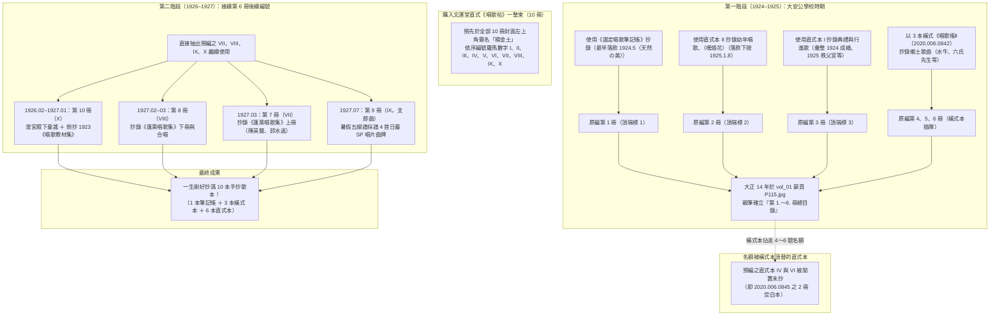

# 《楊金土手抄唱歌帖》編年抄錄時間軸與冊次考證（1923–1934）

國立臺灣歷史博物館（NMTH）所藏日治時期公學校教員**楊金土（1903–？）**音樂教育文獻（館藏號 `2020.006.0841`～`0849`），包含多冊手抄五線譜筆記本、剪貼夾頁、唱片聽寫採譜，以及全套印本《新定兒童唱歌》。

這批歌本並非一時一次性的產物，而是一套跨越**大正 12 年（1923）至昭和 3 年（1928）**、長達五至六年的**活態教案累積檔案**。本文結合最新發現之楊金土官方《履歷書》原件、各冊內頁清晰留下的落款干支年代、歷史事件紀念歌、底本出版年份與中研院臺灣史研究所《[臺灣總督府職員錄系統](https://who.ith.sinica.edu.tw/)》的教職遷徙記錄，完整還原楊金土之確切生年、求學教職歷程，以及手抄筆記本的**真實抄寫先後順序**與**編號流變之謎**。

---

## 〇、楊金土生年與求學生涯考證：日治時期官方《履歷書》原件

過去因臺史博原編目未載其生卒年，僅能依其大正 8 年（1919）初任教員推估其約出生於十九世紀末。依據現存之楊金土日治時期官方**《履歷書》原件（甲號文書）**，以工整楷書詳細登載其身世戶籍與幼年至少年之求學軌跡，徹底解開了楊金土的精確出生年月日與早年成長身世：

| 楊金土日治時期《履歷書》原件特寫（甲號表格） |
| :---: |
|  |

### 《履歷書》逐行考釋與早期生平

| 履歷書欄位 | 原始墨書文字 | 考據與歷史解讀 |
| :--- | :--- | :--- |
| **氏名** | **楊 金 土** | 與各冊封面簽名「楊金土」、第 10 冊及《新定兒童唱歌》封底圓形朱印「楊」完全一致。 |
| **生年月日** | **明治三十六年（1903）一月十九日生** | **出生年確證**：1903 年 1 月 19 日出生（農曆為光緒二十八年十二月廿一日）。由此可知其於 1923 年開始抄寫歌本時年僅 **20 歲**，1927 年抄寫高峰期為 **24 歲**，1934 年購齊《新定兒童唱歌》時為 **31 歲**。 |
| **現住所** | **臺北市水道町三一九番地** | 日治時期臺北市水道町（約今臺北市中正區水源路、師大路、汀州路至溫州街一帶，鄰近臺北水道水源地淨水設施）。 |
| **大正二年（1913）四月一日** | **景尾公學校第一學年入學** | 年滿 10 歲入學景尾公學校（今臺北市文山區景美國小）。 |
| **大正三年（1914）四月一日** | **大安公學校第二學年入學** | 11 歲由景尾公學校轉入大安公學校（今國立臺北教育大學附設實小／臺北市大安國小）讀二年級，自此與大安公學校結下深厚緣分。 |
| **大正七年（1918）三月二十日** | **臺灣公學校修業年限六箇年 教科ヲ卒業セシコトヲ證ス （大安公學校長 中內英夫）** | 15 歲以優異成績完成公學校六年學業，獲大安公學校長中內英夫頒發畢業證書。 |
| **全年全月全日（同日獎懲）** | **文鎮一個、右者在學中學術優等 品行方正且精勵ニシテ他生ノ模範タリ、仍テ［北白川宮／閑院宮殿下］御下賜ノ教育獎勵…** | **全校模範畢業生**：畢業典禮當日，因「學術優等、品行方正且精勵、為他生模範」，特別獲頒日本皇族宮家（北白川宮或閑院宮）御下賜之「教育獎勵文鎮」一個！ |
| **大正八年（1919）三月** | *(履歷書次頁透印部分)* | 16 歲修習師範講習／教員養成，旋即以「訓導心得」資格返回母校大安公學校任教，名列臺灣總督府職員錄。 |

---

## 一、解開「兩套編號」與空白本的實物謎團

檢視楊金土遺留的歌本封面，初看常會對其冊號感到困惑：例如原編第 3 冊封面頂端寫阿拉伯數字 `3`，五線譜內卻標羅馬數字 `I`；又如為何跳過第 `IV`（4）與第 `VI`（6）冊，直接跳到第 `VII`（7）冊？

結合相鄰館藏號 [`2020.006.0842`](../archives/index.md)（楊《唱歌帳》3 冊）與 [`2020.006.0845`](../archives/index.md)（署名空白本 2 冊）的高解析掃描，真相完全浮現：

### 楊金土原編冊次、實物編號與館藏號對照矩陣

| 總目錄序號（依 `P115.jpg`） | 封面五線譜羅馬數字／鉛筆標號 | 實物規格與商標 | 臺史博典藏號與頁碼 | 本資料庫分冊 | 核心內容與底本來源 |
| :---: | :---: | :---: | :---: | :---: | :--- |
| **原編第 1 冊（`1.`）** | 頂端標 **`1`**（`/`） | 臺灣子供世界社《選定唱歌筆記帳》 | `2020.006.0843`（P113–P187） | [**`vol_01/`**](vol_01/index.md)（53 首） | 四大節儀式歌、文部省國定唱歌、《子供の國》剪報 |
| **原編第 2 冊（`2.`）** | 頂端標 **`2`**、五線譜內標 **`II`** | 文運堂直式大象踩地球本（5 錢） | `2020.006.0843`（P065–P112） | [**`vol_02/`**](vol_02/index.md)（35 首） | 目黑書店《大正幼年唱歌》、大稻埕藝旦曲〈嘆烟花〉採譜 |
| **原編第 3 冊（`3.`）** | 頂端標 **`3`**、五線譜內標 **`I`** | 文運堂直式大象踩地球本（5 錢） | `2020.006.0843`（P031–P064） | [**`vol_03/`**](vol_03/index.md)（22 首） | 《共益商社唱歌教科書 教師用卷二》、皇太子訪臺行啟歌 |
| **原編第 4～6 冊（`4.`、`5.`、`6.`）** | 封面下方手寫 **「楊」** | 橫式《唱歌帳》3 冊（軍艦印 9 錢、菊水紋、文運堂） | **[`2020.006.0842`](../archives/index.md)**（3 冊疊放合編） | —（目次 26 首） | 橫式本插隊：收錄〈水牛〉、〈花眉〉、〈六氏先生〉等公學校高年級鄉土教材 |
| *(名額被頂替)* | 預先標註 **`IV`** 與 **`VI`**、皆署名 | 文運堂直式大象踩地球本（5 錢） | **[`2020.006.0845`](../archives/index.md)**（P001–P014） | —（空白預編本） | 因橫式本佔去 4、6 號名額，此 2 冊預編直式本閒置未抄，留白保存至今 |
| **原編第 7 冊（`VII`）** | 五線譜內標 **`VII`**、署名 | 文運堂直式大象踩地球本（5 錢） | `2020.006.0843`（P224–P259） | [**`vol_07/`**](vol_07/index.md)（32 首） | 抄錄《蓬萊唱歌集》上冊（陳英聲〈牛よ牛よ〉、郭水返〈水グルマ〉） |
| **原編第 8 冊（`VIII`）** | 五線譜內標 **`VIII`**、署名 | 文運堂直式大象踩地球本（5 錢） | `2020.006.0843`（P001–P030） | [**`vol_08/`**](vol_08/index.md)（22 首） | 抄錄《蓬萊唱歌集》下冊與合唱、一條慎三郎《一條歌集》、雜誌《りす》 |
| **原編第 9 冊（`IX`）** | 五線譜內標 **`IX`**、題 **「支那曲」** | 文運堂直式大象踩地球本（5 錢） | **[`2020.006.0844`](vol_09/index.md)**（P001–P014） | [**`vol_09/`**](vol_09/index.md)（4 首） | 暑假集中採譜傳統合調曲牌（對照日蓄 1925 年 SP 唱片〈安南行進曲〉） |
| **原編第 10 冊（`X`）** | 五線譜內標 **`X`**、鈐朱紅 **「楊」** 印 | 文運堂直式大象踩地球本（5 錢） | `2020.006.0843`（P188–P223） | [**`vol_10/`**](vol_10/index.md)（31 首） | 《澄宮殿下御作 童謡集》、自 1923《唱歌教材集》第 423 頁倒序往前抄錄高等科歌曲 |

---

## 二、編年抄錄順序總時間軸（Chronological Timeline）

以下依內頁**實際親筆落款年代（註記有「抄」字或明確日期者）**與重大歷史事件，依時間序展開：

### 1. 手抄起點考證：全套歌帖中「最早的手抄落款」
- **無 1923 年手抄證據**：檢視楊金土遺留的全部 10 冊筆記帳，**完全沒有任何大正十二年（1923）的親筆抄寫日期**。
  - 冊內出現的「1923」或更早年代（如 P077〈御星様〉題「大正十一年」、P036〈雨〉題明治 35 年《共益商社》、P044 裕仁皇太子訪臺行啟印本），全屬**所抄歌曲之原書出版年、曲目發表年或歷史事件背景**，並非楊金土抄寫當下的落款。
  - P044〈皇太子殿下奉迎の歌〉在原件中是一張官方印刷單張樂譜（摺疊黏貼於 P044–P045 間），是日後整理儀式典禮專冊時貼入保存的文獻，並非 1923 年親筆抄錄。
- **全套手抄的最早確鑿起點**：整套歌帖中**最早有明確親筆手抄落款（題「抄」字）的曲目，是大正十三年（1924 年）5 月 15 日（或 5 月 5 日）手抄之〈天然の美〉（`vol_01` P131）**。

### 2. 大正十三年（1924 年／21 歲）：現存手抄筆記的確鑿起點與第一波密集抄寫
- **任職狀態**：臺北州臺北市大安公學校「准訓導」。
- **抄錄動作**：
  - **1924 年 5 月 15 日（或 5 月 5 日，最早落款）**：
    - 楊金土購入臺灣子供世界社出版之《選定 唱歌筆記帳》（**`vol_01`**，前半部已隨書預印好樂理與四大節儀式歌）。
    - 在空白五線譜第 P131 頁，他以鋼筆親筆抄入**〈天然の美〉**，右上角端正題署：**「大正十三年五月十五日抄.」**（或作五月五日，右側註記「126 p ヨリ.」）。這是一整套楊金土手抄歌帖傳世的**第一筆確鑿年代起點**！
  - **1924 年 12 月（第一波系統性抄寫潮）**：
    - 楊金土借閱到一條慎三郎《小公學校唱歌教材集》（1915 年版）及同事的歌本，在 `vol_01` 展開密集抄錄：
      - **12 月 4 日**：P144〈虫なく野辺〉（右上註「四年 小公唱歌教材集 167 ページヨリ 13.12.4.」）
      - **12 月 12 日（單日狂抄 8 首）**：P145〈お人形さん〉、P146〈汽車と汽船〉、P147〈お月さん〉、P148〈秋の風〉、P149〈みそらの鏡〉、P150〈雲雀の歌〉、P151〈停車場の鈴〉、P152〈十五夜お月さん〉（全部註明「13.12.12.」）
      - **12 月 13 日（向同事借本抄錄）**：P153〈七里が濱〉、P154〈旅愁〉（明確題署「林サンノ帳ヨリ 13.12.13.」）
      - **12 月 23 日**：P155〈月〉、P157〈羽衣〉（註「13.12.23.」）
  - **直式第 I 冊（`vol_03`）與直式第 II 冊（`vol_02`）的實際定位**：
    - **`vol_02`（直式第 II 冊）**：抄錄《大正幼年唱歌》與大稻埕藝旦曲**〈嘆烟花〉**（P081）。全冊**唯一有日期題記的是 P107〈太陽〉（註記「14. 1. 8.」，即 1925 年 1 月 8 日）**。冊內未標日期的曲目（含〈嘆烟花〉），僅能推知是在 1925 年 1 月 8 日之前抄錄（Terminus ante quem），原件並無 1923 年的任何依據。
    - **`vol_03`（直式第 I 冊）**：抄錄《共益商社唱歌教科書》（P036〈雨〉無抄寫日期）與皇室典禮活動歌。冊內貼有 1924 年 1 月頒布之〈御成婚奉祝歌〉（P049 題「大正十三年正月 文部省」），後續更有 1925 年 5 月之〈秩父宮殿下奉迎行進歌〉與〈銀婚式奉祝行進歌〉。本冊為 1924–1925 年間為學校典禮與學生隊列行進所建立的專冊。

### 3. 大正十四年（1925 年／22 歲）：確立前六冊總目錄
- **任職狀態**：大安公學校准訓導。
- **抄錄動作**：
  - **1925 年 1 月 5 日～2 月**：在 `vol_01` 續抄《小公學校唱歌教材集》：1 月 5 日抄 P156〈胡蝶〉、P158〈四季の散歩〉、P159〈我國兵士〉；1 月 8 日在 `vol_02` 抄 P107〈太陽〉；1 月 15 日在 `vol_01` 抄 P161〈お客様〉；2 月 27 日抄 P179〈卒業式〉。
  - **1925 年 4 月～7 月**：轉抄新潮社刊物與最新童謠：4 月 15 日抄 P164〈アハテ床屋〉（註「佐々木すぐる作曲 女子リードアルバム 24頁ヨリ 14. 4. 15」）；6 月 17 日抄 P166〈豊年祭〉（註「音楽新潮ヨリ 14.6.17.」）；7 月 21 日抄 P168〈蟹の鋏とぎ〉（註「14.7.21 抄」）；9 月 22 日抄 P169A〈兎のお耳〉。
  - **1925 年 5 月**：一條慎三郎發表〈大正天皇銀婚式奉祝行進歌〉與〈秩父宮殿下奉迎行進歌〉，楊金土抄入／貼入 `vol_03`。
  - **1925 年 12 月 2 日（單日連抄四首社會教育歌）**：在 `vol_01` 抄錄 P170〈蜜蜂〉、P173〈富國強兵〉、P175〈社會奉仕〉、P177〈化くらべ〉（皆署名「14.12.2. K」）。
  - **大正 14 年底至大正 15 年初（里程碑）**：楊金土將已完成的 6 冊歌本（`1.` 筆記帳、`2.` 直式II、`3.` 直式I、`4.`～`6.` 橫式 3 冊）進行總整理，在 **`vol_01` 扉頁（[`P115.jpg`](vol_01/0_book_info/P115.jpg)）親手寫下整齊的「第 1.～6. 冊總目錄」**。

### 4. 大正十五年／昭和元年（1926 年／23 歲）：跨向宮家新童謠
- **任職狀態**：大安公學校准訓導。
- **抄錄動作**：
  - **1926 年 2 月 3 日～13 日**：抽出預編整束之末冊（**`vol_10`**，直式 `X`），前半部密集抄寫《澄宮殿下御作 童謡集》（三笠宮崇仁親王幼時詩作，由本居長世、永井幸次作曲之新童謠，如 2 月 3 日 P192B〈田母澤川〉、2 月 13 日 P194B〈坂〉）。

### 5. 昭和二年（1927 年／24 歲）：抄寫高峰年（教材集倒抄、蓬萊唱歌集、支那曲採譜）
*1927 年是楊金土教職生涯的重要轉折點：自大安公學校調任老松公學校，並正式升任「訓導」。這一年也是他抄寫活動最密集、成果最豐碩的巔峰期！*

- **1927 年 1 月 28 日～29 日（倒序狂抄 1923《唱歌教材集》）**：
  - 大正天皇駕崩、改元昭和剛滿一個月。楊金土手持定價高達 **3 圓 50 錢** 的一條慎三郎《新編 小學校・公學校 唱歌教材集》（高等科卷），在 **`vol_10`** 封底蓋上朱紅圓形「**楊**」印，並**從原書最後一頁第 423 頁開始倒著往前抄**：
    - 1 月 28 日：P200〈夜の歸雁（二部）〉（原書 423 頁）、P201〈卒業の歌〉（原書 418 頁）、P202〈新高山〉（原書 390 頁）、P203〈コロンブス〉、P204〈秋の實り〉、P205〈波と磯の石〉
    - 1 月 29 日：P206〈懐友〉、P207〈南洋の歌〉、P208〈燕〉、P209〈庭球〉、P211〈助け船〉、P212〈汽車の旅〉，一路倒抄至 P195A〈朧月夜〉與原書第 195 頁。
- **1927 年 2 月 21 日 ～ 3 月 25 日（轉抄《蓬萊唱歌集》）**：
  - 剛抄完《教材集》不到一個月，楊金土借閱到大稻埕蓬萊公學校的校本教材《蓬萊唱歌集》。他抽出直式文運堂預編之 **`VIII`** 與 **`VII`** 兩冊：
    - **2 月 21 日 ～ 3 月初（`vol_08`，直式 `VIII`）**：先抄錄《蓬萊唱歌集》卷末的合唱曲（P027 二部合唱〈樂シキ我家〉）及後半部（第 77～115 頁）曲目。
    - **3 月 25 日（`vol_07`，直式 `VII`）**：集中抄錄《蓬萊唱歌集》前半部（第 14～76 頁），一舉記錄了蓬萊公學校同僚**郭水返作曲〈水グルマ〉**（P231）、名畫家**陳英聲作曲〈牛よ牛よ〉**（P246）與黑澤隆朝的〈しゃぼん玉〉（P252）。
- **1927 年 7 月 11 日～13 日（暑假三天採譜《唱歌帖・支那曲》）**：
  - 抽出預編第 9 冊（**`vol_09`**，直式 `IX`），封面題「支那曲」，趁暑假三天集中聽寫採譜 4 首傳統合調器樂曲牌：
    - 7 月 11 日：P006〈1. 思春〉
    - 7 月 12 日：P008〈2. 柬甫寨人の戲曲〉、P012〈4. 安南行進曲〉（精準對應日本蓄音器商會 1925 年發行之 78 轉 SP 唱片）
    - 7 月 13 日：P010〈3. 小紅桃〉
- **1927 年 11 月 30 日**：
  - 於 `vol_08` 卷末補抄兒童雜誌《りす》所載歌曲（P023〈春は行く〉）。

### 6. 昭和三年（1928 年／25 歲）：即位大典補綴，手抄告一段落
- **任職狀態**：老松公學校訓導。
- **抄錄動作**：
  - 1928 年 11 月昭和天皇於京都舉行即位大禮。楊金土在第一冊（`vol_01`）卷末夾入並貼妥〈昭和三年十一月 昭和大禮奉祝唱歌〉五線譜鋼琴伴奏版印刷散頁，作為手抄歌本的最後補綴。

---

### 7. 昭和九年（1934 年／31 歲）：時代終章 —— 告別手抄，典藏全套印本
- **任職狀態**：老松公學校資深訓導。
- **歷史事件**：
  - 臺灣教育會審定發行《新定兒童唱歌》全 8 冊（尋常科 1–6 年級、高等科男／女，合計 424 首）。
  - **物質條件的逆轉**：每冊定價僅 **10～15 錢**，全套買齊合計僅約 **90 錢**。身為資深訓導的楊金土不再需要花費無數深夜在 5 錢的筆記本上手抄五線譜，而是**直接一次購齊全套 8 冊印本課本**（即臺史博館藏號 [`2020.006.0847`～`0849`](../shintei_jido_shoka/index.md)）。
  - 他在每冊封底「持主」欄蓋上與手抄本第 10 冊（`vol_10`）完全相同的圓形朱紅「**楊**」印，並在書背打四孔穿繩合訂於講桌旁常備使用——臺灣基層音樂教育自此正式跨過手抄時代，邁入人人有書的普及教育新紀元。

---

## 三、關聯文件與館藏導覽

- 📄 **[臺史博館藏《楊金土手抄唱歌帖》史料整理筆記（含全 10 冊結構與詳細曲目分析）](research_notes.md)**
- 📑 **[《蓬萊唱歌集》存見曲目目次重建（共 45+3 首完整對照表）](horai_shokashu.md)**
- 🕊️ **[《蓬萊唱歌集》與大正新童謠運動（15+1 首創作童謠與 17 首新式唱歌考證）](horai_taisho_doyo.md)**
- 🏛️ **[延伸館藏與日本國會圖書館（NDL）數位影像調查筆記（含文運堂 5 錢與軍艦印 9 錢筆記本實物）](../archives/index.md)**
- 📊 **[《新編 小學校・公學校 唱歌教材集》（1923，定價 3 圓 50 錢之原典考證）](../shoka_kyozai_shu_1923/index.md)**
- 🌸 **[《新定兒童唱歌》（1930，全套 90 錢普及課本與「楊」字朱印考證）](../shintei_jido_shoka/index.md)**
