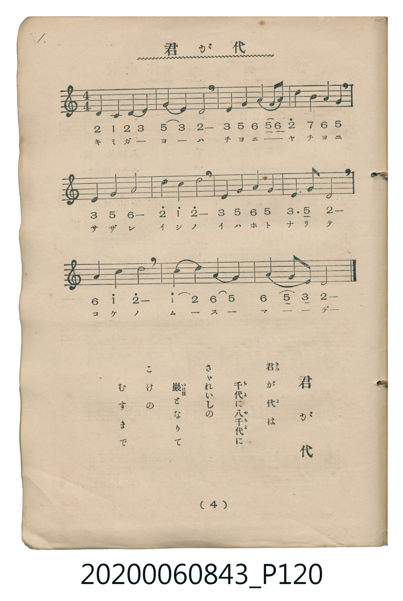

# 君が代

> Re:Shōka 使用 AI 協助辨識與重建樂譜，可能會有錯誤。歡迎回報。

- **鋼琴伴奏版**：<br><audio controls src="kimigayo.mp3"></audio>

- 詞：古歌
- 曲：林廣守
- 唱歌筆記帖（臺灣子供世界社發行，2020.006.0843）P120.jpg（第 4 頁）

## 說明

原書資訊與歌詞全文（對應 P120.jpg，印刷五線譜＋簡譜對照第 4 頁）：
調性與拍號：ハ調四分之四拍子（C 大調 4/4 拍），♩=66


## 歌詞

```text
君が代は　千代に八千代に
さざれいしの　巖となりて
こけの　むすまで
```

## ABC

<div class="abc-score" data-abc-src="kimigayo.abc" aria-label="五線譜載入中"></div>

[下載 ABC 原始檔](kimigayo.abc)

## TMD 檔案連結

- [主旋律 TMD 檔案](kimigayo.tmd) [[在 TMD Studio 編輯](https://tmdlang.github.io/Tmd-TS/#tmd=s7IKdvYPcrWy4qpTUCpJTLdSSM7PyUlNLsnMz7MqzsjPTkzOyFeCS5bl55TmploBqXgDQ4RwcX5pUXJqfEFieqpVgKGRAboM3KT4vPyS1KT8_GyEioKi_LLUvMQ8oKrcxLzS4uSizIKS-OT8gkqEmtSyzJRUkIri5MS8-LLUosy0zNQUJGelFhWDHQxxR0lRYh7EHKAgQlVJRirQ7Zm5BUD9iTno4smpRam5-XkoMvlFmemZeVZA4aRSoBeQJUoy8tOLEgsyKq0yMotLgAqTE3PisxPzEpW4tLQUnk6Y_bix58nuxQpaWlyKtgpmZlz2tgrOXDYm-iZ2IFNerJz3fs-sp_1Lnq3tARv7bPYmoMCzedOf7l78dF0HWOzplI1A6edr216smPF0x7T3ezpetO963rj46doJT_bNfrJj2vOpPc-X7Hs-c8-LhT3v9_QYGRgZ6BkYmOkZWJgYv9_TCYoKvayCdKDG52vWKJgovFzQCBRW4uLS11KwpRbgUlBQeNo3_9nsHS82t79Y0fWiox3oaqAHn7aueDatHWj50w29z9o7FRDO6Xnau-Fpx_Ynu6Y83z7rxdo57_d0P9-wEMgAqnzeuhzZscBAAVnwYtX-Zw3LQUZ3976YOR8o-ri5Hyj4dPbspx1tT3Z2AxlAKWDIAO1zVni6ZDlQUgEY2gpAUbAxPY9mrrQFxgPYubDoedy4_nFDw9PeZjB79dPW1XA2SN3jxqmPG6c9bup53NjyuHH648Z1INXbpz1uXPG4cdXjpq7Hjcsg6iY_bpwIkX7c1PC4cebjxn2PG5eD5CgPYChQ0NLn4vLOzM1MT6zMtwrLByY4hxqDmmqQJQo2Flp2YAa2mFUABuiTHQ3ARAIM1qcb-p-vb9CBxwYW5UCLQEbVKBgp6CoYAjGINgbiGgVTKAskAoI1YB5I1AxMm4F0xQGZ5nAhoCKwcT41Co-b1gK5j5vng8imNXAzHjevgLKBsYok2ggWAck9bu5GEl8CFkGXrQHHLe4Q2NVDeggg-w5iO9h3hiACzMIWCDAREBseUIgw2Ar2_Tawu5HCoAnsq6btYPE-dHFwuDxung0mO6Dh0AUNs1VA3Aa3iEA66ASFgjFJoQDyFrqXEXyEpyEsY2ye3gz23EZ0zzUvgLIfN-1EEp0HE21uhxtVy8Wla6cAywAKQLYyFwA)]
- [鋼琴伴奏 TMD 檔案](kimigayo_piano.tmd) [[在 TMD Studio 編輯](https://tmdlang.github.io/Tmd-TS/#tmd=s7IKdvYPcrWy4qpTUCpJTLdSyC8qychPL0osyKi0ysgsLskvykxOzInPTsxLVIIrKs4vLUpOjS9ITE-1CjA0MkDIlGSk5qZapaaUJieWZObnKXFpaSk8nTD7cWPPk92L3-_peNm95_mELU_2bHm6tP95Z8f7PZ0KWlpcirYKZmZc9rYKzlw2JvomdiDjXqyc937PrKf9S56t7QGb_2z2JqDAs3nTn-5e_HQdUGuHW1FiXpWCa3J2alGJwtNJPS8agSo6wYqfTtkI1Pd8bduLFTOe7pgGVPyifdfzxsVP1054sm_2kx3Tnk_teb5k3_OZe14s7Hm_p8fIwMhAz8DATM_AwsQYaAjIV3pZBelAjc_XrFEwUXi5oBFsNpd3Zm5memJlvlVYPjBgHGoMaqq5FIDAxkLLDsyoUTBS0FUwBGIQbQzENQqmUBZIBARrwDyQqBmYNgPpigMyzeFCQEVg43xqFB43rQVyHzfPB5FNa-BmPG5eAWU_bu5HEm0Ei4DkHjd3I4kvAYugy0KsQXURRAfYRYYgAszC5nCYCIgN9xzC3VvBLt4GtgvJ3U1glzRtB4v3oYuD_fK4eTaY7IC6vQvqz1VA3IZiUQ3YKejORPARDoWwjLE5dDPYQRvRHdS8AMp-3LQTSXQeTLS5HW5ULVLSCMhMzMsP8sCaOMzitUH2AylQEjGH8Ay1IenESBvkUggPKgX1DlgIIm2sjUg0ptpgP5pqgxKOCVgCoggWNpgaIQZCNZppgwMKysNlF9RIqAzIblMkx8HSD1gpNgONUcRQjYR5xhjVSIzQ9EEOTRNEVosHhmQ8UG-8gmE8yFtABkwAhIFuhjBAgsYwFSAM1AlWAAsnhDIQJmASXAAqhmwSzAg8GkEsoCDQCVC_6topwLyrAGQrcwEA)]

## 分析

```text
================================================================================
📊 TMD Song Profile: [ 君が代 ]
================================================================================
⏱  Duration:       0:40 (40.0s), 11 measures total
🎼 Key & Tempo:    首調基準 C, != 66.0 BPM, <4/4>
   - 分析範圍：      由實際發聲的音符與和弦推測調性；播放脈絡另行呈現
🎤 人聲音域:    C4 (MIDI 60) – D5 (MIDI 74) [跨度: 14 個半音 / 1.2 個八度, 難度: moderate]
   - 最低音:  C4 in [Kimigayo #1 @ m.1, 0:00]
   - 最高音: D5 in [Kimigayo #1 @ m.4, 0:10]
   - 適合: soprano, mezzo-soprano, contralto, tenor, baritone, bass
🏛  結構:      Kimigayo (40.0s)
⚡ 編曲密度:        Peak 1 軌道同時演奏
🗝  調性診斷：       D 大調（流行色彩大調，未偵測到可信轉調）
   - 風格氣質:    流行大調（略帶和弦色彩音與裝飾副屬和弦）
   - 轉調歷程:    全曲維持單一推測調性（未偵測到可信轉調）
   - 核心骨幹音:  D, G, A, E, C
   - 調性數值:    D 大調 [相關度: 0.80, 穩定度: Moderate, 自然音純度: 90.9%]
   - 候選調性 (K-S): D 大調 (0.80), G 大調 (0.75), D 小調 (0.65)
   - 五度圈歷程:   +2
   - 各段落調性細節:
     • [Kimigayo #1]: D 大調 (r: 0.80, 自然音純度: 90.9%, 調外音: C)

  [ 五度圈游移軌跡 ]
               C  
         F            G  
      Bb              [D ]*
      Eb               A  
         Ab           E  
            Db       B  
               F# 
     (* = active key center)

  [ 十二半音累積音高分佈 ]
     C  : ██████                     9.1%
     C# :                            0.0%
     D  : ████████████████████████  34.1%
     D# :                            0.0%
     E  : ███████████               15.9%
     F  :                            0.0%
     F# :                            0.0%
     G  : ██████████████            19.3%
     G# :                            0.0%
     A  : ██████████████            19.3%
     A# :                            0.0%
     B  : ██                         2.3%
--------------------------------------------------------------------------------
Assignment 軌道音域：
  - Vocal         : C4 – D5 (14 個半音 / 1.2 個八度, 40 個音符)
================================================================================
```


## 原書掃描頁




