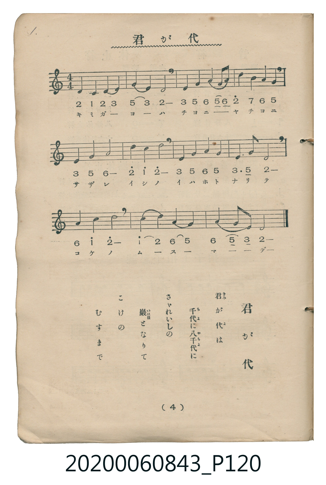

# 君が代

<audio controls src="kimigayo.mp3"></audio>

- 曲：林廣守
- 唱歌筆記帖（臺灣子供世界社發行，2020.006.0843）P120.jpg（第 4 頁）

## 說明

原書資訊與歌詞全文（對應 P120.jpg，印刷五線譜＋簡譜對照第 4 頁）：
調性與拍號：ハ調四分之四拍子（C 大調 4/4 拍）

## 跨冊／重複收錄參照

> 同曲（儀式歌〈君が代〉；收錄於《新定兒童唱歌》卷首與《唱歌帖》P048、P120）

- **[同曲]** 《新定兒童唱歌》尋常科第一學年用（2020.006.0847.0001）：[**〈君が代〉**](../../../shintei_jido_shoka/grade_1_2020.006.0847.0001/0_01_kimigayo/index.md)（`C` / `4/4` — [原始 TMD](../../../shintei_jido_shoka/grade_1_2020.006.0847.0001/0_01_kimigayo/kimigayo.tmd)）
- **[同曲]** 楊金土手抄《唱歌帖》第 3 冊・I（2020.006.0843）：[**〈君が代〉**](../../vol_03/p048a_kimi_ga_yo/index.md)（`C` / `4/4` — [原始 TMD](../../vol_03/p048a_kimi_ga_yo/kimi_ga_yo.tmd)）
- 總表：[跨冊重複與同名歌曲總索引](../../../duplicate_songs.md)

## 歌詞

```text
君が代は　千代に八千代に
さざれいしの　巖となりて
こけの　むすまで
```

## ABC

```abc
X:1
T:君が代
C:曲：林廣守
M:4/4
L:1/16
Q:1/4=66
K:C
V:V1 name="Vocal" snm="Voc"
[V:V1]
D4 C4 D4 E4 | G4 E4 D8 | E4 G4 A4 G2 A2 | d4 B4 A4 G4 |
E4 G4 A8 | d4 c4 d8 | E4 G4 A4 G4 | E6 G2 D8 |
A4 c4 d8 | c4 d4 A4 G4 | A4 G2 E2 D8 |
```

## TMD 檔案連結

- [主旋律 TMD 檔案](kimigayo.tmd) [[在 TMD Studio 編輯](https://tmdlang.github.io/Tmd-TS/#tmd=s7IKdvYPcrWy4tLSUng6Yfbjxp4nuxcraGlxKdoqmJlx2dsqOHPZmOib2HHVKSg9m73p_Z5Zz-ZNf7p78dN1HUogsadTNj5b2_N8bduLFTOe7pj2fk_Hi_ZdzxsXP1074cm-2U92THs-tef5kn3PZ-55sbDn_Z4eIwMjAz0DAzM9AwsT4_d7OgMMgfysgnSgxudr1iiYKLxc0AgUVuLi0tdSsKUW4FJQUHjaN__Z7B0vNre_WNH1oqMd6OoXK-c9bV3xbFo70PKnG3qftXcqIJzT87R3w9OO7U92TXm-fdaLtXPe7-l-vmEhkAFU-bx1ObJjgYECsuDFqv3PGpaDjO7ufTFzPlD0cXM_UPDp7NlPO9qe7OwGMoBSwJAB2ues8HTJcqCkAjBwFYCiQGO4wK6ERcLjxvWPGxqe9jaD2auftq6Gs0HqHjdOfdw47XFTz-PGlseN0x83rgOp3j7tceOKx42rHjd1PW5cBlE3-XHjRIj046aGx40zHzfue9y4HCRHebhCgYKWPheXd2ZuZnpiZb5VWH5yYo5DjUGNQjXIFgUbCy07MANbjCoAA_LJjgZg4lDQMFF4uqH_-foGHXg0aGLRALQLZFiNgpGCroIhEINoYyCuUTCFskAiIFgD5oFEzcC0GUhXHJBpDhcCKgKHO27H7eohx3HIFkOcArbYEESAWdjcBxMBseF-IOC8HZ1g5xmT5jyQfehuQfARroGwjJFcU8vFpWunAItsBSBbmQsA)]
- [鋼琴伴奏 TMD 檔案](kimigayo_piano.tmd) [[在 TMD Studio 編輯](https://tmdlang.github.io/Tmd-TS/#tmd=s7IKdvYPcrWy4tLSUng6Yfbjxp4nuxe_39PxsnvP8wlbnuzZ8nRp__POjvd7OhW0tLgUbRXMzLjsbRWcuWxM9E3suOoUlJ7N3vR-z6xn86Y_3b346Tqgyg63osS8KgXX5OzUohKFp5N6XjQCVXQqgRQ_nbLx2dqe52vbXqyY8XTHNKDiF-27njcufrp2wpN9s5_smPZ8as_zJfuez9zzYmHP-z09RgZGBnoGBmZ6BhYmxkBDAgyB_KyCdKDG52vWKJgovFzQCDabyzszNzM9sTLfKiw_OTHHocagRqGaSwEIbCy07MCMGgUjBV0FQyAG0cZAXKNgCmWBRECwBswDiZqBaTOQrjgg0xwuBFQENQ5ZKUQzWKkhiACzsJkIEwGx4bZCDQSpQNeN4CP0Q1jGSPprkQIgIDMxLz_IA3sQmMVrg3QBKVBAmEN4htqQ0DDSBpkP4UGloI4AC0GkjbURQWOqDXaZqTYoeEzAEhBFMB9haoQYCNVopg32HpSHyy6okVAZkN2mSI6DRQZYKTYDjVHEUI2EecYY1UiM4PRBCU4TRIqKBwZlPFBzvIJhPMhfQAZMAISBjoYwQILGMBUgDNQJVgALKIQyECZgElwAKoZsEswIPBpBLKAg0AlQz-raKcD8qwBkK3MBAA)]

## 分析

```text
================================================================================
📊 TMD Song Profile: [ 君が代 ]
================================================================================
⏱  Duration:       0:40 (40.0s), 11 measures total
🎼 Key & Tempo:    首調基準 C, != 66.0 BPM, <4/4>
   - 分析範圍：      由實際發聲的音符與和弦推測調性；播放脈絡另行呈現
🎤 人聲音域:    C4 (MIDI 60) – D5 (MIDI 74) [跨度: 14 個半音 / 1.2 個八度, 難度: moderate]
   - 最低音:  C4 in [Kimigayo #1 @ m.1, 0:00]
   - 最高音: D5 in [Kimigayo #1 @ m.4, 0:10]
   - 適合: soprano, mezzo-soprano, contralto, tenor, baritone, bass
🏛  結構:      Kimigayo (40.0s)
⚡ 編曲密度:        Peak 1 軌道同時演奏
🗝  調性診斷：       D 大調（流行色彩大調，未偵測到可信轉調）
   - 風格氣質:    流行大調（略帶和弦色彩音與裝飾副屬和弦）
   - 轉調歷程:    全曲維持單一推測調性（未偵測到可信轉調）
   - 核心骨幹音:  D, G, A, E, C
   - 調性數值:    D 大調 [相關度: 0.80, 穩定度: Moderate, 自然音純度: 90.9%]
   - 候選調性 (K-S): D 大調 (0.80), G 大調 (0.75), D 小調 (0.65)
   - 五度圈歷程:   +2
   - 各段落調性細節:
     • [Kimigayo #1]: D 大調 (r: 0.80, 自然音純度: 90.9%, 調外音: C)

  [ 五度圈游移軌跡 ]
               C  
         F            G  
      Bb              [D ]*
      Eb               A  
         Ab           E  
            Db       B  
               F# 
     (* = active key center)

  [ 十二半音累積音高分佈 ]
     C  : ██████                     9.1%
     C# :                            0.0%
     D  : ████████████████████████  34.1%
     D# :                            0.0%
     E  : ███████████               15.9%
     F  :                            0.0%
     F# :                            0.0%
     G  : ██████████████            19.3%
     G# :                            0.0%
     A  : ██████████████            19.3%
     A# :                            0.0%
     B  : ██                         2.3%
--------------------------------------------------------------------------------
Assignment 軌道音域：
  - Vocal         : C4 – D5 (14 個半音 / 1.2 個八度, 40 個音符)
================================================================================
```


## 原書掃描頁




