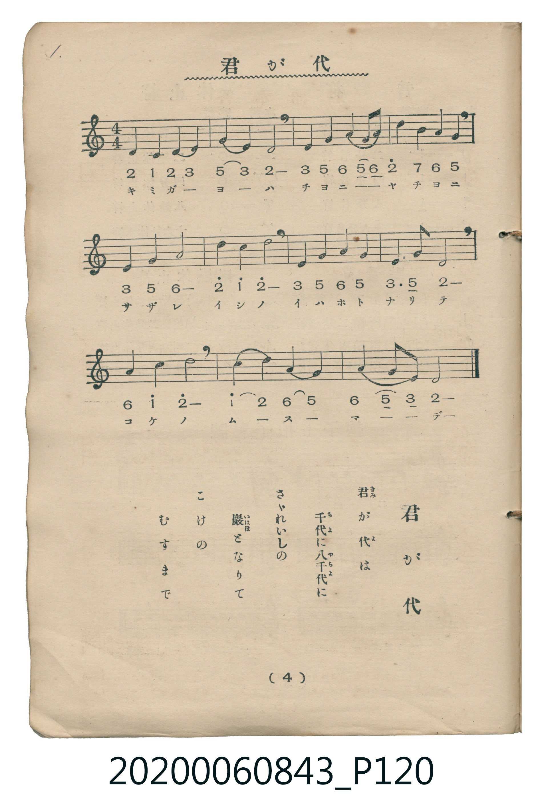

# 君が代

> Re:Shōka 使用 AI 協助辨識與重建樂譜，可能會有錯誤。歡迎回報。

- **鋼琴伴奏版**：<br><audio controls src="kimigayo.mp3"></audio>

- 詞：古歌
- 曲：林廣守
- 唱歌筆記帖（臺灣子供世界社發行，2020.006.0843）P120.jpg（第 4 頁）

## 說明

原書資訊與歌詞全文（對應 P120.jpg，印刷五線譜＋簡譜對照第 4 頁）：
調性與拍號：ハ調四分之四拍子（C 大調 4/4 拍），♩=66


## 歌詞

```text
君が代は　千代に八千代に
さざれいしの　巖となりて
こけの　むすまで
```

## ABC

<div class="abc-score" data-abc-src="kimigayo.abc" aria-label="五線譜載入中"></div>

[下載 ABC 原始檔](kimigayo.abc)

## TMD 檔案連結

- [主旋律 TMD 檔案](kimigayo.tmd) [[在 TMD Studio 編輯](https://tmdlang.github.io/Tmd-TS/#tmd=s7IKdvYPcrWy4qpTUCpJTLdSSM7PyUlNLsnMz7MqzsjPTkzOyFeCS5bl55TmploBqXgDQ4RwcX5pUXJqfEFieqpVgKGRAboM3KT4vPyS1KT8_GyEioKi_LLUvMQ8oKrcxLzS4uSizIKS-OT8gkqEmtSyzJRUkIri5MS8-LLUosy0zNQUJGelFhWDHQxxR0lRYh7EHKAgQlVJRirQ7Zm5BUD9iTno4smpRam5-XkoMvlFmemZeVZA4aRSoBeUuLS0FJ5OmP24sefJ7sUKWlpcirYKZmZc9rYKzlw2JvomdiCdL1bOe79n1tP-Jc_W9oCNejZ7E1Dg2bzpT3cvfrquAyz2dMpGoPTztW0vVsx4umPa-z0dL9p3PW9c_HTthCf7Zj_ZMe351J7nS_Y9n7nnxcKe93t6jAyMDPQMDMz0DCxMjN_v6QSFsl5WQTpQ4_M1axRMFF4uaAQKK3Fx6Wsp2FILcCkoKDztm_9s9o4Xm9tfrOh60dEOdDXQg09bVzyb1g60_OmG3mftnQoI5_Q87d3wtGP7k11Tnm-f9WLtnPd7up9vWAhkAFU-b12O7FhgoIAseLFq_7OG5SCju3tfzJwPFH3c3A8UfDp79tOOtic7u4EMoBQwZID2OSs8XbIcKKkADG0FoCjYmJ5HM1faAuMB7FxY9DxuXP-4oeFpbzOYvfpp62o4G6TucePUx43THjf1PG5sedw4_XHjOpDq7dMeN6543LjqcVPX48ZlEHWTHzdOhEg_bmp43DjzceO-x43LQXKUBzAUKGjpc3F5Z-ZmpidW5luF5Scn5jjUGNQoVINsUbCx0LIDM7BFrQIwRJ_saACmEmC4Pt3Q_3x9gw48OrAoB9oEMqpGwUhBV8EQiEG0MRDXKJhCWSAREKwB80CiZmDaDKQrDsg0hwsBFYGN86lReNy0Fsh93DwfRDatgZvxuHkFlA2MViTRRrAISO5xczeS-BKwCLpsDThycYfArh7SQwDZdxDbwb4zBBFgFrZAgImA2PCAQoTBVrDvt4HdjRQGTWBfNW0Hi_ehi4PD5XHzbDDZAQ2HLmiYrQLiNrhFBNJBJygUjEkKBZC30L2M4CM8DWEZY_P0ZrDnNqJ7rnkBlP24aSeS6DyYaHM73KhaLi5dOwVYDlAAspW5AA)]
- [鋼琴伴奏 TMD 檔案](kimigayo_piano.tmd) [[在 TMD Studio 編輯](https://tmdlang.github.io/Tmd-TS/#tmd=s7IKdvYPcrWy4tLSUng6Yfbjxp4nuxe_39PxsnvP8wlbnuzZ8nRp__POjvd7OhW0tLgUbRXMzLjsbRWcuWxM9E3suOoUlF6snPd-z6yn_Uuere1RAgk8m70JKPBs3vSnuxc_XQfU2uFWlJhXpeCanJ1aVKLwdFLPi0agik6w4qdTNgL1PV_b9mLFjKc7pgEVv2jf9bxx8dO1E57sm_1kx7TnU3ueL9n3fOaeFwt73u_pMTIwMtAzMDDTM7AwMQYaEmAI5GcVpAM1Pl-zRsFE4eWCRrDZXN6ZuZnpiZX5VmH5yYk5DjUGNQrVXApAYGOhZQdm1CgYKegqGAIxiDYG4hoFUygLJAKCNWAeSNQMTJuBdMUBmeZwIaAisHE-NQqPm9YCuY-b54PIpjVwMx43r4CyHzf3I4k2gkVAco-bu5HEl4BF0GUh1qC6CKID7CJDEAFmYXM4TATEhnsO4e6tYBdvA9uF5O4msEuatoPF-9DFwX553DwbTHZA3d4F9ecqIG5DsagG7BR0ZyL4CIdCWMbYHLoZ7KCN6A5qXgBlP27aiSQ6Dyba3A43qhYpbQRkJublB3lgTx1m8dogBwApUBoxh_AMtSEJxUgb5FQIDyoF9Q9YCCJtrI1INabaYE-aaoNSjglYAqIIFjiYGiEGQjWaaYNDCsrDZRfUSKgMyG5TJMfBEhBYKTYDjVHEUI2EecYY1UiM4PRBCU4TRGaLBwZlPFBzvIJhPMhfQAZMAISBjoYwQILGMBUgDNQJVgALKIQyECZgElwAKoZsEswIPBpBLKAg0AlQz-raKcD8qwBkK3MBAA)]

## 分析

```text
================================================================================
📊 TMD Song Profile: [ 君が代 ]
================================================================================
⏱  Duration:       0:40 (40.0s), 11 measures total
🎼 Key & Tempo:    首調基準 C, != 66.0 BPM, <4/4>
   - 分析範圍：      由實際發聲的音符與和弦推測調性；播放脈絡另行呈現
🎤 人聲音域:    C4 (MIDI 60) – D5 (MIDI 74) [跨度: 14 個半音 / 1.2 個八度, 難度: moderate]
   - 最低音:  C4 in [Kimigayo #1 @ m.1, 0:00]
   - 最高音: D5 in [Kimigayo #1 @ m.4, 0:10]
   - 適合: soprano, mezzo-soprano, contralto, tenor, baritone, bass
🏛  結構:      Kimigayo (40.0s)
⚡ 編曲密度:        Peak 1 軌道同時演奏
🗝  調性診斷：       D 大調（流行色彩大調，未偵測到可信轉調）
   - 風格氣質:    流行大調（略帶和弦色彩音與裝飾副屬和弦）
   - 轉調歷程:    全曲維持單一推測調性（未偵測到可信轉調）
   - 核心骨幹音:  D, G, A, E, C
   - 調性數值:    D 大調 [相關度: 0.80, 穩定度: Moderate, 自然音純度: 90.9%]
   - 候選調性 (K-S): D 大調 (0.80), G 大調 (0.75), D 小調 (0.65)
   - 五度圈歷程:   +2
   - 各段落調性細節:
     • [Kimigayo #1]: D 大調 (r: 0.80, 自然音純度: 90.9%, 調外音: C)

  [ 五度圈游移軌跡 ]
               C  
         F            G  
      Bb              [D ]*
      Eb               A  
         Ab           E  
            Db       B  
               F# 
     (* = active key center)

  [ 十二半音累積音高分佈 ]
     C  : ██████                     9.1%
     C# :                            0.0%
     D  : ████████████████████████  34.1%
     D# :                            0.0%
     E  : ███████████               15.9%
     F  :                            0.0%
     F# :                            0.0%
     G  : ██████████████            19.3%
     G# :                            0.0%
     A  : ██████████████            19.3%
     A# :                            0.0%
     B  : ██                         2.3%
--------------------------------------------------------------------------------
Assignment 軌道音域：
  - Vocal         : C4 – D5 (14 個半音 / 1.2 個八度, 40 個音符)
================================================================================
```


## 原書掃描頁




