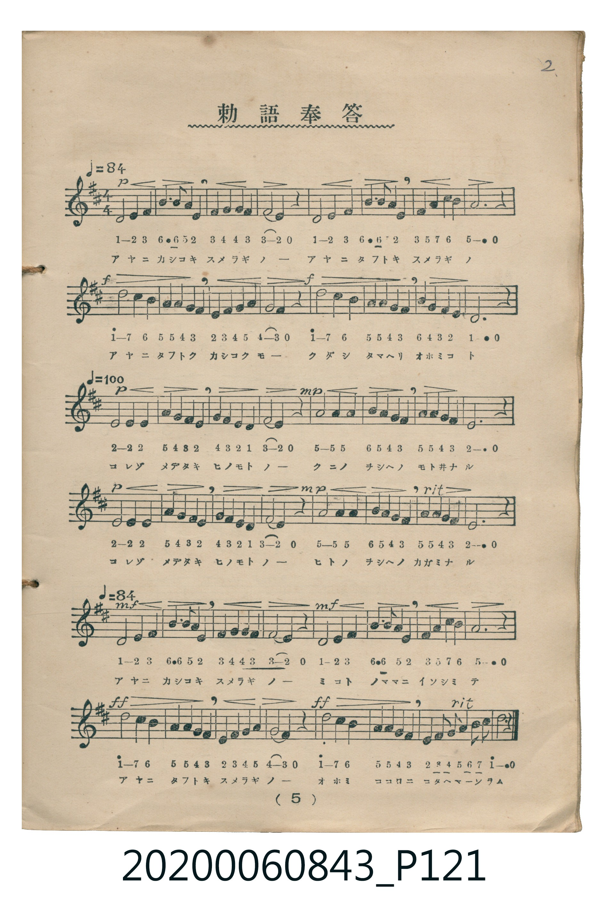

# 勅語奉答

<audio controls src="chokugo_hoto.mp3"></audio>

- 詞：勝安芳
- 曲：小山作之助
- 唱歌筆記帖（臺灣子供世界社發行，2020.006.0843）P121.jpg（第 5 頁）

## 說明

原書資訊與歌詞全文（對應 P121.jpg，印刷五線譜＋簡譜對照第 5 頁）：
調性與拍號：ニ調四分之四拍子（D 大調 4/4 拍），速度 ♩=84 → ♩=100 → ♩=84
力度記號：p → f → p → mp → p → mp → mf → ff, rit.

## 跨冊／重複收錄參照

> 同曲＋同名異曲（《新定兒童唱歌》卷首與《唱歌帖》P122 為「あな尊しや」同曲；《唱歌帖》P121 為小山作之助曲「あやにかしこき」另一版本）

- **[同名異曲]** 《新定兒童唱歌》尋常科第一學年用（2020.006.0847.0001）：[**〈勅語奉答〉**](../../../shintei_jido_shoka/grade_1_2020.006.0847.0001/0_02_chokugo_hoto/index.md)（`D` / `4/4` — [原始 TMD](../../../shintei_jido_shoka/grade_1_2020.006.0847.0001/0_02_chokugo_hoto/chokugo_hoto.tmd)）
- **[同名異曲]** 楊金土手抄《唱歌帖》第 1 冊（2020.006.0843）：[**〈勅語奉答（あな尊しや）〉**](../p122_chokugo_hoto_2/index.md)（`D` / `4/4` — [原始 TMD](../p122_chokugo_hoto_2/chokugo_hoto_2.tmd)）
- 總表：[跨冊重複與同名歌曲總索引](../../../duplicate_songs.md)

## 歌詞

```text
アヤニカシコキ　スメラギノ　アヤニタフトキ　スメラギノ
アヤニタフトク　カシコクモ　クダシタマヘリ　オホミコト
コレゾメデタキ　ヒノモトノ　クニノヲシヘノ　モトヰナル
コレゾメデタキ　ヒノモトノ　ヒトノヲシヘノ　カガミナル
アヤニカシコキ　スメラギノ　ミコトノママニ　イソシミテ
アヤニタフトキ　スメラギノ　オホミココロニ　コタヘマツラム
```

## ABC

```abc
X:1
T:勅語奉答
C:曲：小山作之助
M:4/4
L:1/16
Q:1/4=84
K:D
V:V1 name="Vocal" snm="Voc"
[V:V1]
D4 E2 F2 B3 B A2 E2 | F2 G2 G2 F2 F2 E2 z4 | D4 E2 F2 B3 B A2 E2 | F2 A2 c2 B2 A6 z2 |
d4 c2 B2 A2 A2 G2 F2 | E2 F2 G2 A2 G2 F2 z4 | d4 c2 B2 A2 A2 G2 F2 | B2 G2 F2 E2 D6 z2 |
E4 E2 E2 A2 G2 F2 E2 | G2 F2 E2 D2 F2 E2 z4 | A4 A2 A2 B2 A2 G2 F2 | A2 A2 G2 F2 E6 z2 |
E4 E2 E2 A2 G2 F2 E2 | G2 F2 E2 D2 F2 E2 z4 | A4 A2 A2 B2 A2 G2 F2 | A2 A2 G2 F2 E6 z2 |
D4 E2 F2 B3 B A2 E2 | F2 G2 G2 F2 F2 E2 z4 | D4 E2 F2 B3 B A2 E2 | F2 A2 c2 B2 A6 z2 |
d4 c2 B2 A2 A2 G2 F2 | E2 F2 G2 A2 G2 F2 z4 | d4 c2 B2 A2 A2 G2 F2 | E F G2 A B c2 d6 z2 |
```

## TMD 檔案連結

- [主旋律 TMD 檔案](chokugo_hoto.tmd) [[在 TMD Studio 編輯](https://tmdlang.github.io/Tmd-TS/#tmd=s7IKdvYPcrWy4tLSUnja3fpi1bynSzufr52ioKXFpWirYGHCZW-r4MJlY6JvYsdVp6D0YuW893tmPe2e-3Rd54uuzUogsWezN4HENvQ_3bjxyd45T3Z2P-1aCZZ5OmXjs7U9z9e2vVgx4-mOae_3dLxo3_W8cfHTtROe7Jv9ZMe051N7ni_Z93zmnhcLe97v6TEyMDLQMzAw0zOwMDF-v6czwNDIUC-rIB2o8fmaNQqmCi8XNAKFlbi49LUUbKkFuBQUFJ72zX82e8eLze0vVnS96GgHuhro06etK55Nawda_nRD77P2TgWEc3qe9m542rH9ya4pz7fPerF2zvs93c83LAQygCqfty5HdiwwaEAWvFi1_1nDcpDR3b0vZs4Hij5u7gYKPp09-2lHGyjMZs8GSgFDBmifi8LTJcuBkgrAYFcAioKN6XnZMP_prmUKj2autLUwUXjUNgnMNDQwgLOB0QXyS9dsoDpgkEPsKQBLp4FJCDsXQqFwciEK0tJ0FIoyS_S4QAY9blr0uHkJ0J2Pm1Y_btr-uGnz46a1jxsaHjftfNy88HHzysdN6x4394FF4Cr3P26e-ri5A6tKNEPhSteDlcLtWP-4eRFYBMgAkkBBoMp5j5tnPG5eBRZf9bh59uPm-SDFzR0QQ4GsNY-b9oFtawdpgNjfPAnkQKBxQGugLgUa2g0W3AQyGmQoWByqZsPj5q7HzatJNBQkAmajGQry0xqQS5EMJTpMYR4Emwv0PhB1g1Uuedy0F2wN0Nw2XGGKK6KQwg5k-lqYoUAuUC_Q4UBrWkBamheAjKY8e0GBgpY-F5dzRn52aXq-R35JvlVYfnJijkONQY1CNcgiBRtDMy07MAtb5lYA5qknOxqA5YSChpkCsLB5vr5BB54jNbFoANoHMqxGwVBBFwyNgNgYiM3APDNgDoWI1YBFTaAYxAZhkIwBVGcNSSaBeOZQWRAbBkGm1YAzFm4f7uoB-9CERB_GQa1AthaEYR6qgTsZJIIsg-FFwkaBRGE8kLGwUCHWjzs6cfhRB1ag4fUsyEpYJIAwsuMgkYDuOFzRCYscmBdh3kV4Fd3zMLuJ9CqwTCcnOoeQD4E1IN7ItDAZLlnzaevawZ81jYA0xBgzsCq4FoQna7m4dO0UkApiBSBXmQsA)]
- [鋼琴伴奏 TMD 檔案](chokugo_hoto_piano.tmd) [[在 TMD Studio 編輯](https://tmdlang.github.io/Tmd-TS/#tmd=s7IKdvYPcrWy4tLSUnja3fpi1bynSzufr53yfk_Hy-49zydsebJny9Ol_c87O97v6VTQ0uJStFWwMOGyt1Vw4bIx0Tex46pTUHqxct77PbOeds99uq7zRddmJZDYs9mbQGIb-p9u3Phk75wnO7ufdq0EyzydsvHZ2p7na9terJjxdMc0oE0v2nc9b1z8dO2EJ_tmP9kx7fnUnudL9j2fuefFwp73e3qMDIwM9AwMzPQMLEyMga4IMDQy1MsqSAdqfL5mjYKpwssFjUBhJS4u54z87NL0fI_8knyrsPzkxByHGoMahWouBSCwMTTTsgOzahQMFXTB0AiIjYHYDMwzAxoFEasBi5pAMYgNwiAZA6jOGpJMAvHMobIgNgyCTIObFAcVRFYIwjAn1MAtAYkgy2A4irBRIFEYD2QszB_orgLJwfwHwsimQPyHbgqukIL5G-YWmLsQbkJ3JczuoeCm0RRlBKQhxpiBVcG1IJxVi5pDAzIT8_KDPIjMoybasJAw0kaEhaE2OBy1QTZDSIgIhDSP1yYmiPEZDfaoNshDJupgZRAl2MLbWBvuZ6gOsAZjsAawuUgOrIE5DtkHEKXIytCdTqIdEFlkMZitOPwAlUbOXhAPo2YwqHOhfJBheAMc4jzknAZxGFoKgnsCJobkmiHr0NF0TIV0jF64IGnHX7z4oBQvJojSJR6ETOIVTOPjIVwo2wARuhhKjLAoAcpDFALrCqAcCAM5uJRATUNRAdMGwzCbcbgGxSpUNdQzaaCDR9sQrAYYo7p2CkiRqgDkKnMBAA)]

## 分析

```text
================================================================================
📊 TMD Song Profile: [ 勅語奉答 ]
================================================================================
⏱  Duration:       1:08 (68.6s), 24 measures total
🎼 Key & Tempo:    首調基準 D, != 84.0 BPM, <4/4>
   - 分析範圍：      由實際發聲的音符與和弦推測調性；播放脈絡另行呈現
🎤 人聲音域:    D4 (MIDI 62) – D5 (MIDI 74) [跨度: 12 個半音 / 1.0 個八度, 難度: easy]
   - 最低音:  D4 in [ChokugoHoto #1 @ m.1, 0:00]
   - 最高音: D5 in [ChokugoHoto #1 @ m.5, 0:11]
   - 適合: soprano, mezzo-soprano, contralto, tenor, baritone, bass
🏛  結構:      ChokugoHoto (68.6s)
⚡ 編曲密度:        Peak 1 軌道同時演奏
🗝  調性診斷：       D 大調（純淨自然大調，未偵測到可信轉調）
   - 風格氣質:    純淨自然大調（陽光明朗、易唱易記，無明顯調外色彩）
   - 轉調歷程:    全曲維持單一推測調性（未偵測到可信轉調）
   - 核心骨幹音:  A, E, F#, D, G
   - 調性數值:    D 大調 [相關度: 0.80, 穩定度: Moderate, 自然音純度: 100.0%]
   - 候選調性 (K-S): D 大調 (0.80), A 大調 (0.77), F# 小調 (0.61)
   - 五度圈歷程:   +2
   - 各段落調性細節:
     • [ChokugoHoto #1]: D 大調 (r: 0.80, 自然音純度: 100.0%)

  [ 五度圈游移軌跡 ]
               C  
         F            G  
      Bb              [D ]*
      Eb               A  
         Ab           E  
            Db       B  
               F# 
     (* = active key center)

  [ 十二半音累積音高分佈 ]
     C  :                            0.0%
     C# : ████                       4.0%
     D  : ███████████████           13.8%
     D# :                            0.0%
     E  : █████████████████████     19.3%
     F  :                            0.0%
     F# : ████████████████████      18.1%
     G  : ██████████████            12.6%
     G# :                            0.0%
     A  : ████████████████████████  22.1%
     A# :                            0.0%
     B  : ███████████               10.1%
--------------------------------------------------------------------------------
Assignment 軌道音域：
  - Vocal         : D4 – D5 (12 個半音 / 1.0 個八度, 152 個音符)
================================================================================
```


## 原書掃描頁




