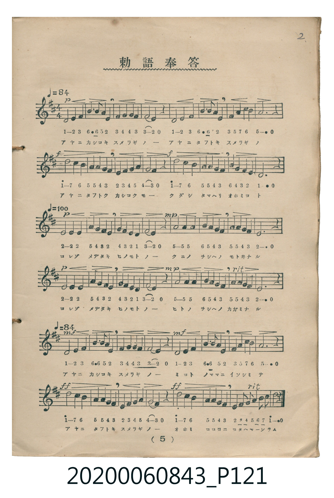

# 勅語奉答

> Re:Shōka 使用 AI 協助辨識與重建樂譜，可能會有錯誤。歡迎回報。

- **鋼琴伴奏版**：<br><audio controls src="chokugo_hoto.mp3"></audio>

- 詞：勝安芳
- 曲：小山作之助
- 唱歌筆記帖（臺灣子供世界社發行，2020.006.0843）P121.jpg（卷首印刷儀式歌第 5 頁）

## 說明


- 出處：唱歌筆記帖（臺灣子供世界社發行，2020.006.0843）P121.jpg（卷首印刷儀式歌第 5 頁）
- 調性與拍號：調號 ?= D，拍號 <4/4>，速度 != 84


## 歌詞

```text
> [!NOTE]
> **原件資訊與版面校勘**（對應《唱歌帖》第 1 冊 `P121.jpg`，卷首預印五線譜＋簡譜對照儀式歌頁 `( 5 )`，右上墨筆標 `2.`）：
> - **物理屬性**：本頁為筆記簿卷首預印之儀式歌專頁（`provenance:printed_text`），非手抄稿。
> - **調性、拍號與速度變化**：ニ長調四分之四拍子（D 大調 4/4 拍，2 個升記號 `?= D`）；起首標 `♩ = 84`（`p` → 第 9 小節 `f`），第 17 小節轉 `♩ = 100`（`p` → `mp`，第 31 小節標 `rit`），第 33 小節復歸 `♩ = 84`（`mf` → 第 41 小節 `ff`，第 47 小節標 `rit`）。
> - **原印簡譜四處排印誤植（均依上方五線譜正之）**：
>   1. **第 6 小節漏印 `5`**：五線譜明確為 `6. 6_ 5 2`（B4 附點四分、B4 八分、A4 四分、E4 四分），下方簡譜第 3 拍漏印 `5`（僅見斷裂殘點 `6 • 6_ ' 2`）。
>   2. **第 16 小節漏印延音線 `-`**：五線譜為附點二分音符加四分休止符（`1 - • 0`），下方簡譜漏印橫線作 `1 • 0`（對照第 8 小節印作 `5 - • 0`）。
>   3. **第 35 小節誤植八分音符底線**：五線譜全小節為四個四分音符 `3 4 4 3`，下方簡譜後二音誤加八分音符底線作 `3 4 4_ 3_`。
>   4. **第 38 小節漏印八分音符底線**：五線譜首二音為附點四分音符加八分音符 `6. 6_ 5 2`，下方簡譜第 2 個 `6` 漏印八分底線作 `6 • 6 5 2`。
> - **末二小節字音對位**：第 47 小節五線譜與簡譜為 `2_ 3_ 4 5_ 6_ 7`（其中 `5_ 6_` 帶圓滑線唱「マ ー」），對位為 `コ タ ヘ - マ - ツ -`；第 48 小節為單一附點二分音符 `1^` 加四分休止符，譜下印雙假名「ラム」，記於首拍 `ラム` 以完整保留詞尾助動詞。
>
> アヤニカシコキ　スメラギノ　アヤニタフトキ　スメラギノ
> アヤニタフトク　カシコクモ　クダシタマヘリ　オホミコト
> コレゾメデタキ　ヒノモトノ　クニノヲシヘノ　モトヰナル
> コレゾメデタキ　ヒノモトノ　ヒトノヲシヘノ　カガミナル
> アヤニカシコキ　スメラギノ　ミコトノママニ　イソシミテ
> アヤニタフトキ　スメラギノ　オホミココロニ　コタヘマツラム
```

## ABC

<div class="abc-score" data-abc-src="chokugo_hoto.abc" aria-label="五線譜載入中"></div>

[下載 ABC 原始檔](chokugo_hoto.abc)

## TMD 檔案連結

- [主旋律 TMD 檔案](chokugo_hoto.tmd) [[在 TMD Studio 編輯](https://tmdlang.github.io/Tmd-TS/#tmd=s7IKdvYPcrWy4qpTUCpJTLdSSM7PyUlNLsnMz7MqzsjPTkzOyFeCS5bl55TmploBqXgDQ4RwcX5pUXJqfEFieqpVgKERhgzcpPi8_JLUpPz8bISKgqL8stS8xDygqoKizLyS1JT4ktSKEoSC1LLMlFSQdHFyYl58WWpRZlpmagqSm1KLisGuhTiipCgxrzi5KLMA5AWEqvyikoz89KLEgoxKq4zM4pL8oszkxJz47MS8RISikoxUoO8ycwuAliTmoIsnpxal5ubnocgAjUnPzLPKTc3MygS7G-I5LS2Fp92tL1bNe7q08_naKQpaWlyKtgoWJlz2tgouXDYm-iZ2ICNerJz3fs-sp91zn67rfNG1GWzss9mbQGIb-p9u3Phk75wnO7ufdq0EyzydsvHZ2p7na9terJjxdMe093s6XrTvet64-OnaCU_2zX6yY9rzqT3Pl-x7PnPPi4U97_f0GBkYGegZGJjpGViYGL_f0wmKGb2sgnSgxqe9218um_a0d8PTju1PWxqe7ukHmbxmjYKpwssFjUC1Slxc-loKttQCXAoKCnYK0Yp-_iGusRCOltbTvvlPdm97sbn9xYquFx3tzzs7Xs5d9GzBwqfdM7S0QI7c0PusvfNxQxfE40AvP27oBjnSUOFpW5dCAsw_CUC_Qjz0csEEoJ-e7JryfPusF2vnvN_T_XzDQiADaNLz1uVwjwK9qJCgAfSrJlhr_-YnO7qeLloBDNlnK2YqJBjpAYU7gZEAcagu0KnPO1c-n9D2dOOaZw3LQW6b9WzOGqApz5t2QaLj-Yb9KC4ARhrMsqcbOsBB2pGAI6VDLOt5OXfes87uZ10tz1fsf9zQhLD7xar9QFsfNzQ-6-59MXM-MKReNsx_umvZi3VdT3umgV3zuLn75dTtQIVPZ89-2tEGsn72bKByYMoAWuyi8HTJcqCkAjDZKQBFQUlD4WlD99NeYMjPABqpkABKlhB3zH6xFeQPcEA8mrlSAZRqgTJA1ycoPGqbpAAKf0sFYPJ8vr5BISEN6nhwrJhDhV_s7YTpNTQwQNackFsACnGQamNgJIJVg20qyoQFA1jOGCr3dN_KZ2t3oDkkNw3hEhOYKUCngNwC1m4Ccwiy0ShBCkx5wFiCpo3Zs1_MnPqsbxJQ5MWqJc-WAMOn4-nc9if75gKTxbNpO-HJ6dnaxcCQBZoFDnOIaQoKhnqg9AG01gxm655-oFEKCaYJYHUI7TP6ni_aBUwyCglmegpm8cD0ZwTykJOJwsuZLS93z4NEHjCigSJPW1dD2I5ANkzcFcaGBNWTHd1A50F8AQ42UOQibAd5o7n1xTKgou0vFjc9WzcDaAfQboVHDYtA1quDrUcEjIKCEcwrhqh-ebp728v5m4G-UEjQRfMU0DsQxz_Z1QN0GEjZmmVPuxZAE-Keic_WLgKKgOLNEBj0IKtBKQLd-RB7nq1cDTQVWOgpABXDlIKKAWDmBTnLApYsgDkMpMgU2UQkfxjD_GFsCkuS4IiFBCrUjbumAu1C9czT1hUQ5UBfgTwAzCJgb0B0KCQYK5gAoTEonSE7_um-HqDvgYqAtoC8jmEL2LFgzfEKxvEJSC41gbsU5jdoiBNwKTCHQqyEhz-yS9EcgZreMJINuCwAqklQQLYbyeXQFAPWj5KNns1ZDYp2SJysnQ60DRhXT_b2gt2KkhPhDgeV8xCbQfnACBQewHAxjQe5zxwc263bnuxYC4xbkFCCwtMd257Omfxs90SgdmA18Lih53HzPIXHzXseNwDzKSgZQawEG_e4abPC46b9QOkZQPeBFILIFgVdoMGzwe6BhTIogqete7KjATPxAtNeHNBeLEm4B-hsYOABg-jl7JlPG9ufTugFu2fl4-YFYOf0AIvTZ9P2gIrP7l6gc8AyCQpPdi99uq7n2dQtT_bPfT51JrDSf7phH7BSf9o9FciGhSgkWB83LXrcvARYnj9uWv24aTvQR4-b1j5uaHjctPNx80KQiU3rHjf3gUXgKvc_bp76uLkDq0oMY-GK14MVw21Z_7h5EVgEyACSQEGgynnAoHzcvAosvupx8-zHzfNBips7YMYC2WseN-0D29gO0gJxQ_MkkCOBBgItgroWaGw3WHATyHCQsWBxqJoNj5u7HjevJtlYkAiYjWYsyF9rQK5FMZbosIV5E2wyMBCAqBuscsnjpr1gi4Amt-EOW1xRhhSGIPPXwowFcoF6gY4HWtQCSTcgwylveEGBgpY-F5czsBFemp7vkV-SbxWWD2z9OtQY1FSD7FGwsdACJ0AFbI0-UE0LzCrARiW8BNZRgDW-dBSAlbOthQkWbUA7QUZWF9SC6Rpgu00XDI2A2BiIa4CFCogPKlogojVgcRMohqgBkTBdBiARsGk-NaCAh0oBwx9MdoM1AKMXItq0HZSUwKy1UJmdYHULweRKsMw6iExzH9QsEERYQ7yjQTxzsDhIBMTDNA2vo_dDRacCcQfZjsYfi7t6sMcinthLg8deHNQiVF-CMCKyYKEEEgHJ1IBZIAgSJSEkQOEAIiEhsR4qA4pYULSCSEjEQmWaYWZhRB8xrgaJw3iQGIXFOpb4A9kIcXUD3DUIV0PqHEj9swoqA6KBGR9Mzoe7HeRqkO9Iib8dnfhyIbC1jSciFUHytUjZEeRTWMqG-Bo5VCAiyDxQmODNjiBfQUJmDdiX-6C-hKTcdrAYOJRgKbt5ElgGlIohMQgJEdzZsToX7npYDoPFJiQWUeMVe_okGK-gdAhxAcglm8AuBqc5aLzCZBAuBlZgYLILKgMpgIiOV1AfhNR8ORqNGMaCXA92C8T1kIghGI3QQgXsV0j2JDcaga1csitJRaA0MHPmIopbpAgasZUlOD4gzgM7DS1dQfoCkCIX5h2w55r2Qr0Ei1OQnjYMa_Bnyta1pFeWg6K2pCD-iHM1qC8LEjUDq0PShhmD4MoP4mxEBQgrZWCxCnIwwkM4OnFgh4Naxhh21XJx6dopIDVvFYBcZS4A)]
- [鋼琴伴奏 TMD 檔案](chokugo_hoto_piano.tmd) [[在 TMD Studio 編輯](https://tmdlang.github.io/Tmd-TS/#tmd=s7IKdvYPcrWy4tLSUnja3fpi1bynSzufr53yfk_Hy-49zydsebJny9Ol_c87O97v6VTQ0uJStFWwMOGyt1Vw4bIx0Tex46pTUHqxct77PbOeds99uq7zRddmJZDYs9mbQGIb-p9u3Phk75wnO7ufdq0EyzydsvHZ2p7na9terJjxdMc0oE0v2nc9b1z8dO2EJ_tmP9kx7fnUnudL9j2fuefFwp73e3qMDIwM9AwMzPQMLEyMga4IMDQy1MsqSAdqfNq7_eWyaU97Nzzt2P60peHpnn6QyWvWKJgqvFzQCFSrxMXlnJGfXZqe75Ffkm8VkJmYlx_k4VBjUFPNpQAENhZadmBGdUEtmK5RMFTQBUMjIDYG4hoFMzDfDGgoRLQGLG4CxRA1IBKmywAkAjbNp0bhcdMiqNTj5iVgshus4XHTaoho03Yg3gxmrYXK7ASrWwgmV4Jl1kFkmvugZoEgwhriHQ3imYPFQSIgHqZpeB29Hyo6FYg7KHJ0dRo8xOOgkqguA2FEAMN8BhIBydSAWSAIEiXB9SC3g0iI69dDZUCRAYoKEAmJDKhMM8wsjCAnxtUgcRgPEguwmMIS5iAbIa5ugLsG4ep5YHIGmFwFlQHRj5tng8n5cLeDXA3yHZYwV7Q1NDCoRUrtIEfBEg7EgcgegIgg80DOx5vaQQ6AeGIN2EH7oA6CJIx2sBjYQ7CE0zwJLANKJJDAhjgeT8LJhbseloBhAQ8JcNQowJ6UCEYBKMlAXAByySawi8HJAxoFMBmEix83bwCTXVAZSP7GcP1o0GMYC3I92C0Q10MCk2DQQ_Ms2K-Q1E8o6BVtLUyAiT8XUfIgBeaILevBYQdxHthpaGkAVPLASh-Yd8Cea9oL9RIs_EF62rBaU502KAp7CsKcOFcbQ11sBlaHpA0z1MFlN8TZiPIblothMQFyMMJDm8GeguUCSIy0QB2-8nHzAgy7arG0fnyQWz8m0NaPvpbCi76up7O2vGhqfb6yDdRYmz37ZfOKF43TXqxcAGxWwRtXkOaggpY-eqspXiHaMFYh2jQeSAAZwBgDipjAREAERBFQCCQDVoKsyQAR1sQaBVdkZA4SMo0HioH4IAbMOKRWBrIOoGnIIkD9EJvAZoDEQNbB7YYrwOFIXKbB3A1TCFdkiOxCjDoZxSNIGuEmQ8Wg4YgUUNgCFKnMhkobw8IfYQDcybjCBCNch5ZrMUv-QZteBzLBgrpDYCOBckBzgG0OMA3WBCpnQAUGehoGFjK6dgpI5YwCkKvMBQA)]

## 分析

```text
================================================================================
📊 TMD Song Profile: [ 勅語奉答 ]
================================================================================
⏱  Duration:       2:09 (129.8s), 48 measures total
🎼 Key & Tempo:    首調基準 D, != 84.0 BPM, <4/4>
   - 分析範圍：      由實際發聲的音符與和弦推測調性；播放脈絡另行呈現
🎤 人聲音域:    D4 (MIDI 62) – D5 (MIDI 74) [跨度: 12 個半音 / 1.0 個八度, 難度: easy]
   - 最低音:  D4 in [ChokugoHoto #1 @ m.1, 0:00]
   - 最高音: D5 in [ChokugoHoto #1 @ m.9, 0:22]
   - 適合: soprano, mezzo-soprano, contralto, tenor, baritone, bass
🏛  結構:      ChokugoHoto (129.8s)
⚡ 編曲密度:        Peak 1 軌道同時演奏
🗝  調性診斷：       D 大調（純淨自然大調，未偵測到可信轉調）
   - 風格氣質:    純淨自然大調（陽光明朗、易唱易記，無明顯調外色彩）
   - 轉調歷程:    全曲維持單一推測調性（未偵測到可信轉調）
   - 核心骨幹音:  A, F#, E, D, G
   - 調性數值:    D 大調 [相關度: 0.79, 穩定度: Moderate, 自然音純度: 100.0%]
   - 候選調性 (K-S): D 大調 (0.79), A 大調 (0.73), F# 小調 (0.63)
   - 五度圈歷程:   +2
   - 各段落調性細節:
     • [ChokugoHoto #1]: D 大調 (r: 0.79, 自然音純度: 100.0%)

  [ 五度圈游移軌跡 ]
               C  
         F            G  
      Bb              [D ]*
      Eb               A  
         Ab           E  
            Db       B  
               F# 
     (* = active key center)

  [ 十二半音累積音高分佈 ]
     C  :                            0.0%
     C# : ████                       3.9%
     D  : ███████████████           13.3%
     D# :                            0.0%
     E  : █████████████████████     18.6%
     F  :                            0.0%
     F# : ██████████████████████    19.7%
     G  : ███████████████           13.3%
     G# :                            0.0%
     A  : ████████████████████████  21.4%
     A# :                            0.0%
     B  : ███████████                9.7%
--------------------------------------------------------------------------------
Assignment 軌道音域：
  - Vocal         : D4 – D5 (12 個半音 / 1.0 個八度, 152 個音符)
================================================================================
```


## 原書掃描頁




