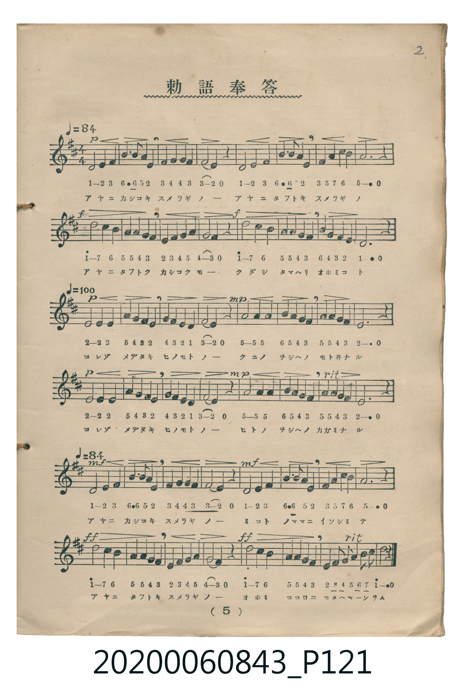

# 勅語奉答

> Re:Shōka 使用 AI 協助辨識與重建樂譜，可能會有錯誤。歡迎回報。

<audio controls src="chokugo_hoto.mp3"></audio>

- 詞：勝安芳
- 曲：小山作之助
- 唱歌筆記帖（臺灣子供世界社發行，2020.006.0843）P121.jpg（第 5 頁）

## 說明

原書資訊與歌詞全文（對應 P121.jpg，印刷五線譜＋簡譜對照第 5 頁）：
調性與拍號：ニ調四分之四拍子（D 大調 4/4 拍），速度 ♩=84 → ♩=100 → ♩=84
力度記號：p → f → p → mp → p → mp → mf → ff, rit.


## 跨冊／重複收錄參照

> 同曲＋同名異曲（《新定兒童唱歌》卷首與《唱歌帖》P122 為「あな尊しや」同曲；《唱歌帖》P121 為小山作之助曲「あやにかしこき」另一版本）

- **[同名異曲]** 《新定兒童唱歌》尋常科第一學年用（2020.006.0847.0001）：[**〈勅語奉答〉**](../../../shintei_jido_shoka/grade_1_2020.006.0847.0001/0_02_chokugo_hoto/index.md)（`D` / `4/4` — [原始 TMD](../../../shintei_jido_shoka/grade_1_2020.006.0847.0001/0_02_chokugo_hoto/chokugo_hoto.tmd)）
- **[同名異曲]** 楊金土手抄《唱歌帖》第 1 冊（2020.006.0843）：[**〈勅語奉答（あな尊しや）〉**](../p122_chokugo_hoto_2/index.md)（`D` / `4/4` — [原始 TMD](../p122_chokugo_hoto_2/chokugo_hoto_2.tmd)）
- 總表：[跨冊重複與同名歌曲總索引](../../../duplicate_songs.md)

## 歌詞

```text
アヤニカシコキ　スメラギノ　アヤニタフトキ　スメラギノ
アヤニタフトク　カシコクモ　クダシタマヘリ　オホミコト
コレゾメデタキ　ヒノモトノ　クニノヲシヘノ　モトヰナル
コレゾメデタキ　ヒノモトノ　ヒトノヲシヘノ　カガミナル
アヤニカシコキ　スメラギノ　ミコトノママニ　イソシミテ
アヤニタフトキ　スメラギノ　オホミココロニ　コタヘマツラム
```

## ABC

```abc
X:1
T:勅語奉答
C:曲：小山作之助
M:4/4
L:1/16
Q:1/4=84
K:D
V:V1 name="Vocal" snm="Voc"
[V:V1]
!p! D8 E4 F4 | B6 B2 A4 E4 | F4 G4 G4 F4 | F8 E4 z4 |
w: ア ヤ ニ | カ シ コ キ | ス メ ラ ギ | ノ _
D8 E4 F4 | B6 B2 A4 E4 | F4 A4 c4 B4 | A12 z4 |
w: ア ヤ ニ | タ フ ト キ | ス メ ラ ギ | ノ
!f! d8 c4 B4 | A4 A4 G4 F4 | E4 F4 G4 A4 | G8 F4 z4 |
w: ア ヤ ニ | タ フ ト ク | カ シ コ ク | モ _
d8 c4 B4 | A4 A4 G4 F4 | B4 G4 F4 E4 | D12 z4 |
w: ク ダ シ | タ マ ヘ リ | オ ホ ミ コ | ト
!p! E8 E4 E4 | A4 G4 F4 E4 | G4 F4 E4 D4 | F8 E4 z4 |
w: コ レ ゾ | メ デ タ キ | ヒ ノ モ ト | ノ _
!mp! A8 A4 A4 | B4 A4 G4 F4 | A4 A4 G4 F4 | E12 z4 |
w: ク ニ ノ | ヲ シ ヘ ノ | モ ト ヰ ナ | ル
!p! E8 E4 E4 | A4 G4 F4 E4 | G4 F4 E4 D4 | F8 E4 z4 |
w: コ レ ゾ | メ デ タ キ | ヒ ノ モ ト | ノ _
!mp! A8 A4 A4 | B4 A4 G4 F4 | A4 A4 G4 F4 | E12 z4 |
w: ヒ ト ノ | ヲ シ ヘ ノ | カ ガ ミ ナ | ル
!mf! D8 E4 F4 | B6 B2 A4 E4 | F4 G4 G4 F4 | F8 E4 z4 |
w: ア ヤ ニ | カ シ コ キ | ス メ ラ ギ | ノ _
D8 E4 F4 | B6 B2 A4 E4 | F4 A4 c4 B4 | A12 z4 |
w: ミ コ ト | ノ マ マ ニ | イ ソ シ ミ | テ
!ff! d8 c4 B4 | A4 A4 G4 F4 | E4 F4 G4 A4 | G8 F4 z4 |
w: ア ヤ ニ | タ フ ト キ | ス メ ラ ギ | ノ _
d8 c4 B4 | A4 A4 G4 F4 | E2 F2 G4 A2 B2 c4 | d12 z4 |
w: オ ホ ミ | コ コ ロ ニ | コ _ タ ヘ マ ツ | ラ
```

## TMD 檔案連結

- [主旋律 TMD 檔案](chokugo_hoto.tmd) [[在 TMD Studio 編輯](https://tmdlang.github.io/Tmd-TS/#tmd=s7IKdvYPcrWy4qpTUCpJTLdSSM7PyUlNLsnMz7MqzsjPTkzOyFeCS5bl55TmploBqXgDQ4RwcX5pUXJqfEFieqpVgKERhgzcpPi8_JLUpPz8bISKgqL8stS8xDygqtzEvNLi5KLMgpL45PyCSoSa1LLMlFSQiuLkxLz4stSizLTM1BQkZ6UWFYMdDHFHSVFiHsQcoCBCVUlGKtDtmbkFQP2JOejiyalFqbn5eWAZLS2Fp92tL1bNe7q08_naKQpaWlyKtgoWJlz2tgouXDYm-iZ2IN0vVs57v2fW0-65T9d1vujaDDbx2exNILEN_U83bnyyd86Tnd1Pu1aCZZ5O2fhsbc_ztW0vVsx4umPa-z0dL9p3PW9c_HTthCf7Zj_ZMe351J7nS_Y9n7nnxcKe93t6jAyMDPQMDMz0DCxMjN_v6QQFrF5WQTpQ4_M1axRMFV4uaAQKK3Fx6Wsp2FILcCkoKDztm_9s9o4Xm9tfrOh60dEOdDXQp09bVzyb1g60_OmG3mftnQoI5_Q87d3wtGP7k11Tnm-f9WLtnPd7up9vWAhkAFU-b12O7Fhg0IAseLFq_7OG5SCju3tfzJwPFH3c3A0UfDp79tOONlCYzZ4NlAKGDNA-F4WnS5YDJRWAwa4AFAUb0_OyYf7TXcsUHs1caWthovCobRKYaWhgAGcDowvkl67ZQHXAIIfYUwCWTgOTEHYuhELh5EIUpKXpKBRlluhxgQx63LTocfMSoDsfN61-3LT9cdPmx01rHzc0PG7a-bh54ePmlY-b1j1u7gOLwFXuf9w89XFzB1aVaIbCla4HK4Xbsf5x8yKwCJABJIGCQJXzHjfPeNy8Ciy-6nHz7MfN80GKmzsghgJZax437QPb1g7SALG_eRLIgUDjgNZAXQo0tBssuAlkNMhQsDhUzYbHzV2Pm1eTaChIBMxGMxTkpzUglyIZSnSYwjwINhfofSDqBqtc8rhpL9gaoLltuMIUV0QhhR3I9LUwQ4FcoF6gw4HWtIC0NC8AGU159oICBS19Li5nYKFYmp7vkV-SbxWWn5yY41BjUKNQDbJIwcZCyw7MwJa3FYBZ6smOBmAxoWChACxqnq9v0IHnRx1YnsBqKcjI6oJaMF2jYKigC4ZGQGwMxDUKZmC-GTDDQkRrwOImUAxRAyJhugxAImDTfGpAIQ-VAkYAmOwGawDGLkS0aTsoHYFZa6EyO8HqFoLJlWCZdRCZ5j6oWSAYD7eGeEeDeOZgcZAIiAeDRDp6P1R0KhB3kO1o_LG4qwd7LOKJvTR47MVBLUL1JQgjIgsWSiARkEwNmAWCIFESQgIUDiASEhLroTKgiAVFK4iERCxUphlmFkb0EeNqkDiMB4lRWKxjiT-QjRBXN8Bdg3D1PDA5A0yugsqAaGDOB5Pz4W4HuRrkO1Lib0cnvlwIqo6IyIYgH8JSNMS3yKEBEUHmgcICbzYE-QYSImvAvtsH9R0kxbaDxcChA0vRzZPAMqDUC4k5SEjgzobVuXDXw3IWLBYhsYcan9jTJcH4BKU_iAtALtkEdjE4rUHjEyaDcDGwzgKTXVAZSMFDdHwC2x0k58fRaIRCVNeD3QJxPSRiCEYjtDAB-xWSLcmNRmBTlOzKMRdRviLFzIitHcERAXEe2GloCQpUvsLKWJh3wJ5r2gv1EiwyQXraMByNPze2riW9dhwU1SMF8Uecq42hLjYDq0PShhmD4NoO4mxEjQcrXmCxCnIwwkMQGYi3ZkDjuAXqcJA3IKYtgDu9lotL104BqT2rAOQqcwEA)]
- [鋼琴伴奏 TMD 檔案](chokugo_hoto_piano.tmd) [[在 TMD Studio 編輯](https://tmdlang.github.io/Tmd-TS/#tmd=s7IKdvYPcrWy4tLSUnja3fpi1bynSzufr53yfk_Hy-49zydsebJny9Ol_c87O97v6VTQ0uJStFWwMOGyt1Vw4bIx0Tex46pTUHqxct77PbOeds99uq7zRddmJZDYs9mbQGIb-p9u3Phk75wnO7ufdq0EyzydsvHZ2p7na9terJjxdMc0oE0v2nc9b1z8dO2EJ_tmP9kx7fnUnudL9j2fuefFwp73e3qMDIwM9AwMzPQMLEyMga4IMDQy1MsqSAdqfL5mjYKpwssFjUBhJS4u54z87NL0fI_8knyrsPzkxByHGoMahWouBSCwsdCyAzNqFAwVdMHQCIiNgbhGwQzMNwOaBRGtAYubQDFEDYiE6TIAiYBN86lReNy0CCr1uHkJmOwGa3jctBoi2rQdiDeDWWuhMjvB6haCyZVgmXUQmeY-qFkgGA-3hnhHg3jmYHGQCIgHg0Q6ej9UdCoQd1Dq6DioIKqLQBgRsDAfgURAMjVgFgiCRElwNcjNIBLi6vVQGVAkgKIAREIiASrTDDOLLFeDxGE8SOjDYghLWINshLi6Ae4ahKvngckZYHIVVAZEP26eDSbnw90OcjXId9hcDXIELIFAHITsYIgIMg_kXLypGmQhxNFrwA7YB3UAJAG0g8XAHoAlkOZJYBlQYoAELsSx-BIILH3CwhcSrqghjT3FEAxpUMqAWAxywCawQ8GpABrSMBmEQx83bwCTXVAZSPYdDWkoRHU02AkQR0PCjmBIQ3Mi2IuQNE0wpEdLapBFoLCCOA_sNLSoBpUfsDIE5h2w55r2Qr0EC2-QnjZcjh7AkpqCoCbO1cZQF5uB1SFpwwxscMELcTai8IXlUVgEgByM8BBEBuKtGdDoaIE6HOQNiGkL4E6vRW2oBGQm5uUHeRDbVDHRhqUmI21EejLUBhc22iB_QkiICEwGHEbx2qg5glTjwUGrDQpCE3WwMmDYghVhBiUwhWvDQxmqB6rFGKwFbDaKQ6HOQ_YJRCnIFlg6g8hSZA9EHlkMajOuGhzuNFhIQRRDvI5a6kOdDeVDyn28EQBxJNjxUAxzIFoahnsGIYbkqiHv4NF0TvV0jlnsIRmB8AW20sgHpTQyQZRG8QgEDMJ4EDKNh2CwLEQILAsTB2EDREQQMgGIjMAIvwkQnejmIetANhGIiDMAi4NADBT9mJbgsZbEoMDtEexmDCa3jMDEoQ0pV0DagdlI104BKScpALnKXAA)]

## 分析

```text
================================================================================
📊 TMD Song Profile: [ 勅語奉答 ]
================================================================================
⏱  Duration:       2:17 (137.1s), 48 measures total
🎼 Key & Tempo:    首調基準 D, != 84.0 BPM, <4/4>
   - 分析範圍：      由實際發聲的音符與和弦推測調性；播放脈絡另行呈現
🎤 人聲音域:    D4 (MIDI 62) – D5 (MIDI 74) [跨度: 12 個半音 / 1.0 個八度, 難度: easy]
   - 最低音:  D4 in [ChokugoHoto #1 @ m.1, 0:00]
   - 最高音: D5 in [ChokugoHoto #1 @ m.9, 0:22]
   - 適合: soprano, mezzo-soprano, contralto, tenor, baritone, bass
🏛  結構:      ChokugoHoto (137.1s)
⚡ 編曲密度:        Peak 1 軌道同時演奏
🗝  調性診斷：       D 大調（純淨自然大調，未偵測到可信轉調）
   - 風格氣質:    純淨自然大調（陽光明朗、易唱易記，無明顯調外色彩）
   - 轉調歷程:    全曲維持單一推測調性（未偵測到可信轉調）
   - 核心骨幹音:  A, F#, E, D, G
   - 調性數值:    D 大調 [相關度: 0.79, 穩定度: Moderate, 自然音純度: 100.0%]
   - 候選調性 (K-S): D 大調 (0.79), A 大調 (0.73), F# 小調 (0.63)
   - 五度圈歷程:   +2
   - 各段落調性細節:
     • [ChokugoHoto #1]: D 大調 (r: 0.79, 自然音純度: 100.0%)

  [ 五度圈游移軌跡 ]
               C  
         F            G  
      Bb              [D ]*
      Eb               A  
         Ab           E  
            Db       B  
               F# 
     (* = active key center)

  [ 十二半音累積音高分佈 ]
     C  :                            0.0%
     C# : ████                       3.9%
     D  : ███████████████           13.3%
     D# :                            0.0%
     E  : █████████████████████     18.6%
     F  :                            0.0%
     F# : ██████████████████████    19.7%
     G  : ███████████████           13.3%
     G# :                            0.0%
     A  : ████████████████████████  21.4%
     A# :                            0.0%
     B  : ███████████                9.7%
--------------------------------------------------------------------------------
Assignment 軌道音域：
  - Vocal         : D4 – D5 (12 個半音 / 1.0 個八度, 152 個音符)
================================================================================
```


## 原書掃描頁




