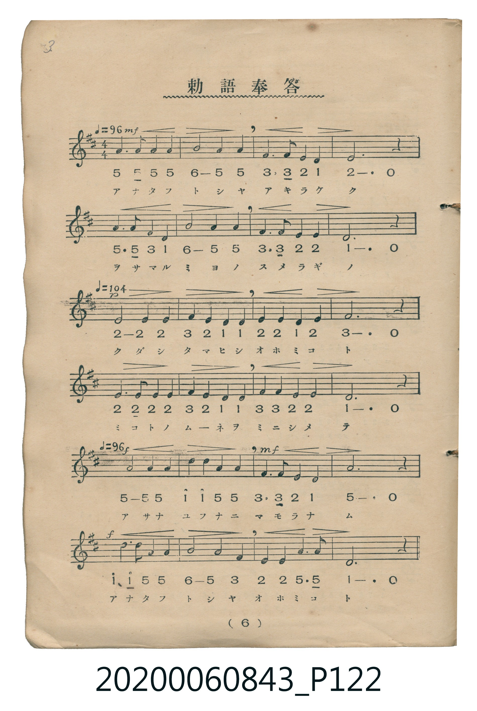

# 勅語奉答（あな尊しや）

<audio controls src="chokugo_hoto_2.mp3"></audio>

- 唱歌筆記帖（臺灣子供世界社發行，2020.006.0843）P122.jpg（第 6 頁）

## 說明

原書資訊與歌詞全文（對應 P122.jpg，印刷五線譜＋簡譜對照第 6 頁）：
調性與拍號：ニ調四分之四拍子（D 大調 4/4 拍），速度 ♩=96 → ♩=104 → ♩=96
力度記號：mf → p → f → mf → f

## 跨冊／重複收錄參照

> 同曲＋同名異曲（《新定兒童唱歌》卷首與《唱歌帖》P122 為「あな尊しや」同曲；《唱歌帖》P121 為小山作之助曲「あやにかしこき」另一版本）

- **[同曲]** 《新定兒童唱歌》尋常科第一學年用（2020.006.0847.0001）：[**〈勅語奉答〉**](../../../shintei_jido_shoka/grade_1_2020.006.0847.0001/0_02_chokugo_hoto/index.md)（`D` / `4/4` — [原始 TMD](../../../shintei_jido_shoka/grade_1_2020.006.0847.0001/0_02_chokugo_hoto/chokugo_hoto.tmd)）
- **[同名異曲]** 楊金土手抄《唱歌帖》第 1 冊（2020.006.0843）：[**〈勅語奉答〉**](../p121_chokugo_hoto/index.md)（`D` / `4/4` — [原始 TMD](../p121_chokugo_hoto/chokugo_hoto.tmd)）
- 總表：[跨冊重複與同名歌曲總索引](../../../duplicate_songs.md)

## 歌詞

```text
アナタフトシヤ　アキラケク
ヲサマルミヨノ　スメラギノ
クダシタマヒシ　オホミコト
ミコトノムーネヲ　ミニシメテ
アサナユフナニ　マモラナム
アナタフトシヤ　オホミコト
```

## ABC

```abc
X:1
T:勅語奉答（あな尊しや）
M:4/4
L:1/16
Q:1/4=96
K:D
V:V1 name="Vocal" snm="Voc"
[V:V1]
A6 A2 A4 A4 | B8 A4 A4 | F6 F2 E4 D4 | E12 z4 |
A6 A2 F4 D4 | B8 A4 A4 | F6 F2 E4 E4 | D12 z4 |
E8 E4 E4 | F4 E4 D4 D4 | E4 E4 D4 E4 | F12 z4 |
E6 E2 E4 E4 | F4 E4 D4 D4 | F4 F4 E4 E4 | D12 z4 |
A6 A2 A8 | d4 d4 A4 A4 | F6 F2 E4 D4 | A12 z4 |
d6 d2 A4 A4 | B8 A4 F4 | E4 E4 A6 A2 | D12 z4 |
```

## TMD 檔案連結

- [主旋律 TMD 檔案](chokugo_hoto_2.tmd) [[在 TMD Studio 編輯](https://tmdlang.github.io/Tmd-TS/#tmd=s7IKdvYPcrWy4tLSUnja3fpi1bynSzufr53yfk_H48amx42rnm7oetw4_XFTy_s9nQpaWlyKtgqWZlz2tgouXDYm-iZ2XHUKSk-nbHy2tuf52rYXK2Y83TENqPdF-67njYufrp3wZN_sJzumPZ_a83zJvucz97xY2PN-T4-RgZGBnoGBmZ6BhYkx0NwAQyMjvayCdKDG52vWKJgpvFzQCBRW4uLS11KwpRbgUlBQeNo3_9nsHS82t79Y0fWiox3o6hcr5z1tXfFsWjvQ8qcbep-1dyognNPztHfD047tT3ZNeb591ou1c97v6X6-YSGQAVT5vHU5smPf75kFsuDFqv3PGpaDjO7ufTFzPlD0cXM3UPDp7NlPO9qe7OwGMoBSwJAB2uei8HTJcqCkAjAgFYCiYGN6XjbMf7prmcKjmSttLc0UHrVNAjMNDUzgbGAEgPzSNRuoDhjkEHty08DyBWASwoYKpXGBlD9uWvS4uetx0_7HzVMfN3c8btr-uHnJ44YGkHjT2sfNKx83bXzctB6stHnT46atj5vnPW5e_bh5_uPmFY-b-8BKdz5uXghWug4oAjF1_eNmoMR2sMFADZNAbJDSVY-bZ4M0N20G2gYxFcoBGda84HHznsfNvSCrgKpBlnSDnQQ0vg3mXJAbuh43LwO7GMjoBisFWgL0yUqwyAL8PsNwA-WpCAoUtPS5uJwz8rNL0_M98kvyjazC8pMTcxxqDGoUqkE2KdhYaNmBGdjSsAIw6TzZ0QDMDgoaJgpPN_Q_X9-gA094OtBY1sSiEWgvyNAaBVMFXSA0BdMgXANMiiARCA8iYgzmGysYAUlDsAiIBYMGIBFw2sDtxl09ONxIlNtA9kPsxe82EK4BqyTFbTs68YYfMMfgdSQsKBAOADkJFlSI4IKJINSQ4EhgdicnACFuM8LrNpAITJS8ANw1hVoJEASB9seBHAci8CVBmHpiQ7B1LTkhCHYG2DXYMwjIXYj4hfkFWxjWcnHp2ikg53UFIF-ZCwA)]
- [鋼琴伴奏 TMD 檔案](chokugo_hoto_2_piano.tmd) [[在 TMD Studio 編輯](https://tmdlang.github.io/Tmd-TS/#tmd=s7IKdvYPcrWy4tLSUnja3fpi1bynSzufr53yfk_H48amx42rnm7oetw4_XFTy-Pm3S-79zyfsOXJni1Pl_Y_7-x4v6dTQUuLS9FWwdKMy95WwYXLxkTfxI6rTkHp6ZSNz9b2PF_b9mLFjKc7pgFNe9G-63nj4qdrJzzZN_vJjmnPp_Y8X7Lv-cw9Lxb2vN_TY2RgZKBnYGCmZ2BhYgw0N8DQyEgvqyAdqPH5mjUKZgovFzQChZW4uJwz8rNL0_M98kvyjazC8pMTcxxqDGoUqrkUgMDGQssOzKhRMFXQBUJTMA3CNUBDQCIQHkTEGMw3VjACkoZgERALBg1AImimgXRAVOI3DYRrwCqxmQazBaESpBfmCoRLYCIINbhNM8JrGkgEJorfbcjhBoJAlXEgY0AEvpCDqUc3D6wRrB97TIBMQvgWZjs299WiRX5AZmJefpAH9ug31oZHGZgFIWsUTLRhlqOKG2rDvGQer43wFZSDzWMIGyB6IRqINh9KIWQwbUCyHLsmJKeiOBdJnBRrjIi1BuphZEki7EGPEkjqMtYGpxA4RUSkGMG1Y1qBSG744x1iNDApQgyGUkBrkFIgFp9gTYM-KGnQBJ4GDeMRCOiCeBCC8SC0aTyUC2LAsAEi7-AxAFkHCINVQ81DmIBPFYoxUGEKTcHvGFTvYONREB5G8SCE7ABtUGqBR5uunQJyzCkA-cpcAA)]

## 分析

```text
================================================================================
📊 TMD Song Profile: [ 勅語奉答（あな尊しや） ]
================================================================================
⏱  Duration:       1:00 (60.0s), 24 measures total
🎼 Key & Tempo:    首調基準 D, != 96.0 BPM, <4/4>
   - 分析範圍：      由實際發聲的音符與和弦推測調性；播放脈絡另行呈現
🎤 人聲音域:    D4 (MIDI 62) – D5 (MIDI 74) [跨度: 12 個半音 / 1.0 個八度, 難度: easy]
   - 最低音:  D4 in [ChokugoHoto2 #1 @ m.3, 0:06]
   - 最高音: D5 in [ChokugoHoto2 #1 @ m.18, 0:42]
   - 適合: soprano, mezzo-soprano, contralto, tenor, baritone, bass
🏛  結構:      ChokugoHoto2 (60.0s)
⚡ 編曲密度:        Peak 1 軌道同時演奏
🗝  調性診斷：       A 大調（純淨自然大調，未偵測到可信轉調）
   - 風格氣質:    純淨自然大調（陽光明朗、易唱易記，無明顯調外色彩）
   - 轉調歷程:    全曲維持單一推測調性（未偵測到可信轉調）
   - 核心骨幹音:  E, A, D, F#, B
   - 調性數值:    A 大調 [相關度: 0.83, 穩定度: Moderate, 自然音純度: 100.0%]
   - 候選調性 (K-S): A 大調 (0.83), D 大調 (0.77), F# 小調 (0.55)
   - 五度圈歷程:   +3
   - 各段落調性細節:
     • [ChokugoHoto2 #1]: A 大調 (r: 0.83, 自然音純度: 100.0%)

  [ 五度圈游移軌跡 ]
               C  
         F            G  
      Bb               D  
      Eb              [A ]*
         Ab           E  
            Db       B  
               F# 
     (* = active key center)

  [ 十二半音累積音高分佈 ]
     C  :                            0.0%
     C# :                            0.0%
     D  : █████████████████████     23.3%
     D# :                            0.0%
     E  : ████████████████████████  26.7%
     F  :                            0.0%
     F# : ███████████████           16.7%
     G  :                            0.0%
     G# :                            0.0%
     A  : ████████████████████████  26.7%
     A# :                            0.0%
     B  : ██████                     6.7%
--------------------------------------------------------------------------------
Assignment 軌道音域：
  - Vocal         : D4 – D5 (12 個半音 / 1.0 個八度, 73 個音符)
================================================================================
```


## 原書掃描頁




