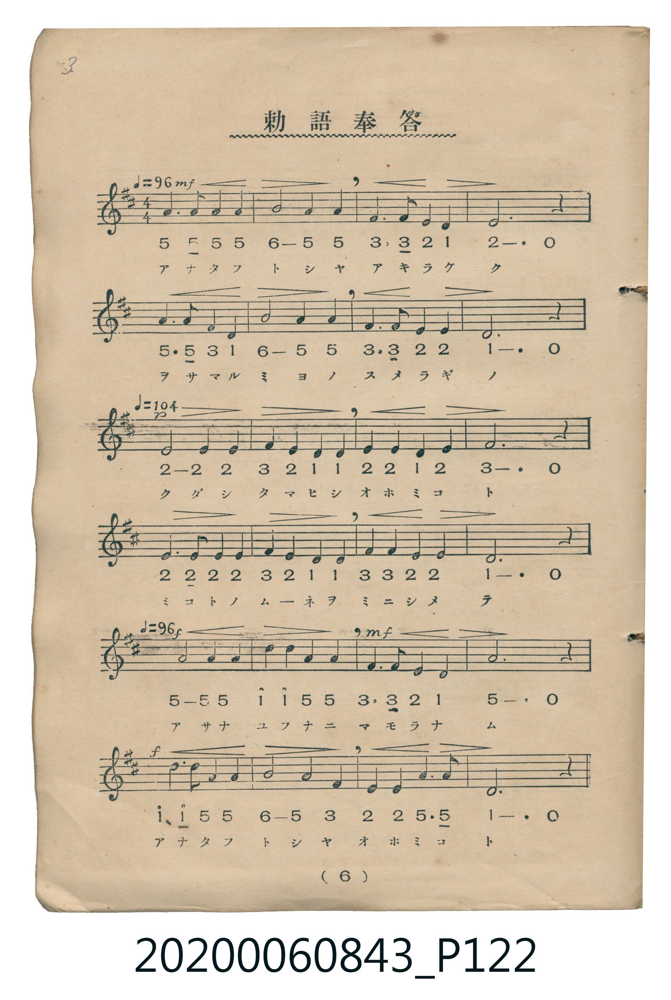

# 勅語奉答（あな尊しや）

> Re:Shōka 使用 AI 協助辨識與重建樂譜，可能會有錯誤。歡迎回報。

<audio controls src="chokugo_hoto_2.mp3"></audio>

- 唱歌筆記帖（臺灣子供世界社發行，2020.006.0843）P122.jpg（第 6 頁）

## 說明

原書資訊與歌詞全文（對應 P122.jpg，印刷五線譜＋簡譜對照第 6 頁）：
調性與拍號：ニ調四分之四拍子（D 大調 4/4 拍），速度 ♩=96 → ♩=104 → ♩=96
力度記號：mf → p → f → mf → f


## 跨冊／重複收錄參照

> 同曲＋同名異曲（《新定兒童唱歌》卷首與《唱歌帖》P122 為「あな尊しや」同曲；《唱歌帖》P121 為小山作之助曲「あやにかしこき」另一版本）

- **[同曲]** 《新定兒童唱歌》尋常科第一學年用（2020.006.0847.0001）：[**〈勅語奉答〉**](../../../shintei_jido_shoka/grade_1_2020.006.0847.0001/0_02_chokugo_hoto/index.md)（`D` / `4/4` — [原始 TMD](../../../shintei_jido_shoka/grade_1_2020.006.0847.0001/0_02_chokugo_hoto/chokugo_hoto.tmd)）
- **[同名異曲]** 楊金土手抄《唱歌帖》第 1 冊（2020.006.0843）：[**〈勅語奉答〉**](../p121_chokugo_hoto/index.md)（`D` / `4/4` — [原始 TMD](../p121_chokugo_hoto/chokugo_hoto.tmd)）
- 總表：[跨冊重複與同名歌曲總索引](../../../duplicate_songs.md)

## 歌詞

```text
アナタフトシヤ　アキラケク
ヲサマルミヨノ　スメラギノ
クダシタマヒシ　オホミコト
ミコトノムーネヲ　ミニシメテ
アサナユフナニ　マモラナム
アナタフトシヤ　オホミコト
```

## ABC

```abc
X:1
T:勅語奉答（あな尊しや）
M:4/4
L:1/16
Q:1/4=96
K:D
V:V1 name="Vocal" snm="Voc"
[V:V1]
!mf! A6 A2 A4 A4 | B8 A4 A4 | F6 F2 E4 D4 | E12 z4 |
w: ア ナ タ フ | ト シ ヤ | ア キ ラ ケ | ク
!p! A6 A2 F4 D4 | B8 A4 A4 | F6 F2 E4 E4 | D12 z4 |
w: ヲ サ マ ル | ミ ヨ ノ | ス メ ラ ギ | ノ
!f! E8 E4 E4 | F4 E4 D4 D4 | E4 E4 D4 E4 | F12 z4 |
w: ク ダ シ | タ マ ヒ シ | オ ホ ミ コ | ト
!mf! E6 E2 E4 E4 | F4 E4 D4 D4 | F4 F4 E4 E4 | D12 z4 |
w: ミ コ ト ノ | ム _ ネ ヲ | ミ ニ シ メ | テ
!f! A8 A4 A4 | d4 d4 A4 A4 | F6 F2 E4 D4 | A,12 z4 |
w: ア サ ナ | ユ フ ナ ニ | マ モ ラ ナ | ム
d6 d2 A4 A4 | B8 A4 F4 | E4 E4 A6 A,2 | D12 z4 |
w: ア ナ タ フ | ト シ ヤ | オ ホ ミ コ | ト
```

## TMD 檔案連結

- [主旋律 TMD 檔案](chokugo_hoto_2.tmd) [[在 TMD Studio 編輯](https://tmdlang.github.io/Tmd-TS/#tmd=s7IKdvYPcrWy4qpTUCpJTLdSSM7PyUlNLsnMz7MqzsjPTkzOyFeCS5bl55TmploBqXgDQ4RwcX5pUXJqfEFieqpVgKGREboM3KT4vPyS1KT8_GyEioKi_LLUvMQ8oKrcxLzS4uSizIKS-OT8gkqEmtSyzJRUkIri5MS8-LLUosy0zNQUJGelFhWDHQxxR0lRYh7EHKAgQlVJRirQ7Zm5BUD9iTno4smpRam5-XlgGS0thafdrS9WzXu6tPP52inv93Q8bmx63Ljq6Yaux43THze1vN_TqaClxaVoq2BpxmVvq-DCZWOib2IHMvLplI3P1vY8X9v2YsWMpzumAfW-aN_1vHHx07UTnuyb_WTHtOdTe54v2fd85p4XC3ve7-kxMjAy0DMwMNMzsDAxBpoLCj-9rIJ0oMbna9YomCm8XNAIFFbi4tLXUrClFuBSUFB42jf_2ewdLza3v1jR9aKjHejqFyvnPW1d8WxaO9Dypxt6n7V3KiCc0_O0d8PTju1Pdk15vn3Wi7Vz3u_pfr5hIZABVPm8dTmyY9_vmQWy4MWq_c8aloOM7u59MXM-UPRxczdQ8Ons2U872p7s7AYygFLAkAHa56LwdMlyoKQCMCAVgKJgY3peNsx_umuZwqOZK20tzRQetU0CMw0NTOBsYASA_NI1G6gOGOQQe3LTwPIFYBLChgqlcYGUP25a9Li563HT_sfNUx83dzxu2v64ecnjhgaQeNPax80rHzdtfNy0Hqy0edPjpq2Pm-c9bl79uHn-4-YVj5v7wEp3Pm5eCFa6DigCMXX942agxHawwUANk0BskNJVj5tngzQ3bQbaBjEVygEZ1rzgcfOex829IKuAqkGWdIOdBDS-DeZckBu6HjcvA7sYyOgGKwVaAvTJSrDIAvw-w3AD5akIChS09Lm4nIFZvDQ93yO_JN_IKiw_OTHHocagRqEaZJOCjYWWHZiBLQ0rAJPOkx0NwOygYKLwdEP_8_UNOvB0pwOLe6y2goyszk2rBTNqFEwVdIHQFEyDcA0wRYJEIDyIiDGYb6xgBCQNwSIgFgwagETApvnUgMISLAgMUCB7P5g1FawFGIJQDcAABosvgYjDdDStBYqtBLM2QmXWI1kTD7YGf4js6sEeInhCogA9IECehXgSf0CAcA1YJfaAaN4E9dZWIHse2MOroQExHxYQzSvAZB_UuzuhogvhAbEOqgOkgpSA2NGJL2mAygLcIQJPGrBIRvgW5H9YIkAkBJgIQg2OpAGLTmCOB_sOlAxA4pBkAgmjSSgyq8Bis8EkKNSAOREaIrDERGSIAItNkpMGIpNAQsIIb0iARGCiBNMGJAWAfAPxCTwNNC-Ah1EvmASlIpgOYAkGDx1QKoHItJEWEsDKiOxiA63UQM4ahnGgkAAR-MoNU5AD8RYckBwDKUAg_lsG5oEKEYgYJBRAMqAUA-IvguUXuB5YKBKbOlrXkpo6oD4G-xl72QnyPSKDQIuXeLzpgozCEz2HQFIV9hxSy8Wla6eAXOsoAPnKXAA)]
- [鋼琴伴奏 TMD 檔案](chokugo_hoto_2_piano.tmd) [[在 TMD Studio 編輯](https://tmdlang.github.io/Tmd-TS/#tmd=s7IKdvYPcrWy4tLSUnja3fpi1bynSzufr53yfk_H48amx42rnm7oetw4_XFTy-Pm3S-79zyfsOXJni1Pl_Y_7-x4v6dTQUuLS9FWwdKMy95WwYXLxkTfxI6rTkHp6ZSNz9b2PF_b9mLFjKc7pgFNe9G-63nj4qdrJzzZN_vJjmnPp_Y8X7Lv-cw9Lxb2vN_TY2RgZKBnYGCmZ2BhYgw0N8DQyEgvqyAdqPH5mjUKZgovFzQChZW4uJwz8rNL0_M98kvyjazC8pMTcxxqDGoUqrkUgMDGQssOzKhRMFXQBUJTMA3CNUBDQCIQHkTEGMw3VjACkoZgERALBg1AImDTfGoUHjctAgs-bu4CsveDWVPBWh43d0A1PG7aDhZfAhGH6WhaCxRbCWZthMqsR7ImHm4NwtEgh0EchN_RIFwDVond0c2boE7YCmTPAztuNdTR82GObl4BJvugTtsJFV0Id_Q6qA6QCmyOhoUZwkEgJ8LCFBGuMBGEGhwhDQudx80NYAeAQhUkDgl1iDcmocisAovNBpMgjz1u2gx1NCxusDvaCK-jQSIwUYIhDQlPkMUQS-Eh2rwA7p1eMAmKE5iOx83dcI-Awhwi04bD0ZDkgZwYDONArgUR-FK1KcgQvMkakkYgyRvihmVgHiiJQ8QgLgXJgCIAxF8ESyFwPTCforsb7ECwO7HnRpCLEWkEmgni8YY3GdkRPZFAYgt7IqlFK2gCMhPz8oM8sBc1xtrwfAtmQcgaBRNtmCdRxQ21YVFkHq-NiCUoB9O_yDZA9EI0EG0-lELIYNqAZDl2TUhORXEukjgp1hgRaw3Uw8iSRNiDHiUgCBIFp0Q4RUSk4Mg6cLPAqRp_tENMBqZ4iLlQCmgLckLH4hOsadAHJQ2awNOgYTwCAZ0QD0IwHoQ2jYdyQQwYNkDkUTwGIOsAYbBqqHkIE_CpQjEGKkyhKfgdg-odbDwKwsMoHoSQHaANSi3waNO1U0COOQUgX5kLAA)]

## 分析

```text
================================================================================
📊 TMD Song Profile: [ 勅語奉答（あな尊しや） ]
================================================================================
⏱  Duration:       1:00 (60.0s), 24 measures total
🎼 Key & Tempo:    首調基準 D, != 96.0 BPM, <4/4>
   - 分析範圍：      由實際發聲的音符與和弦推測調性；播放脈絡另行呈現
🎤 人聲音域:    A3 (MIDI 57) – D5 (MIDI 74) [跨度: 17 個半音 / 1.4 個八度, 難度: challenging]
   - 最低音:  A3 in [ChokugoHoto2 #1 @ m.20, 0:47]
   - 最高音: D5 in [ChokugoHoto2 #1 @ m.18, 0:42]
   - 適合: soprano, mezzo-soprano, contralto, tenor, baritone, bass
🏛  結構:      ChokugoHoto2 (60.0s)
⚡ 編曲密度:        Peak 1 軌道同時演奏
🗝  調性診斷：       A 大調（純淨自然大調，未偵測到可信轉調）
   - 風格氣質:    純淨自然大調（陽光明朗、易唱易記，無明顯調外色彩）
   - 轉調歷程:    全曲維持單一推測調性（未偵測到可信轉調）
   - 核心骨幹音:  E, A, D, F#, B
   - 調性數值:    A 大調 [相關度: 0.83, 穩定度: Moderate, 自然音純度: 100.0%]
   - 候選調性 (K-S): A 大調 (0.83), D 大調 (0.77), F# 小調 (0.55)
   - 五度圈歷程:   +3
   - 各段落調性細節:
     • [ChokugoHoto2 #1]: A 大調 (r: 0.83, 自然音純度: 100.0%)

  [ 五度圈游移軌跡 ]
               C  
         F            G  
      Bb               D  
      Eb              [A ]*
         Ab           E  
            Db       B  
               F# 
     (* = active key center)

  [ 十二半音累積音高分佈 ]
     C  :                            0.0%
     C# :                            0.0%
     D  : █████████████████████     23.3%
     D# :                            0.0%
     E  : ████████████████████████  26.7%
     F  :                            0.0%
     F# : ███████████████           16.7%
     G  :                            0.0%
     G# :                            0.0%
     A  : ████████████████████████  26.7%
     A# :                            0.0%
     B  : ██████                     6.7%
--------------------------------------------------------------------------------
Assignment 軌道音域：
  - Vocal         : A3 – D5 (17 個半音 / 1.4 個八度, 73 個音符)
================================================================================
```


## 原書掃描頁




