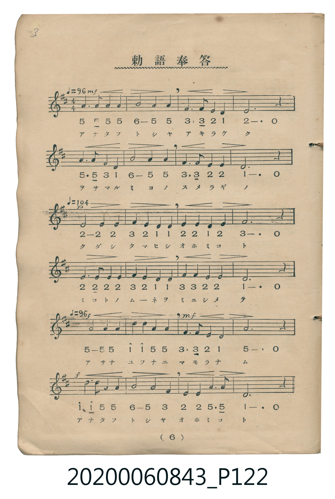

# 勅語奉答（あな尊しや）

> Re:Shōka 使用 AI 協助辨識與重建樂譜，可能會有錯誤。歡迎回報。

- **鋼琴伴奏版**：<br><audio controls src="chokugo_hoto_2.mp3"></audio>

- 唱歌筆記帖（臺灣子供世界社發行，2020.006.0843）P122.jpg（第 6 頁）

## 說明

原書資訊與歌詞全文（對應 P122.jpg，印刷五線譜＋簡譜對照第 6 頁）：
調性與拍號：ニ調四分之四拍子（D 大調 4/4 拍），速度 ♩=96 → ♩=104 → ♩=96
力度記號：mf → p → f → mf → f


## 歌詞

```text
アナタフトシヤ　アキラケク
ヲサマルミヨノ　スメラギノ
クダシタマヒシ　オホミコト
ミコトノムーネヲ　ミニシメテ
アサナユフナニ　マモラナム
アナタフトシヤ　オホミコト
```

## ABC

<div class="abc-score" data-abc-src="chokugo_hoto_2.abc" aria-label="五線譜載入中"></div>

[下載 ABC 原始檔](chokugo_hoto_2.abc)

## TMD 檔案連結

- [主旋律 TMD 檔案](chokugo_hoto_2.tmd) [[在 TMD Studio 編輯](https://tmdlang.github.io/Tmd-TS/#tmd=s7IKdvYPcrWy4qpTUCpJTLdSSM7PyUlNLsnMz7MqzsjPTkzOyFeCS5bl55TmploBqXgDQ4RwcX5pUXJqfEFieqpVgKGREboM3KT4vPyS1KT8_GyEioKi_LLUvMQ8oKrcxLzS4uSizIKS-OT8gkqEmtSyzJRUkIri5MS8-LLUosy0zNQUJGelFhWDHQxxR0lRYh7EHKAgQlVJRirQ7Zm5BUD9iTno4smpRam5-XkoMvlFmemZeVYliZnlQHvz09Iyk9HkSzLy04sSCzIqrTIyi0uA6pMTc-KzE_MSlbi0tBSedre-WDXv6dLO52unvN_T8bix6XHjqqcbuh43Tn_c1PJ-T6eClhaXoq2CpRmXva2CC5eNib6JHcj0p1M2Plvb83xt24sVM57umAbU-6J91_PGxU_XTniyb_aTHdOeT-15vmTf85l7Xizseb-nx8jAyEDPwMBMz8DCxBhoLigS9LIK0oEan69Zo2Cm8HJBI1BYiYtLX0vBllqAS0FB4Wnf_Gezd7zY3P5iRdeLjnagq1-snPe0dcWzae1Ay59u6H3W3qmAcE7P094NTzu2P9k15fn2WS_Wznm_p_v5hoVABlDl89blyI59v2cWyIIXq_Y_a1gOMrq798XM-UDRx83dQMGns2c_7Wh7srMbyABKAUMGaJ-LwtMly4GSCsCAVACKgo3pedkw_-muZQqPZq60tTRTeNQ2Ccw0NDCBs4ERAPJL12ygOmCQQ-zJTQPLF4BJCBsqlMYFUv64adHj5q7HTfsfN0993NzxuGn74-YljxsaQOJNax83r3zctPFx03qw0uZNj5u2Pm6e97h59ePm-Y-bVzxu7gMr3fm4eSFY6TqgCMTU9Y-bgRLbwQYDNUwCsUFKVz1ung3S3LQZaBvEVCgHZFjzgsfNex4394KsAqoGWdINdhLQ-DaYc0Fu6HrcvAzsYiCjG6wUaAnQJyvBIgvw-wzDDZSnIihQ0NLn4nIGlhOl6fke-SX5RlZh-cDM5FBjUFMNskjBxkLLDszAloQVgCnnyY4GYG5QMFF4uqH_-foGHXiy04FFPVZLQUZW56bVghk1CqYKukBoCqZBuAaYIEEiEB5ExBjMN1YwApKGYBEQCwYNQCJg03xqQEEJFgSGJ5C9H8yaCtYCDECoBmD4gsWXQMRhOprWAsVWglkboTLrkayJB1uDP0R29WAPETwhUYAeECDPQjyJPyBAuAasEntANG-CemsrkD0P7OHV0ICYDwuI5hVgsg_q3Z1Q0YXwgFgH1QFSQUpA7OjElzRARQHuEIEnDVgkI3wL8j8sESASAkwEoQZH0oBFJzDDg30HSgYgcUgygYTRJBSZVWCx2WASFGrAjAgNEVhiIjJEgKUmyUkDkUkgIWGENyRAIjBRgmkDkgJAvoH4BJ4GmhfAw6gXTIJSEUwHsACDhw4olUBk2kgLCWBdRHaxgVZqIGcNwzhQSIAIfOWGKciBeAsOSI6BFCAQ_y0D80CFCEQMEgogGVCKAfEXwfILXA8sFIlNHa1rSU0dUB-D_Yy97AT5HpFBoMVLPN50QUbhiZ5DIKkKew6p5eLStVNArnQUgHxlLgA)]
- [鋼琴伴奏 TMD 檔案](chokugo_hoto_2_piano.tmd) [[在 TMD Studio 編輯](https://tmdlang.github.io/Tmd-TS/#tmd=s7IKdvYPcrWy4qpTUCpJTLdSyC8qychPL0osyKi0ysgsLskvykxOzInPTsxLVIIrKs4vLUpOjS9ITE-1CjA0MkLIlGSk5qZapaaUJieWZObnKXFpaSk87W59sWre06Wdz9dOeb-n43Fj0-PGVU83dD1unP64qeVx8-6X3XueT9jyZM-Wp0v7n3d2vN_TqaClxaVoq2BpxmVvq-DCZWOib2IHsuPplI3P1vY8X9v2YsWMpzumAU170b7reePip2snPNk3-8mOac-n9jxfsu_5zD0vFva839NjZGBkoGdgYKZnYGFiDDQX5Fi9rIJ0oMbna9YomCm8XNAIFFbi4nLOyM8uTc_3yC_JN7IKywf62aHGoKaaSwEIbCy07MCMGgVTBV0gNAXTIFwDNAMkAuFBRIzBfGMFIyBpCBYBsWDQACQCNs2nRuFx0yKw4OPmLiB7P5g1FazlcXMHVMPjpu1g8SUQcZiOprVAsZVg1kaozHoka-Lh1iAcDXIYxEH4HQ3CNWCV2B3dvAnqhK1A9jyw41ZDHT0f5ujmFWCyD-q0nVDRhXBHr4PqAKnA5mhYmCEcBHIiLEwR4QoTQajBEdKw0Hnc3AB2AChUQeKQUId4YxKKzCqw2GwwCfLY46bNUEfD4ga7o43wOhokAhMlGNKQ8ARZDLEUHqLNC-De6QWToDiB6Xjc3A33CCjMITJtOBwNSR7IicEwDuRaEIEvVZuCDMGbrCFpBJK8IW5YBuaBkjhEDOJSkAwoAkD8RbAUAtcD8ym6u8EOBLsTe24EuRiRRqCZIB5veJORHdETCSS2sCeSWrRyJiAzMS8_yANrSWOsDc-2YBaErFEw0Yb5EVXcUBsWQ-bx2ohIgnIwvYtsA0QvRAPR5kMphAymDUiWY9eE5FQU5yKJk2KNEbHWQD2MLEmEPehRAoIgUXBChFNERAqOnAM3C5yo8Uc7xGRggoeYC6WAtiCncyw-wZoEfZCToAk8CRrGIxDQBfEgBONBaNN4KBfEgGEDRA7FYwCyDhAGq4aahzABnyoUY6DCFJqC3zGo3sHGoyA8jOJBCNkB2qDEAo81XTsF5IhTAPKVuQA)]

## 分析

```text
================================================================================
📊 TMD Song Profile: [ 勅語奉答（あな尊しや） ]
================================================================================
⏱  Duration:       1:00 (60.0s), 24 measures total
🎼 Key & Tempo:    首調基準 D, != 96.0 BPM, <4/4>
   - 分析範圍：      由實際發聲的音符與和弦推測調性；播放脈絡另行呈現
🎤 人聲音域:    A3 (MIDI 57) – D5 (MIDI 74) [跨度: 17 個半音 / 1.4 個八度, 難度: challenging]
   - 最低音:  A3 in [ChokugoHoto2 #1 @ m.20, 0:47]
   - 最高音: D5 in [ChokugoHoto2 #1 @ m.18, 0:42]
   - 適合: soprano, mezzo-soprano, contralto, tenor, baritone, bass
🏛  結構:      ChokugoHoto2 (60.0s)
⚡ 編曲密度:        Peak 1 軌道同時演奏
🗝  調性診斷：       A 大調（純淨自然大調，未偵測到可信轉調）
   - 風格氣質:    純淨自然大調（陽光明朗、易唱易記，無明顯調外色彩）
   - 轉調歷程:    全曲維持單一推測調性（未偵測到可信轉調）
   - 核心骨幹音:  E, A, D, F#, B
   - 調性數值:    A 大調 [相關度: 0.83, 穩定度: Moderate, 自然音純度: 100.0%]
   - 候選調性 (K-S): A 大調 (0.83), D 大調 (0.77), F# 小調 (0.55)
   - 五度圈歷程:   +3
   - 各段落調性細節:
     • [ChokugoHoto2 #1]: A 大調 (r: 0.83, 自然音純度: 100.0%)

  [ 五度圈游移軌跡 ]
               C  
         F            G  
      Bb               D  
      Eb              [A ]*
         Ab           E  
            Db       B  
               F# 
     (* = active key center)

  [ 十二半音累積音高分佈 ]
     C  :                            0.0%
     C# :                            0.0%
     D  : █████████████████████     23.3%
     D# :                            0.0%
     E  : ████████████████████████  26.7%
     F  :                            0.0%
     F# : ███████████████           16.7%
     G  :                            0.0%
     G# :                            0.0%
     A  : ████████████████████████  26.7%
     A# :                            0.0%
     B  : ██████                     6.7%
--------------------------------------------------------------------------------
Assignment 軌道音域：
  - Vocal         : A3 – D5 (17 個半音 / 1.4 個八度, 73 個音符)
================================================================================
```


## 原書掃描頁




