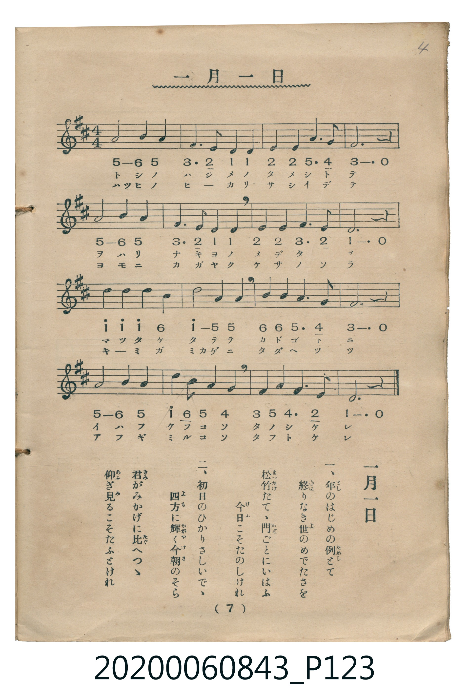

# 一月一日

<audio controls src="ichigatsu_ichijitsu.mp3"></audio>

- 詞：千家尊福
- 曲：上眞行
- 唱歌筆記帖（臺灣子供世界社發行，2020.006.0843）P123.jpg（第 7 頁）

## 說明

原書資訊與歌詞全文（對應 P123.jpg，印刷五線譜＋簡譜對照第 7 頁）：
調性與拍號：ニ調四分之四拍子（D 大調 4/4 拍）

## 跨冊／重複收錄參照

> 同曲（儀式歌〈一月一日〉；收錄於《新定兒童唱歌》卷首與《唱歌帖》P123）

- **[同曲]** 《新定兒童唱歌》尋常科第一學年用（2020.006.0847.0001）：[**〈一月一日〉**](../../../shintei_jido_shoka/grade_1_2020.006.0847.0001/0_05_ichigatsu_ichijitsu/index.md)（`D` / `4/4` — [原始 TMD](../../../shintei_jido_shoka/grade_1_2020.006.0847.0001/0_05_ichigatsu_ichijitsu/ichigatsu_ichijitsu.tmd)）
- 總表：[跨冊重複與同名歌曲總索引](../../../duplicate_songs.md)

## 歌詞

```text
一、年のはじめの例（ためし）とて
終りなき世のめでたさを
松竹たてて、門ごとにいはふ
今日こそたのしけれ

二、初日のひかりさしいで、
四方に輝く今朝のそら
君がみかげに比（たぐ）へつつ
仰ぎ見るこそたふとけれ
```

## ABC

```abc
X:1
T:一月一日
C:曲：上眞行
M:4/4
L:1/16
Q:1/4=96
K:D
V:V1 name="Vocal" snm="Voc"
[V:V1]
A8 B4 A4 | F6 E2 D4 D4 | E4 E4 A6 G2 | F12 z4 |
A8 B4 A4 | F6 E2 D4 D4 | E4 E4 F6 E2 | D12 z4 |
d4 d4 d4 B4 | d8 A4 A4 | B4 B4 A6 G2 | F12 z4 |
A8 B4 A4 | d4 B4 A4 G4 | F4 A4 G6 E2 | D12 z4 |
```

## TMD 檔案連結

- [主旋律 TMD 檔案](ichigatsu_ichijitsu.tmd) [[在 TMD Studio 編輯](https://tmdlang.github.io/Tmd-TS/#tmd=s7IKdvYPcrWy4tLSUniyo-HZnA4QOX2pgpYWl6KtgqUZl72tgguXjYm-iR1XnYLSi5Xz3u-Z9bS3-em6bU83dD1f1q8EEn42exNQ-MmOrudz5r1Y2AMWezpl47O1Pc_Xtr1YMePpjmnv93S8aN_1vHHx07UTnuyb_WTHtOdTe54v2fd85h6gjvd7eowMjAz0DAzM9AwsTIzf7-kMMDQy1ssqSAdqfL5mjYK5wssFjUBhJS4ufS0FW2oBLgUFhad985_N3vFic_uLFV0vOtqBrgZ682nrimfT2oGWP93Q-6y9UwHhnJ6nvRuedmx_smvK8-2zXqyd835P9_MNC4EMoMrnrcuRHQsMFJAFL1btf9awHGR0d--LmfOBoo-bu4GCT2fPftrR9mRnN5ABlAKGDNA-F4WnS5YDJRWAYa4AFAUawwUyBBgxjxsan-7c8rhx3ePG9Y8bZzxuagSyn-zrBup63DgfzJ0OVP64ccXjxmUgPSDwfGvT46aux42rHjf2AkMdpBukcDlIR-PUx02TYAqfzd33fPVOsPAyEGpofDmt4XHjFLBxqx83toBt3QpT_mR3FzChPG6c_LhxLlgT0FXTHzdOfNzUA3Hvrh6QezvmglUBJTc9buwGu2QqWCHQuOVABTDjQEEwDWj76hd7gMb1g0yfA2QA9c193NQJVzVh9uPGnseN-0FmNU4CKn-2fgrU-43A0AP6fcfjxiVAhHDmhseNfS-WAa0G6oA7divYV2DHAhVRno6gQEFLn4vLMzkjMz2xpLgUxMjKBDKswvKTE3McagxqFKrBDrOx0LIDM7ClZQVgEgLGNjBbKGiYKDzd0P98fYMOPAFqYtEAtBVkWI2CqYIuGJoBMYhdo2AM5hspGAJJEK4BskF8iLyugglcDQQagNSAIxC323b10NptMJkasDgpbtvRSY7bDONAToATICdCBUEQ5FqIi0ESMPeTFXbAZE6dsIO7E8Q1gQcnjIcr8Gq5uHTtFDBTqAJQVJkLAA)]
- [鋼琴伴奏 TMD 檔案](ichigatsu_ichijitsu_piano.tmd) [[在 TMD Studio 編輯](https://tmdlang.github.io/Tmd-TS/#tmd=s7IKdvYPcrWy4tLSUniyo-HZnA4QOX3p-z0dL7v3PJ-w5cmeLU-X9j_v7Hi_p1NBS4tL0VbB0ozL3lbBhcvGRN_EjqtOQenFynnv98x62tv8dN22pxu6ni_rVwIJP5u9CSj8ZEfX8znzXizsAYs9nbLx2dqe52vbXqyY8XTHNKA1L9p3PW9c_HTthCf7Zj_ZMe351J7nS_Y9n7kHqOP9nh4jAyMDPQMDMz0DCxNjoBMCDI2M9bIK0oEan69Zo2Cu8HJBI1BYiYvLMzkjMz2xpLgUxMjKBDKswvKTE3McagxqFKq5FIDAxkLLDsyoUTBV0AVDMyAGsWsUjMF8IwVDIAnCNUA2iA-R11UwgauBQAOQGjJMg8nUgMWxmWYYB9IEJ0CGQgVBEGQ-xA6QBMxGUt0HNxnENYE7GcbD5cBarOEckJmYlx_kgT2kjbVhtptogyyE8IGGa2OGkXm8NiiIoJQRVCfIZzDVmH4j33yECvzmg8MKSpnAKEisQEVBEGIvzHaIAghJmT_gFiMEjbQhMQYxDCIG9BNSxGGxBU_U-aBEnQk86gzjQcgETIJ5pvFgNpgLYiNjZAUGiLRMRSOACMaDmQARJcUJEB1AphEuF2iD0go8zHTtFDCDTQEoqswFAA)]

## 分析

```text
================================================================================
📊 TMD Song Profile: [ 一月一日 ]
================================================================================
⏱  Duration:       0:40 (40.0s), 16 measures total
🎼 Key & Tempo:    首調基準 D, != 96.0 BPM, <4/4>
   - 分析範圍：      由實際發聲的音符與和弦推測調性；播放脈絡另行呈現
🎤 人聲音域:    D4 (MIDI 62) – D5 (MIDI 74) [跨度: 12 個半音 / 1.0 個八度, 難度: easy]
   - 最低音:  D4 in [IchigatsuIchijitsu #1 @ m.2, 0:03]
   - 最高音: D5 in [IchigatsuIchijitsu #1 @ m.9, 0:20]
   - 適合: soprano, mezzo-soprano, contralto, tenor, baritone, bass
🏛  結構:      IchigatsuIchijitsu (40.0s)
⚡ 編曲密度:        Peak 1 軌道同時演奏
🗝  調性診斷：       D 大調（純淨自然大調，未偵測到可信轉調）
   - 風格氣質:    純淨自然大調（陽光明朗、易唱易記，無明顯調外色彩）
   - 轉調歷程:    全曲維持單一推測調性（未偵測到可信轉調）
   - 核心骨幹音:  D, A, F#, B, E
   - 調性數值:    D 大調 [相關度: 0.94, 穩定度: High, 自然音純度: 100.0%]
   - 候選調性 (K-S): D 大調 (0.94), A 大調 (0.69), F# 小調 (0.64)
   - 五度圈歷程:   +2
   - 各段落調性細節:
     • [IchigatsuIchijitsu #1]: D 大調 (r: 0.94, 自然音純度: 100.0%)

  [ 五度圈游移軌跡 ]
               C  
         F            G  
      Bb              [D ]*
      Eb               A  
         Ab           E  
            Db       B  
               F# 
     (* = active key center)

  [ 十二半音累積音高分佈 ]
     C  :                            0.0%
     C# :                            0.0%
     D  : ████████████████████████  26.7%
     D# :                            0.0%
     E  : █████████                 10.0%
     F  :                            0.0%
     F# : █████████████████         19.2%
     G  : █████                      5.8%
     G# :                            0.0%
     A  : ████████████████████████  26.7%
     A# :                            0.0%
     B  : ███████████               11.7%
--------------------------------------------------------------------------------
Assignment 軌道音域：
  - Vocal         : D4 – D5 (12 個半音 / 1.0 個八度, 48 個音符)
================================================================================
```


## 原書掃描頁




