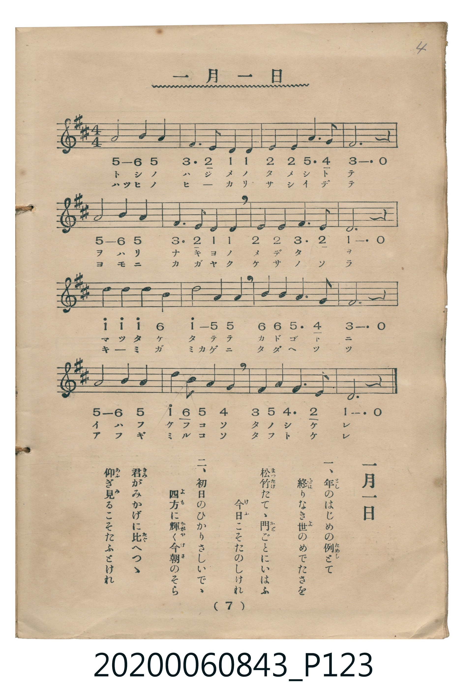

# 一月一日

> Re:Shōka 使用 AI 協助辨識與重建樂譜，可能會有錯誤。歡迎回報。

- **鋼琴伴奏版**：<br><audio controls src="ichigatsu_ichijitsu.mp3"></audio>

- 詞：千家尊福
- 曲：上眞行
- 唱歌筆記帖（臺灣子供世界社發行，2020.006.0843）P123.jpg（第 7 頁）

## 說明

原書資訊與歌詞全文（對應 P123.jpg，印刷五線譜＋簡譜對照第 7 頁）：
調性與拍號：ニ調四分之四拍子（D 大調 4/4 拍），♩=96


## 歌詞

```text
一、年のはじめの例（ためし）とて
終りなき世のめでたさを
松竹たてて、門ごとに
いはふ今日こそたのしけれ

二、初日のひかりさしいでて
四方に輝く今朝のそら
君がみかげに比（たぐ）へつつ
仰ぎ見るこそたふとけれ
```

## ABC

<div class="abc-score" data-abc-src="ichigatsu_ichijitsu.abc" aria-label="五線譜載入中"></div>

[下載 ABC 原始檔](ichigatsu_ichijitsu.abc)

## TMD 檔案連結

- [主旋律 TMD 檔案](ichigatsu_ichijitsu.tmd) [[在 TMD Studio 編輯](https://tmdlang.github.io/Tmd-TS/#tmd=s7IKdvYPcrWy4qpTUCpJTLdSSM7PyUlNLsnMz7MqzsjPTkzOyFeCS5bl55TmploBqXgDQ4RwcX5pUXJqfEFieqpVgKGRMboM3KT4vPyS1KT8_GyEioKi_LLUvMQ8oKrcxLzS4uSizIKS-OT8gkqEmtSyzJRUkIri5MS8-LLUosy0zNQUJGelFhWDHQxxR0lRYh7EHKAgQlVJRirQ7cWpicX5ecUI4fyizPTMPKvc_LykUqA7MSVSM7My40tSK0pQHZ5fVJKRn16UWJBRaZWRWVwCVJ6cmBOfnZiXqMSlpaXwZEfDszkdIHL6UgUtLS5FWwVLMy57WwUXLhsTfRM7kEEvVs57v2fW097mp-u2Pd3Q9XxZP9j8Z7M3AYWf7Oh6Pmfei4U9YLGnUzY-W9vzfG3bixUznu6Y9n5Px4v2Xc8bFz9dO-HJvtlPdkx7PrXn-ZJ9z2fuAep4v6fHyMDIQM_AwEzPwMLE-P2eTlC86GUVpAM1Pl-zRsFc4eWCRqCwEheXvpaCLbUAl4KCwtO--c9m73ixuf3Fiq4XHe1AVwO9-bR1xbNp7UDLn27ofdbeqYBwTs_T3g1PO7Y_2TXl-fZZL9bOeb-n-_mGhUAGUOXz1uXIjgUGCsiCF6v2P2tYDjK6u_fFzPlA0cfN3UDBp7NnP-1oe7KzG8gASgFDBmifi8LTJcuBkgrAMFcAioKN6Xk0c6UtMDZApgFj6HFD49OdWx43rnvcuP5x44zHTY1A9pN93UDtjxvng7nTgfoeN6543LgMpAcEnm9tetzU9bhx1ePGXmDwg3SDFC4H6Wic-rhpEkzhs7n7nq_eCRZeBkINjS-nNTxunAI2bjVM1ePGFrDtW5_s7gKmmMeNkx83zgVrArpq-uPGiY-beiDu3dUDcm_HXLAqoOSmx43dYJdMBSsEGgN0A9yZoLCYBrR99Ys9QOP6QabPATKA-uY-buqEq5ow-3Fjz-PG_SCzGicBlT9bPwXq_UZgMAL9vuNx4xIggul4snvD48a-F8uAVgN1wB27FewrsGOBiihPUFCgoKXPxeWZnJGZnlhSXApiZGUCGVZh-cA851BjUFMNdpeNhZYdmIEtTSsAkxIwsoHZQ8FE4emG_ufrG3Tg6RCLcqCVIKNqFEwVdMHQDIhB7BoFYzDfSMEQSIJwDZAN4kPkdYHmw9RAoAFIDdg0H8MahcfNHVDxx03bQWRzH9iMx839UNEdQPZCZJmm_WAeWAysB8TrAOtpQ7InHmGPEVCucT1IXeMSMLkJTK6DmAfmgU1p7Aab2QUVnwoWmw4mW6AqloNllmHYgz-kd_XQNqRhMjVgcVwhDfcnOGwfN6-ChjTIvyB_rwWyV6DEASTc28GyoFAH0VvBMjCzsIR0EyJGm8BhthoanqDQBfF7gDKg8ARmQajMRDAPEt6gWAHRc8Fx3UliSO_oJD2kDeNAAQonQAEOFQRBUNhDwh8kAYsNwul6HjjswP6EpNimjRDfQkMSJAtKrxASJA4Kp8fNIB8_btoCVQFJ15CQw56ue2GmNYJtAYYuJEwhPHCKbpyEEg_zwbwJYHIHVO8SsAwod5AQ2sDylBrpGhrUZmCuCVgIFLAwHsGE3QRzNixhgxISSBwU4BD-46bN4GDdixQFkGQOL0KAqkFBvQZPUIOSMyS4toJJaDYBBzXIhG4gezJYZi5KUENUg7IWiJ4IdgEomlDtqeXi0rVTwCzYFYCiylwA)]
- [鋼琴伴奏 TMD 檔案](ichigatsu_ichijitsu_piano.tmd) [[在 TMD Studio 編輯](https://tmdlang.github.io/Tmd-TS/#tmd=s7IKdvYPcrWy4qpTUCpJTLdSyC8qychPL0osyKi0ysgsLskvykxOzInPTsxLVIIrKs4vLUpOjS9ITE-1CjA0MkbIlGSk5qZapaaUJieWZObnKXFpaSk82dHwbE4HiJy-9P2ejpfde55P2PJkz5anS_ufd3a839OpoKXFpWirYGnGZW-r4MJlY6JvYgcy8cXKee_3zHra2_x03banG7qeL-sHW_Rs9iag8JMdXc_nzHuxsAcs9nTKxmdre56vbXuxYsbTHdOA1rxo3_W8cfHTtROe7Jv9ZMe051N7ni_Z93zmHqCO93t6jAyMDPQMDMz0DCxMjIFOAPlCL6sgHajx-Zo1CuYKLxc0AoWVuLg8kzMy0xNLiktBjKxMIMMqLB8YJA41BjXVXApAYGOhZQdm1CiYKuiCoRkQg9g1CsZgvpGCIZAE4RogG8SHyOsqmMDVQKABSA3YNB_DGoXHzR1Q8cdN20Fkcx_YjMfN_VDRHUD2QmSZpv1gHlgMrAfE6wDraUOyJx5hjxFQrnE9SF3jEjC5CUyug5gH5oFNaewGm9kFFZ8KFpsOJlugKpaDZZZhtYe00IHJ1IDFcYUO3G3g8HjcvAoaOiA3gty6FshegRJukLBqB8uCQgpEbwXLwMzCEjpNiFhoAvtzNTQMQCEC4vcAZUBh8LgR5A6QzEQwDxJGoJAE0XPB8dOJI3QM40CBACdAgQQVBEFQeEHCDCQBC0HC6Wce2L9gt0FSRtNGiAuhvgfJgtIFhASJg_z2uBnkysdNW6AqIOkH4lvs6acXZloj2BZgiEDCAcIDp5zGSShhNx_MmwAmd0D1LgHLgFIhcekHGjxmYK4JWAgUGDAewQTUBLMKloBAEQYSBwUShP-4aTM4KPYiBRskOcGzF1A1KHjW4AkeULKBeHErmIQmR3DwgEzoBrIng2XmogQPRDUoCYPoiWAXgIIW1Z5arMVUQGZiXn6QB9aCylgbFpgm2qDghPCBYaWNmSXN47VBORJKGUF1ghIeTDV62FJiPkIFfvPBUQ-lTGAUJNNARUEQYi_MdogCCEmZP-BWgIQhgkbakAQIMQwiBvQTUjrEYguemPNBjjkTeMwZxoOQCZgE80zjwWwwF8RGxsgKDBAlDRWNACIYD2YCRJQUJ0B0AJlGuFygDUoq8CDTtVPADLVoH8NYBRwyRmAZZS4A)]

## 分析

```text
================================================================================
📊 TMD Song Profile: [ 一月一日 ]
================================================================================
⏱  Duration:       0:40 (40.0s), 16 measures total
🎼 Key & Tempo:    首調基準 D, != 96.0 BPM, <4/4>
   - 分析範圍：      由實際發聲的音符與和弦推測調性；播放脈絡另行呈現
🎤 人聲音域:    D4 (MIDI 62) – D5 (MIDI 74) [跨度: 12 個半音 / 1.0 個八度, 難度: easy]
   - 最低音:  D4 in [IchigatsuIchijitsu #1 @ m.2, 0:03]
   - 最高音: D5 in [IchigatsuIchijitsu #1 @ m.9, 0:20]
   - 適合: soprano, mezzo-soprano, contralto, tenor, baritone, bass
🏛  結構:      IchigatsuIchijitsu (40.0s)
⚡ 編曲密度:        Peak 1 軌道同時演奏
🗝  調性診斷：       D 大調（純淨自然大調，未偵測到可信轉調）
   - 風格氣質:    純淨自然大調（陽光明朗、易唱易記，無明顯調外色彩）
   - 轉調歷程:    全曲維持單一推測調性（未偵測到可信轉調）
   - 核心骨幹音:  D, A, F#, B, E
   - 調性數值:    D 大調 [相關度: 0.95, 穩定度: High, 自然音純度: 100.0%]
   - 候選調性 (K-S): D 大調 (0.95), A 大調 (0.69), F# 小調 (0.64)
   - 五度圈歷程:   +2
   - 各段落調性細節:
     • [IchigatsuIchijitsu #1]: D 大調 (r: 0.95, 自然音純度: 100.0%)

  [ 五度圈游移軌跡 ]
               C  
         F            G  
      Bb              [D ]*
      Eb               A  
         Ab           E  
            Db       B  
               F# 
     (* = active key center)

  [ 十二半音累積音高分佈 ]
     C  :                            0.0%
     C# :                            0.0%
     D  : ████████████████████████  27.5%
     D# :                            0.0%
     E  : █████████                 10.0%
     F  :                            0.0%
     F# : █████████████████         19.2%
     G  : █████                      5.8%
     G# :                            0.0%
     A  : ███████████████████████   26.7%
     A# :                            0.0%
     B  : █████████                 10.8%
--------------------------------------------------------------------------------
Assignment 軌道音域：
  - Vocal         : D4 – D5 (12 個半音 / 1.0 個八度, 48 個音符)
================================================================================
```


## 原書掃描頁




