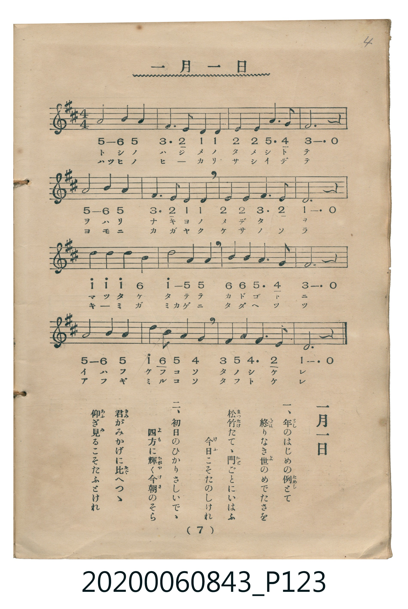

# 一月一日

> Re:Shōka 使用 AI 協助辨識與重建樂譜，可能會有錯誤。歡迎回報。

- **鋼琴伴奏版**：<br><audio controls src="ichigatsu_ichijitsu.mp3"></audio>

- 詞：千家尊福
- 曲：上眞行
- 唱歌筆記帖（臺灣子供世界社發行，2020.006.0843）P123.jpg（第 7 頁）

## 說明

原書資訊與歌詞全文（對應 P123.jpg，印刷五線譜＋簡譜對照第 7 頁）：
調性與拍號：ニ調四分之四拍子（D 大調 4/4 拍），♩=96


## 歌詞

```text
一、年のはじめの例（ためし）とて
終りなき世のめでたさを
松竹たてて、門ごとに
いはふ今日こそたのしけれ

二、初日のひかりさしいでて
四方に輝く今朝のそら
君がみかげに比（たぐ）へつつ
仰ぎ見るこそたふとけれ
```

## ABC

<div class="abc-score" data-abc-src="ichigatsu_ichijitsu.abc" aria-label="五線譜載入中"></div>

[下載 ABC 原始檔](ichigatsu_ichijitsu.abc)

## TMD 檔案連結

- [主旋律 TMD 檔案](ichigatsu_ichijitsu.tmd) [[在 TMD Studio 編輯](https://tmdlang.github.io/Tmd-TS/#tmd=s7IKdvYPcrWy4qpTUCpJTLdSSM7PyUlNLsnMz7MqzsjPTkzOyFeCS5bl55TmploBqXgDQ4RwcX5pUXJqfEFieqpVgKGRMboM3KT4vPyS1KT8_GyEioKi_LLUvMQ8oKrcxLzS4uSizIKS-OT8gkqEmtSyzJRUkIri5MS8-LLUosy0zNQUJGelFhWDHQxxR0lRYh7EHKAgQlVJRirQ7cWpicX5ecUI4fyizPTMPKvc_LykUqA7MSVSM7My40tSK0ogDtfSUniyo-HZnA4QOX2pgpYWl6KtgqUZl72tgguXjYm-iR3IiBcr573fM-tpb_PTdduebuh6vqwfbPKz2ZuAwk92dD2fM-_Fwh6w2NMpG5-t7Xm-tu3FihlPd0x7v6fjRfuu542Ln66d8GTf7Cc7pj2f2vN8yb7nM_cAdbzf02NkYGSgZ2BgpmdgYWL8fk8nKMj1sgrSgRqfr1mjYK7wckEjUFiJi0tfS8GWWoBLQUHhad_8Z7N3vNjc_mJF14uOdqCrgd582rri2bR2oOVPN_Q-a-9UQDin52nvhqcd25_smvJ8-6wXa-e839P9fMNCIAOo8nnrcmTHAgMFZMGLVfufNSwHGd3d-2LmfKDo4-ZuoODT2bOfdrQ92dkNZAClgCEDtM9F4emS5UBJBWCYKwBFwcb0PJq50hYYGyDTgDH0uKHx6c4tjxvXPW5c_7hxxuOmRiD7yb5uoPbHjfPB3OlAfY8bVzxuXAbSAwLPtzY9bup63LjqcWMvMPhBukEKl4N0NE593DQJpvDZ3H3PV-8ECy8DoYbGl9MaHjdOARu3GqbqcWML2PatT3Z3AVPM48bJjxvngjUBXTX9cePEx009EPfu6gG5t2MuWBVQctPjxm6wS6aCFQKNAboB7kxQWEwD2r76xR6gcf0g0-cAGUB9cx83dcJVTZj9uLHnceN-kFmNk4DKn62fAvV-IzAYgX7f8bhxCRDBdDzZveFxY9-LZUCrgTrgjt0K9hXYsUBFlCcoKFDQ0ufi8kzOyExPLCkuBTGyMoEMq7D85MQchxqDGoVqsMNsLLTswAxsiVoBmJaAsQ3MHwomCk839D9f36ADT4hYlAPtBBlVo2CqoAuGZkAMYtcoGIP5RgqGQBKEa4BsEB8irws0H6YGAg1AasCm-RjWKDxu7oCKP27aDiKb-8BmPG7uh4ruALIXIss07QfzwGJgPSBeB1hPG5I98Qh7jIByjetB6hqXgMlNYHIdxDwwD2xKYzfYzC6o-FSw2HQw2QJVsRwsswzDHvwhvauHtiENk6kBi-MKabg_wWH7uHkVNKRB_gX5ey2QvQIlDiDh3g6WBYU6iN4KloGZhSWkmxAx2gQOs9XQ8ASFLojfA5QBhScwD0JlJoJ5kPAGxQqInguO604SQ3pHJ-khbRgHClA4AQpwqCAIgsIeEv4gCVhsEE7X88BhB_YnJMU2bYT4FhqSIFlQeoWQIHFQOD1uBvn4cdMWqApIuoaEHPZ03QszrRFsCzB0IWEK4YFTdOMklHiYD-ZNAJM7oHqXgGVAuYOE0AYWqNRI19CgNgNzTcBCoICF8Qgm7CaYs2EJG5SQQOKgAIfwHzdtBgfrXqQogCRzeBECVA0K6jV4ghqUnCHBtRVMQrMJOKhBJnQD2ZPBMnNRghqiGpS1QPREsAtA0YRqTy0Xl66dAmbJrgAUVeYCAA)]
- [鋼琴伴奏 TMD 檔案](ichigatsu_ichijitsu_piano.tmd) [[在 TMD Studio 編輯](https://tmdlang.github.io/Tmd-TS/#tmd=s7IKdvYPcrWy4tLSUniyo-HZnA4QOX3p-z0dL7v3PJ-w5cmeLU-X9j_v7Hi_p1NBS4tL0VbB0ozL3lbBhcvGRN_EjqtOQenFynnv98x62tv8dN22pxu6ni_rVwIJP5u9CSj8ZEfX8znzXizsAYs9nbLx2dqe52vbXqyY8XTHNKA1L9p3PW9c_HTthCf7Zj_ZMe351J7nS_Y9n7kHqOP9nh4jAyMDPQMDMz0DCxNjoBMCDI2M9bIK0oEan69Zo2Cu8HJBI1BYiYvLMzkjMz2xpLgUxMjKBDKswvKTE3McagxqFKq5FIDAxkLLDsyoUTBV0AVDMyAGsWsUjMF8IwVDIAnCNUA2iA-R11UwgauBQAOQGrBpPoY1Co-bO6Dij5u2g8jmPrAZj5v7oaI7gOyFyDJN-8E8sBhYD4jXAdbThmRPPMIeI6Bc43qQusYlYHITmFwHMQ_MA5vS2A02swsqPhUsNh1MtkBVLAfLLMNqD2mhA5OpAYvjCh2428Dh8bh5FTR0QG4EuXUtkL0CJdwgYdUOlgWFFIjeCpaBmYUldJoQsdAE9udqaBiAQgTE7wHKgMLgcSPIHSCZiWAeJIxAIQmi54LjpxNH6BjGgQIBToACCSoIgqDwgoQZSAIWgoTTzzywf8Fug6SMpo0QF0J9D5IFpQsICRIH-e1xM8iVj5u2QFVA0g_Et9jTTy_MtEawLcAQgYQDhAdOOY2TUMJuPpg3AUzugOpdApYBpULi0g80eMzAXBOwECgwYDyCCagJZhUsAYEiDCQOCiQI_3HTZnBQ7EUKNkhygmcvoGpQ8KzBEzygZAPx4lYwCU2O4OABmdANZE8Gy8xFCR6IalASBtETwS4ABS2qPbVYy6mAzMS8_CAP7CWVsTYsNE20QeEJ4QMDSxszT5rHa4OyJJQyguoEpTyYavTApcR8hAr85oPjHkqZwChIroGKgiDEXpjtEAUQkjJ_wK0ACUMEjbQhKRBiGEQM6CekhIjFFjxR54MSdSbwqDOMByETMAnmmcaD2WAuiI2MkRUYIMoaKhoBRDAezASIKClOgOgAMo1wuUAblFbgYaZrp4AZbNE-hrEKOGSMwDLKXAA)]

## 分析

```text
================================================================================
📊 TMD Song Profile: [ 一月一日 ]
================================================================================
⏱  Duration:       0:40 (40.0s), 16 measures total
🎼 Key & Tempo:    首調基準 D, != 96.0 BPM, <4/4>
   - 分析範圍：      由實際發聲的音符與和弦推測調性；播放脈絡另行呈現
🎤 人聲音域:    D4 (MIDI 62) – D5 (MIDI 74) [跨度: 12 個半音 / 1.0 個八度, 難度: easy]
   - 最低音:  D4 in [IchigatsuIchijitsu #1 @ m.2, 0:03]
   - 最高音: D5 in [IchigatsuIchijitsu #1 @ m.9, 0:20]
   - 適合: soprano, mezzo-soprano, contralto, tenor, baritone, bass
🏛  結構:      IchigatsuIchijitsu (40.0s)
⚡ 編曲密度:        Peak 1 軌道同時演奏
🗝  調性診斷：       D 大調（純淨自然大調，未偵測到可信轉調）
   - 風格氣質:    純淨自然大調（陽光明朗、易唱易記，無明顯調外色彩）
   - 轉調歷程:    全曲維持單一推測調性（未偵測到可信轉調）
   - 核心骨幹音:  D, A, F#, B, E
   - 調性數值:    D 大調 [相關度: 0.95, 穩定度: High, 自然音純度: 100.0%]
   - 候選調性 (K-S): D 大調 (0.95), A 大調 (0.69), F# 小調 (0.64)
   - 五度圈歷程:   +2
   - 各段落調性細節:
     • [IchigatsuIchijitsu #1]: D 大調 (r: 0.95, 自然音純度: 100.0%)

  [ 五度圈游移軌跡 ]
               C  
         F            G  
      Bb              [D ]*
      Eb               A  
         Ab           E  
            Db       B  
               F# 
     (* = active key center)

  [ 十二半音累積音高分佈 ]
     C  :                            0.0%
     C# :                            0.0%
     D  : ████████████████████████  27.5%
     D# :                            0.0%
     E  : █████████                 10.0%
     F  :                            0.0%
     F# : █████████████████         19.2%
     G  : █████                      5.8%
     G# :                            0.0%
     A  : ███████████████████████   26.7%
     A# :                            0.0%
     B  : █████████                 10.8%
--------------------------------------------------------------------------------
Assignment 軌道音域：
  - Vocal         : D4 – D5 (12 個半音 / 1.0 個八度, 48 個音符)
================================================================================
```


## 原書掃描頁




