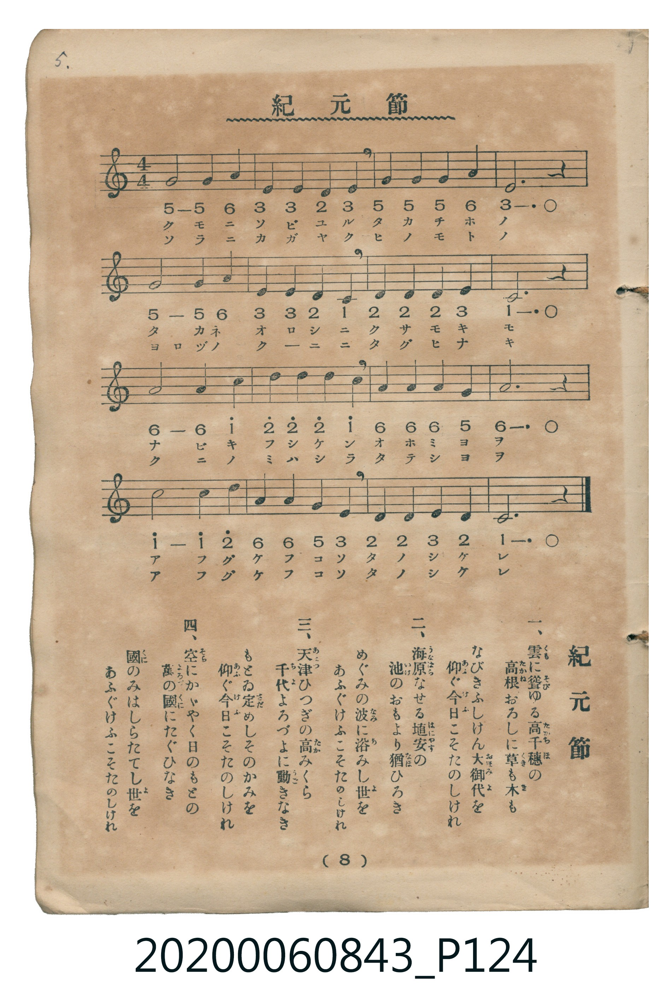

# 紀元節

> Re:Shōka 使用 AI 協助辨識與重建樂譜，可能會有錯誤。歡迎回報。

<audio controls src="kigensetsu.mp3"></audio>

- 詞：高崎正風
- 曲：伊澤修二
- 唱歌筆記帖（臺灣子供世界社發行，2020.006.0843）P124.jpg（第 8 頁）

## 說明

原書資訊與歌詞全文（對應 P124.jpg，印刷五線譜＋簡譜對照第 8 頁）：
調性與拍號：ハ調四分之四拍子（C 大調 4/4 拍），♩=92


## 跨冊／重複收錄參照

> 同曲（儀式歌〈紀元節〉；收錄於《公學校唱歌集》、《新定兒童唱歌》卷首與《唱歌帖》P124）

- **[同曲]** 《公學校唱歌集》（大正4年／1915，國臺圖 0725 26）：[**〈紀元節〉**](../../../kogakko_shokashu_1915/3_06_kigensetsu/index.md)（`C` / `4/4` — [原始 TMD](../../../kogakko_shokashu_1915/3_06_kigensetsu/kigensetsu.tmd)）
- **[同曲]** 《新定兒童唱歌》尋常科第一學年用（2020.006.0847.0001）：[**〈紀元節〉**](../../../shintei_jido_shoka/grade_1_2020.006.0847.0001/0_04_kigensetsu/index.md)（`C` / `4/4` — [原始 TMD](../../../shintei_jido_shoka/grade_1_2020.006.0847.0001/0_04_kigensetsu/kigensetsu.tmd)）
- 總表：[跨冊重複與同名歌曲總索引](../../../duplicate_songs.md)

## 歌詞

```text
一、雲に聳（そび）ゆる高千穗の　高根おろしに草も木も
なびきふしけん大御代を　仰ぐ今日こそたのしけれ
二、海原なせる埴安（はにやす）の　池のおもより猶ひろき
めぐみの波に浴みし世を　あふぐけふこそたのしけれ
三、天津ひつぎの高みくら　千代よろづよに動きなき
もとゐ定めしそのかみを　仰ぐ今日こそたのしけれ
四、空にかがやく日のもとの　萬の國にたぐひなき
國のみはしらたてし世を　あふぐけふこそたのしけれ
```

## ABC

```abc
X:1
T:紀元節
C:曲：伊澤修二
M:4/4
L:1/16
Q:1/4=92
K:C
V:V1 name="Vocal" snm="Voc"
[V:V1]
G8 G4 A4 | E4 E4 D4 E4 | G4 G4 G4 A4 | E12 z4 |
w: 1.~ク モ ニ | ソ ビ ユ ル | タ カ チ ホ | ノ
w: 2.~う な ば | ら な せ る | は に や す | の
w: 3.~ア マ ツ | ヒ ツ ギ ノ | タ カ ミ ク | ラ
w: 4.~そ ら に | か が や く | ひ の も と | の
G8 G4 A4 | E4 E4 D4 C4 | D4 D4 D4 E4 | C12 z4 |
w: 1.~タ カ ネ | オ ロ シ ニ | ク サ モ キ | モ
w: 2.~い け の | お も よ り | な ほ ひ ろ | き
w: 3.~チ ヨ ヨ | ロ ヅ ヨ ニ | ウ ゴ キ ナ | キ
w: 4.~よ ろ づ | の く に に | た ぐ ひ な | き
A8 A4 c4 | d4 d4 d4 c4 | A4 A4 A4 G4 | A12 z4 |
w: 1.~ナ ビ キ | フ シ ケ ン | オ ホ ミ ヨ | ヲ
w: 2.~め ぐ み | の な み に | あ み し よ | を
w: 3.~モ ト ヰ | サ ダ メ シ | ソ ノ カ ミ | ヲ
w: 4.~く に の | み は し ら | た て し よ | を
c8 c4 d4 | A4 A4 G4 E4 | D4 D4 E4 D4 | C12 z4 |
w: 1.~ア フ グ | ケ フ コ ソ | タ ノ シ ケ | レ
w: 2.~あ ふ ぐ | け ふ こ そ | た の し け | れ
w: 3.~ア フ グ | ケ フ コ ソ | タ ノ シ ケ | レ
w: 4.~あ ふ ぐ | け ふ こ そ | た の し け | れ
```

## TMD 檔案連結

- [主旋律 TMD 檔案](kigensetsu.tmd) [[在 TMD Studio 編輯](https://tmdlang.github.io/Tmd-TS/#tmd=s7IKdvYPcrWy4qpTUCpJTLdSSM7PyUlNLsnMz7MqzsjPTkzOyFeCS5bl55TmploBqXgDQ4RwcX5pUXJqfEFieqpVgKGRCboM3KT4vPyS1KT8_GyEioKi_LLUvMQ8oKrcxLzS4uSizIKS-OT8gkqEmtSyzJRUkIri5MS8-LLUosy0zNQUJGelFhWDHQxxR0lRYh7EHKAgQlVJRirQ7Zm5BUD9iTno4smpRam5-XlgGS0thedbGp62Nj9f36CgpcWlaKtgacRlb6vgzGVjom9iB9L6YuW893tmvVw94-mWvmdrF79ctAJs4rPZm4DCT_Z0Pdu35Mn-dU929YCFn07Z-Gxtz_O1bS9WzHi6Y9r7PR0v2nc9b1z8dO2EJ_tmP9kx7fnUnudL9j2fuefFwp73e3qMDIwM9AwMzPQMLEyM3-_pBIWqXlZBOlDj8zVrFCwUXi5oBAorcXHpaynYUgtwKSgoPO2b_2z2jheb21-s6HrR0Q50NdCnT1tXPJvWDrT86YbeZ-2dCgjn9Dzt3fC0Y_uTXVOeb5_1Yu2c93u6n29YCGQAVT5vXY7sWGC4gCx4sWr_s4blIKO7e1_MnA8UfdzcDxR8Onv20462Jzu7gQygFDBkgPY5KzxdshwoqQAMdgWgKNiYnkczV9oCIwRk2pMdDY8bGl_O3vS4cfWLxs1ALY8b5z4GMTofN7U9buoGxVBv8_OV0x83rnvc0ADkPluw83Fj1-Om3seNQMHVL3qBKpuezVkBJEEmgsDjxlVAMx43ApVsBaua-LhpMtAlT_ctfLJ78eOmSUCTnuze8LhxwpPdXc-mL33cOBls7XyQJVD1PWDn7eoBOu_Z1u3AYAUbOhvopKfztzxdB_QH0KnrgQ543NTyuHEmyMFgFz7buABsCtCFTY-bOh43dT3v2fa4cRPYwb1wFzY1Am1_3LgfqPbZ5kVAY55t3QLmTgemJogLHzc2gd0PVDYRzMDlyB2dQEc-XbLy2RagT4AhueRxYx9QETCswCb2P24CKmgABiPY80AnAV2yFMRoXP20eyo4mIBeQ3Ib0F5gcE54um4W2J1Au4D2Ai3tBplHfOgBUwLQYc9X7gKFEkhzDzis-sF61kGtAQfaiwlrgIync4BqgCqBBgH9DPQIsqvAkkDzgR4Chvp0kJ9ACpeRE2KUZzUoUNDS5-LyzkxPzStOLSkutQrLT07McagxqFGoBrvbxkLLDszAls0VgLkLmP6BJYaCicLTDf3A0koHnjWxKAfaBTKqRsFUQRcMQbQZENcoGANJEDaC0hA1MIxQA4MGIBGwaT6GNcAIXw8Vf9y8CEx2g3U8btoL5k0Gk8vA5GqozH4QrwnEe9zcCCZnQ2Sa-5DsiUfYYwSUa2yD2dO4CkxugJrWiSQGMgeYyyAyjSCXARMFWKwFzJ4JlVmH3R5jkHkgX0D8Mw9MgnSC3DYJznvcBNIPcS26f-aD2SCbQXpWYrfHBOSGuTB7oD6Ahk4jyPXA5I7k6n6ozCYwD2x3UxOYvQKnf_CnnF091E45hmAREAuGIWkJJI4r5YDCDRICkLDrhYYnOC6b14JltoPZsDQFjtGmrWAxcGprAqkChTQs1rClHFAoQlLORHgIgsS7ECHZ1AEmQSIgGUhq2g0mwaHeBHVbI4jGkXLAaRmSckDxAiFB4mCfNLciycD8A84XTVvgPnncDHUBmIcj5YDdCgk3kGuA5THUbeCUAU4t0FQPT1PgVNk4AeEfsA-x-4dAmdNJesoBpRYQBNGGcWCLjUAUgoCKghTAMCiZIbRiST7goIIEN7iQgSeFqWAeOOE0bQTLb4YGKiRhgQsJSEaFRxEoUHAknyZ4tEIDEJRsEcENSSrgIgAe3JDMCRGbDnYHKMpAZoEKEVzJB1HwgBNjM6yAgyT3BjC5EO43RBELKoaQix88_gEXPKAEAvEPJJHAsgPEvZBCE-JqUMGESD7gxErQP3iTD7BWJz35gBMHCIIZ4PSCSCqgZAIpaZDLHRCNv-xBBDYkucACG5JgIGKgZAMJZHgpDw1sROICBfYa7IENLntASQES2OBoBCchkDikJIKIgZMvuD5ABDYkcYEDG6wW5AJQnYAj8dDDP-DEQ1v_1HJx6dopIBpFCkCeMhcA)]
- [鋼琴伴奏 TMD 檔案](kigensetsu_piano.tmd) [[在 TMD Studio 編輯](https://tmdlang.github.io/Tmd-TS/#tmd=s7IKdvYPcrWy4tLSUni-peFpa_Pz9Q3v93S87N7zfMKWJ3u2PF3a_7yz4_2eTgUtLS5FWwVLIy57WwVnLhsTfRM7rjoFpRcr573fM-vl6hlPt_Q9W7v45aIVSiDhZ7M3AYWf7Ol6tm_Jk_3rnuzqAQs_nbLx2dqe52vbXqyY8XTHNKBNL9p3PW9c_HTthCf7Zj_ZMe351J7nS_Y9n7nnxcKe93t6jAyMDPQMDMz0DCxMjIGuCDA0MtHLKkgHany-Zo2ChcLLBY1AYSUuLu_M9NS84tSS4lKrsPzkxByHGoMahWouBSCwsdCyAzNqFEwVdMEQRJsBcY2CMZAEYSMoDVEDwwg1MGgAEgGb5mNYo_C4aT1U_HHzIjDZDdbxuGkvmDcZTC4Dk6uhMvtBvCYQ73FzI5icDZFp7kOyJx5hjxFQrrENZk_jKjC5AWpaJ5IYyJzHTVAXNIJc9rgRbE9TC5g9EyqzDrs9xiDzQL6A-GcemATpBLltEpz3uAmkH-JadP_MB7NBNoP0rMRujwnIDXNh9kB9AA2dRpDrHzf2ILm6HyqzCcwD293UBGavwOsfQrFtCBYBsWAYEv8gcVyxDfIrxNUQ__ZCwwAc_s1rwTLbwWxYOgDHQtNWsBg4hTSBVIFCBxbS2GIb5HNIbE-E-xok3oXwfVMHmASJgGQgKWA3mASHVBPUbY0gGkdsg9MfJLZBYQkhQeJgnzS3IsnA_ANOy01b4D553Ax1AZiHI7bBboWEG8g1jxuXQt0Gjk1wDENTKjwdgFNS4wSEf8A-xO2fGnAMgyCINowDKzYCUQgCKgpSAMOgpIHQiiXKwd6DBBE4M8OjbyqYB47spo1g-c3QgIAkBnBmhGQIeLCCPIIjypvgUQH1NCipIYIIEr3grAYPIkgmgIhNB7sDFMwgs0CZFVeUIzI4OAE1wwoSSBJtAJML4X5DFGWg7I6czfH4B5zBQZEK8Q8kYmFJGOJeSOEEcTWoAEBEOTiBEeUfYFYFRSgIghngOEZELyhqITkaOX-DaPx5HBFAkCiGBRAkkiFioKiGBAy8BIQGECJBgAJoDfYAAudxUPRBAggc9OBoB4lDcjxEDJzkwGUlIoAgCQIcQGC1IBeAykscEU4P_4AjnLb-qUWp4gMyE_PygzywV_LG2rCCH8Iy0YYU_obaoAQAIc3jtcF1AJgD04JMomrCTCukWQOWgHJQKZgLsKdIkC2wwgnCMtaGlWLa4PSOSsFlYYoRpBHYkcgGYloFz09QJtRUdONABsHcjc03UA42T2GJRh-UaDSBR6NhPBSZxMN5pvFgCoskVMYAUTbg0G4GxMCmAZBExtjNAKlFxsCiJB6KIFxkSWOYAJABorA4BagPoQciRNgpwCDTtVNAhFq0j2GsApqIEYaIMYaICVhEmQsA)]

## 分析

```text
================================================================================
📊 TMD Song Profile: [ 紀元節 ]
================================================================================
⏱  Duration:       0:41 (41.7s), 16 measures total
🎼 Key & Tempo:    首調基準 C, != 92.0 BPM, <4/4>
   - 分析範圍：      由實際發聲的音符與和弦推測調性；播放脈絡另行呈現
🎤 人聲音域:    C4 (MIDI 60) – D5 (MIDI 74) [跨度: 14 個半音 / 1.2 個八度, 難度: moderate]
   - 最低音:  C4 in [Kigensetsu #1 @ m.6, 0:15]
   - 最高音: D5 in [Kigensetsu #1 @ m.10, 0:23]
   - 適合: soprano, mezzo-soprano, contralto, tenor, baritone, bass
🏛  結構:      Kigensetsu (41.7s)
⚡ 編曲密度:        Peak 1 軌道同時演奏
🗝  調性診斷：       A 調性不明確（純淨自然大調，未偵測到可信轉調）
   - 風格氣質:    純淨自然大調（陽光明朗、易唱易記，無明顯調外色彩）
   - 轉調歷程:    全曲維持單一推測調性（未偵測到可信轉調）
   - 核心骨幹音:  A, C, D, E, G
   - 調性數值:    A 調性不明確 [相關度: 0.75, 穩定度: Ambiguous, 自然音純度: 100.0%]
   - 候選調性 (K-S): A 小調 (0.75), C 大調 (0.73), G 大調 (0.68)
   - 五度圈歷程:   +3
   - 各段落調性細節:
     • [Kigensetsu #1]: A 調性不明確 (r: 0.75, 自然音純度: 100.0%)

  [ 五度圈游移軌跡 ]
               C  
         F            G  
      Bb               D  
      Eb              [A ]*
         Ab           E  
            Db       B  
               F# 
     (* = active key center)

  [ 十二半音累積音高分佈 ]
     C  : █████████████████████     20.0%
     C# :                            0.0%
     D  : █████████████████████     20.0%
     D# :                            0.0%
     E  : ███████████████████       18.3%
     F  :                            0.0%
     F# :                            0.0%
     G  : ███████████████████       18.3%
     G# :                            0.0%
     A  : ████████████████████████  23.3%
     A# :                            0.0%
     B  :                            0.0%
--------------------------------------------------------------------------------
Assignment 軌道音域：
  - Vocal         : C4 – D5 (14 個半音 / 1.2 個八度, 48 個音符)
================================================================================
```


## 原書掃描頁




