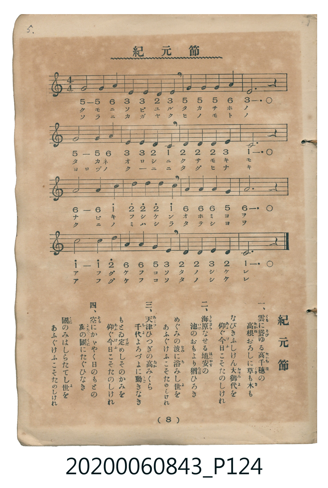

# 紀元節

<audio controls src="kigensetsu.mp3"></audio>

- 詞：高崎正風
- 曲：伊澤修二
- 唱歌筆記帖（臺灣子供世界社發行，2020.006.0843）P124.jpg（第 8 頁）

## 說明

原書資訊與歌詞全文（對應 P124.jpg，印刷五線譜＋簡譜對照第 8 頁）：
調性與拍號：ハ調四分之四拍子（C 大調 4/4 拍）

## 跨冊／重複收錄參照

> 同曲（儀式歌〈紀元節〉；收錄於《新定兒童唱歌》卷首與《唱歌帖》P124）

- **[同曲]** 《新定兒童唱歌》尋常科第一學年用（2020.006.0847.0001）：[**〈紀元節〉**](../../../shintei_jido_shoka/grade_1_2020.006.0847.0001/0_04_kigensetsu/index.md)（`C` / `4/4` — [原始 TMD](../../../shintei_jido_shoka/grade_1_2020.006.0847.0001/0_04_kigensetsu/kigensetsu.tmd)）
- 總表：[跨冊重複與同名歌曲總索引](../../../duplicate_songs.md)

## 歌詞

```text
一、雲に聳（そび）ゆる高千穗の　高根おろしに草も木も
なびきふしけん大御代を　仰ぐ今日こそたのしけれ
二、海原なせる埴安（はにやす）の　池のおもより猶ひろき
めぐみの波に浴みし世を　あふぐけふこそたのしけれ
三、天津ひつぎの高みくら　千代よろづよに動きなき
もとゐ定めしそのかみを　仰ぐ今日こそたのしけれ
四、空にかがやく日のもとの　萬の國にたぐひなき
國のみはしらたてし世を　あふぐけふこそたのしけれ
```

## ABC

```abc
X:1
T:紀元節
C:曲：伊澤修二
M:4/4
L:1/16
Q:1/4=92
K:C
V:V1 name="Vocal" snm="Voc"
[V:V1]
G8 G4 A4 | E4 E4 D4 E4 | G4 G4 G4 A4 | E12 z4 |
G8 G4 A4 | E4 E4 D4 C4 | D4 D4 D4 E4 | C12 z4 |
A8 A4 c4 | d4 d4 d4 c4 | A4 A4 A4 G4 | A12 z4 |
c8 c4 d4 | A4 A4 G4 E4 | D4 D4 E4 D4 | C12 z4 |
G8 G4 A4 | E4 E4 D4 E4 | G4 G4 G4 A4 | E12 z4 |
G8 G4 A4 | E4 E4 D4 C4 | D4 D4 D4 E4 | C12 z4 |
A8 A4 c4 | d4 d4 d4 c4 | A4 A4 A4 G4 | A12 z4 |
c8 c4 d4 | A4 A4 G4 E4 | D4 D4 E4 D4 | C12 z4 |
G8 G4 A4 | E4 E4 D4 E4 | G4 G4 G4 A4 | E12 z4 |
G8 G4 A4 | E4 E4 D4 C4 | D4 D4 D4 E4 | C12 z4 |
A8 A4 c4 | d4 d4 d4 c4 | A4 A4 A4 G4 | A12 z4 |
c8 c4 d4 | A4 A4 G4 E4 | D4 D4 E4 D4 | C12 z4 |
G8 G4 A4 | E4 E4 D4 E4 | G4 G4 G4 A4 | E12 z4 |
G8 G4 A4 | E4 E4 D4 C4 | D4 D4 D4 E4 | C12 z4 |
A8 A4 c4 | d4 d4 d4 c4 | A4 A4 A4 G4 | A12 z4 |
c8 c4 d4 | A4 A4 G4 E4 | D4 D4 E4 D4 | C12 z4 |
```

## TMD 檔案連結

- [主旋律 TMD 檔案](kigensetsu.tmd) [[在 TMD Studio 編輯](https://tmdlang.github.io/Tmd-TS/#tmd=s7IKdvYPcrWy4qpTUCpJTLdSSM7PyUlNLsnMz7MqzsjPTkzOyFeCS5bl55TmploBqXgDQ4RwcX5pUXJqfEFieqpVgKGRCboM3KT4vPyS1KT8_GyEioKi_LLUvMQ8oKrcxLzS4uSizIKS-OT8gkqEmtSyzJRUkIrUlMyS_KLMxBwkJ6UWFYMdC3FDSVFiHsQMoCBCVUlGKtDdmbkFqRDdWloKz7c0PG1tfr6-QUFLi0vRVsHSiMveVsGZy8ZE38QOpPHFynnv98x6uXrG0y19z9YufrloBdi8Z7M3AYWf7Ol6tm_Jk_3rnuzqAQs_nbLx2dqe52vbXqyY8XTHtPd7Ol6073reuPjp2glP9s1-smPa86k9z5fsez5zz4uFPe_39BgZGBnoGRiY6RlYmBi_39MJCje9rIJ0oMbna9YoWCi8XNAIFFbi4tLXUrClFuBSUFB42jf_2ewdLza3v1jR9aKjHehqoE-ftq54Nq0daPnTDb3P2jsVEM7pedq74WnH9ie7pjzfPuvF2jnv93Q_37AQyACqfN66HNmxwHABWfBi1f5nDctBRnf3vpg5Hyj6uLkfKPh09uynHW1PdnYDGUApYMgA7XNWeLpkOVBSARjsCkBRoDFcIEOe7Gh43ND4cvamx42rXzRuBqp83Dj3MYjR-bip7XFTNyhiepufr5z-uHHd44YGIPfZgp2PG7seN_U-bgQKrn7RC1TZ9GzOCiAJMhEEHjeuAprxuBGoZCtY1cTHTZOBDni6b-GT3YsfN00CmvRk94bHjROe7O56Nn3p48bJYGvngyyBqu8BO29XD9B5z7ZuB4Ym2NDZQCc9nb_l6TpgKACduh7ogMdNLY8bZ4IcDHbhs40LwKYAXdj0uKnjcVPX855tjxs3gR3cC3dhUyPQ9seN-4Fqn21eBDTm2dYtYO50YCKCuPBxYxPY_UBlE8EMXI7c0Ql05NMlK59tAfoEGJJLHjf2ARUBwwpsYv_jJqCCBmAwgj0PdBLQJUtBjMbVT7ungoMJ6DUktwHtBQbnhKfrZoHdCbQLaC_Q0m6QecSHHjABAB32fOUuUCiBNPeAw6ofrGcd1BpwoL2YsAbIeDoHqAaoEmgQ0M9AjyC7CiwJNB_oIWCoTwf5CaRwGTkhRnkOgwIFLX0uLu_M9NS84tSS4lKrsPzkxByHGoMahWqwu20stOzADGy5WwGYqYDpH1hQKGiYKDzd0A8spXTgWVITiwagbSDDahRMFXTBEESbAXGNgjGQBGEjKA1RA8MINTBoABIBZ0HcbtvVQ323GYJFQCwYhrgWJE6K23Z0kuM2kHtAEEQbxkGcAqIQBFQUpACGQR5BaCXSgcC0T44DwdaDIJgBdhHCMSCHQEILOexANLbwq-Xi0rVTQCROBZJ4ylwA)]
- [鋼琴伴奏 TMD 檔案](kigensetsu_piano.tmd) [[在 TMD Studio 編輯](https://tmdlang.github.io/Tmd-TS/#tmd=s7IKdvYPcrWy4tLSUni-peFpa_Pz9Q3v93S87N7zfMKWJ3u2PF3a_7yz4_2eTgUtLS5FWwVLIy57WwVnLhsTfRM7rjoFpRcr573fM-vl6hlPt_Q9W7v45aIVSiDhZ7M3AYWf7Ol6tm_Jk_3rnuzqAQs_nbLx2dqe52vbXqyY8XTHNKBNL9p3PW9c_HTthCf7Zj_ZMe351J7nS_Y9n7nnxcKe93t6jAyMDPQMDMz0DCxMjIGuCDA0MtHLKkgHany-Zo2ChcLLBY1AYSUuLu_M9NS84tSS4lKrsPzkxByHGoMahWouBSCwsdCyAzNqFEwVdMEQRJsBcY2CMZAEYSMoDVEDwwg1MGgAEiHKNEOwCIgFwxDzQeLYTAOZAIIg2jAOohlEIQioKEgBDIOsRmhFNxKsAQTBDLAZCO0grRAXIbsPRGNzYy1KEAdkJublB3lgD2RjbVjAQFgm2pDAMdQGWQAhzeO1wWEE5sC0IJOomrB5jhRrwBJQDioFcwGuWDEGmwqxBcQy1obFgjY4PFEpuCxMMYI0AjsS2UBMq-DxBWVCTUU3DmQQzN3YfAPlEBmNPijRaAKPRsN4KDKJh_NM48EUFkmojAEi7eHQbgbEwKwDJJExdjNAapExMKnGQxGEiyxpDBMAMkAUFqcA9SH0QIQIOwUYZLp2CohQUyCJp8wFAA)]

## 分析

```text
================================================================================
📊 TMD Song Profile: [ 紀元節 ]
================================================================================
⏱  Duration:       2:46 (167.0s), 64 measures total
🎼 Key & Tempo:    首調基準 C, != 92.0 BPM, <4/4>
   - 分析範圍：      由實際發聲的音符與和弦推測調性；播放脈絡另行呈現
🎤 人聲音域:    C4 (MIDI 60) – D5 (MIDI 74) [跨度: 14 個半音 / 1.2 個八度, 難度: moderate]
   - 最低音:  C4 in [Kigensetsu #1 @ m.6, 0:15]
   - 最高音: D5 in [Kigensetsu #1 @ m.10, 0:23]
   - 適合: soprano, mezzo-soprano, contralto, tenor, baritone, bass
🏛  結構:      Kigensetsu (41.7s) -> Kigensetsu (41.7s) -> Kigensetsu (41.7s) -> Kigensetsu (41.7s)
⚡ 編曲密度:        Peak 1 軌道同時演奏
🗝  調性診斷：       A 調性不明確（純淨自然大調，未偵測到可信轉調）
   - 風格氣質:    純淨自然大調（陽光明朗、易唱易記，無明顯調外色彩）
   - 轉調歷程:    全曲維持單一推測調性（未偵測到可信轉調）
   - 核心骨幹音:  A, C, D, E, G
   - 調性數值:    A 調性不明確 [相關度: 0.75, 穩定度: Ambiguous, 自然音純度: 100.0%]
   - 候選調性 (K-S): A 小調 (0.75), C 大調 (0.73), G 大調 (0.68)
   - 五度圈歷程:   +3 -> +3 -> +3 -> +3
   - 各段落調性細節:
     • [Kigensetsu #1]: A 調性不明確 (r: 0.75, 自然音純度: 100.0%)
     • [Kigensetsu #2]: A 調性不明確 (r: 0.75, 自然音純度: 100.0%)
     • [Kigensetsu #3]: A 調性不明確 (r: 0.75, 自然音純度: 100.0%)
     • [Kigensetsu #4]: A 調性不明確 (r: 0.75, 自然音純度: 100.0%)

  [ 五度圈游移軌跡 ]
               C  
         F            G  
      Bb               D  
      Eb              [A ]*
         Ab           E  
            Db       B  
               F# 
     (* = active key center)

  [ 十二半音累積音高分佈 ]
     C  : █████████████████████     20.0%
     C# :                            0.0%
     D  : █████████████████████     20.0%
     D# :                            0.0%
     E  : ███████████████████       18.3%
     F  :                            0.0%
     F# :                            0.0%
     G  : ███████████████████       18.3%
     G# :                            0.0%
     A  : ████████████████████████  23.3%
     A# :                            0.0%
     B  :                            0.0%
--------------------------------------------------------------------------------
Assignment 軌道音域：
  - Vocal         : C4 – D5 (14 個半音 / 1.2 個八度, 192 個音符)
================================================================================
```


## 原書掃描頁




