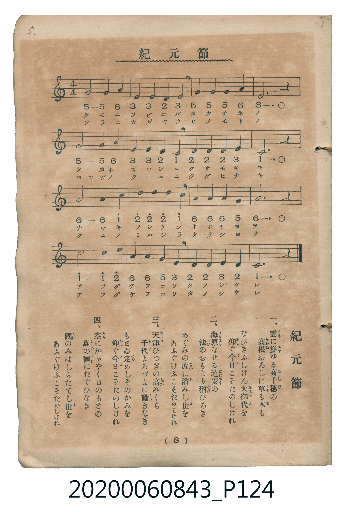

# 紀元節

> Re:Shōka 使用 AI 協助辨識與重建樂譜，可能會有錯誤。歡迎回報。

- **鋼琴伴奏版**：<br><audio controls src="kigensetsu.mp3"></audio>

- 詞：高崎正風
- 曲：伊澤修二
- 唱歌筆記帖（臺灣子供世界社發行，2020.006.0843）P124.jpg（第 8 頁）

## 說明

原書資訊與歌詞全文（對應 P124.jpg，印刷五線譜＋簡譜對照第 8 頁）：
調性與拍號：ハ調四分之四拍子（C 大調 4/4 拍），♩=92


## 歌詞

```text
一、雲に聳（そび）ゆる高千穗の　高根おろしに草も木も
なびきふしけん大御代を　仰ぐ今日こそたのしけれ
二、海原なせる埴安（はにやす）の　池のおもより猶ひろき
めぐみの波に浴みし世を　あふぐけふこそたのしけれ
三、天津ひつぎの高みくら　千代よろづよに動きなき
もとゐ定めしそのかみを　仰ぐ今日こそたのしけれ
四、空にかがやく日のもとの　萬の國にたぐひなき
國のみはしらたてし世を　あふぐけふこそたのしけれ
```

## ABC

<div class="abc-score" data-abc-src="kigensetsu.abc" aria-label="五線譜載入中"></div>

[下載 ABC 原始檔](kigensetsu.abc)

## TMD 檔案連結

- [主旋律 TMD 檔案](kigensetsu.tmd) [[在 TMD Studio 編輯](https://tmdlang.github.io/Tmd-TS/#tmd=s7IKdvYPcrWy4qpTUCpJTLdSSM7PyUlNLsnMz7MqzsjPTkzOyFeCS5bl55TmploBqXgDQ4RwcX5pUXJqfEFieqpVgKGRCboM3KT4vPyS1KT8_GyEioKi_LLUvMQ8oKrcxLzS4uSizIKS-OT8gkqEmtSyzJRUkIri5MS8-LLUosy0zNQUJGelFhWDHQxxR0lRYh7EHKAgQlVJRirQ7Zm5BUD9iTno4smpRam5-XkoMvlFmemZeVZA4aRSoBcwJVIzszLjS1IrSlD9lF9UkpGfXpRYkFFplZFZXAJUnpyYE5-dmJeoxKWlpfB8S8PT1ubn6xsUtLS4FG0VLI247G0VnLlsTPRN7ECmvFg57_2eWS9Xz3i6pe_Z2sUvF60AG_5s9iag8JM9Xc_2LXmyf92TXT1g4adTNj5b2_N8bduLFTOe7pj2fk_Hi_ZdzxsXP1074cm-2U92THs-tef5kn3PZ-55sbDn_Z4eIwMjAz0DAzM9AwsT4_d7OkFRppdVkA7U-HzNGgULhZcLGoHCSlxc-loKttQCXAoKCk_75j-bvePF5vYXK7pedLQDXQ306dPWFc-mtQMtf7qh91l7pwLCOT1Pezc87dj-ZNeU59tnvVg75_2e7ucbFgIZQJXPW5cjOxYYLiALXqza_6xhOcjo7t4XM-cDRR839wMFn86e_bSj7cnObiADKAUMGaB9zgpPlywHSioAg10BKAo2pufRzJW2wAgBmfZkR8PjhsaXszc9blz9onEzUMvjxrmPQYzOx01tj5u6QTHU2_x85fTHjeseNzQAuc8W7Hzc2PW4qfdxI1Bw9YteoMqmZ3NWAEmQiSDwuHEV0IzHjUAlW8GqJj5umgx0ydN9C5_sXvy4aRLQpCe7NzxunPBkd9ez6UsfN04GWzsfZAlUfQ_Yebt6gM57tnU7MFjBhs4GOunp_C1P1wH9AXTqeqADHje1PG6cCXIw2IXPNi4AmwJ0YdPjpo7HTV3Pe7Y9btwEdnAv3IVNjUDbHzfuB6p9tnkR0JhnW7eAudOBqQniwseNTWD3A5VNBDNwOXJHJ9CRT5esfLYF6BNgSC553NgHVAQMK7CJ_Y-bgAoagMEI9jzQSUCXLAUxGlc_7Z4KDiag15DcBrQXGJwTnq6bBXYn0C6gvUBLu0HmER96wJQAdNjzlbtAoQTS3AMOq36wnnVQa8CB9mLCGiDj6RygGqBKoEFAPwM9guwqsCTQfKCHgKE-HeQnkMJl5IQY5VkNChS09Lm4vDPTU_OKU0uKS63C8oGlkEONQU012Nk2Jlp2YAa2XK4AzFzA5A8sMBRMFJ5u6AcWVjrwnIlFOdAqkFE1CqYKukBsBmQZA6EREIPEQBAipguEBgo1YNU-hjXA-FwPFHncvAiIu4EqHjftBbImA_EyIF4NFtkPxKuBvEYgng0Sae4DmxMPM8cIKNbYBjKncRUQbwDr6oTyZgPZYJMb1wMx0JymFiA9EyyyDtUcY5C-RWD3zAPiFrBdk8Csx03rwPYiu2c-2PUgNStRzTEBmT0XZA7YFWBfNHYDcQ_U9n6wyCawC4BJDUivQHMP_pjZ1UN5zBgCWUZgCIojQywxsx_sA5BPe8H-BoZm81ogvR0eV8AQbdoKib2mteCQAIUeesy0gGNmIth_IH4XxM9NHUDcBRYBxdNuSIg0ge1q7MWMGWD8g2JmBRiD-EC3NLdCRSDuAaaZpi1gtzxuBpsMZGHEDNBekL96gbYshYY6KEbAaQMaV8CYbZwAjaFVaO4hkGc6SY8ZM6DJZgqGcaAIiYMiMM8MDE2hStCiB-hBUHAAswo06KdCoqZpI5C9GR5hwOQPSqjQINuEGT1N4GAFe3c_PDhAEQJM5tDgACVQEG86OPBAeiZhiR5IxgFGajMkA4ISRgMQLwS7C5a1--CZB4t7wBmnH-weUGRAkgvIZlDWBdneCY8eYFRjdQ_e6AEW-qRHDzAqdEEEMFYgUWIKzjGQnGOEI-9AAgMUJZDAAEUKiLcZHAzQUgQcGJAoAwXGGix5pwkcGMCgBEYQiA_KRSAeMNqBJQwsMEBRBgwMoCzI5B6cpRpF7gFHDmXuqeXi0rVTQNRJCkCeMhcA)]
- [鋼琴伴奏 TMD 檔案](kigensetsu_piano.tmd) [[在 TMD Studio 編輯](https://tmdlang.github.io/Tmd-TS/#tmd=s7IKdvYPcrWy4qpTUCpJTLdSyC8qychPL0osyKi0ysgsLskvykxOzInPTsxLVIIrKs4vLUpOjS9ITE-1CjA0MkHIlGSk5qZapaaUJieWZObnKXFpaSk839LwtLX5-fqG93s6XnbveT5hy5M9W54u7X_e2fF-T6eClhaXoq2CpRGXva2CM5eNib6JHci4Fyvnvd8z6-XqGU-39D1bu_jlohVgW57N3gQUfrKn69m-JU_2r3uyqwcs_HTKxmdre56vbXuxYsbTHdOANr1o3_W8cfHTtROe7Jv9ZMe051N7ni_Z93zmnhcLe97v6TEyMDLQMzAw0zOwMDEGugLkC72sgnSgxudr1ihYKLxc0AgUVuLi8s5MT80rTi0pLrUKywcGhUONQU01lwIQ2Jho2YEZNQqmCrpAbAZkGQOhERCDxEAQIqYLhAYKNWDVPoY1Co-b1gNFHjcvAuJuoIrHTXuBrMlAvAyIV4NF9gPxaiCvEYhng0Sa-8DmxMPMMQKKNbaBzGlcBcQbwLo6obzZQDbY5Mb1QAw0p6kFSM8Ei6xDNccYpG8R2D3zgLgFbNckMOtx0zqwvcjumQ92PUjNSlRzTEBmzwWZA3YF2BeN3UDcA7W9HyyyCeyCx01NQHoFFvdghqYhkGUEhqBwNcQSmvvBtoJc1wt2KzAEmtcC6e3w8AWGQtNWSIg3rQW7HuRj9NBsAYfmRLCbQPwuiDubOoC4CywCCtvdEF80ge1q7MUMTWCcgUJzBRiD-EC3NLdCRSDuAcZz0xawWx43g00GsjBCE2gvyF-9QFuWQkMKFIrg-ISGLzA2GidAQ3UVFvfUAMNRF4gN40CBGAdFYJ4ZGJpClaAFKdBRIC8AkyQ0uKZCgrNpI5C9GR7IwGQGShBQb27CDNImcFCAnbgf7gVQIAKTE9QLoIQA4k0HexikZxKWIIUkUGBENEMSOigyG4B4IdhdsCzUB0-kWNwDTqD9YPeAAhASxSCbQVkEZHsnPEiB0YPTPcAkGAfkAglgSEKC0RScMiEp1AhHGoV4ABSMEA-AAhLE2wx2OjSHgT0ACWaQB9ZgSaNNYA8AvQ8MVBAflFpBPGBUAXMfzAOgYAZ6ACgLMrkHZ46nyD3gAKXMPbUoJWxAZmJefpAHUhlrAS9jjbVB5QIIQlgm2qBkCwxrbVD5CiHN47WN4ByYFmQSVRMMGoDEyLAGLAHloFIwF0ASAjZbIHkOZAuIZawNTlPA1KQNTFTADItCwWVhihGkEdiRyAZiWgXWDLELzISaim4cyCCYu7H5BsrB5iksseiDHIuImtIwHopMgLEPZZrGgyksklAZWEbCrd0MiIEVB5BExtjNAKlFxsCMGw9FEC6ypDFMAMgAUVicAtSH0AMRIuwUYIjp2ikgAi3axzBWAU3ECEPEGEPEBCyizAUA)]

## 分析

```text
================================================================================
📊 TMD Song Profile: [ 紀元節 ]
================================================================================
⏱  Duration:       0:41 (41.7s), 16 measures total
🎼 Key & Tempo:    首調基準 C, != 92.0 BPM, <4/4>
   - 分析範圍：      由實際發聲的音符與和弦推測調性；播放脈絡另行呈現
🎤 人聲音域:    C4 (MIDI 60) – D5 (MIDI 74) [跨度: 14 個半音 / 1.2 個八度, 難度: moderate]
   - 最低音:  C4 in [Kigensetsu #1 @ m.6, 0:15]
   - 最高音: D5 in [Kigensetsu #1 @ m.10, 0:23]
   - 適合: soprano, mezzo-soprano, contralto, tenor, baritone, bass
🏛  結構:      Kigensetsu (41.7s)
⚡ 編曲密度:        Peak 1 軌道同時演奏
🗝  調性診斷：       A 調性不明確（純淨自然大調，未偵測到可信轉調）
   - 風格氣質:    純淨自然大調（陽光明朗、易唱易記，無明顯調外色彩）
   - 轉調歷程:    全曲維持單一推測調性（未偵測到可信轉調）
   - 核心骨幹音:  A, C, D, E, G
   - 調性數值:    A 調性不明確 [相關度: 0.75, 穩定度: Ambiguous, 自然音純度: 100.0%]
   - 候選調性 (K-S): A 小調 (0.75), C 大調 (0.73), G 大調 (0.68)
   - 五度圈歷程:   +3
   - 各段落調性細節:
     • [Kigensetsu #1]: A 調性不明確 (r: 0.75, 自然音純度: 100.0%)

  [ 五度圈游移軌跡 ]
               C  
         F            G  
      Bb               D  
      Eb              [A ]*
         Ab           E  
            Db       B  
               F# 
     (* = active key center)

  [ 十二半音累積音高分佈 ]
     C  : █████████████████████     20.0%
     C# :                            0.0%
     D  : █████████████████████     20.0%
     D# :                            0.0%
     E  : ███████████████████       18.3%
     F  :                            0.0%
     F# :                            0.0%
     G  : ███████████████████       18.3%
     G# :                            0.0%
     A  : ████████████████████████  23.3%
     A# :                            0.0%
     B  :                            0.0%
--------------------------------------------------------------------------------
Assignment 軌道音域：
  - Vocal         : C4 – D5 (14 個半音 / 1.2 個八度, 48 個音符)
================================================================================
```


## 原書掃描頁




