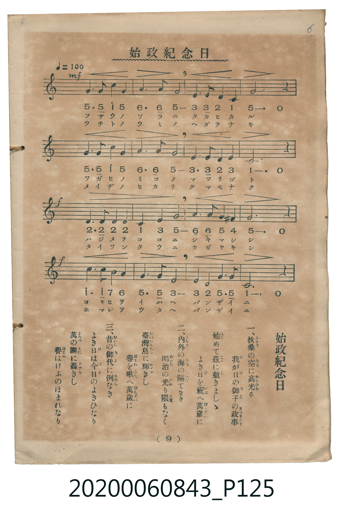

# 始政紀念日

> Re:Shōka 使用 AI 協助辨識與重建樂譜，可能會有錯誤。歡迎回報。

<audio controls src="shisei_kinenbi.mp3"></audio>

- 臺灣總督府始政紀念日唱歌
- 唱歌筆記帖（臺灣子供世界社發行，2020.006.0843）P125.jpg（第 9 頁）

## 說明

原書資訊與歌詞全文（對應 P125.jpg，印刷五線譜＋簡譜對照第 9 頁）：
調性與拍號：ハ調四分之四拍子（C 大調 4/4 拍），♩=100


## 跨冊／重複收錄參照

> 同曲（6月17日臺灣始政紀念日唱歌；收錄於《公學校唱歌集》、《新定兒童唱歌》卷首及《唱歌帖》P047、P125）

- **[同曲]** 《公學校唱歌集》（大正4年／1915，國臺圖 0725 26）：[**〈始政紀念日〉**](../../../kogakko_shokashu_1915/5_01_shisei_kinenbi/index.md)（`C` / `4/4` — [原始 TMD](../../../kogakko_shokashu_1915/5_01_shisei_kinenbi/shisei_kinenbi.tmd)）
- **[同曲]** 《新定兒童唱歌》尋常科第一學年用（2020.006.0847.0001）：[**〈始政記念日〉**](../../../shintei_jido_shoka/grade_1_2020.006.0847.0001/0_07_shisei_kinenbi/index.md)（`C` / `4/4` — [原始 TMD](../../../shintei_jido_shoka/grade_1_2020.006.0847.0001/0_07_shisei_kinenbi/shisei_kinenbi.tmd)）
- **[同曲]** 《新編小公學校唱歌教材集》第三、四學年（大正12年／1923，國臺圖 0725-41）：[**〈始政紀念日〉**](../../../shoka_kyozai_shu_1923/grade_3_4/27_shisei_kinenbi/index.md)（`C` / `4/4` — [原始 TMD](../../../shoka_kyozai_shu_1923/grade_3_4/27_shisei_kinenbi/shisei_kinenbi.tmd)）
- **[同曲]** 楊金土手抄《唱歌帖》第 3 冊・I（2020.006.0843）：[**〈始政紀念日〉**](../../vol_03/p047_shisei_kinembi/index.md)（`C` / `4/4` — [原始 TMD](../../vol_03/p047_shisei_kinembi/shisei_kinembi.tmd)）
- 總表：[跨冊重複與同名歌曲總索引](../../../duplicate_songs.md)

## 歌詞

```text
一、高砂島の　民草が
あまねきめぐみの　露うけて
よみがへりたる　よろこびを
うたふけふこそ　めでたけれ

二、いやさかへゆく　此の島の
すがたを庭の　木々に見て
今日をことほぐ　人のこゑ
どよむちまたぞ　にぎはしき

三、すめら御國の　にひじまの
民てふほまれ　忘るなと
さとすがごとく　あふぎ見る
日のみはたこそ　たふとけれ
```

## ABC

```abc
X:1
T:始政紀念日
M:4/4
L:1/16
Q:1/4=100
K:C
V:V1 name="Vocal" snm="Voc"
[V:V1]
G6 G2 c4 G4 | A6 A2 G8 | E6 E2 D4 C4 | G,12 z4 |
w: 1.~タ カ サ ゴ | ジ マ ノ | タ ミ ク サ | ガ
w: 2.~い や さ か | へ ゆ く | こ の し ま | の
w: 3.~ス メ ラ ミ | ク ニ ノ | ニ ヒ ジ マ | ノ
G6 G2 c4 G4 | A6 A2 G8 | E6 E2 D4 E4 | C12 z4 |
w: 1.~ア マ ネ キ | メ グ ミ | ツ ユ ウ ケ | テ
w: 2.~す が た を | に は の | き ぎ に み | て
w: 3.~タ ミ テ フ | ホ マ レ | ワ ス ル ナ | ト
D6 D2 D4 D4 | C4 E4 G8 | A6 A2 G4 ^F4 | G12 z4 |
w: 1.~ヨ ミ ガ ヘ | リ タ ル | ヨ ロ コ ビ | ヲ
w: 2.~け ふ を こ | と ほ ぐ | ひ と の こ | ゑ
w: 3.~サ ト ス ガ | ゴ ト ク | ア フ ギ ミ | ル
c6 c2 B4 A4 | G6 G2 E8 | E4 D4 G6 G,2 | C12 z4 |
w: 1.~ウ タ フ ケ | フ コ ソ | メ デ タ ケ | レ
w: 2.~ど よ む ち | ま た ぞ | に ぎ は し | き
w: 3.~ヒ ノ ミ ハ | タ コ ソ | タ フ ト ケ | レ
```

## TMD 檔案連結

- [主旋律 TMD 檔案](shisei_kinenbi.tmd) [[在 TMD Studio 編輯](https://tmdlang.github.io/Tmd-TS/#tmd=s7IKdvYPcrWy4qpTUCpJTLdSSM7PyUlNLsnMz7MqzsjPTkzOyFeCS5bl55TmploBqXgDQ4RwcX5pUXJqfEFieqpVgKGRKboM3KT4vPyS1KT8_GyEioKi_LLUvMQ8oKrcxLzS4uSizIKS-OT8gkqEmtSyzJRUkIri5MS8-LLUosy0zNQUJGelFhWDHQxxR0lRYh7EHKAgQlVJRirQ7Zm5BUD9iTno4smpRam5-XkoMjn5yYngkChJzCxPBBqlpaXwdHn3syn7n29peLp_67PpSxW0tLgUbRUMDQy47G0VnLlsTPRN7EAGvGjf9bxx8fMde5_PXfx01xw0bU-nbHy2tgdsE4T5fG3bixUznu6Y9n5PB0Tr07UTnuyb_WTHtOdTe54v2fd85p4XC3ve7-kxMjAy0DMwMNMzsDAxfr-nExTgelkF6UCNz9esUbBUeLmgESisxMWlr6VgSy3ApaCg8LRv_rPZO15sbn-xoutFRzvQ1S9WznvauuLZtHag5U839D5r71RAOKfnae-Gpx3bn-ya8nz7rBdr57zf0_18w0IgA6jyeetyZMe-3zMLZMGLVfufNSwHGd3d-2LmfKDo4-Z-oODT2bOfdrQ92dkNZAClgCEDtM9Z4emS5UBJBWCIKwBFwcb0PJq50hYUGSDjnuxoeNzQ-HL1jOcLmp5u3va4cd3jhoZnGya-6O183NgDUgECjxubHjfue9y49nFj7-OmxseNEx437oeofTln0-PGtseNEx83LoMrb-oAy_c8btzxuKnrceP8x03dQLUg8abex42THzduftw0CWE6UP_8x41bwaYASaD8XLByoE3LwVITHzf1QNy7qwfo3seNLY-bWh43Tn3c2A22A2hAP8jha5cAXQXxB8L0mWCXAN0w6ekuoA_APpyz4nFD6-PG1S-WAQ2AO_zJ7i5gwgMqBLthxePG3SCvNjQ82bULpA8o2DQRYe5KsH8aHjcuBAcO0JnzQK5uXP24se9x4_rHjdOBwQUN5U6wq2eCvNTU-XTfwqdzgPaCXAJWDgzCGWAz4K4GRgHQXeDQALphH9D7QLVP988ABWTjKqDbEM4ABgLQpRBPTgGzQUEBjjKg7j6QD5u64eYCvQfyCTB2gA4EOhkW1tAIAOoGhzVQKeUZAgoUtPS5uIIzMotTM70z81LzkjKtwoClRo5DjUGNQjXYZTYWWnZgBrb8qADMBsB0CszaCiYKTzf0P1_foAPPQ1iUA60DGVWjYKqgC4SmCoZxYEoXKGQGFjKDSoFEjMG0sYIRkDQEi5jGQyVB0AAkBDbPx7AGmLL3g0UfN60G4q1g1hawpsdNOyAyzfOAuA9uPFxH83wgez1YB0gfSGYNkj0gO6H2GAHlGlug9rSAYhjEauyG6GqE2tPUBmT3I-xpnAwRb1wHxNPBrH1QmXXY7TEGuWEn1HULgXgl1J0Q14HcCuJ3o_oHyIeIT4L6GeRjiAxMFcIe_HG6q4cOcQpi14BjFleULoJ6CBRxveCgXQv10EJoUG-ABgvEiyAZaPQ0LwPKLgOr2QiVacMe2OBInQnR1dgDxGDzmiZBdDWuhsqsR4oukDjIPSDxPqgaYM6FyoBsxRWpSEkO7J7HzaAkBHLdbCS_wpIfSBwa2cDk8LgZbE9zF1SmA8MeAhm1k_RIBcWTLpAE0SAMiS9QzCHiFDmWTdTBQjBJLJHavAIRBOB89rh5BtRDq8AeBQURxKuwIIDpWAuU3QxmgXIUSGYT9qAGR-lEiK7GrdDIhORDkAzIPGDpDSYnIOxphJgGkodENVxHE8Qs7FEKKjNAbuqA5lmIr0AyoPIHEk2wPAsRhyXrqUA22B5Yzob7msgoBbYoSI9ScP4ElqhxCuZAChR5iLwLyZ6wjAqKcKhMPIGcCknzoMiDpGhErgPxQPzNQLwXEQjgHPy4uR2qC6JmI1gGX-ELKghBKkGB3QBiNYLMAcmAilQQH5isGkHFHixSIXkTVDqA8jBEzXSkHIw1UoFFKCSKgLkbWr6ACnTkagbNP9BkC_Y7NGfi9k8tF5eunQJKxasAFFDmAgA)]
- [鋼琴伴奏 TMD 檔案](shisei_kinenbi_piano.tmd) [[在 TMD Studio 編輯](https://tmdlang.github.io/Tmd-TS/#tmd=s7IKdvYPcrWy4tLSUni6vPvZlP3PtzQ83b_12fSl7_d0vOze83zClid7tjxd2v-8s-P9nk4FLS0uRVsFQwMDLntbBWcuGxN9EzuuOgWlF-27njcufr5j7_O5i5_umoNm1tMpG5-t7VECKYQwn69te7FixtMd04C2QLQ-XTvhyb7ZT3ZMez615_mSfc9n7nmxsOf9nh4jAyMDPQMDMz0DCxNjoAsCDI1M9bIK0oEan69Zo2Cp8HJBI1BYiYsrOCOzODXTOzMvNS8p0yosPzkxx6HGoEahmksBCGwstOzAjBoFUwVdIDRVMIwDU7pAITOwkBlUCiRiDKaNFYyApCFYxDQeKgmCBiAhsHk-hjUKj5v2g0UfN60G4q1g1hawpsdNOyAyzfOAuA9uPFxH83wgez1YB0gfSGYNkj0gO6H2GAHlGlug9rQA2VNBrMZuiK5GqD1NbUB2P8KexskQ8cZ1QDwdzNoHlVmH3R5jkBt2Ql23EIhXQt0JcR3IrSB-N6p_gHyI-CSon0E-hsjAVKHaQ0Y8gNg14NjAFQ2LoI4ABXYvODjWQh2xEBo8G6BegTgLJAMN0uZlQNllYDUboTJt2AMIHBEzIboae4AYbF7TJIiuxtVQmfVIQQwSB7kHJN4HVfO4EZQEQDIgW3FFBFIyAbvncTMo2kGum43kV1iSAYlDIwgYhY-bwfY0d0FlOrDaUwMOW10gCaJBGBLGoNBGxANyzJiog4VgklgionkFwtng9Py4eQbUEavAjgN5C-I8mLNhOtYCZTeDWaCUC5LZhD14wNEwEaKrcSs0AiDpHSQDMu9x424wOQFhTyPENJA8JHrgOpogZmGPBlDeBLmpA5o3IL4CyYDyOSRoYXkDIg5LilOBbLA9sBwE9zV6NIDzAbC0iVMwB1KgAEfkEUg2gGUIUCRBZeIJ5AhI2gIFOCTlIFI3iAfibwbivQiHg3PK4-Z2qC6Imo1gGXwFE6iQAKkEBVADiNUIMgckAypuQHxgUmgEFQmwiIDkAVAuBOUViJrpSDkFa0QAixdIsAJzETQfgwo75CIYzT_QpAb2OzQH4PZPLXo1EpCZmJcf5IG9IjHWhkePNjjyIAI1CibasOwCUwLOVNqwwsw8XptgvUIF48ECuJJHDUwZKDlBmVAKogWiHdkGE3W4xUZgYUNtaFEA0ghXiOkPRMo20galbYgHkH0IczzCI0hOgqnCntaxx5kPSpyZwOPMMB6BgD6KByEYD0KbxscrmAExKGbiFYwgAgaIXEqUASAM5oMYQAqhHyaLogrJRKCFcITXCSAxoN3o-rGaj-QKYHDp2imghFi0j2GsAqagETZBY7CgMhcA)]

## 分析

```text
================================================================================
📊 TMD Song Profile: [ 始政紀念日 ]
================================================================================
⏱  Duration:       0:38 (38.4s), 16 measures total
🎼 Key & Tempo:    首調基準 C, != 100.0 BPM, <4/4>
   - 分析範圍：      由實際發聲的音符與和弦推測調性；播放脈絡另行呈現
🎤 人聲音域:    G3 (MIDI 55) – C5 (MIDI 72) [跨度: 17 個半音 / 1.4 個八度, 難度: challenging]
   - 最低音:  G3 in [ShiseiKinenbi #1 @ m.4, 0:07]
   - 最高音: C5 in [ShiseiKinenbi #1 @ m.1, 0:01]
   - 適合: mezzo-soprano, contralto, tenor, baritone, bass
🏛  結構:      ShiseiKinenbi (38.4s)
⚡ 編曲密度:        Peak 1 軌道同時演奏
🗝  調性診斷：       G 大調（純淨自然大調，未偵測到可信轉調）
   - 風格氣質:    純淨自然大調（陽光明朗、易唱易記，無明顯調外色彩）
   - 轉調歷程:    全曲維持單一推測調性（未偵測到可信轉調）
   - 核心骨幹音:  G, C, E, D, A
   - 調性數值:    G 大調 [相關度: 0.85, 穩定度: Moderate, 自然音純度: 100.0%]
   - 候選調性 (K-S): G 大調 (0.85), C 大調 (0.79), E 小調 (0.66)
   - 五度圈歷程:   +1
   - 各段落調性細節:
     • [ShiseiKinenbi #1]: G 大調 (r: 0.85, 自然音純度: 100.0%)

  [ 五度圈游移軌跡 ]
               C  
         F           [G ]*
      Bb               D  
      Eb               A  
         Ab           E  
            Db       B  
               F# 
     (* = active key center)

  [ 十二半音累積音高分佈 ]
     C  : █████████████             20.0%
     C# :                            0.0%
     D  : ███████                   11.7%
     D# :                            0.0%
     E  : █████████                 15.0%
     F  :                            0.0%
     F# : █                          1.7%
     G  : ████████████████████████  38.3%
     G# :                            0.0%
     A  : ███████                   11.7%
     A# :                            0.0%
     B  : █                          1.7%
--------------------------------------------------------------------------------
Assignment 軌道音域：
  - Vocal         : G3 – C5 (17 個半音 / 1.4 個八度, 48 個音符)
================================================================================
```


## 原書掃描頁




