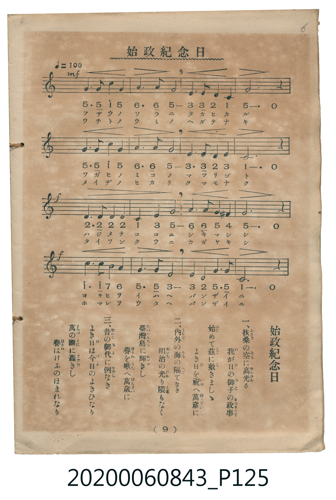

# 始政紀念日

> Re:Shōka 使用 AI 協助辨識與重建樂譜，可能會有錯誤。歡迎回報。

- **鋼琴伴奏版**：<br><audio controls src="shisei_kinenbi.mp3"></audio>

- 臺灣總督府始政紀念日唱歌
- 唱歌筆記帖（臺灣子供世界社發行，2020.006.0843）P125.jpg（第 9 頁）

## 說明

> [!NOTE]
> **原書資訊與歌詞全文**（對應 `P125.jpg`，印刷五線譜＋簡譜對照第 9 頁）：
> - **曲名**：始政紀念日
> - **調性與拍號**：ハ調四分之四拍子（C 大調 4/4 拍），速度 ♩= 100，起音標 `mf`，第 9、13 小節標 `f`。
> - **校勘備註**：譜下第 2 節第 5 小節配詞印作「メ イ デ ノ」（下方歌詞排印作「明治（めいち）の」）。
>
> **一、**
> 扶桑（ふさう）の空（そら）に高光（たかひか）る
> 我（わ）が日（ひ）の御子（みこ）の政事（まつりごと）
> 始（はじ）めて茲（こゝ）に敷（し）きましゝ
> よき日（ひ）を祝（いは）へ萬歲（ばんざい）に
>
> **二、**
> 內外（うちと）の海（うみ）の隔（へだ）てなき
> 明治（めいち）の光（ひか）り隈（くま）もなく
> 臺灣島（たいわんたう）に輝（かゞや）きし
> 譽（ほまれ）を歌（うた）へ萬歲（ばんざい）に
>
> **三、**
> 昔（むかし）の御代（みよ）に例（ためし）なき
> よき日（ひ）は今日（けふ）のよきひなり
> 萬（よろづ）の國（くに）に轟（とゞろ）きし
> 譽（ほまれ）はけふのほまれなり


## 歌詞

```text
（TMD 檔案未包含歌詞註解）
```

## ABC

<div class="abc-score" data-abc-src="shisei_kinenbi.abc" aria-label="五線譜載入中"></div>

[下載 ABC 原始檔](shisei_kinenbi.abc)

## TMD 檔案連結

- [主旋律 TMD 檔案](shisei_kinenbi.tmd) [[在 TMD Studio 編輯](https://tmdlang.github.io/Tmd-TS/#tmd=s7IKdvYPcrWy4qpTUCpJTLdSSM7PyUlNLsnMz7MqzsjPTkzOyFeCS5bl55TmploBqXgDQ4RwcX5pUXJqfEFieqpVgKGRKboM3KT4vPyS1KT8_GyEioKi_LLUvMQ8oKqCosy8ktSU-OKM1NQShIrUssyUVJB8cXJiXnxZalFmWmZqCpKjUouKwc6FuKKkKDGvOLkoswDkB4Sq_KKSjPz0osSCjEqrjMzikvyizOTEnPjsxLxEhKKSjFSg9zJzC4CWJOagiyenFqXm5uehyOTkJyeCA6skMbM8EcW-zPRMmHB8flpaZjJYo5aWwtPl3c-m7H--peHp_q3Ppi9V0NLiUrRVMDQw4LK3VXDmsjHRN7EDmfOifdfzxsXPd-x9Pnfx011z0LQ9nbLx2doesIUQ5vO1bS9WzHi6Y9r7PR0QrU_XTniyb_aTHdOeT-15vmTf85l7Xizseb-nx8jAyEDPwMBMz8DCxPj9nk5QnOllFaQDNT5fs0bBUuHlgkagsBIXl76Wgi21AJeCgoKdQrSin3-IayyEo6X1tG_-s9k7Xmxuf7Gi60VHO9AbL1bOe9q64tm0di0toHuebuh91t6pkABzYgLQ-U97Nzzt2P5k15Tn22e9WDvn_Z7u5xsWAhlAtc9blyP74P2eWRCLdIFWPZu96emEXpCps9CCEqHmxar9zxqWgxzS3fti5nyw4sfN_UDhp7NnP-1oe7KzG8gASgKDFug6Z4WnS5YDJRWAUaYAFAVb2fOyYf7TXcsUHs1cCY5VoMiLrdtfzt_8bMVMhYTcNJAXwI583NBoaKzwdEP_8_UNYLm0hMcNTUgOXrDwafeMp00zX6zYDXYJ0I9PdnSD9BopAPWAGKZQ_S9be0EB17vhyd45jxt6HjcvVHjctEThcXM7EPc9bgA6rQOo99m0nZAgftY3Ca742Yy-Z5t2AxU8bmp83NjyuHEh0B-PG9eBdXXCnASLsSc7GoAOB6ZZMP9Z57ZnCyeC9DZufdw49XFjG0Tv85W7wIJzHzcBgwQosvrl6hlPW4FsoOD8x43djxs3AUmQVFM31KgOsDlN_WD1PcB4ASveBDHw6b6FkDB_3Lj_ceNkiCAwEp_sAhoCFNz3uHHJ46aux41THjeuAMpCzARGNFh2_ePGGWC7gB5c9qIHaCZQcPLjprkQtz2buh0sMh3M7QWbNh0oCzHkcRNQqhfFPU2Tni8F6gVygcG1Hqxrx4sJa56thZi84XHT5MeN04CyEPNRA3BXD1IAPm1d_nQJKMsCgw4Y8hDHg7y2FeIkoOB-iMjLWVPAIjseNy4Aiyx73LgK6DBo6OGIRFiYw0O76-WsDrBIP9CbYJEmsDn9EHOgJcfmbbCYagHGCNg7QDYkcle_2APxe_fjpnmPmyB-BAbadKgJa_eCZXeDgrEJWN6AgguY6mDemU9icO0AJkFEepsBDoSmBnASgsQXKG082b0YmjaagL4DGfJkHyTq54MDBKISEVxY4rRx_ZPdXTCRicD0DM0FYJXgAFwFDD2oHyesATsDiIBSQC1gZ8yB2AgM2NXQgNoL9CxQZAU4oMC5CX9AgRIqyGqQvTBxhL2Ul8FQoKClz8UVDKwGUzO9M_NS85IyrQIyE_PyHWoMaqpBNinYWGiBY0ABWw2gACx5gMUAsDJRMIGWPzoKsBIai3KgbSCjahSqc9NqgUWWLhCaKhjGgSldoLgZWMgMKgUSMQbTxsCCTlfBECxiGg-VBEEDkBDYUB_DGmAJNxUs-rhpKxAvA7Ga-8CaHjfthcg0rwTibrjxj5v2Q3WsBopPgrLAMs0gGgZBdkLtMQLpApkNMq0RiDtQ7IHJzIeKQe1pngEVbwDiNjCrC6pjLXZ7jEFyDRBdjd1APB3MWgfR1QhzdweQDXMpSHw-VBzoMqiOVVCZXgx78Efsrh7SI5bkOAWxa8AxiytK10M9tAYWQbCgBgYxRGYzWlDPgwZ1CxCDPP-4aQtUBhRVOKIUWFFCTINUlsj2gGyFJRGQebCkA3UZ0L7HzYvALFiUQmSwRynEDaDoAJYlYBZINSiCJkJlgIkXHM0wezB1QKO0CWQfKVG6o5OMvArMqqCY0gWSIBqEITEGijtErCLHs4k6WAgmiS1a-6GBugMa9JBcAfLUZrA4mETJqduhOtZCoxgigpDBGq3w_A2KVlBAP24GmQyTgZUSyPZAchMkwS2B2ojXHuRobQJF0lIQC55TQT6F5FHUnLoCoqMRWCIBdUEiGCIDyrckRCuwJUpetIJzKbBcjVMwB1KgCETkYEgmhWVXUKRDZeIJ5Feot8DRBMmvoDQLCiJQYIL4_fDiEJK_JsCj5XHTNqjuJWAZWLRgidjm2VDTQLlvDYo90CIYGMEU2gOK2MbdEJWN-4Cqe8AsAvkVrAOkHmQ-SAckx2LPr7VcXLp2CihVsAJQQJkLAA)]
- [鋼琴伴奏 TMD 檔案](shisei_kinenbi_piano.tmd) [[在 TMD Studio 編輯](https://tmdlang.github.io/Tmd-TS/#tmd=s7IKdvYPcrWy4qpTUCpJTLdSyC8qychPL0osyKi0ysgsLskvykxOzInPTsxLVIIrKs4vLUpOjS9ITE-1CjA0MkXIlGSk5qZapaaUJieWZObnKXFpaSk8Xd79bMr-51sanu7f-mz60vd7Ol5273k-YcuTPVueLu1_3tnxfk-ngpYWl6KtgqGBAZe9rYIzl42JvokdyNQX7bueNy5-vmPv87mLn-6ag2bW0ykbn63tAVsPYT5f2_ZixYynO6YBbYFofbp2wpN9s5_smPZ8as_zJfuez9zzYmHP-z09RgZGBnoGBmZ6BhYmxkAXgPyhl1WQDtT4fM0aBUuFlwsagcJKXFzBwHBIzfTOzEvNS8q0CshMzMt3qDGoqeZSAAIbCy07MKNGoTo3rVbBVEEXCE0VDOPAlC5Q3AwsZAaVAokYg2ljBSMgaQgWMY2HSoKgAUgIbKiPYY3C4-apYNHHTVuBeBmI1dwH1vS4aS9EpnklEHfDjX_ctB-qYzVQfBKUBZZpBtEwCLITao8RSBfIbJBpjUDcgWIPTGY-VAxqT_MMqHgDELeBWV1QHWux22MMkmuA6GrsBuLpYNY6iK5GmLs7gGyYS0Hi86HiQJdBdayCyvRitQcYoGAREuIBxK4BxwauaFgPdcQaWKDCggcYLBCZzWjBMw8aPC1ADHLw46YtUBlQ8OKIhuaFUNOWANntKPaAbIVFK8g8WHRDXQa073HzIjALFg0QGezRAHEDKAgfN24Cs0CqQYE6ESoDTHDgqIHZg6kDGg1NIPuwRUM1MEuAQlcXSIJoEIaEMii8ETGBHDcm6mAhmCS2qOiHBsQOaHBBUh_IIZvB4mASJUdsh-pYC40WiAhCBmtUwPMRKCpAgfO4GWQyTAaWG5HtgaRaSCJZArURrz3IUdEECtilIBY8R4B8CskLqDliBURHIzDnA3VBIgUiA8ofuKICnBuAZU6cgjmQAgU6IqdAMgMsW4AiCioTTyBfQJ0CDlpIvgClDZC3QAEA4vfDiwpIOp4AD8rHTdugupeAZWBBiSUymmdDTQOl8jUo9kCLJ2CkUGgPKDIad0NUNu4Dqu4BswjkC7AOkHqQ-SAdkJyBPV_UYq1QgjywVinG2vDY0QbHHUSgRsFEG5ZjYErA-UobVqKZx2sTrFyoYDxYAFfqqIEpA6UmKBNKQbRAtCPbYKIOt9gILGyoDS0NQBrhCjH9gUjYRtqgpA3xALIPYY5HeATJSTBV2JM69ijzQY4yE3iUGcYjENBD8SAE40Fo0_h4BTMgBkVMvIIRRMAA7hniDABhMB_EAFII_TBZFFVIJgIthCO8TgCJAe1G14_VfCRXAENL104BJcCifQxjFTAFjbAJGoMFlbkA)]

## 分析

```text
================================================================================
📊 TMD Song Profile: [ 始政紀念日 ]
================================================================================
⏱  Duration:       0:38 (38.4s), 16 measures total
🎼 Key & Tempo:    首調基準 C, != 100.0 BPM, <4/4>
   - 分析範圍：      由實際發聲的音符與和弦推測調性；播放脈絡另行呈現
🎤 人聲音域:    G3 (MIDI 55) – C5 (MIDI 72) [跨度: 17 個半音 / 1.4 個八度, 難度: challenging]
   - 最低音:  G3 in [ShiseiKinenbi #1 @ m.4, 0:07]
   - 最高音: C5 in [ShiseiKinenbi #1 @ m.1, 0:01]
   - 適合: mezzo-soprano, contralto, tenor, baritone, bass
🏛  結構:      ShiseiKinenbi (38.4s)
⚡ 編曲密度:        Peak 1 軌道同時演奏
🗝  調性診斷：       G 大調（純淨自然大調，未偵測到可信轉調）
   - 風格氣質:    純淨自然大調（陽光明朗、易唱易記，無明顯調外色彩）
   - 轉調歷程:    全曲維持單一推測調性（未偵測到可信轉調）
   - 核心骨幹音:  G, C, E, D, A
   - 調性數值:    G 大調 [相關度: 0.85, 穩定度: Moderate, 自然音純度: 100.0%]
   - 候選調性 (K-S): G 大調 (0.85), C 大調 (0.79), E 小調 (0.66)
   - 五度圈歷程:   +1
   - 各段落調性細節:
     • [ShiseiKinenbi #1]: G 大調 (r: 0.85, 自然音純度: 100.0%)

  [ 五度圈游移軌跡 ]
               C  
         F           [G ]*
      Bb               D  
      Eb               A  
         Ab           E  
            Db       B  
               F# 
     (* = active key center)

  [ 十二半音累積音高分佈 ]
     C  : █████████████             20.0%
     C# :                            0.0%
     D  : ███████                   11.7%
     D# :                            0.0%
     E  : █████████                 15.0%
     F  :                            0.0%
     F# : █                          1.7%
     G  : ████████████████████████  38.3%
     G# :                            0.0%
     A  : ███████                   11.7%
     A# :                            0.0%
     B  : █                          1.7%
--------------------------------------------------------------------------------
Assignment 軌道音域：
  - Piano         : G3 – C5 (17 個半音 / 1.4 個八度, 48 個音符)
================================================================================
```


## 原書掃描頁




