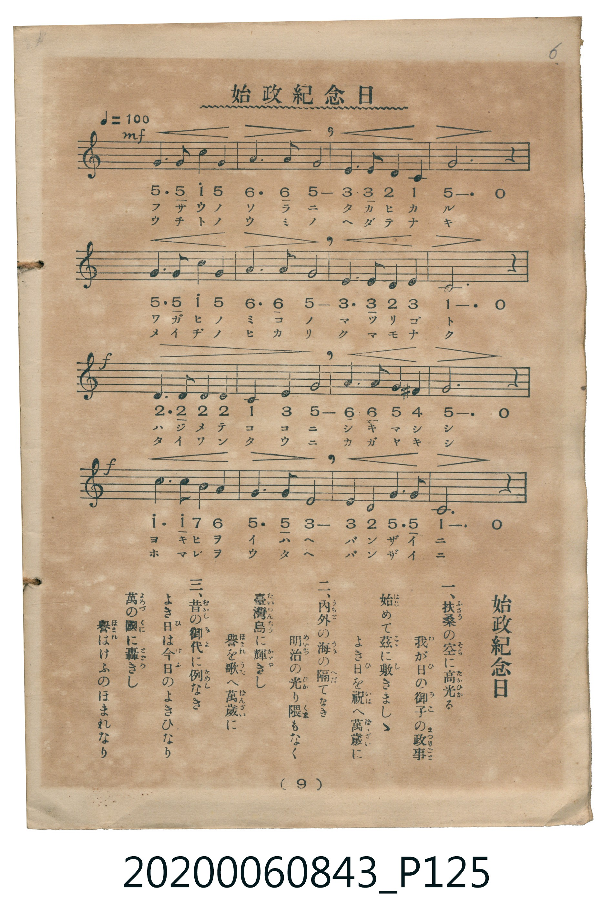

# 始政紀念日

<audio controls src="shisei_kinenbi.mp3"></audio>

- 臺灣總督府始政紀念日唱歌
- 唱歌筆記帖（臺灣子供世界社發行，2020.006.0843）P125.jpg（第 9 頁）

## 說明

原書資訊與歌詞全文（對應 P125.jpg，印刷五線譜＋簡譜對照第 9 頁）：
調性與拍號：ハ調四分之四拍子（C 大調 4/4 拍），速度 ♩=100

## 跨冊／重複收錄參照

> 同曲（6月17日臺灣始政紀念日唱歌；收錄於《新定兒童唱歌》卷首及《唱歌帖》P047 五線譜版、P125 五線譜與簡譜對照版）

- **[同曲]** 《新定兒童唱歌》尋常科第一學年用（2020.006.0847.0001）：[**〈始政記念日〉**](../../../shintei_jido_shoka/grade_1_2020.006.0847.0001/0_07_shisei_kinenbi/index.md)（`C` / `4/4` — [原始 TMD](../../../shintei_jido_shoka/grade_1_2020.006.0847.0001/0_07_shisei_kinenbi/shisei_kinenbi.tmd)）
- **[同曲]** 楊金土手抄《唱歌帖》第 3 冊・I（2020.006.0843）：[**〈始政紀念日〉**](../../vol_03/p047_shisei_kinembi/index.md)（`C` / `4/4` — [原始 TMD](../../vol_03/p047_shisei_kinembi/shisei_kinembi.tmd)）
- 總表：[跨冊重複與同名歌曲總索引](../../../duplicate_songs.md)

## 歌詞

```text
一、扶桑の空に高光る　我が日の御子の政事（まつりごと）
始めて茲に敷きましし　よき日を祝へ萬歳に
二、内外の海の隔てなき　明治の光り隈もなく
臺灣島に輝きし　譽を歌へ萬歳に
三、昔の御代に例なき　よき日は今日のよきひなり
萬の國に轟きし　譽はけふのほまれなり
```

## ABC

```abc
X:1
T:始政紀念日
M:4/4
L:1/16
Q:1/4=100
K:C
V:V1 name="Vocal" snm="Voc"
[V:V1]
G6 G2 c4 G4 | A6 A2 G8 | E6 E2 D4 C4 | G12 z4 |
G6 G2 c4 G4 | A6 A2 G8 | E6 E2 D4 E4 | C12 z4 |
D6 D2 D4 D4 | C4 E4 G8 | A6 A2 G4 ^F4 | G12 z4 |
c6 c2 B4 A4 | G6 G2 E8 | E4 D4 G6 G2 | C12 z4 |
```

## TMD 檔案連結

- [主旋律 TMD 檔案](shisei_kinenbi.tmd) [[在 TMD Studio 編輯](https://tmdlang.github.io/Tmd-TS/#tmd=s7IKdvYPcrWy4tLSUni6vPvZlP3PtzQ83b_12fSlClpaXIq2CoYGBlz2tgrOXDYm-iZ2XHUKSi_adz1vXPx8x97ncxc_3TUHTdvTKRufre1RAimEMJ-vbXuxYsbTHdPe7-mAaH26dsKTfbOf7Jj2fGrP8yX7ns_c82Jhz_s9PUYGRgZ6BgZmegYWJsbv93QGGBqZ6mUVpAM1Pl-zRsFS4eWCRqCwEheXvpaCLbUAl4KCwtO--c9m73ixuf3Fiq4XHe1AV79YOe9p64pn09qBlj_d0PusvVMB4Zyep70bnnZsf7JryvPts16snfN-T_fzDQuBDKDK563LkR37fs8skAUvVu1_1rAcZHR374uZ84Gij5v7gYJPZ89-2tH2ZGc3kAGUAoYM0D5nhadLlgMlFYAhrgAUBRvT87Jh_tNdyxQezVxpC4oTkKlPdjQ8bmh81rnt2cKJjxvXPV-563Hj6perZzxt7Xzc1P24oeFZB1C8BxgrQNmn-xYCjQcygLH1ZFc30J7HjfseNy553NT1uHHK48YVQGtAhoIAME4fNzU-blz2omcT0MhnU7c_buwFK58OQg0Nj5uAuntBBjdNer507uPGHS8mrHm2djNQMdhhu3qADnva1vp0yTSQjVuB-te9nAW0ZdnjxlUgs4Bum9H3bNNukMNAru16OavjcVMTWLYf5gxoctm8DWjsiz1AW4BuANn-Yu1eoL3AWMKwd0cnKEBmAC0C-ffJ7sVAiSf7uuGWItzduP7J7i5IyEAEHzcCvboK6BK47RPWgIyZA9S9-sXe-Si2N65_3AgM2q0g3Y1AT-x73AR0DEw35YkSChS09Lm4gjMyi1MzvTPzUvOSMq3C8pMTcxxqDGoUqsEOtbHQsgMzsOUJBWBSBCYSYPZS0DBReLqh__n6Bh14QtbEogFoIciwGgVTBV0gNFUwjANTukAhM7CQGVQKJGIMpo0VjICkIVgEJgeCBiARcELF7bhdPXRxHIhdA3YiKY7b0UmO40D26QJJEA3CEHtBLkC4Ddm1JurkhBywwCDHceAQA0ZWnII52AEIm02hAQYLOpDTYTLYgq6Wi0vXTgElcSoABZS5AA)]
- [鋼琴伴奏 TMD 檔案](shisei_kinenbi_piano.tmd) [[在 TMD Studio 編輯](https://tmdlang.github.io/Tmd-TS/#tmd=s7IKdvYPcrWy4tLSUni6vPvZlP3PtzQ83b_12fSl7_d0vOze83zClid7tjxd2v-8s-P9nk4FLS0uRVsFQwMDLntbBWcuGxN9EzuuOgWlF-27njcufr5j7_O5i5_umoNm1tMpG5-t7VECKYQwn69te7FixtMd04C2QLQ-XTvhyb7ZT3ZMez615_mSfc9n7nmxsOf9nh4jAyMDPQMDMz0DCxNjoAsCDI1M9bIK0oEan69Zo2Cp8HJBI1BYiYsrOCOzODXTOzMvNS8p0yosPzkxx6HGoEahmksBCGwstOzAjBoFUwVdIDRVMIwDU7pAITOwkBlUCiRiDKaNFYyApCFYBCYHggYgEXKNA7FrwIZiMw6kQhdIgmgQhqgE6UGYhmy-iTpe14FdBfRCnII5WAtCrSnUUTDngSyDyWBzXi16EAdkJublB3lgD2Rjbbgt2mA3QARqFEy0Ya6HKQH7URsWQubx2ogwB3HgqtC9RrEVYAHcMQFVBgoZKBNKQbRAtCPbYKIOtxjiakNtaOwQ8Acikoy0QdEE8QCyD2GOR3gEyUlwVcRHmw9KtJnAo80wHoGAHooHIRgPQpvGxyuYATEwGQFJI4iAASK9EWUACIP5IAaQQuiHyaKoQjIRaCEc4XUCSAxoN7p-rOYjuQIYXLp2CighpgAUUOYCAA)]

## 分析

```text
================================================================================
📊 TMD Song Profile: [ 始政紀念日 ]
================================================================================
⏱  Duration:       0:38 (38.4s), 16 measures total
🎼 Key & Tempo:    首調基準 C, != 100.0 BPM, <4/4>
   - 分析範圍：      由實際發聲的音符與和弦推測調性；播放脈絡另行呈現
🎤 人聲音域:    C4 (MIDI 60) – C5 (MIDI 72) [跨度: 12 個半音 / 1.0 個八度, 難度: easy]
   - 最低音:  C4 in [ShiseiKinenbi #1 @ m.3, 0:06]
   - 最高音: C5 in [ShiseiKinenbi #1 @ m.1, 0:01]
   - 適合: soprano, mezzo-soprano, contralto, tenor, baritone, bass
🏛  結構:      ShiseiKinenbi (38.4s)
⚡ 編曲密度:        Peak 1 軌道同時演奏
🗝  調性診斷：       G 大調（純淨自然大調，未偵測到可信轉調）
   - 風格氣質:    純淨自然大調（陽光明朗、易唱易記，無明顯調外色彩）
   - 轉調歷程:    全曲維持單一推測調性（未偵測到可信轉調）
   - 核心骨幹音:  G, C, E, D, A
   - 調性數值:    G 大調 [相關度: 0.85, 穩定度: Moderate, 自然音純度: 100.0%]
   - 候選調性 (K-S): G 大調 (0.85), C 大調 (0.79), E 小調 (0.66)
   - 五度圈歷程:   +1
   - 各段落調性細節:
     • [ShiseiKinenbi #1]: G 大調 (r: 0.85, 自然音純度: 100.0%)

  [ 五度圈游移軌跡 ]
               C  
         F           [G ]*
      Bb               D  
      Eb               A  
         Ab           E  
            Db       B  
               F# 
     (* = active key center)

  [ 十二半音累積音高分佈 ]
     C  : █████████████             20.0%
     C# :                            0.0%
     D  : ███████                   11.7%
     D# :                            0.0%
     E  : █████████                 15.0%
     F  :                            0.0%
     F# : █                          1.7%
     G  : ████████████████████████  38.3%
     G# :                            0.0%
     A  : ███████                   11.7%
     A# :                            0.0%
     B  : █                          1.7%
--------------------------------------------------------------------------------
Assignment 軌道音域：
  - Vocal         : C4 – C5 (12 個半音 / 1.0 個八度, 48 個音符)
================================================================================
```


## 原書掃描頁




