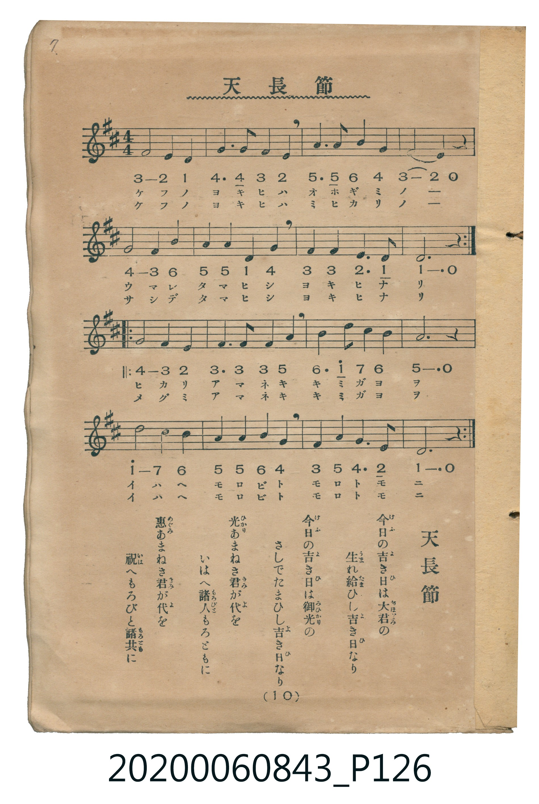

# 天長節

<audio controls src="tenchosetsu.mp3"></audio>

- 詞：黒川真頼
- 曲：奥好義
- 唱歌筆記帖（臺灣子供世界社發行，2020.006.0843）P126.jpg（第 10 頁）

## 說明

原書資訊與歌詞全文（對應 P126.jpg，印刷五線譜＋簡譜對照第 10 頁）：
調性與拍號：ニ調四分之四拍子（D 大調 4/4 拍）

## 跨冊／重複收錄參照

> 同曲（儀式歌〈天長節〉；收錄於《新定兒童唱歌》卷首與《唱歌帖》P126）

- **[同曲]** 《新定兒童唱歌》尋常科第一學年用（2020.006.0847.0001）：[**〈天長節〉**](../../../shintei_jido_shoka/grade_1_2020.006.0847.0001/0_03_tenchosetsu/index.md)（`D` / `4/4` — [原始 TMD](../../../shintei_jido_shoka/grade_1_2020.006.0847.0001/0_03_tenchosetsu/tenchosetsu.tmd)）
- 總表：[跨冊重複與同名歌曲總索引](../../../duplicate_songs.md)

## 歌詞

```text
今日の吉き日は大君の　生れ給ひし吉き日なり
今日の吉き日は御光の　さしでたまひし吉き日なり
光あまねき君が代を　いはへ諸人もろともに
惠あまねき君が代を　祝へもろびと諸共に
```

## ABC

```abc
X:1
T:天長節
C:曲：奥好義
M:4/4
L:1/16
Q:1/4=96
K:D
V:V1 name="Vocal" snm="Voc"
[V:V1]
F8 E4 D4 | G6 G2 F4 E4 | A6 A2 B4 G4 | F4 E4 z8 |
G8 F4 B4 | A4 A4 D4 G4 | F4 F4 E6 D2 | D12 z4 |
G8 F4 E4 | F6 F2 F4 A4 | B6 d2 c4 B4 | A12 z4 |
d8 c4 B4 | A4 A4 B4 G4 | F4 A4 G6 E2 | D12 z4 |
```

## TMD 檔案連結

- [主旋律 TMD 檔案](tenchosetsu.tmd) [[在 TMD Studio 編輯](https://tmdlang.github.io/Tmd-TS/#tmd=s7IKdvYPcrWy4tLSUni6ZOXLqdufr29Q0NLiUrRVsDTjsrdVcOGyMdE3seOqU1B6sXLe-z2zXu6e9HT73Odz5r9csEcJJPxs9iag8NOlS58u3ft830qw2NMpG5-t7Xm-tu3FihlPd0x7v6fjRfuu542Ln66d8GTf7Cc7pj2f2vN8yb7nM_e8WNjzfk-PkYGRgZ6BgZmegYWJ8fs9nQGGRmZ6WQXpQI3P16xRMDRQeLmgESiuxMWlr6VgSy3ApaCg8LRv_rPZO15sbn-xoutFRzvQ2UB_Pm1d8WxaO9D2pxt6n7V3KiDc0_O0d8PTju1Pdk15vn3Wi7Vz3u_pfr5hIZABVPm8dTmKa4HBArLhxar9zxqWg8zu7n0xcz5Q9HFzN1Dw6ezZTzvanuzsBjKAUsCwAVroAoyH5UBJBWCoKwBFgcZwgQx5srvr2fSljxvXPZ3Q-bixF8xeD1T6dMJsoODjhobnU-Y_bup5vnXZ48ZNjxunIylb9bipC7cR-xY-bQVyQUY8bpwK1Pm4cfnjxvmPG_fhNAisoQmsYi1QDuyEnie7Fz9umgQ2pQVo7uPGHS9W73iya9fjpqbHTb2PG1eAGI2rQfqfNS_Ao__50rlAzTBtm4E6gQY9bd0I1Ux5rEOBgpY-F1dIal5yRn5xaklxqVVYfnJijkONQY1CNcgiBRsLLTswA1uSUwDG9JMdDcDkq6BhovB0Qz8w4-jA04kmFg1A60CG1SgYK-iCoREQGwJxjYIJmG8ClgGJ1iiYgkVMFczA4iARmJwBVHcNOFngdtuuHnLcBnGJLtg2kN0Ql4AwyKUIl8BcAxKvAcvBIMh9hNy2o5NSt0FCCRKSxmAa5MYasJuBbopTMEfxAAmOA2ZGchwHtBJiBarFIIwahyARiE-MsIZcLReXrp0CUrpUAHKVuQA)]
- [鋼琴伴奏 TMD 檔案](tenchosetsu_piano.tmd) [[在 TMD Studio 編輯](https://tmdlang.github.io/Tmd-TS/#tmd=s7IKdvYPcrWy4tLSUni6ZOXLqdufr294v6fjZfee5xO2PNmz5enS_uedHe_3dCpoaXEp2ipYmnHZ2yq4cNmY6JvYcdUpKL1YOe_9nlkvd096un3u8znzXy7YowQSfjZ7E1D46dKlT5fufb5vJVjs6ZSNz9b2PF_b9mLFjKc7pgGtedG-63nj4qdrJzzZN_vJjmnPp_Y8X7Lv-cw9Lxb2vN_TY2RgZKBnYGCmZ2BhYgx0QoChkZleVkE6UOPzNWsUDA0UXi5oBIorcXGFpOYlZ-QXp5YUl1qF5Scn5jjUGNQoVHMpAIGNhZYdmFGjYKygC4ZGQGwIxDUKJmC-CVgGJFqjYAoWMVUwA4uDRGByBlDdNVDTIHp1wfIg1RC9IAwyG6EXph8kXgOWg0GQidhMg7gE4lpjMA0ytQZsC9CUOAVzFCuxGQdUBBFEVQrCqD4DiUDsNsLqulrU0A3ITMzLD_LAHr6G2rAQNo_XRgSyoTYsmCEKoJJA-7VhoW2iDXIVRCHMHKgy9GCHmQZSDlIG0QozDEKC7EU1DMVI_DEBVIRqA9y9MP8ZQ1kQy4BxB3YCOGaMtEEBbqIOdZQR1IeYthhrw6MIqgeLP7AFC0QG7kjiY80HJdZMELEWD0Km8WAK6BkgA4ShYjB5mDAwHQFJEEZJvQhNEEUQTWYYmmAYrAJqpwHcGJgsmt0QhLDFCIwgyoEMiGPg6QOuHdklmM7H5RJg0OnaKSCFngKQq8wFAA)]

## 分析

```text
================================================================================
📊 TMD Song Profile: [ 天長節 ]
================================================================================
⏱  Duration:       0:40 (40.0s), 16 measures total
🎼 Key & Tempo:    首調基準 D, != 96.0 BPM, <4/4>
   - 分析範圍：      由實際發聲的音符與和弦推測調性；播放脈絡另行呈現
🎤 人聲音域:    D4 (MIDI 62) – D5 (MIDI 74) [跨度: 12 個半音 / 1.0 個八度, 難度: easy]
   - 最低音:  D4 in [Tenchosetsu #1 @ m.1, 0:01]
   - 最高音: D5 in [Tenchosetsu #1 @ m.11, 0:25]
   - 適合: soprano, mezzo-soprano, contralto, tenor, baritone, bass
🏛  結構:      Tenchosetsu (40.0s)
⚡ 編曲密度:        Peak 1 軌道同時演奏
🗝  調性診斷：       D 大調（純淨自然大調，未偵測到可信轉調）
   - 風格氣質:    純淨自然大調（陽光明朗、易唱易記，無明顯調外色彩）
   - 轉調歷程:    全曲維持單一推測調性（未偵測到可信轉調）
   - 核心骨幹音:  F#, D, A, G, B
   - 調性數值:    D 大調 [相關度: 0.91, 穩定度: High, 自然音純度: 100.0%]
   - 候選調性 (K-S): D 大調 (0.91), B 小調 (0.67), G 大調 (0.63)
   - 五度圈歷程:   +2
   - 各段落調性細節:
     • [Tenchosetsu #1]: D 大調 (r: 0.91, 自然音純度: 100.0%)

  [ 五度圈游移軌跡 ]
               C  
         F            G  
      Bb              [D ]*
      Eb               A  
         Ab           E  
            Db       B  
               F# 
     (* = active key center)

  [ 十二半音累積音高分佈 ]
     C  :                            0.0%
     C# : ████                       3.4%
     D  : ██████████████████████    18.6%
     D# :                            0.0%
     E  : ████████████              10.2%
     F  :                            0.0%
     F# : ████████████████████████  20.3%
     G  : █████████████████████     17.8%
     G# :                            0.0%
     A  : ██████████████████████    18.6%
     A# :                            0.0%
     B  : █████████████             11.0%
--------------------------------------------------------------------------------
Assignment 軌道音域：
  - Vocal         : D4 – D5 (12 個半音 / 1.0 個八度, 49 個音符)
================================================================================
```


## 原書掃描頁




