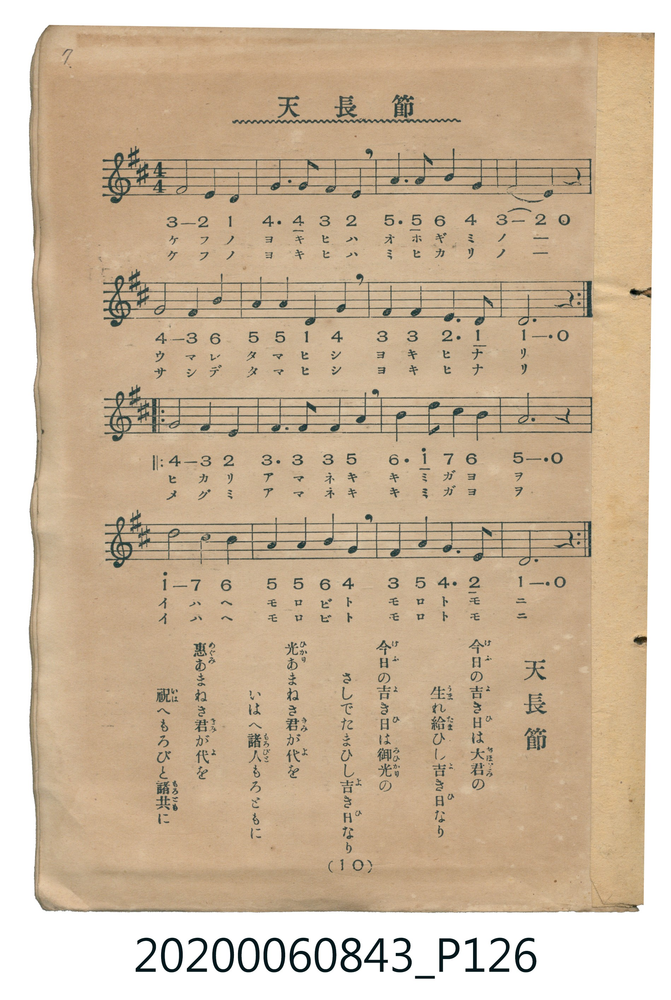

# 天長節

> Re:Shōka 使用 AI 協助辨識與重建樂譜，可能會有錯誤。歡迎回報。

<audio controls src="tenchosetsu.mp3"></audio>

- 詞：黒川真頼
- 曲：奥好義
- 唱歌筆記帖（臺灣子供世界社發行，2020.006.0843）P126.jpg（第 10 頁）

## 說明

原書資訊與歌詞全文（對應 P126.jpg，印刷五線譜＋簡譜對照第 10 頁）：
調性與拍號：ニ調四分之四拍子（D 大調 4/4 拍），♩=96

## 跨冊／重複收錄參照

> 同曲（儀式歌〈天長節〉；收錄於《新定兒童唱歌》卷首與《唱歌帖》P126）

- **[同曲]** 《新定兒童唱歌》尋常科第一學年用（2020.006.0847.0001）：[**〈天長節〉**](../../../shintei_jido_shoka/grade_1_2020.006.0847.0001/0_03_tenchosetsu/index.md)（`D` / `4/4` — [原始 TMD](../../../shintei_jido_shoka/grade_1_2020.006.0847.0001/0_03_tenchosetsu/tenchosetsu.tmd)）
- 總表：[跨冊重複與同名歌曲總索引](../../../duplicate_songs.md)

## 歌詞

```text
一、今日の吉き日は大君の　生れ給ひし吉き日なり
二、今日の吉き日は御光の　さしでたまひし吉き日なり
光あまねき君が代を　いはへ諸人もろともに
惠あまねき君が代を　祝へもろびと諸共に
```

## ABC

```abc
X:1
T:天長節
C:曲：奥好義
M:4/4
L:1/16
Q:1/4=96
K:D
V:V1 name="Vocal" snm="Voc"
[V:V1]
F8 E4 D4 | G6 G2 F4 E4 | A6 A2 B4 G4 | F8 E4 z4 |
w: 1.~ケ フ ノ | ヨ キ ヒ ハ | オ ホ ギ ミ | ノ _
w: 2.~け ふ の | よ き ひ は | み ひ か り | の _
G8 F4 B4 | A4 A4 D4 G4 | F4 F4 E6 D2 | D12 z4 |
w: 1.~ウ マ レ | タ マ ヒ シ | ヨ キ ヒ ナ | リ
w: 2.~さ し で | た ま ひ し | よ き ひ な | り
G8 F4 E4 | F6 F2 F4 A4 | B6 d2 c4 B4 | A12 z4 |
w: 1.~ヒ カ リ | ア マ ネ キ | キ ミ ガ ヨ | ヲ
w: 2.~め ぐ み | あ ま ね き | き み が よ | を
d8 c4 B4 | A4 A4 B4 G4 | F4 A4 G6 E2 | D12 z4 |
w: 1.~イ ハ ヘ | モ ロ ビ ト | モ ロ ト モ | ニ
w: 2.~い は へ | も ろ び と | も ろ と も | に
```

## TMD 檔案連結

- [主旋律 TMD 檔案](tenchosetsu.tmd) [[在 TMD Studio 編輯](https://tmdlang.github.io/Tmd-TS/#tmd=s7IKdvYPcrWy4qpTUCpJTLdSSM7PyUlNLsnMz7MqzsjPTkzOyFeCS5bl55TmploBqXgDQ4RwcX5pUXJqfEFieqpVgKGRGboM3KT4vPyS1KT8_GyEioKi_LLUvMQ8oKrcxLzS4uSizIKS-OT8gkqEmtSyzJRUkIri5MS8-LLUosy0zNQUJGelFhWDHQxxR0lRYh7EHKAgQlVJRirQ7Zm5BUD9iTno4smpRam5-XlgGS0thadLVr6cuv35-gYFLS0uRVsFSzMue1sFFy4bE30TO5DWFyvnvd8z6-XuSU-3z30-Z_7LBXvAJj6bvQko_HTp0qdL9z7ftxIs9nTKxmdre56vbXuxYsbTHdPe7-l40b7reePip2snPNk3-8mOac-n9jxfsu_5zD0vFva839NjZGBkoGdgYKZnYGFi_H5PJyhI9bIK0oEan69Zo2BooPByQSNQXImLS19LwZZagEtBQeFp3_xns3e82Nz-YkXXi452oLOB_nzauuLZtHag7U839D5r71RAuKfnae-Gpx3bn-ya8nz7rBdr57zf0_18w0IgA6jyeetyFNcCgwVkw4tV-581LAeZ3d37YuZ8oOjj5m6g4NPZs592tD3Z2Q1kAKWAYQO00AUYD8uBkgrAUFcAioKN6Xk0c6UtMD5Apj3Z0fC4ofHJ7q5n05c-blz3dELn48ZeMHs9UOfTCbOBgo8bGp5Pmf-4qef51mWPGzc9bpyOpGzV46YusEG7enAatG_h01YgF2TQ48apQP2PG5c_bpz_uHEfTuNAAKypCaxqLVAe7JieJ7sXP26aBDapBWj248YdL1bveLJr1-OmpsdNvY8bV4AYjathZjxrXoDHjOdL5wINgGndDNQNNOxp60aoAZQnCShQ0NLn4goB5sCM_OLUkuJSq7D85MQchxqDGoVqsEttLLTswAxs6VEBmAyA8QRM2womCk839AMzlQ48DWFRDrQMZFSNgrGCLhgaAbEhENcA9YP4JmAZkGiNgilYxFTBDCwOEkHWZQASAZvmY1ij8LhpI1TucfNUMNkH1vG4eQVEtGktkD0JLNMPkWlaBVU_G8heB2bNh-oB6YXBeIQ9RkC5xokwexq3gkmQTpBpHVDRXiDeBGath8g07ofKbALibrBbuqAyIL2o9uAP6V09pIc0JFx1wWEHCklIuIIwKNwR4QoLd5B4DVgOBtFDehk8pOeByTXQEAD5EyYGDumm7UhxAIoBmAyI7gLLQOIAe0iD4hESctPB5HJoqIFiCZhtoGEKk4fFASgGYDIgehVYBhTipIT0jk7KQhqSgiHp1RhMg0K8BhwDwBCOUzAHUojowBHU0MACBd5qcKCBggvknUXwCHjcDPYuOHBBMiAakpQfN4EiBhL4ILMgAYI1qJsa4UE9AUyCohIU1E1Q0X1ADI4-cOCCZEA0RCWw1AK7ABT4ILNgbiYyqIF1AulBDQxAiAWowQjCqKUFSAQSL0YEUvUSWBCAy4fHzTOgwQYK6sfNkLQ7GUxCPYoiA839QDGQDCiX40rVLfCgBpUPwDIeGmygoAaW9WCxzWASGnEoMrDSrAkcCaBEgWpPLReXrp0CUnmuAOQqcwEA)]
- [鋼琴伴奏 TMD 檔案](tenchosetsu_piano.tmd) [[在 TMD Studio 編輯](https://tmdlang.github.io/Tmd-TS/#tmd=s7IKdvYPcrWy4tLSUni6ZOXLqdufr294v6fjZfee5xO2PNmz5enS_uedHe_3dCpoaXEp2ipYmnHZ2yq4cNmY6JvYcdUpKL1YOe_9nlkvd096un3u8znzXy7YowQSfjZ7E1D46dKlT5fufb5vJVjs6ZSNz9b2PF_b9mLFjKc7pgGtedG-63nj4qdrJzzZN_vJjmnPp_Y8X7Lv-cw9Lxb2vN_TY2RgZKBnYGCmZ2BhYgx0QoChkZleVkE6UOPzNWsUDA0UXi5oBIorcXGFpOYlZ-QXp5YUl1qF5Scn5jjUGNQoVHMpAIGNhZYdmFGjYKygC4ZGQGwIxDUKJmC-CVgGJFqjYAoWMVUwA4uDRJB1GYBEwKb5GNYoPG7aCJV73DwVTPaBdTxuXgERbVoLZE8Cy_RDZJpWQdXPBrLXgVnzoXpAemEwHmGPEVCucSLMnsatYBKkE2RaB1S0F4g3gVnrITKN-6Eym4C4G-yWLqgMSC-mPbCw0AX7F-R7SFiAMCisEGEBCyuQeA1YDgbRQ2cZPHTmgck1UFeD3AYTA4dO03akcAOFGkwGRHeBZSDhhj10QGEP8e10MLkc6lNQyD5u3AcNB5g8LNxAoQaTAdGrwDKgUCIUOpCUAkkXxmAaFEo14FADhkqcgjmQQgQhjuCBehDk4dVgj4K8CHLCInigPW4GOxEcICAZEA1JMo-bQIEJCTCQWRBPYA2epkZ48EwAk6DgBwVPE1R0HxCDgxwcICAZEA1R-bixB-wCUICBzIK5GT14gJ6GCKJ6HYRRcxJIBBKWRgRSzxKYs8F553HzDKhXQcHzuBmSRiaDSajjUGSgOQMoBpIB5QBcqacFHjygvPO4cQfUq6DgedwESSObwSQ0sFFkYDm9CRxwoIhEtacWtXQKyEzMyw_ywF4-GWrDyhrzeG1EIWWoDSumIAqgksDw1IaVVibaoFCGKMRiDiJoEaaBlIOUQbTCDIOQIHtRDUOxGV_OrwEpQrUB7l6Yu4yhLIhlwLwFdgI45xhpgxKQiTrUUUZQH2LaYqwNT3JQPVj8gS1YIDJwR2JPhdhizQcl1kwQsRYPQqbxYAroGSADhKFiMHmYMDBfAEkYNkCULwhtEGUQbWZYtcENhtqKMAYmi2Y7BCFsMQIjiHIgA9UpCA8huwS7B7C5BBh4unYKSOEX7WMYq4AuZAQWUuYCAA)]

## 分析

```text
================================================================================
📊 TMD Song Profile: [ 天長節 ]
================================================================================
⏱  Duration:       0:40 (40.0s), 16 measures total
🎼 Key & Tempo:    首調基準 D, != 96.0 BPM, <4/4>
   - 分析範圍：      由實際發聲的音符與和弦推測調性；播放脈絡另行呈現
🎤 人聲音域:    D4 (MIDI 62) – D5 (MIDI 74) [跨度: 12 個半音 / 1.0 個八度, 難度: easy]
   - 最低音:  D4 in [Tenchosetsu #1 @ m.1, 0:01]
   - 最高音: D5 in [Tenchosetsu #1 @ m.11, 0:25]
   - 適合: soprano, mezzo-soprano, contralto, tenor, baritone, bass
🏛  結構:      Tenchosetsu (40.0s)
⚡ 編曲密度:        Peak 1 軌道同時演奏
🗝  調性診斷：       D 大調（純淨自然大調，未偵測到可信轉調）
   - 風格氣質:    純淨自然大調（陽光明朗、易唱易記，無明顯調外色彩）
   - 轉調歷程:    全曲維持單一推測調性（未偵測到可信轉調）
   - 核心骨幹音:  F#, D, A, G, B
   - 調性數值:    D 大調 [相關度: 0.90, 穩定度: High, 自然音純度: 100.0%]
   - 候選調性 (K-S): D 大調 (0.90), B 小調 (0.66), F# 小調 (0.62)
   - 五度圈歷程:   +2
   - 各段落調性細節:
     • [Tenchosetsu #1]: D 大調 (r: 0.90, 自然音純度: 100.0%)

  [ 五度圈游移軌跡 ]
               C  
         F            G  
      Bb              [D ]*
      Eb               A  
         Ab           E  
            Db       B  
               F# 
     (* = active key center)

  [ 十二半音累積音高分佈 ]
     C  :                            0.0%
     C# : ████                       3.3%
     D  : ████████████████████      18.3%
     D# :                            0.0%
     E  : ███████████               10.0%
     F  :                            0.0%
     F# : ████████████████████████  21.7%
     G  : ███████████████████       17.5%
     G# :                            0.0%
     A  : ████████████████████      18.3%
     A# :                            0.0%
     B  : ████████████              10.8%
--------------------------------------------------------------------------------
Assignment 軌道音域：
  - Vocal         : D4 – D5 (12 個半音 / 1.0 個八度, 49 個音符)
================================================================================
```


## 原書掃描頁




