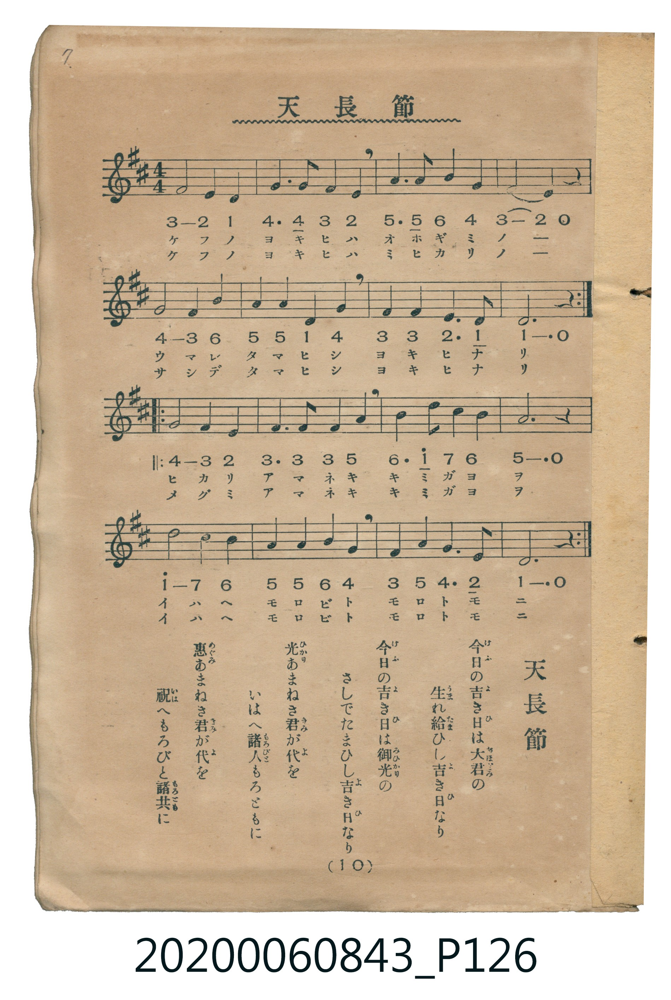

# 天長節

> Re:Shōka 使用 AI 協助辨識與重建樂譜，可能會有錯誤。歡迎回報。

- **鋼琴伴奏版**：<br><audio controls src="tenchosetsu.mp3"></audio>

- 詞：黒川真頼
- 曲：奥好義
- 唱歌筆記帖（臺灣子供世界社發行，2020.006.0843）P126.jpg（第 10 頁）

## 說明

原書資訊與歌詞全文（對應 P126.jpg，印刷五線譜＋簡譜對照第 10 頁）：
調性與拍號：ニ調四分之四拍子（D 大調 4/4 拍），♩=96


## 歌詞

```text
一、今日の吉き日は大君の　生れ給ひし吉き日なり
二、今日の吉き日は御光の　さしでたまひし吉き日なり
光あまねき君が代を　いはへ諸人もろともに
惠あまねき君が代を　祝へもろびと諸共に
```

## ABC

<div class="abc-score" data-abc-src="tenchosetsu.abc" aria-label="五線譜載入中"></div>

[下載 ABC 原始檔](tenchosetsu.abc)

## TMD 檔案連結

- [主旋律 TMD 檔案](tenchosetsu.tmd) [[在 TMD Studio 編輯](https://tmdlang.github.io/Tmd-TS/#tmd=s7IKdvYPcrWy4qpTUCpJTLdSSM7PyUlNLsnMz7MqzsjPTkzOyFeCS5bl55TmploBqXgDQ4RwcX5pUXJqfEFieqpVgKGRGboM3KT4vPyS1KT8_GyEioKi_LLUvMQ8oKrcxLzS4uSizIKS-OT8gkqEmtSyzJRUkIri5MS8-LLUosy0zNQUJGelFhWDHQxxR0lRYh7EHKAgQlVJRirQ7Zm5BUD9iTno4smpRam5-XkoMvlFmemZeVZA4aRSoBcwJVIzszLjS1IrSlD9lF9UkpGfXpRYkFFplZFZXAJUnpyYE5-dmJeoxKWlpfB0ycqXU7c_X9-goKXFpWirYGnGZW-r4MJlY6JvYgcy5cXKee_3zHq5e9LT7XOfz5n_csEesOHPZm8CCj9duvTp0r3P960Eiz2dsvHZ2p7na9terJjxdMe093s6XrTvet64-OnaCU_2zX6yY9rzqT3Pl-x7PnPPi4U97_f0GBkYGegZGJjpGViYGL_f0wmKL72sgnSgxudr1igYGii8XNAIFFfi4tLXUrClFuBSUFB42jf_2ewdLza3v1jR9aKjHehsoD-ftq54Nq0daPvTDb3P2jsVEO7pedq74WnH9ie7pjzfPuvF2jnv93Q_37AQyACqfN66HMW1wGAB2fBi1f5nDctBZnf3vpg5Hyj6uLkbKPh09uynHW1PdnYDGUApYNgALXQBxsNyoKQCMNQVgKJgY3oezVxpC4wPkGlPdjQ8bmh8srvr2fSljxvXPZ3Q-bixF8xeD9T5dMJsoODjhobnU-Y_bup5vnXZ48ZNjxunIylb9bipC2zQrh6cBu1b-LQVyAUZ9LhxKlD_48bljxvnP27ch9M4EABragKrWguUBzum58nuxY-bJoFNagGa_bhxx4vVO57s2vW4qelxU-_jxhUgRuNqmBnPmhfgMeP50rlAA2BaNwN1Aw172roRagDlSQIKFLT0ubhCgNk7I784taS41CosH5hZHGoMaqrBDrWx0LIDM7AlRwVgKgBGEzBpK5goPN3QD8xTOvAkhEU50C6QUTUKxgq6YGgExIZAXAPUD-KbgGVAojUKpmARUwUzsDhIBFmXAUgEbJqPYY3C46aNULnHzVPBZB9Yx-PmFRDRprVA9iSwTD9EpmkVVP1sIHsdmDUfqgekFwbjEfYYAeUaJ8LsadwKJkE6QaZ1QEV7gXgTmLUeItO4HyqzCYi7wW7pgsqA9KLagz-kd_WQHtKQcNUFhx0oJCHhCsKgcEeEKyzcQeI1YDkYRA_pZfCQngcm10BDAORPmBg4pJu2I8UBKAZgMiC6CywDiQPsIQ2KR0jITQeTy6GhBoolYK6BhilMHhYHoBiAyYDoVWAZUIiTEtI7OikLaUgKhqRXYzANCvEacAwAQzhOwRxIIaIDR1BDAwsUeKvBgQYKLpB3FsEj4HEz2LvgwAXJgGhIUn7cBIoYSOCDzIIECNagbmqEB_UEMAmKSlBQN0FF9wExOPrAgQuSAdEQlcBCC-wCUOCDzIK5mcigBlYJpAc1MAAhFqAGIwijlhYgEUi8GBFI1UtgQQAuHx43z4AGGyioHzdD0u5kMAn1KIoMNPcDxUAyoFyOK1W3wIMaVD4Ai3hosIGCGljUg8U2g0loxKHIwEqzJnAkgBIFqj21XFy6dgpIxbkCkKvMBQA)]
- [鋼琴伴奏 TMD 檔案](tenchosetsu_piano.tmd) [[在 TMD Studio 編輯](https://tmdlang.github.io/Tmd-TS/#tmd=s7IKdvYPcrWy4qpTUCpJTLdSyC8qychPL0osyKi0ysgsLskvykxOzInPTsxLVIIrKs4vLUpOjS9ITE-1CjA0MkPIlGSk5qZapaaUJieWZObnKXFpaSk8XbLy5dTtz9c3vN_T8bJ7z_MJW57s2fJ0af_zzo73ezoVtLS4FG0VLM247G0VXLhsTPRN7EDGvVg57_2eWS93T3q6fe7zOfNfLtgDtuXZ7E1A4adLlz5duvf5vpVgsadTNj5b2_N8bduLFTOe7pgGtOZF-67njYufrp3wZN_sJzumPZ_a83zJvucz97xY2PN-T4-RgZGBnoGBmZ6BhYkx0AkgL-hlFaQDNT5fs0bB0EDh5YJGoLgSF1dIal5yRn5xaklxqVVYPjAkHGoMaqq5FIDAxkLLDsyoUTBW0AVDIyA2BOIaBRMw3wQsAxKtUTAFi5gqmIHFQSLIugxAImDTfAxrFB43bYTKPW6eCib7wDoeN6-AiDatBbIngWX6ITJNq6DqZwPZ68Cs-VA9IL0wGI-wxwgo1zgRZk_jVjAJ0gkyrQMq2gvEm8Cs9RCZxv1QmU1A3A12SxdUBqQX0x5YWOiC_QvyPSQsQBgUVoiwgIUVSLwGLAeD6KGzDB4688DkGqirQW6DiYFDp2k7UriBQg0mA6K7wDKQcMMeOqCwh_h2OphcDvUpKGQfN-6DhgNMHhZuoFCDyYDoVWAZUCgRCh1ISoGkC2MwDQqlGnCoAUMlTsEcSCGCEEfwQD0I8vBqsEdBXgQ5YRE80B43g50IDhCQDIiGJJnHTaDAhAQYyCyIJ7AGT1MjPHgmgElQ8IOCpwkqug-IwUEODhCQDIiGqHzc2AN2ASjAQGbB3IwePEBPQwRRvQ7CqDkJJAIJSyMCqWcJzNngvPO4eQbUq6DgedwMSSOTwSTUcSgy0JwBFAPJgHIArtTTAg8eUN553LgD6lVQ8DxugqSRzWASGtgoMrCc3gQOOFBEotpTi1o4BWQm5uUHeWAtngy1YUWNebw2oowy1IaVUhAFUElgcGrDCisTbVAgQxRiMQcRsgjTQMpByiBaYYZBSJC9qIah2Iwv49eAFKHaAHcvzF3GUBbEMmDWAjsBnHGMtEHpx0Qd6igjqA8xbTHWhqc4qB4s_sAWLBAZuCOxJ0JskeaDHGkmiEiLByHTeDAF9AuQAcJQMZg8TBiYK4AkDBsgSheENogyiDYzrNrgBkNtRRgDk0WzHYIQthiBEUQ5kIHqFISHkF2C3QPYXAIMO107BaTgi_YxjFVAFzICCylzAQA)]

## 分析

```text
================================================================================
📊 TMD Song Profile: [ 天長節 ]
================================================================================
⏱  Duration:       0:40 (40.0s), 16 measures total
🎼 Key & Tempo:    首調基準 D, != 96.0 BPM, <4/4>
   - 分析範圍：      由實際發聲的音符與和弦推測調性；播放脈絡另行呈現
🎤 人聲音域:    D4 (MIDI 62) – D5 (MIDI 74) [跨度: 12 個半音 / 1.0 個八度, 難度: easy]
   - 最低音:  D4 in [Tenchosetsu #1 @ m.1, 0:01]
   - 最高音: D5 in [Tenchosetsu #1 @ m.11, 0:25]
   - 適合: soprano, mezzo-soprano, contralto, tenor, baritone, bass
🏛  結構:      Tenchosetsu (40.0s)
⚡ 編曲密度:        Peak 1 軌道同時演奏
🗝  調性診斷：       D 大調（純淨自然大調，未偵測到可信轉調）
   - 風格氣質:    純淨自然大調（陽光明朗、易唱易記，無明顯調外色彩）
   - 轉調歷程:    全曲維持單一推測調性（未偵測到可信轉調）
   - 核心骨幹音:  F#, D, A, G, B
   - 調性數值:    D 大調 [相關度: 0.90, 穩定度: High, 自然音純度: 100.0%]
   - 候選調性 (K-S): D 大調 (0.90), B 小調 (0.66), F# 小調 (0.62)
   - 五度圈歷程:   +2
   - 各段落調性細節:
     • [Tenchosetsu #1]: D 大調 (r: 0.90, 自然音純度: 100.0%)

  [ 五度圈游移軌跡 ]
               C  
         F            G  
      Bb              [D ]*
      Eb               A  
         Ab           E  
            Db       B  
               F# 
     (* = active key center)

  [ 十二半音累積音高分佈 ]
     C  :                            0.0%
     C# : ████                       3.3%
     D  : ████████████████████      18.3%
     D# :                            0.0%
     E  : ███████████               10.0%
     F  :                            0.0%
     F# : ████████████████████████  21.7%
     G  : ███████████████████       17.5%
     G# :                            0.0%
     A  : ████████████████████      18.3%
     A# :                            0.0%
     B  : ████████████              10.8%
--------------------------------------------------------------------------------
Assignment 軌道音域：
  - Vocal         : D4 – D5 (12 個半音 / 1.0 個八度, 49 個音符)
================================================================================
```


## 原書掃描頁




