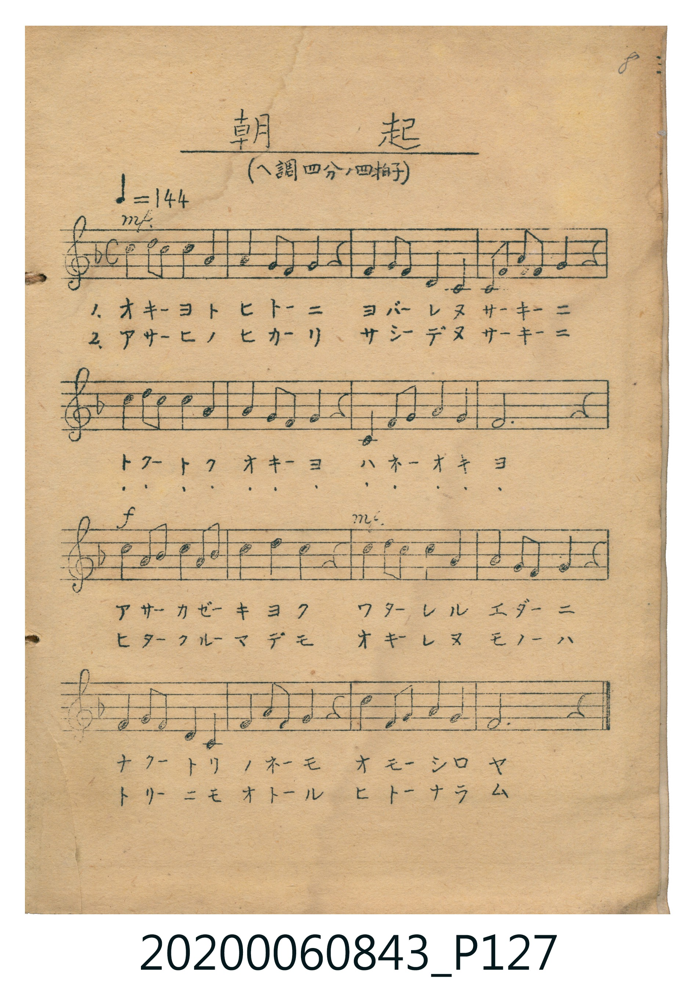

# 朝起

> Re:Shōka 使用 AI 協助辨識與重建樂譜，可能會有錯誤。歡迎回報。

- **鋼琴伴奏版**：<br><audio controls src="asaoki.mp3"></audio>

- （ヘ調四分ノ四拍子）
- 唱歌筆記帖（臺灣子供世界社發行，2020.006.0843）P127.jpg（手寫第 8 首）

## 說明

原書資訊與歌詞全文（對應 P127.jpg，手寫五線譜＋簡譜第 8 首）：
調性與拍號：ヘ調四分ノ四拍子（F 大調 4/4 拍），♩=144


## 歌詞

```text
一、おきよと人に　よばれぬさきに
とくとく起きよ　はねおきよ
あさかぜきよく　わたれるえだに
なくとりのねも　おもしろし

二、あさひのひかり　さしでぬさきに
とくとく起きよ　はねおきよ
ひたくるまでも　おきでぬものは
とりにもおとる　ひとならむ
```

## ABC

```abc
X:1
T:朝起
M:4/4
L:1/16
Q:1/4=144
K:F
V:V1 name="Vocal" snm="Voc"
[V:V1]
!mf! c4 d2 c2 c4 A4 | A4 G2 F2 G4 z4 | F4 G2 F2 C4 A,4 | C4 F2 G2 G4 z4 |
w: 1.~オ キ _ ヨ ト | ヒ ト _ ニ | ヨ バ _ レ ヌ | サ キ _ ニ
w: 2.~あ さ _ ひ の | ひ か _ り | さ し _ で ぬ | さ き _ に
c4 d2 c2 c4 A4 | A4 G2 F2 G4 z4 | C4 F2 G2 A4 G4 | F12 z4 |
w: 1.~ト ク _ ト ク | オ キ _ ヨ | ハ ネ _ オ キ | ヨ
w: 2.~と く _ と く | お き _ よ | は ね _ お き | よ
!f! c4 A2 B2 c4 A2 B2 | c4 d4 c4 z4 | !mf! c4 d2 c2 c4 A4 | A4 G2 F2 G4 z4 |
w: 1.~ア サ _ カ ゼ _ | キ ヨ ク | ワ タ _ レ ル | エ ダ _ ニ
w: 2.~ひ た _ く る _ | ま で も | お き _ で ぬ | も の _ は
F4 G2 F2 C4 A,4 | F4 G2 A2 G4 z4 | c4 F2 G2 A4 G4 | F12 z4 |
w: 1.~ナ ク _ ト リ | ノ ネ _ モ | オ モ _ シ ロ | シ
w: 2.~と り _ に も | お と _ る | ひ と _ な ら | む
```

## TMD 檔案連結

- [主旋律 TMD 檔案](asaoki.tmd) [[在 TMD Studio 編輯](https://tmdlang.github.io/Tmd-TS/#tmd=s7IKdvYPcrWy4qpTUCpJTLdSSM7PyUlNLsnMz7MqzsjPTkzOyFeCS5bl55TmploBqXgDQ4RwcX5pUXJqfEFieqpVgKGROboM3KT4vPyS1KT8_GyEioKi_LLUvMQ8oKrcxLzS4uSizIKS-OT8gkqEmtSyzJRUkIri5MS8-LLUosy0zNQUJGelFhWDHQxxR0lRYh7EHKAgQlVJRirQ7SmJmTmV8TmZaanoMnmJJaVFqfFJmUUpxQi5_KLM9Mw8q9zUzKzM-JLUihKI87W0FJ7Nmfti63YFLS0uRVsFQxMTLntbBTcuGxN9EzuQ7vd7Oh43z3ixav_T2bOfdrQ9bu4DMp519z5dO-H9nk6wBU-nbHy2tuf52rYXK2Y83TENqONF-67njYuBSp7sm_1kx7TnU3ueL9n3fOaeFwt73u_pMTIwMtAzMDDTM7AwMQYaAgprvayCdKDGZ53dT9evfr5mjYKFwstlQKOANnDpaynYUgtwKSgoPO2b_2z2jheb21-s6HrR0Q50-4uV8562rng2rR3ohKcbep-1dyogHNUDcdSTXVOeb5_1Yu2c93u6n29YCGQgO_P9nlkgo4Hh9KxhOcjQ7t4XM-cDRXEHXoebwtMly4GSCsCwVgCKgo3peTRzpS0oGkDGPdnR8Lih8XFj1-PG3sdNHY8bVzzZtetx4-rHDQ1g7obHTT2PG9c8bpwKUtC4GqQHBIAKHzf2Q0hg5EJ1AzU1rn_cuBZuHkJ5E9iI7seNc2A29YPtAJoxH2RHE1AKKLgAxY5VUDuagMatA5nb1AS2owvEaJz-uAnopOkQf-zqAfsDYs0msHIg2Q3SCtIBFJz-uHE5VbwCNHc-SAfIyftAhsJdBTIXbAfIeUAXrEe2A-SJ1WAZIAPI7QZrAhoGtHjV46bOx00NIOWUp0AoUNDS5-JyLE7Mz860CstPTsxxqDGoUagGO8nGQssOzMCW8hWAyQ6YLoBZScFE4emG_ufrG3TgqRWLcqA9IKOqc9NqwYwaBVMFXQUzIAmijYG4BkwaKRgCsa6CAVjEECpiGg9SBCKA-kAUSBFcGdhAH8MahcdNq4D8x01rQWTzCjDZAdb0uHkSnPe4uRtIQgyDqZoAJteAyR6ITNNWJLPgOiB2GQHlG5tAMo1TweQmMLkOohPKA-kBRijCLqja6WByOZgE2YiQ6QWTq-F24Q_9XT2khj5xgQ4PYIgULB5gEC3IIUHatB4RvGA2tsiABXk_WATsWSQ1sMiAQfTgBkdUI1gvEhskAwpiaOA1gVwAC26wmxrB9iOpAbkMpArVHgIJvZPkhI6Szo2BemE0LBJ0wTQkyEHZgpi4QUrpi8DehaRRUIp53LQH6jmk1A-OCliwg4OjaT9YFpLSQfpAOiB5oAFMYkvpkPQ8HxEBTSBVIJl9YDFwWm4C5QdY0CNFCWpKB6uC5BRIBBER_MDaivSUjq3ogIgZI6d1IEl8Ugf7CjmpN4OSL0imD8wD-7cZFDPQcIAkb7DI46btYDY0qYN5eJM6uOSAlAaQUEOEK0QeqRSDxhAkW0CyVCfUHlCsotpTy8Wla6cAKfQVgCxlLgA)]
- [鋼琴伴奏 TMD 檔案](asaoki_piano.tmd) [[在 TMD Studio 編輯](https://tmdlang.github.io/Tmd-TS/#tmd=s7IKdvYPcrWy4tLSUng2Z-6Lrdvf7-l42b3n-YQtT_Zsebq0_3lnx_s9nQpaWlyKtgqGJiZc9rYKblw2Jvomdlx1CkpA1Y-bZ7xYtf_p7NlPO9oeN_cBGc-6e5-unQDUpgRS8nTKxmdre56vbXuxYsbTHdOAOowMjAz0DAzM9AwsTIyBygIMjcz1sgrSgVLPOrufrl_9fM0aBQuFl8uAioFmcDkWJ-ZnZ1qF5Scn5jjUGNQoVHMpAIGNhZYdmFGdm1YLZtQomCroKpgBSRBtDMQ1YNJIwRCIdRUMwCKGUBHTeJAiEAHUB6JAiuDKwAb6GNYoPG5aBeQ_bloLIptXgMkOsKbHzZPgvMfN3UASYhhM1QQwuQZM9kBkmrYimQXXAbHLCCjf2ASSaZwKJjeByXUQnVAeSM_jpi6EXVC108HkcjAJshEh0wsmV6PYRVxAwQMFIgULOxhECyZIMDStRwQJmI0tAGHB1A8WATsQSQ0sAGEQPYjAgdsI1ovEBsmAggXq4SaQC2BBBHZTI9h-JDUgl4FUYdpTjZKejBVM4DQs4HTBNCSYQMmPmPBESlGLwE6EpAVQzDxu2gN1EFIqAwcfLKjAXmjaD5aFpCiQPpAOSFprAJPYUhQk3cxHBFoTSBVIZh9YDJxmmkDpDhZcSMGImqLAqiApEhKoyCkKW7aCiBkjpykgSXySArsEOUk1g5IJSKYPzAO7sRkUmlC3Q5IRWORx03YwG5qkwDy8SQqcqyA5BeJTRFhA5JFyODRUIckPknQ7ofaAYgLVnlp4ERaQmZiXH-SBrRADJhhtUOCYaJuBWRCeoTYkMUFo83htUAiDKeTSDCqOtUBDVkyRRXATkZTgjj-YLSDFRtomaDxkNwCdDGZDbCHLbUgpEEtQIISB-lG8BDWeGD-hxaEPShyawOPQMB6BYDzT-HigIWAeiAmThLKhssTpNwEyQVwQRjYQjwEgLRAV-AxH6EZ2Ikn2A0NI104BEkjRPoaxCkg8IzBPmQsA)]

## 分析

```text
================================================================================
📊 TMD Song Profile: [ 朝起 ]
================================================================================
⏱  Duration:       0:26 (26.7s), 16 measures total
🎼 Key & Tempo:    首調基準 F, != 144.0 BPM, <4/4>
   - 分析範圍：      由實際發聲的音符與和弦推測調性；播放脈絡另行呈現
🎤 人聲音域:    A3 (MIDI 57) – D5 (MIDI 74) [跨度: 17 個半音 / 1.4 個八度, 難度: challenging]
   - 最低音:  A3 in [Asaoki #1 @ m.3, 0:04]
   - 最高音: D5 in [Asaoki #1 @ m.1, 0:00]
   - 適合: soprano, mezzo-soprano, contralto, tenor, baritone, bass
🏛  結構:      Asaoki (26.7s)
⚡ 編曲密度:        Peak 1 軌道同時演奏
🗝  調性診斷：       F 調性不明確（純淨自然大調，未偵測到可信轉調）
   - 風格氣質:    純淨自然大調（陽光明朗、易唱易記，無明顯調外色彩）
   - 轉調歷程:    全曲維持單一推測調性（未偵測到可信轉調）
   - 核心骨幹音:  C, F, G, A, D
   - 調性數值:    F 調性不明確 [相關度: 0.83, 穩定度: Ambiguous, 自然音純度: 100.0%]
   - 候選調性 (K-S): F 大調 (0.83), C 大調 (0.81), A 小調 (0.65)
   - 五度圈歷程:   -1
   - 各段落調性細節:
     • [Asaoki #1]: F 調性不明確 (r: 0.83, 自然音純度: 100.0%)

  [ 五度圈游移軌跡 ]
               C  
        [F ]*          G  
      Bb               D  
      Eb               A  
         Ab           E  
            Db       B  
               F# 
     (* = active key center)

  [ 十二半音累積音高分佈 ]
     C  : ████████████████████████  29.5%
     C# :                            0.0%
     D  : ████                       4.5%
     D# :                            0.0%
     E  :                            0.0%
     F  : ███████████████████       23.2%
     F# :                            0.0%
     G  : █████████████████         20.5%
     G# :                            0.0%
     A  : █████████████████         20.5%
     A# : █                          1.8%
     B  :                            0.0%
--------------------------------------------------------------------------------
Assignment 軌道音域：
  - Vocal         : A3 – D5 (17 個半音 / 1.4 個八度, 66 個音符)
================================================================================
```


## 原書掃描頁




