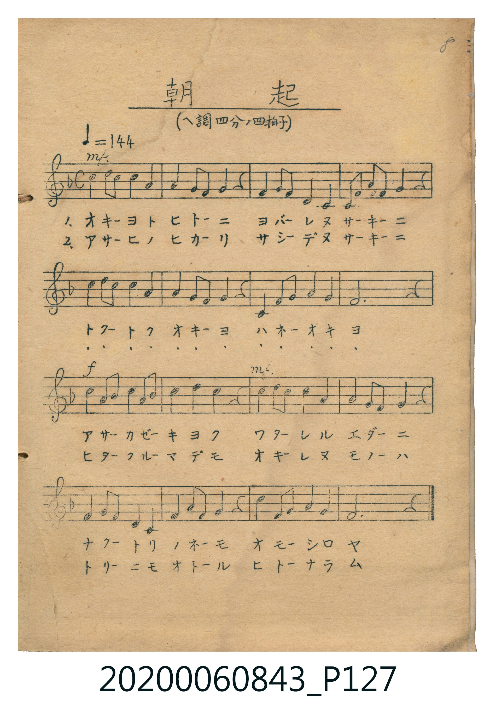

# 朝起

> Re:Shōka 使用 AI 協助辨識與重建樂譜，可能會有錯誤。歡迎回報。

- **鋼琴伴奏版**：<br><audio controls src="asaoki.mp3"></audio>

- （ヘ調四分ノ四拍子）
- 唱歌筆記帖（臺灣子供世界社發行，2020.006.0843）P127.jpg（手寫第 8 首）

## 說明

原書資訊與歌詞全文（對應 P127.jpg，手寫五線譜＋簡譜第 8 首）：
調性與拍號：ヘ調四分ノ四拍子（F 大調 4/4 拍），♩=144


## 歌詞

```text
一、おきよと人に　よばれぬさきに
とくとく起きよ　はねおきよ
あさかぜきよく　わたれるえだに
なくとりのねも　おもしろし

二、あさひのひかり　さしでぬさきに
とくとく起きよ　はねおきよ
ひたくるまでも　おきでぬものは
とりにもおとる　ひとならむ
```

## ABC

<div class="abc-score" data-abc-src="asaoki.abc" aria-label="五線譜載入中"></div>

[下載 ABC 原始檔](asaoki.abc)

## TMD 檔案連結

- [主旋律 TMD 檔案](asaoki.tmd) [[在 TMD Studio 編輯](https://tmdlang.github.io/Tmd-TS/#tmd=s7IKdvYPcrWy4qpTUCpJTLdSSM7PyUlNLsnMz7MqzsjPTkzOyFeCS5bl55TmploBqXgDQ4RwcX5pUXJqfEFieqpVgKGROboM3KT4vPyS1KT8_GyEioKi_LLUvMQ8oKrcxLzS4uSizIKS-OT8gkqEmtSyzJRUkIri5MS8-LLUosy0zNQUJGelFhWDHQxxR0lRYh7EHKAgQlVJRirQ7SmJmTmV8TmZaanoMnmJJaVFqfFJmUUpxQi5_KLM9Mw8q9zUzKzM-JLUihJU5-cXlWTkpxclFmRUWmVkFpcAlScn5sRnJ-YlKnFpaSk8mzP3xdbtClpaXIq2CoYmJlz2tgpuXDYm-iZ2IDPe7-l43Dzjxar9T2fPftrR9ri5D8h41t37dO2E93s6wdY8nbLx2dqe52vbXqyY8XTHNKCOF-27njcuBip5sm_2kx3Tnk_teb5k3_OZe14s7Hm_p8fIwMhAz8DATM_AwsQYaAgoQvSyCtKBGp91dj9dv_r5mjUKFgovlwGNAtrApa-lYEstwKWgoPC0b_6z2TtebG5_saLrRUc70O0vVs572rri2bR2oBOebuh91t6pgHBUD8RRT3ZNeb591ou1c97v6X6-YSGQgezM93tmgYwGhtOzhuUgQ7t7X8ycDxTFHXgdbgpPlywHSioAw1oBKAo2pufRzJW2oGgAGfdkR8PjhsbHjV2PG3sfN3U8blzxZNeux42rHzc0gLkbHjf1PG5c87hxKkhB42qQHhAAKnzc2A8hgZEL1Q3U1Lj-ceNauHkI5U1gI7ofN86B2dQPtgNoxnyQHU1AKaDgAhQ7VkHtaAIatw5kblMT2I4uEKNx-uMmoJOmQ_yxqwfsD4g1m8DKgWQ3SCtIB1Bw-uPG5VTxCtDc-SAdICfvAxkKdxXIXLAdIOcBXbAe2Q6QJ1aDZYAMILcbrAloGNDiVY-bOh83NYCUU54CoUBBS5-Ly7E4MT870yogMzEv36HGoKYa7CIbCy07MANbwlcApjpgsgDmJAUThacb-p-vb9CBJ1YsyoHWgIyqzk2rBTNqFEwVdBXMgCSINgbiGjBppGAIxLoKBmARQ6iIaTxIEYgA6gNRIEVwZWADfQxrFB43rQLyHzetBZHNK8BkB1jT4-ZJcN7j5m4gCTEMpmoCmFwDJnsgMk1bkcyC64DYZQSUb2wCyTROBZObwOQ6iE4oD6QHGJ8Iu6Bqp4PJ5WASZCNCphdMrobbhT_0d_WQGvrEBTo8gCFSsHiAQbQghwRp03pE8ILZ2CIDFuT9YBGwZ5HUwCIDBtGDGxxRjWC9SGyQDCiIoYHXBHIBLLjBbmoE24-kBuQykCpUewgk9E6SEzpKOjcG6oXRsEjQBdOQIAdlC2LiBimlLwJ7F5JGQSnmcdMeqOeQUj84KmDBDg6Opv1gWUhKB-kD6YDkgQYwiS2lQ9LzfEQENIFUgWT2gcXAabkJlB9gQY8UJagpHawKklMgEURE8AMrK9JTOraiAyJmjJzWgSTxSR3sK-Sk3gxKviCZPjAP7N9mUMxAwwGSvMEij5u2g9nQpA7m4U3q4JIDUhpAQg0RrhB5pFIMGkOQbAHJUp1Qe0CximpPLReXrp0CpMxXALKUuQA)]
- [鋼琴伴奏 TMD 檔案](asaoki_piano.tmd) [[在 TMD Studio 編輯](https://tmdlang.github.io/Tmd-TS/#tmd=s7IKdvYPcrWy4qpTUCpJTLdSyC8qychPL0osyKi0ysgsLskvykxOzInPTsxLVIIrKs4vLUpOjS9ITE-1CjA0MkfIlGSk5qZapaaUJieWZObnKXFpaSk8mzP3xdbt7_d0vOze83zClid7tjxd2v-8s-P9nk4FLS0uRVsFQxMTLntbBTcuGxN9EzuQYUDVj5tnvFi1_-ns2U872h439wEZz7p7n66dANQGtu_plI3P1vY8X9v2YsWMpzumAXUYGRgZ6BkYmOkZWJgYA5WBnKaXVZAOlHrW2f10_erna9YoWCi8XAZUDDSDy7E4MT870yogMzEv36HGoKaaSwEIbCy07MCM6ty0WjCjRsFUQVfBDEiCaGMgrgGTRgqGQKyrYAAWMYSKmMaDFIEIoD4QBVIEVwY20MewRuFx0yog_3HTWhDZvAJMdoA1PW6eBOc9bu4GkhDDYKomgMk1YLIHItO0FcksuA6IXUZA-cYmkEzjVDC5CUyug-iE8kB6Hjd1IeyCqp0OJpeDSZCNCJleMLkaxS7iAgoeKBApWNjBIFowQYKhaT0iSMBsbAEIC6Z-sAjYgUhqYAEIg-hBBA7cRrBeJDZIBhQsUA83gVwACyKwmxrB9iOpAbkMpArTnmqU9GSsYAKnYQGnC6YhwQRKfsSEJ1KKWgR2IiQtgGLmcdMeqIOQUhk4-GBBBfZC036wLCRFgfSBdEDSWgOYxJaiIOlmPiLQmkCqQDL7wGLgNNMESnew4EIKRtQUBVYFSZGQQEVOUdiyFUTMGDlNAUnikxTYJchJqhmUTEAyfWAe2I3NoNCEuh2SjMAij5u2g9nQJAXm4U1S4FwFySkQnyLCAiKPlMOhoQpJfpCk2wm1BxQTqPbUopZgQR5YyjBgetEGhY2JthmYBeEZakPSEoQ2j9cGBTCYQi7MoOJYyzNkxRRZBDcRSQnu6IPZAlJspG2CxkN2A9DJYDbEFrLchpQAsQQFQhioH8VLUOOJ8RNaFPogR6EJPAoN4xEIxjONjweaAeaBmDBJKBsqS5x-EyATxAVhZAPxGADSAlGBz3CEbmQnkmQ_MIB07RQgYRTtYxirgMQzAvOUuQA)]

## 分析

```text
================================================================================
📊 TMD Song Profile: [ 朝起 ]
================================================================================
⏱  Duration:       0:26 (26.7s), 16 measures total
🎼 Key & Tempo:    首調基準 F, != 144.0 BPM, <4/4>
   - 分析範圍：      由實際發聲的音符與和弦推測調性；播放脈絡另行呈現
🎤 人聲音域:    A3 (MIDI 57) – D5 (MIDI 74) [跨度: 17 個半音 / 1.4 個八度, 難度: challenging]
   - 最低音:  A3 in [Asaoki #1 @ m.3, 0:04]
   - 最高音: D5 in [Asaoki #1 @ m.1, 0:00]
   - 適合: soprano, mezzo-soprano, contralto, tenor, baritone, bass
🏛  結構:      Asaoki (26.7s)
⚡ 編曲密度:        Peak 1 軌道同時演奏
🗝  調性診斷：       F 調性不明確（純淨自然大調，未偵測到可信轉調）
   - 風格氣質:    純淨自然大調（陽光明朗、易唱易記，無明顯調外色彩）
   - 轉調歷程:    全曲維持單一推測調性（未偵測到可信轉調）
   - 核心骨幹音:  C, F, G, A, D
   - 調性數值:    F 調性不明確 [相關度: 0.83, 穩定度: Ambiguous, 自然音純度: 100.0%]
   - 候選調性 (K-S): F 大調 (0.83), C 大調 (0.81), A 小調 (0.65)
   - 五度圈歷程:   -1
   - 各段落調性細節:
     • [Asaoki #1]: F 調性不明確 (r: 0.83, 自然音純度: 100.0%)

  [ 五度圈游移軌跡 ]
               C  
        [F ]*          G  
      Bb               D  
      Eb               A  
         Ab           E  
            Db       B  
               F# 
     (* = active key center)

  [ 十二半音累積音高分佈 ]
     C  : ████████████████████████  29.5%
     C# :                            0.0%
     D  : ████                       4.5%
     D# :                            0.0%
     E  :                            0.0%
     F  : ███████████████████       23.2%
     F# :                            0.0%
     G  : █████████████████         20.5%
     G# :                            0.0%
     A  : █████████████████         20.5%
     A# : █                          1.8%
     B  :                            0.0%
--------------------------------------------------------------------------------
Assignment 軌道音域：
  - Piano         : A3 – D5 (17 個半音 / 1.4 個八度, 66 個音符)
================================================================================
```


## 原書掃描頁




