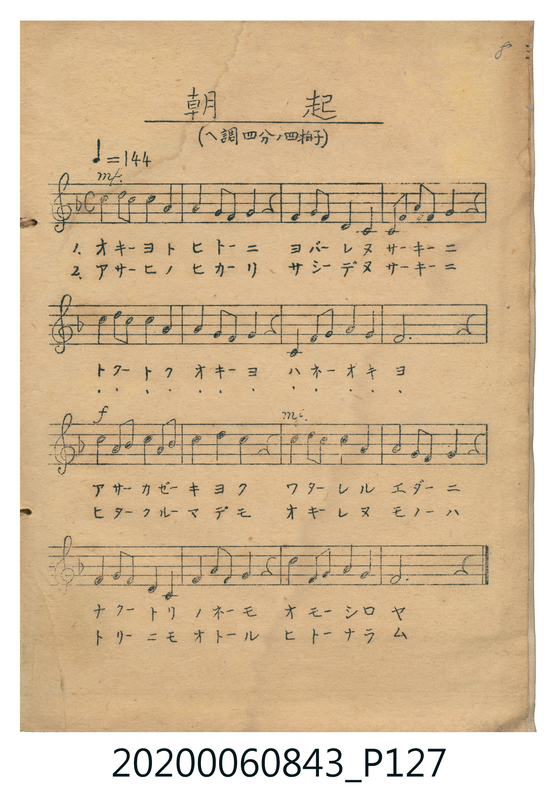

# 朝起

> Re:Shoka 使用 AI 協助辨識與重建樂譜，可能會有錯誤。歡迎回報。

<audio controls src="asaoki.mp3"></audio>

- （ヘ調四分ノ四拍子）
- 唱歌筆記帖（2020.006.0843）P127.jpg（手寫第 8 首）

## 說明

原書資訊與歌詞全文（對應 P127.jpg，手寫五線譜）：
調性與拍號：ヘ調四分ノ四拍子（F 大調 4/4 拍），速度 ♩=144
力度記號：mf → f → mf

## 歌詞

```text
1. オキーヨトヒトーニ　ヨバーレヌサーキーニ
トアートクオキーヨ　ハネーオキヨ
アサーカゼーキヨク　ワターレルエダーニ
ナクートリノネーモ　オモーシロヤ

2. アサーヒノヒカーリ　サシーデヌサーキーニ
トアートクオキーヨ　ハネーオキヨ
ヒタークルーマデモ　オキーレヌモノーハ
トリーニモオトール　ヒトーナラム
```

## ABC

```abc
X:1
T:朝起
M:4/4
L:1/16
Q:1/4=144
K:F
V:V1 name="Vocal" snm="Voc"
[V:V1]
c4 d2 c2 c4 A4 | A4 G2 F2 G4 z4 | F4 G2 F2 C4 A,4 | C4 F2 G2 G4 z4 |
c4 d2 c2 c4 A4 | A4 G2 F2 G4 z4 | C4 F2 G2 A4 G4 | F12 z4 |
G4 F2 G2 A4 F2 A2 | c4 d4 c4 z4 | d4 d2 d2 c4 A4 | A4 G2 F2 G4 z4 |
F4 G2 F2 C4 A,4 | F4 G2 F2 G4 z4 | D4 F2 G2 A4 G4 | F12 z4 |
```

## TMD 檔案連結

- [主旋律 TMD 檔案](asaoki.tmd) [[在 TMD Studio 編輯](https://tmdlang.github.io/Tmd-TS/#tmd=s7IKdvYPcrWy4qpTUCpJTLdSSM7PyUlNLsnMz7MqzsjPTkzOyFeCS5bl55TmploBqXgDQ4RwcX5pUXJqfEFieqpVgKGROboM3KT4vPyS1KT8_GyEioKi_LLUvMQ8oKrcxLzS4uSizIKS-OT8gkqEmtSyzJRUkIrUlMyS_KLMxBwkJ6UWFYMdC3FDSVFiHsQMoKASl5aWwrM5c19s3a6gpcWlaKtgaGLCZW-r4MZlY6JvYgcy5P2ejsfNM16s2v909uynHW2Pm_uAjGfdvU_XTni_pxNsz9MpG5-t7Xm-tu3FihlPd0wD6jAyMDLQMzAw0zOwMDEGKgN5Wi-rIB0o9ayz--n61c_XrFGwUHi5DKgYaAaXvpaCLbUAl4KCwtO--c9m73ixuf3Fiq4XHe1A171YOe9p64pn09qBTni6ofdZe6cCwlE9EEc92TXl-fZZL9bOATrq_Z5ZIIOA_n7WsBxkRHfvi5nzgaK4A6PDTeHpkuVASQVg2CkARcHG9LxsmP901zKFRzNX2oJCF-S6rtlAEWBgQUzMTVN41DZJAULmpnGBlBjqKTxuWvW4ae3j5j2Pm1c8bgZGwiQwCeR2P25oAAtOAHPXPG7uedy0FcSGqu8GGQEEIA1Ni8BCQMZ6FBNBRvQ_bu4Fa4OIr4BpA-qBmrf6cRNQNcTgFSAjQNqABu2H2QxUAHQIUBDF2i6QUoi1zauAoQS1p3kRSD_QNiADZOj2x81Ac5eAfWwE8jHMXpBfgZomgRwA4q4C69sK1gHktlPdxyCrwH4CuRti5zywPTAXQ00BhzXI9UDXAbn9SNaCPAqOHKA0yIuQuFoNthYedV2Pm1c-bl4A0kZ5SocCBS19Li7H4sT87EyrsPzkxByHGoMahWqw02wstOzADGw5TAGYC5_saHixsEdBw0Th6Yb-5-sbdODZQhOLBqBNIMNqFEwVdBXMgCSINgbiGjBppGAIxLoKBmARQ6iIaTxIEYgA6gNRIEVwZeDIx-28XT20ch7cKRApmIthkBjH7egkx3Egu2D2GgJJmHN1wTTEcSCeGdgLOD2A323Acokct2GLM5gYIujMiAm6Wi4uXTsFSLpUALKUuQA)]
- [鋼琴伴奏 TMD 檔案](asaoki_piano.tmd) [[在 TMD Studio 編輯](https://tmdlang.github.io/Tmd-TS/#tmd=s7IKdvYPcrWy4tLSUng2Z-6Lrdvf7-l42b3n-YQtT_Zsebq0_3lnx_s9nQpaWlyKtgqGJiZc9rYKblw2Jvomdlx1CkpA1Y-bZ7xYtf_p7NlPO9oeN_cBGc-6e5-unQDUpgRS8nTKxmdre56vbXuxYsbTHdOAOowMjAz0DAzM9AwsTIyBygIMjcz1sgrSgVLPOrufrl_9fM0aBQuFl8uAioFmcDkWJ-ZnZ1qF5Scn5jjUGNQoVHMpAIGNhZYdmFGjYKqgq2AGJEG0MRDXgEkjBUMg1lUwAIsYQkVM40GKQARQH4gCKYIrI8FAuGaIFMwOGEQ2DiQLU2kIJGEW6IJpiHEgnhnYUpxWQk3D5hOYGMJ5ZsQ4rxYeugGZiXn5QR7Yw9dYG-QqE20zMAvCM9SGuBJCm8drg6wHU8ghDhXHGujIiimyCG4ikhJ80QFVgNABiROE5UC3gtkQ4yEiIBLmMCIchRRXWMIASRjFJ_BII-gTtJjzQYk5E3jMGcYjEIxnGh8PNATMAzFhklA2VJY4_SZAJogLwsgGIgyAySIZAdIEUQNmQrmYFiCcgGYAkhtgBuByBDCYdO0UICGlgMJS5gIA)]

## 分析

```text
================================================================================
📊 TMD Song Profile: [ 朝起 ]
================================================================================
⏱  Duration:       0:26 (26.7s), 16 measures total
🎼 Key & Tempo:    首調基準 F, != 144.0 BPM, <4/4>
   - 分析範圍：      由實際發聲的音符與和弦推測調性；播放脈絡另行呈現
🎤 人聲音域:    A3 (MIDI 57) – D5 (MIDI 74) [跨度: 17 個半音 / 1.4 個八度, 難度: challenging]
   - 最低音:  A3 in [Asaoki #1 @ m.3, 0:04]
   - 最高音: D5 in [Asaoki #1 @ m.1, 0:00]
   - 適合: soprano, mezzo-soprano, contralto, tenor, baritone, bass
🏛  結構:      Asaoki (26.7s)
⚡ 編曲密度:        Peak 1 軌道同時演奏
🗝  調性診斷：       F 大調（純淨自然大調，未偵測到可信轉調）
   - 風格氣質:    純淨自然大調（陽光明朗、易唱易記，無明顯調外色彩）
   - 轉調歷程:    全曲維持單一推測調性（未偵測到可信轉調）
   - 核心骨幹音:  F, G, C, A, D
   - 調性數值:    F 大調 [相關度: 0.82, 穩定度: Moderate, 自然音純度: 100.0%]
   - 候選調性 (K-S): F 大調 (0.82), C 大調 (0.75), A 小調 (0.59)
   - 五度圈歷程:   -1
   - 各段落調性細節:
     • [Asaoki #1]: F 大調 (r: 0.82, 自然音純度: 100.0%)

  [ 五度圈游移軌跡 ]
               C  
        [F ]*          G  
      Bb               D  
      Eb               A  
         Ab           E  
            Db       B  
               F# 
     (* = active key center)

  [ 十二半音累積音高分佈 ]
     C  : ████████████████████      21.4%
     C# :                            0.0%
     D  : ████████                   8.9%
     D# :                            0.0%
     E  :                            0.0%
     F  : ████████████████████████  25.9%
     F# :                            0.0%
     G  : ██████████████████████    23.2%
     G# :                            0.0%
     A  : ███████████████████       20.5%
     A# :                            0.0%
     B  :                            0.0%
--------------------------------------------------------------------------------
Assignment 軌道音域：
  - Vocal         : A3 – D5 (17 個半音 / 1.4 個八度, 66 個音符)
================================================================================
```


## 原書掃描頁




