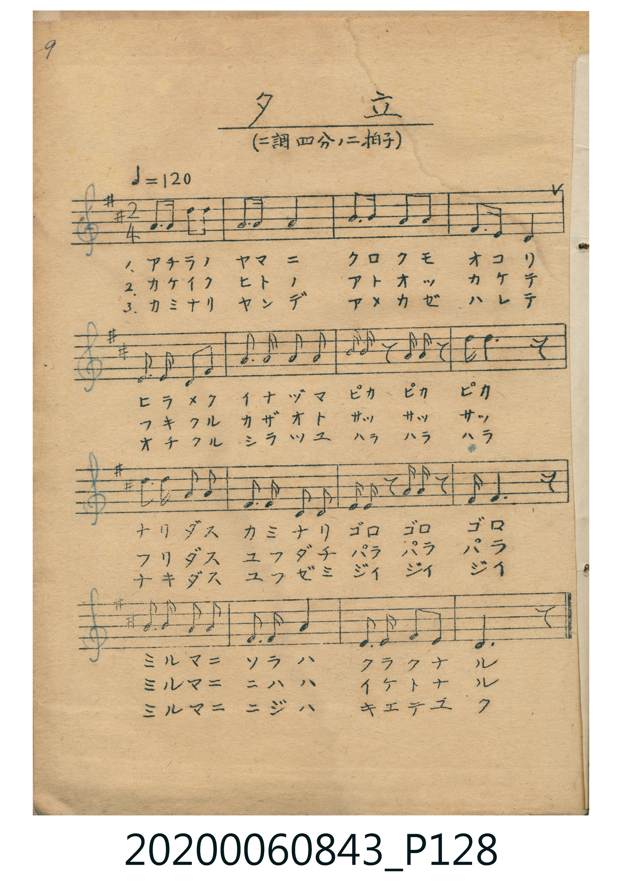

# 夕立

> Re:Shōka 使用 AI 協助辨識與重建樂譜，可能會有錯誤。歡迎回報。

<audio controls src="yudachi.mp3"></audio>

- 詞：公學校用國民讀本
- 曲：宮島慎三郎
- 唱歌筆記帖（臺灣子供世界社發行，2020.006.0843）P128.jpg（手寫第 9 首）

## 說明

原書資訊與歌詞全文（對應 P128.jpg，手寫五線譜＋簡譜第 9 首）：
調性與拍號：ニ調四分ノ二拍子（D 大調 2/4 拍），♩=120


## 歌詞

```text
一、あちらの山に　くろくもおこり
ひらめくいなづま　ぴかぴかぴか
なりだすかみなり　ごろごろごろ
みるまにそらは　くらくなる

二、かけゆく人の　あとおっかけて
ふきくるかざおと　さっさっさっ
ふりだすゆふだち　ぱらぱらぱら
みるまににはは　いけとなる

三、かみなりやんで　あめかぜはれて
おちくるしらつゆ　はらはらはら
なきだすゆふぜみ　じいじいじい
みるまににじは　きえてゆく
```

## ABC

```abc
X:1
T:夕立
C:曲：宮島慎三郎
M:2/4
L:1/16
Q:1/4=120
K:D
V:V1 name="Vocal" snm="Voc"
[V:V1]
F3 F A2 A2 | F3 F A4 | A3 A G2 G2 | F3 E D4 |
w: 1.~ア チ ラ ノ | ヤ マ ニ | ク ロ ク モ | オ コ リ
w: 2.~か け ゆ く | ひ と の | あ と お っ | か け て
w: 3.~カ ミ ナ リ | ヤ ン デ | ア メ カ ゼ | ハ レ テ
D3 D E2 F2 | F3 F A2 A2 | B2 z2 B2 z2 | c3 d3 z2 |
w: 1.~ヒ ラ メ ク | イ ナ ヅ マ | ピ ピ | ピ カ
w: 2.~ふ き く る | か ざ お と | さ さ | さ っ
w: 3.~オ チ ク ル | シ ラ ツ ユ | ハ ハ | ハ ラ
d3 d B2 B2 | A3 A F2 F2 | E2 z2 A2 z2 | F3 E3 z2 |
w: 1.~ナ リ ダ ス | カ ミ ナ リ | ゴ ゴ | ゴ ロ
w: 2.~ふ り だ す | ゆ ふ だ ち | ぱ ぱ | ぱ ら
w: 3.~ナ キ ダ ス | ユ フ ゼ ミ | ジ ジ | ジ イ
F3 F A2 A2 | E3 E G4 | D3 D F2 E2 | D6 z2 |
w: 1.~ミ ル マ ニ | ソ ラ ハ | ク ラ ク ナ | ル
w: 2.~み る ま に | に は は | い け と な | る
w: 3.~ミ ル マ ニ | ニ ジ ハ | キ エ テ ユ | ク
```

## TMD 檔案連結

- [主旋律 TMD 檔案](yudachi.tmd) [[在 TMD Studio 編輯](https://tmdlang.github.io/Tmd-TS/#tmd=s7IKdvYPcrWy4qpTUCpJTLdSSM7PyUlNLsnMz7MqzsjPTkzOyFeCS5bl55TmploBqXgDQ4RwcX5pUXJqfEFieqpVgKGRBboM3KT4vPyS1KT8_GyEioKi_LLUvMQ8oKrcxLzS4uSizIKS-OT8gkqEmtSyzJRUkIri5MS8-LLUosy0zNQUJGelFhWDHQxxR0lRYh7EHKAgQlVJRirQ7eWpiUBGkRKXlpbC0yVTn6_uVtDS4lK0VTA0MuCyt1Vw4bIx0jexA-l6sXLe-z2znrauebp2x7MFC59PWfF0TvezDRNfrGt4NmcN2OBnszeBlKxb93TztmetfU92dL5s7gPLPJ2y8dnanudr216smPF0x7T3ezpetO963rj46doJT_bNfrJj2vOpPc-X7Hs-c8-LhT3v9_QYGRgZ6BkYmOkZWJgYv9_TCQpHvayCdKDGZ53dT9evfr5mjYKlwstlQKM6lbi49LUUbKkFuBQUFJ72zX82e8eLze0vVnS96GgHuh3o_aetK55Nawc64emG3mftnQoIR_VAHPVk15Tn22e9WDvn_Z7u5xsWAhnIzgQGDcjoF6v2P2tYDjK0u_fFzPlA0cfN3UDBp7NnP-1oe9zc92RXD1AKGDJAm1yAsbIcKKkAjAUFoCjYmJ5HM1fagiIIZNyTHQ2PGxofNzY9blz4uKnzceO6pxs3Pm5c_bih4XFj_-OmXjAJlO163Dj5cVMXSA8IPG7cBFLeBNTa_7ix5XHjqseNSx837gPr2_K4sRuZRGhaBTTiceOCx40zwZL7oSIgTVPAliFIhKb9j5uAaveBXNU4F-zI9TDnAdlA64FmdEN8s6sH7Bug8omPm9qAkk927QL6Cawc6IkVYH8shipoXIawY-vjRohXgTJANA2scAVY31SwDgSJrAnuG5BlQDOA7IVgTRvBbkOQ2H0DROthvgGGIdBJQBcifLOjE-YbWEA1tTxumvy4cTnUQ6DgB8rOAZnR1IPiIaDDFsI8NB3sjCUgR4L0AdWCwxBGIkcPKBSQPQQ0ej9Y0wywCxEkTg8BJSEeAprUAXQSJB5AyinPW1CgoKXPxRVZmgIsBTOtwvKTE3McagxqFKrBbrIxNNOyA7Ow5WoFYJYCpnlgMaFgovB0Q__z9Q068JyIRTnQJpBRNQrGCrpAaKxgCiRBGFUEBGugLFOgybpgDFNjpGAIUwM2zcewRuFx0yKwyOPmRiBeCWb1gfU8bl4ClZkHxN1w0x83rYeKr4WyHzeDzADJrILING0GikHYcLuMgPKNEFOAKQyopg3M6ofobNwElVkBxOsQdjU2IYl3gVmLoTJIZjUuQ7XLGOSW1VBXzgdisE6wi5D9BXJlO5K_YCGxEKr7cdMeqA6QK0Eya4AY5G6IXfhjd1cP6bELiR9DYEyBYhQ9diHxbQYkDYAYRtcomEN0xYEpsBAiepsnQZ2-EuwxkKdAUQbyLiwYuoC4FcyaB_XuFHAAxIPFEGyIDCSCIYELFkWK3q3QKOmFRiwwR6JF1jR4NK6AykwFRynYLiQ2RAaiBxThKHaBoxea1EDJFpoIQW4CyWxH8nELmAVKHpBoBIlC_IVgI0cwKAPA7CKQeTvJiF5IFAEpUOSBMCKzgiIaEuWgyAfFIkgGEsGw7IstfkGhCUncj5sbwGG-ExoOODNA0xZw5gWHAxIbIgPL2njitwmYYhoXgONmJlQfJFOAVMBkQGkNpGcjULYTGr8INkQGYlontviF-asJWMig-gscmyA3AlMLOIOCfAhxxQ5wqob4C8GGyEBMg6R5IuIX2I6hRuEMiTMjcDEMKWZgWRykFiQLE4FA9NgF-QyStiG5E1IQg3y0FyoDSuWQ1ItaOAPFofkCFJIgsyDpAQLRY3Y_NHy6gex94LiC5iYwDeKvB2O4PY2gnAUrfkF5GVhrQ10AqyqwxSpO_0ArGHC8ofgHkhIfNwErAHDRC8_NUJ8i21PLxaVrpwCtkRWATGUuAA)]
- [鋼琴伴奏 TMD 檔案](yudachi_piano.tmd) [[在 TMD Studio 編輯](https://tmdlang.github.io/Tmd-TS/#tmd=s7IKdvYPcrWy4tLSUni6ZOrz1d3v93S87N7zfMKWJ3u2PF3a_7yz4_2eTgUtLS5FWwVDIwMue1sFFy4bI30TO646BaUXK-e93zPraeuap2t3PFuw8PmUFU_ndD_bMPHFuoZnc9YogZQ8m70JpGTduqebtz1r7Xuyo_Nlcx9Y5umUjc_W9jxf2_ZixYynO6YBbTYyMDLQMzAw0zOwMDEG2htgaGShl1WQDpR61tn9dP3q52vWKFgqvFwGVNypxMUVWZqSmJyRaRWWn5yY41BjUKNQzaUABDaGZlp2YFaNgrGCLhAaK5gCSRBGFQHBGijLVMEESIIwTI2RgiFMDdg0H8MahcdNi8Aij5sbgXglmNUH1vO4eQlUZh4Qd8NNf9y0Hiq-Fsp-3AwyAySzCiLTtBkoBmHD7TICyjdCTHncOBGopg3M6ofobNwElVkBxOsQdjU2IYl3gVmLoTJIZjUuQ7XLGOSW1VBXzgdisE6wi5D9BXJlO5K_YCGxEKr7cdMeqA6QK0Eya4AY5G6EXTXQMDUEhi4oFtBjBBJHZkDSAIhhdI2COURXHJgCCyGipHkS1LqVYMeAHAIKZpATYU7vAuJWMGse1IlTwI6OB4sh2BAZSKRAAgQsihQlW6HB2AuNjMdNoIBFDuBp8KBfAZWZCo4GsF1IbIgMRA8oklDsAkcJNHmAkho04YDcBJLZjuTjFjALFKWQoAeJQvyFYCNHCijRItsFjBJIsAIpUICDMCJTgCIHEk2gCAOFPEgGEimwbIItTkAhAElEj5sbwOG0E-p2nAmtaQs4k4DdjsSGyMCyEJ44aQLGcuMCcHjOhOqDJD6QCpgMKH2A9GwEynZC4wTBhshATOvEFicwfzUBMzOqv8AxAHIjMIbBGQHkQ4grdoBTIsRfCDZEBmIaJJ0ixwlmpoCEsxG4iIJkQVhWAqkFycJEIBA9RkCugaQhSC6AFFIgV-yFyoBSEySVoBZcQHFo-gP5HmQWJA4hED029kP91A1k7wOHLzTVgmkQfz0Yw-1pBKVgWNEEyjOPG2EpAlaMYosJnP6BFr7gsEbxDyT1PG4CFo7gYgmea6A-RbanFlG_BGQm5uUHeeCoYQy1IVEFoo21QVEFIbHJQBwCY4NoI21QdEJIhA7zeG30ygcR22BJiKnYbYHZb6INKz8RLGDG1oaUpcbaGKUpSAtUEMyAaIOQqM6GWApzAtRFIIOMwIogNqH4Bt0m3M6GKwczgARmgodohirElurRY88HJfYsEJEXr2AaDyXReabxYAaUgsqCpQ0QvoArAbLQDTABqQQTEMOA4iiagVJAPoTEZrkBlIRbDeVidTsW1yLpQnc9MHx07RSgQRTtYxirgMw1QuUag7nKXAA)]

## 分析

```text
================================================================================
📊 TMD Song Profile: [ 夕立 ]
================================================================================
⏱  Duration:       0:16 (16.0s), 16 measures total
🎼 Key & Tempo:    首調基準 D, != 120.0 BPM, <2/4>
   - 分析範圍：      由實際發聲的音符與和弦推測調性；播放脈絡另行呈現
🎤 人聲音域:    D4 (MIDI 62) – D5 (MIDI 74) [跨度: 12 個半音 / 1.0 個八度, 難度: easy]
   - 最低音:  D4 in [Yudachi #1 @ m.4, 0:03]
   - 最高音: D5 in [Yudachi #1 @ m.8, 0:07]
   - 適合: soprano, mezzo-soprano, contralto, tenor, baritone, bass
🏛  結構:      Yudachi (16.0s)
⚡ 編曲密度:        Peak 1 軌道同時演奏
🗝  調性診斷：       D 大調（純淨自然大調，未偵測到可信轉調）
   - 風格氣質:    純淨自然大調（陽光明朗、易唱易記，無明顯調外色彩）
   - 轉調歷程:    全曲維持單一推測調性（未偵測到可信轉調）
   - 核心骨幹音:  F#, A, D, E, G
   - 調性數值:    D 大調 [相關度: 0.88, 穩定度: Moderate, 自然音純度: 100.0%]
   - 候選調性 (K-S): D 大調 (0.88), F# 小調 (0.77), A 大調 (0.67)
   - 五度圈歷程:   +2
   - 各段落調性細節:
     • [Yudachi #1]: D 大調 (r: 0.88, 自然音純度: 100.0%)

  [ 五度圈游移軌跡 ]
               C  
         F            G  
      Bb              [D ]*
      Eb               A  
         Ab           E  
            Db       B  
               F# 
     (* = active key center)

  [ 十二半音累積音高分佈 ]
     C  :                            0.0%
     C# : ██                         2.6%
     D  : ████████████████████      21.9%
     D# :                            0.0%
     E  : ███████████               12.3%
     F  :                            0.0%
     F# : ████████████████████████  26.3%
     G  : ██████                     7.0%
     G# :                            0.0%
     A  : █████████████████████     22.8%
     A# :                            0.0%
     B  : ██████                     7.0%
--------------------------------------------------------------------------------
Assignment 軌道音域：
  - Vocal         : D4 – D5 (12 個半音 / 1.0 個八度, 50 個音符)
================================================================================
```


## 原書掃描頁




