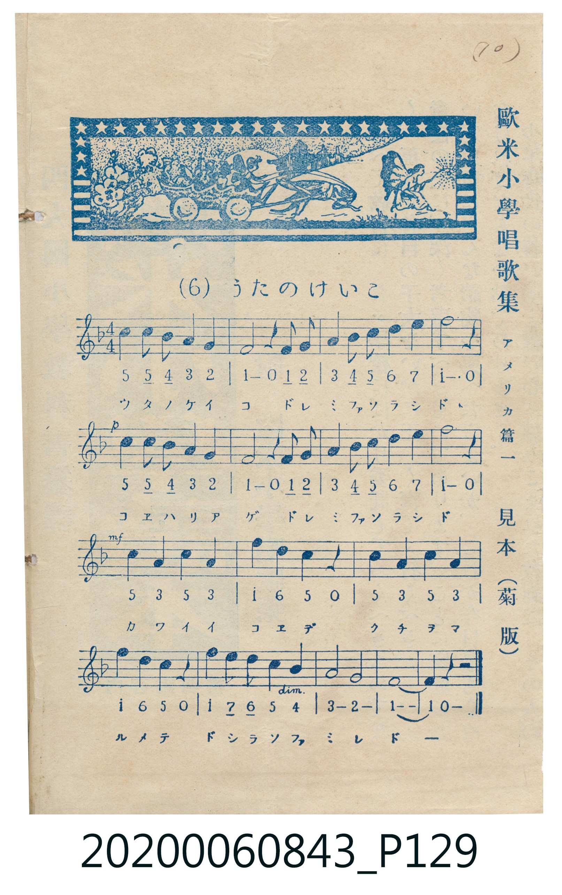
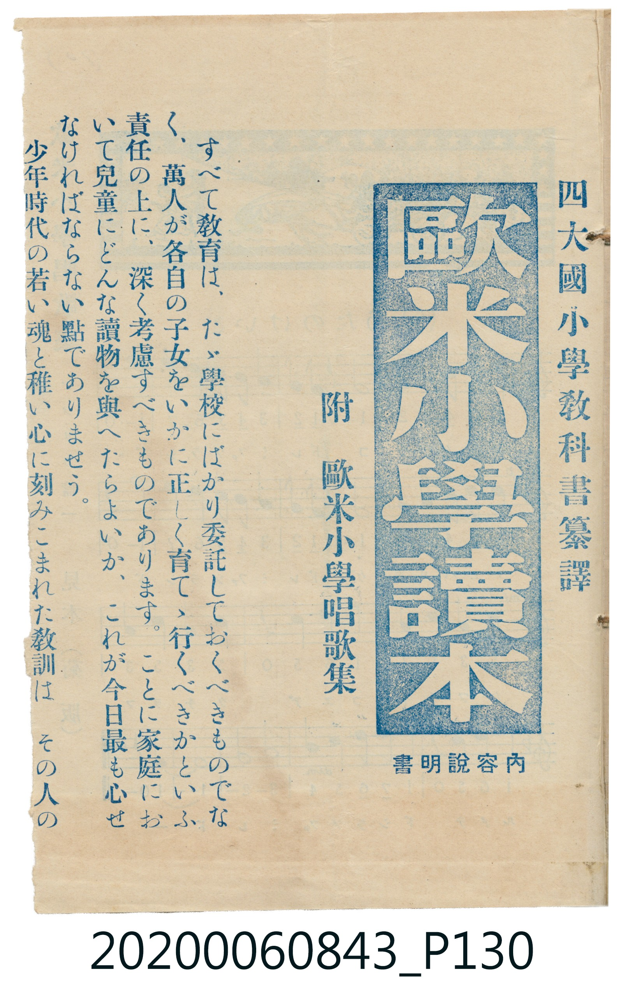

# (6) うたのけいこ

<audio controls src="uta_no_keiko.mp3"></audio>

- 歐米小學唱歌集 アメリカ篇一 見本（菊版）
- 唱歌帳（2020.006.0843）P129.jpg

## 說明

原書資訊與歌詞全文（對應 P129.jpg，印刷五線譜＋簡譜對照見本）：
調性與拍號：ヘ調四分之四拍子（F 大調 4/4 拍）
力度記號：p → mf → dim.

## 歌詞

```text
ウタノケイコ　ドレミファソラシド
コエハリアゲ　ドレミファソラシド
カワイイコエデ　クチヲマルメテ
ドシラソファミレドー
```

## ABC

```abc
X:1
T:6 うたのけいこ
M:4/4
L:1/16
Q:1/4=100
K:F
V:V1 name="Vocal" snm="Voc"
[V:V1]
c4 c2 B2 A4 G4 | F8 z4 F2 G2 | A4 B2 c2 d4 e4 | f12 z4 |
c4 c2 B2 A4 G4 | F8 z4 F2 G2 | A4 B2 c2 d4 e4 | f12 z4 |
c4 A4 c4 A4 | f4 d4 c4 z4 | c4 A4 c4 A4 | f4 d4 c4 z4 |
f4 e2 d2 c4 B4 | A8 G8 | F16 | F4 z4 z8 |
```

## TMD 檔案連結

- [主旋律 TMD 檔案](uta_no_keiko.tmd) [[在 TMD Studio 編輯](https://tmdlang.github.io/Tmd-TS/#tmd=s7IKdvYPcrWy4qpTUCpJTLdSSM7PyUlNLsnMz7MqzsjPTkzOyFeCS5bl55TmploBqXgDQ4RwcX5pUXJqfEFieqpVgKGRJboM3KT4vPyS1KT8_GyEioKi_LLUvMQ8oKrcxLzS4uSizIKS-OT8gkqEmtSyzJRUkIrUlMyS_KLMxBwkJ6UWFYMdC3FDSVFiHsQMoCBCVUlGKtDdxUAnAJ2ek5mWqsSlpaWgYaap8Lix7XHj_MeN6x43Tnzc2PK4cbKClhaXoq2CoYEBl72tghuXjYm-iR3IpGdrJzzfuPnphv6na3c8nbLx2dqel7PbFB43LXrcvPBx86rHTaufr29_sqNB4cWy7mdz1rzf0_Giv-t5Z8f7PZ1gl0D0PN2xGShjZGBkoGdgYKZnYGFiDFQACja9rIJ0JS4ufS0FW2oBLgUFhad985_N3vFic_uLFV0vOtqBTnixct7T1hXPprUDHfJ0Q--z9k4FmP3v9_Q87d3wtGP7k11Tnm-f9WLtnPd7up9vWAhkAFU-b10O81vn-z2zQKa_WLX_WcNykLndvS9mzgeKPm6eARR8Onv20462Jzu7gQyg1NO1E4CWuSk8XbIcKKkADFIFoCjQGLALu2Y_3bXsxYoZEAMKFB61TVLITQNTKZm5elwgRY-blj1u2v-4ue9x08bHTUseN21-3NDwuLnzcfOax83zHzdPfdy08HHT3sfNKx83bQeKQ_Rsfty04nFzPzh6Fj1u2kSMntWPm9eDbQBbAtLfDtLWtP5xc-Pj5k2Pm-c9bgaqAcZ5G1gD0DyQbqAZQJPARoLMBtoAtGcPSAXl8QgFClr6XFyhJYl--d6pmdn5VmH5yYk5DjUGNQrVIHsUbCy07MAMbGlI4fmaNcDU-WJhj4KGiQIwGT9f36ADj3hNLBqAtoEMq1EwVdAFYhMFYyBtBMQ1CoZAEgQNgNgQKFYDljMBqjID0uYQNXFQRTCFNeCIxO24XT2D2HE7OsGOMybdcSDLYTTUYpA7QEJgizEV4XcKMEeBnWJKmlOwWAwWMgcKgoRMwEIg-0EQFJIgiAhNGISIgAwAYbAIVy0Xl66dAiJlKgB5ylwA)]
- [鋼琴伴奏 TMD 檔案](uta_no_keiko_piano.tmd) [[在 TMD Studio 編輯](https://tmdlang.github.io/Tmd-TS/#tmd=s7IKdvYPcrWy4tLSUtAw01R43Nj2uHH-48Z1jxsnPm5sedw4-f2ejpfde55P2PJkz5anS_ufd3a839OpoKXFpWirYGhgwGVvq-DGZWOib2LHVaeg9GzthOcbNz_d0P907Y6nUzY-W9vzcnabwuOmRY-bFz5uXvW4afXz9e1PdjQovFjW_WzOGqDhL_q7IGYqgfRD9DzdsRkoY2RgZKBnYGCmZ2BhYgxUEGBoZKmXVZCuxMUVWpLol--dmpmdbxWWn5yY41BjUKNQzaUABDYWWnZgRo2CqYIuEJsoGANpIyCuUTAEkiBoAMSGQLEasJwJUJUZkDaHqImDKoIprKGdcSDlMBqqFKQTJARWiqkIqhmLUrCQOVAQJGQCFgLpAEGQa0EQ4WIYhIiADABhsAhXLUr4BmQm5uUHeWAPYWNtWKAYaoMsM4_XhoYMmIsaNhAxUOiYaIOdrg0JIWNtnGFEH_MhGpHZcE0QkyBSkGDGqQVuJE6N8BiCCBtpQ2IJ4Reo96ARAxdGiiywGMHo8kGJLhN4dBnGg4IlHkRi45ggsZFDiRJtYKIGogbKRhKHqkSWBbONIGyINbhsNoDaBgwAXTsFRBgoAHnKXAA)]

## 分析

```text
================================================================================
📊 TMD Song Profile: [ 6 うたのけいこ ]
================================================================================
⏱  Duration:       0:38 (38.4s), 16 measures total
🎼 Key & Tempo:    首調基準 F, != 100.0 BPM, <4/4>
   - 分析範圍：      由實際發聲的音符與和弦推測調性；播放脈絡另行呈現
🎤 人聲音域:    F4 (MIDI 65) – F5 (MIDI 77) [跨度: 12 個半音 / 1.0 個八度, 難度: easy]
   - 最低音:  F4 in [UtaNoKeiko #1 @ m.2, 0:02]
   - 最高音: F5 in [UtaNoKeiko #1 @ m.4, 0:07]
   - 適合: soprano, mezzo-soprano, contralto, tenor, baritone, bass
🏛  結構:      UtaNoKeiko (38.4s)
⚡ 編曲密度:        Peak 1 軌道同時演奏
🗝  調性診斷：       F 大調（純淨自然大調，未偵測到可信轉調）
   - 風格氣質:    純淨自然大調（陽光明朗、易唱易記，無明顯調外色彩）
   - 轉調歷程:    全曲維持單一推測調性（未偵測到可信轉調）
   - 核心骨幹音:  F, C, A, G, D
   - 調性數值:    F 大調 [相關度: 0.96, 穩定度: High, 自然音純度: 100.0%]
   - 候選調性 (K-S): F 大調 (0.96), D 小調 (0.62), C 大調 (0.60)
   - 五度圈歷程:   -1
   - 各段落調性細節:
     • [UtaNoKeiko #1]: F 大調 (r: 0.96, 自然音純度: 100.0%)

  [ 五度圈游移軌跡 ]
               C  
        [F ]*          G  
      Bb               D  
      Eb               A  
         Ab           E  
            Db       B  
               F# 
     (* = active key center)

  [ 十二半音累積音高分佈 ]
     C  : ██████████████            20.0%
     C# :                            0.0%
     D  : ██████                     8.2%
     D# :                            0.0%
     E  : ███                        4.5%
     F  : ████████████████████████  34.5%
     F# :                            0.0%
     G  : ██████                     9.1%
     G# :                            0.0%
     A  : █████████████             18.2%
     A# : ████                       5.5%
     B  :                            0.0%
--------------------------------------------------------------------------------
Assignment 軌道音域：
  - Vocal         : F4 – F5 (12 個半音 / 1.0 個八度, 51 個音符)
================================================================================
```


## 原書掃描頁






