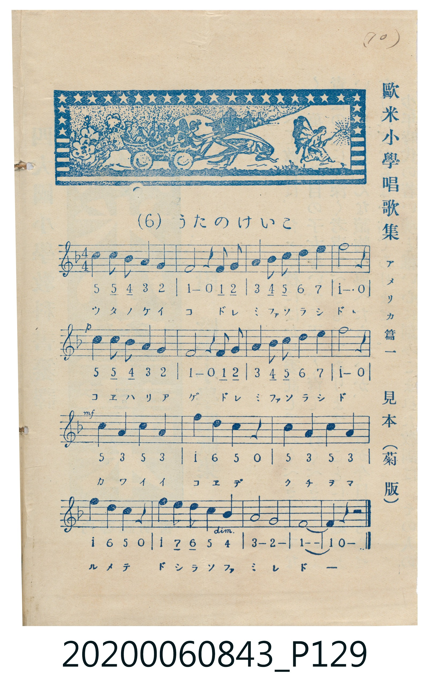
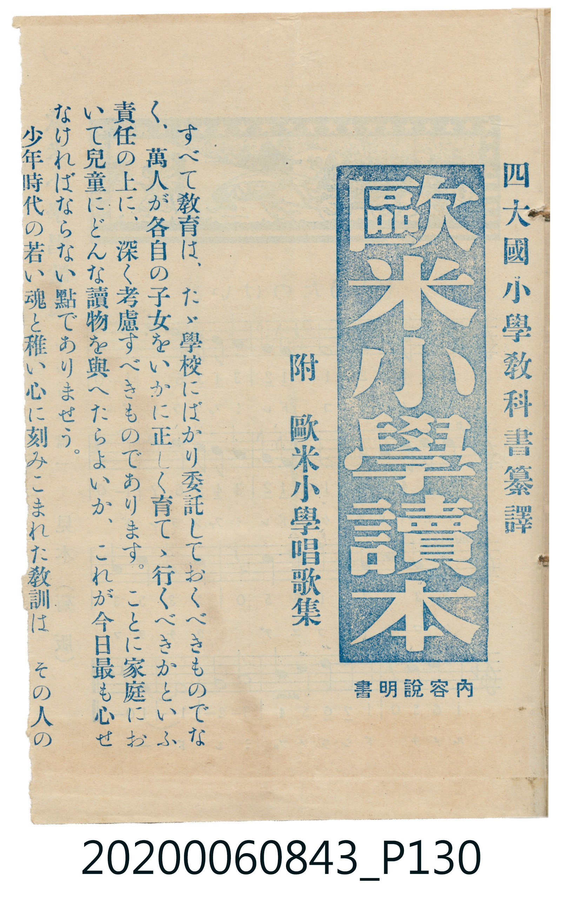

# うたのけいこ

> Re:Shōka 使用 AI 協助辨識與重建樂譜，可能會有錯誤。歡迎回報。

- **鋼琴伴奏版**：<br><audio controls src="uta_no_keiko.mp3"></audio>

- 歐米小學唱歌集 アメリカ篇一 見本（菊版）
- 唱歌帳（2020.006.0843）P129.jpg

## 說明

原書資訊與歌詞全文（對應 P129.jpg，印刷五線譜＋簡譜對照見本）：
調性與拍號：ヘ調四分之四拍子（F 大調 4/4 拍）
力度記號：p → mf → dim.


## 歌詞

```text
ウタノケイコ　ドレミファソラシド
コエハリアゲ　ドレミファソラシド
カワイイコエデ　クチヲマルメテ
ドシラソファミレドー
```

## ABC

<div class="abc-score" data-abc-src="uta_no_keiko.abc" aria-label="五線譜載入中"></div>

[下載 ABC 原始檔](uta_no_keiko.abc)

## TMD 檔案連結

- [主旋律 TMD 檔案](uta_no_keiko.tmd) [[在 TMD Studio 編輯](https://tmdlang.github.io/Tmd-TS/#tmd=s7IKdvYPcrWy4qpTUCpJTLdSSM7PyUlNLsnMz7MqzsjPTkzOyFeCS5bl55TmploBqXgDQ4RwcX5pUXJqfEFieqpVgKGRJboM3KT4vPyS1KT8_GyEioKi_LLUvMQ8oKrcxLzS4uSizIKS-OT8gkqEmtSyzJRUkIrUlMyS_KLMxBwkJ6UWFYMdC3FDSVFiHsQMoCBCVUlGKtDdxUAnAJ2ek5mWipACmpeemWdVnlpcklqUF5-bmpOfgmR3flFJRn56UWJBRqVVRmYxyPrkxJz47MS8RCUuLS2Fx41tjxvnP25c97hx4uPGlseNkxW0tLgUbRUMDQy47G0V3LhsTPRN7EDmPVs74fnGzU839D9du-PplI3P1va8nN2m8Lhp0ePmhY-bVz1uWv18ffuTHQ0KL5Z1P5uz5v2ejhf9Xc87O97v6QS7B6Ln6Y7NQBkjAyMDPQMDMz0DCxNjoAJQsOtlFaQrcXHpaynYUgtwKSgoPO2b_2z2jheb21-s6HrR0Q50wouV8562rng2rR3okKcbep-1dyrA7H-_p-dp74anHduf7JryfPusF2vnvN_T_XzDQiADqPJ563KY3zrf75kFMv3Fqv3PGpaDzO3ufTFzPlD0cfMMoODT2bOfdrQ92dkNZAClnq6dALTMTeHpkuVASQVgkCoARYHGgF3YNfvprmUvVsyAGFCg8KhtkkJuGphKyczV4wIpety07HHT_sfNfY-bNj5uWvK4afPjhobHzZ2Pm9c8bp7_uHnq46aFj5v2Pm5e-bhpO1Acomfz46YVj5v7wdGz6HHTJmL0rH7cvB5sA9gSkP52kLam9Y-bGx83b3rcPO9xM1ANMM7bwBqA5oF0A80AmgQ2EmQ20AagPXtAKiiPRyhQ0NLn4gotSfTL907NzM63CssHpmWHGoOaapA1CjYWWnZgBrYkpPB8zRpg4nyxsEdBw0QBmIqfr2_Qgce7JhYNQMtAhtUomCroArGJgjGQNgLiGgVDIAmCBkBsCBSrAcuZAFWZAWlziJo4qCKYwhpwPOJ23K6eQey4HZ1gxxmT7jiQ5TAaajHIHSAhsMWYivA7BZihwE4xJc0pWCwGC5kDBUFCJmAhkP0gCApJEESEJgxCREAGgDBYhKuWi0vXTgGRMBWAPGUuAA)]
- [鋼琴伴奏 TMD 檔案](uta_no_keiko_piano.tmd) [[在 TMD Studio 編輯](https://tmdlang.github.io/Tmd-TS/#tmd=s7IKdvYPcrWy4qpTUCpJTLdSyC8qychPL0osyKi0ysgsLskvykxOzInPTsxLVIIrKs4vLUpOjS9ITE-1CjA0stQNMDQ2QEiXZKTmplqlppQmJ5Zk5ucpcWlpKWiYaSo8bmx73Dj_ceO6x40THze2PG6c_H5Px8vuPc8nbHmyZ8vTpf3POzve7-lU0NLiUrRVMDQw4LK3VXDjsjHRN7EDGf5s7YTnGzc_3dD_dO2Op1M2Plvb83J2m8LjpkWPmxc-bl71uGn18_XtT3Y0KLxY1v1szhqg4S_6uyBmgh0H0fN0x2agjJGBkYGegYGZnoGFiTFQAcgbelkF6UpcXKEliX753qmZ2flWYflAzzvUGNRUcykAgY2Flh2YUaNgqqALxCYKxkDaCIhrFAyBJAgaALEhUKwGLGcCVGUGpM0hauKgimAKa2hnHEg5jIYqBekECYGVYiqCasaiFCxkDhQECZmAhUA6QBDkWhBEuBgGISIgA0AYLMJVixK8AZmJeflBHlgD2FgbFiaG2iC7zOO1oQED5qIGDUQMFDgm2mCXa0MCyFgbZxDRx3yIRmQ2XBPEJIgUJJRxaoEbiVMjPIIgwkbakEhC-AXqPWi8wIWR4gosRjC2fJBjywQeW4bxoFCJB5HYOCZIbORAokQbmKiBqIGykcShKpFlwWwjCBtiDS6bDaC2Af2va6eACAIFIE-ZCwA)]

## 分析

```text
================================================================================
📊 TMD Song Profile: [ うたのけいこ ]
================================================================================
⏱  Duration:       0:38 (38.4s), 16 measures total
🎼 Key & Tempo:    首調基準 F, != 100.0 BPM, <4/4>
   - 分析範圍：      由實際發聲的音符與和弦推測調性；播放脈絡另行呈現
🎤 人聲音域:    F4 (MIDI 65) – F5 (MIDI 77) [跨度: 12 個半音 / 1.0 個八度, 難度: easy]
   - 最低音:  F4 in [UtaNoKeiko #1 @ m.2, 0:02]
   - 最高音: F5 in [UtaNoKeiko #1 @ m.4, 0:07]
   - 適合: soprano, mezzo-soprano, contralto, tenor, baritone, bass
🏛  結構:      UtaNoKeiko (38.4s)
⚡ 編曲密度:        Peak 1 軌道同時演奏
🗝  調性診斷：       F 大調（純淨自然大調，未偵測到可信轉調）
   - 風格氣質:    純淨自然大調（陽光明朗、易唱易記，無明顯調外色彩）
   - 轉調歷程:    全曲維持單一推測調性（未偵測到可信轉調）
   - 核心骨幹音:  F, C, A, G, D
   - 調性數值:    F 大調 [相關度: 0.96, 穩定度: High, 自然音純度: 100.0%]
   - 候選調性 (K-S): F 大調 (0.96), D 小調 (0.62), C 大調 (0.60)
   - 五度圈歷程:   -1
   - 各段落調性細節:
     • [UtaNoKeiko #1]: F 大調 (r: 0.96, 自然音純度: 100.0%)

  [ 五度圈游移軌跡 ]
               C  
        [F ]*          G  
      Bb               D  
      Eb               A  
         Ab           E  
            Db       B  
               F# 
     (* = active key center)

  [ 十二半音累積音高分佈 ]
     C  : ██████████████            20.0%
     C# :                            0.0%
     D  : ██████                     8.2%
     D# :                            0.0%
     E  : ███                        4.5%
     F  : ████████████████████████  34.5%
     F# :                            0.0%
     G  : ██████                     9.1%
     G# :                            0.0%
     A  : █████████████             18.2%
     A# : ████                       5.5%
     B  :                            0.0%
--------------------------------------------------------------------------------
Assignment 軌道音域：
  - Vocal         : F4 – F5 (12 個半音 / 1.0 個八度, 51 個音符)
================================================================================
```


## 原書掃描頁






