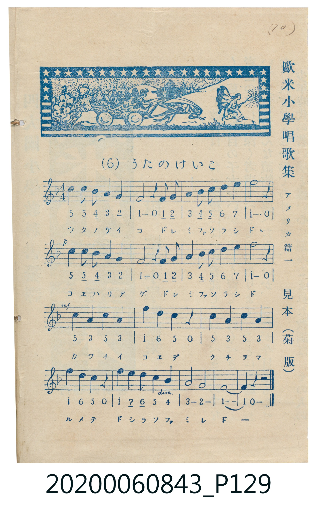
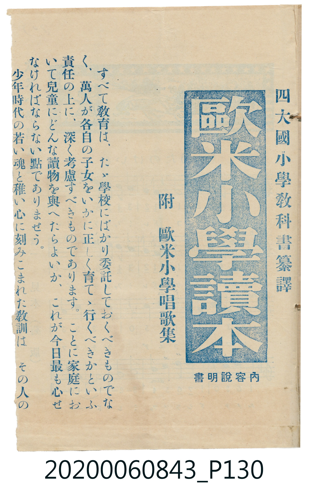

# うたのけいこ

> Re:Shōka 使用 AI 協助辨識與重建樂譜，可能會有錯誤。歡迎回報。

- **鋼琴伴奏版**：<br><audio controls src="uta_no_keiko.mp3"></audio>

- 歐米小學唱歌集 アメリカ篇一 見本（菊版）
- 唱歌帳（2020.006.0843）P129.jpg

## 說明

原書資訊與歌詞全文（對應 P129.jpg，印刷五線譜＋簡譜對照見本）：
調性與拍號：ヘ調四分之四拍子（F 大調 4/4 拍）
力度記號：p → mf → dim.


## 歌詞

```text
ウタノケイコ　ドレミファソラシド
コエハリアゲ　ドレミファソラシド
カワイイコエデ　クチヲマルメテ
ドシラソファミレドー
```

## ABC

<div class="abc-score" data-abc-src="uta_no_keiko.abc" aria-label="五線譜載入中"></div>

[下載 ABC 原始檔](uta_no_keiko.abc)

## TMD 檔案連結

- [主旋律 TMD 檔案](uta_no_keiko.tmd) [[在 TMD Studio 編輯](https://tmdlang.github.io/Tmd-TS/#tmd=s7IKdvYPcrWy4qpTUCpJTLdSSM7PyUlNLsnMz7MqzsjPTkzOyFeCS5bl55TmploBqXgDQ4RwcX5pUXJqfEFieqpVgKGRJboM3KT4vPyS1KT8_GyEioKi_LLUvMQ8oKrcxLzS4uSizIKS-OT8gkqEmtSyzJRUkIrUlMyS_KLMxBwkJ6UWFYMdC3FDSVFiHsQMoCBCVUlGKtDdxUAnAJ2ek5mWipACmpeemWdVnlpcklqUF5-bmpOfArRbS0vhcWPb48b5jxvXPW6c-Lix5XHjZAUtLS5FWwVDAwMue1sFNy4bE30TO5BJz9ZOeL5x89MN_U_X7ng6ZeOztT0vZ7cpPG5a9Lh54ePmVY-bVj9f3_5kR4PCi2Xdz-aseb-n40V_1_POjvd7OsEugeh5umMzUMbIwMhAz8DATM_AwsQYqAAUonpZBelKXFz6Wgq21AJcCgoKT_vmP5u948Xm9hcrul50tAOd8GLlvKetK55Nawc65OmG3mftnQow-9_v6Xnau-Fpx_Ynu6Y83z7rxdo57_d0P9-wEMgAqnzeuhzmt873e2aBTH-xav-zhuUgc7t7X8ycDxR93DwDKPh09uynHW1PdnYDGUCpp2snAC1zU3i6ZDlQUgEYpApAUaAxYBd2zX66a9mLFTMgBhQoPGqbpJCbBqZSMnP1uECKHjcte9y0_3Fz3-OmjY-bljxu2vy4oeFxc-fj5jWPm-c_bp76uGnh46a9j5tXPm7aDhSH6Nn8uGnF4-Z-cPQsety0iRg9qx83rwfbALYEpL8dpK1p_ePmxsfNmx43z3vcDFQDjPM2sAageSDdQDOAJoGNBJkNtAFozx6QCsrjEQoUtPS5uEJLEv3yvVMzs_OtwvKTE3McagxqqkHWKNhYaNmBGdiSkMLzNWuAifPFwh4FDRMFYCp-vr5BBx7vmlg0AC0DGVajYKqgC8QmCsZA2giIaxQMgSQIGgCxIVCsBixnAlRlBqTNIWrioIpgCmvA8Yjbcbt6BrHjdnSCHWdMuuNAlsNoqMUgd4CEwBZjKsLvFGCGAjvFlDSnYLEYLGQOFAQJmYCFQPaDICgkQRARmjAIEQEZAMJgEa5aLi5dOwVEwlQA8pS5AA)]
- [鋼琴伴奏 TMD 檔案](uta_no_keiko_piano.tmd) [[在 TMD Studio 編輯](https://tmdlang.github.io/Tmd-TS/#tmd=s7IKdvYPcrWy4tLSUtAw01R43Nj2uHH-48Z1jxsnPm5sedw4-f2ejpfde55P2PJkz5anS_ufd3a839OpoKXFpWirYGhgwGVvq-DGZWOib2LHVaeg9GzthOcbNz_d0P907Y6nUzY-W9vzcnabwuOmRY-bFz5uXvW4afXz9e1PdjQovFjW_WzOGqDhL_q7IGYqgfRD9DzdsRkoY2RgZKBnYGCmZ2BhYgxUEGBoZKmXVZCuxMUVWpLol--dmpmdbxWWn5yY41BjUFPNpQAENhZadmBGjYKpgi4QmygYA2kjIK5RMASSIGgAxIZAsRqwnAlQlRmQNoeoiYMqgimsoZ1xIOUwGqoUpBMkBFaKqQiqGYtSsJA5UBAkZAIWAukAQZBrQRDhYhiEiIAMAGGwCFctSvAGZCbm5Qd5YA1gY21YmBhqg-wyj9eGBgyYixo0EDFQ4Jhog12uDQkgY22cQUQf8yEakdlwTRCTIFKQUMapBW4kTo3wCIIIG2lDIgnhF6j3oPECF0aKK7AYwdjyQY4tE3hsGcaDQiUeRGLjmCCxkQOJEm1gogaiBspGEoeqRJYFs40gbIg1uGw2gNoG9L-unQIiCBSAPGUuAA)]

## 分析

```text
================================================================================
📊 TMD Song Profile: [ うたのけいこ ]
================================================================================
⏱  Duration:       0:38 (38.4s), 16 measures total
🎼 Key & Tempo:    首調基準 F, != 100.0 BPM, <4/4>
   - 分析範圍：      由實際發聲的音符與和弦推測調性；播放脈絡另行呈現
🎤 人聲音域:    F4 (MIDI 65) – F5 (MIDI 77) [跨度: 12 個半音 / 1.0 個八度, 難度: easy]
   - 最低音:  F4 in [UtaNoKeiko #1 @ m.2, 0:02]
   - 最高音: F5 in [UtaNoKeiko #1 @ m.4, 0:07]
   - 適合: soprano, mezzo-soprano, contralto, tenor, baritone, bass
🏛  結構:      UtaNoKeiko (38.4s)
⚡ 編曲密度:        Peak 1 軌道同時演奏
🗝  調性診斷：       F 大調（純淨自然大調，未偵測到可信轉調）
   - 風格氣質:    純淨自然大調（陽光明朗、易唱易記，無明顯調外色彩）
   - 轉調歷程:    全曲維持單一推測調性（未偵測到可信轉調）
   - 核心骨幹音:  F, C, A, G, D
   - 調性數值:    F 大調 [相關度: 0.96, 穩定度: High, 自然音純度: 100.0%]
   - 候選調性 (K-S): F 大調 (0.96), D 小調 (0.62), C 大調 (0.60)
   - 五度圈歷程:   -1
   - 各段落調性細節:
     • [UtaNoKeiko #1]: F 大調 (r: 0.96, 自然音純度: 100.0%)

  [ 五度圈游移軌跡 ]
               C  
        [F ]*          G  
      Bb               D  
      Eb               A  
         Ab           E  
            Db       B  
               F# 
     (* = active key center)

  [ 十二半音累積音高分佈 ]
     C  : ██████████████            20.0%
     C# :                            0.0%
     D  : ██████                     8.2%
     D# :                            0.0%
     E  : ███                        4.5%
     F  : ████████████████████████  34.5%
     F# :                            0.0%
     G  : ██████                     9.1%
     G# :                            0.0%
     A  : █████████████             18.2%
     A# : ████                       5.5%
     B  :                            0.0%
--------------------------------------------------------------------------------
Assignment 軌道音域：
  - Vocal         : F4 – F5 (12 個半音 / 1.0 個八度, 51 個音符)
================================================================================
```


## 原書掃描頁






