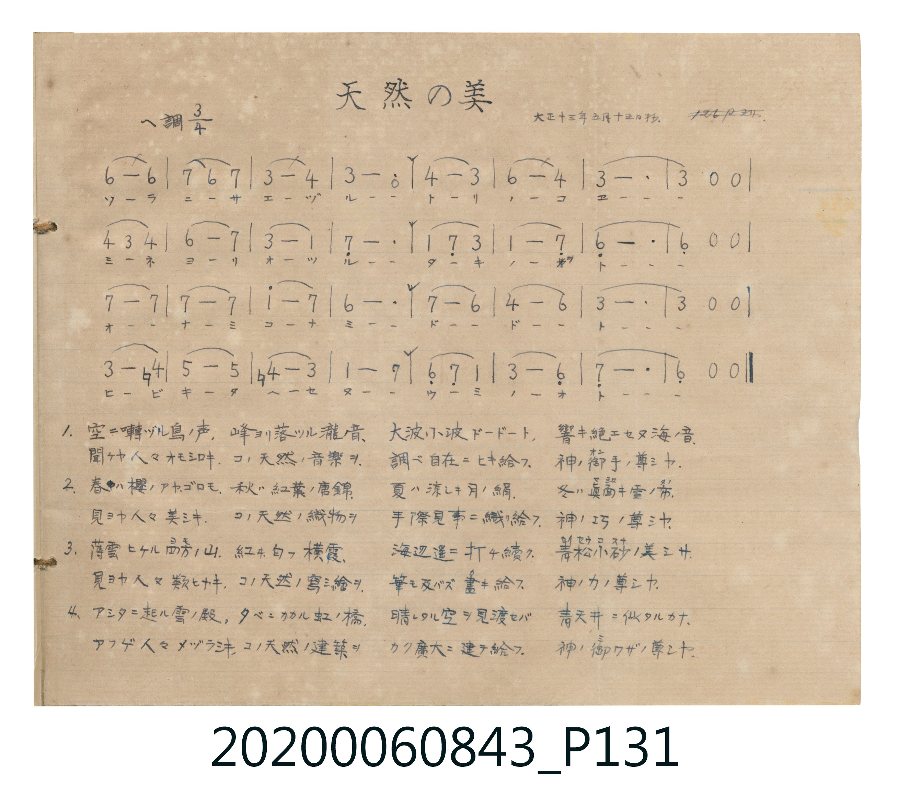

# 天然の美

> Re:Shōka 使用 AI 協助辨識與重建樂譜，可能會有錯誤。歡迎回報。

- **鋼琴伴奏版**：<br><audio controls src="tennen_no_bi.mp3"></audio>

- 詞：武島羽衣
- 曲：田中穗積
- 唱歌帳（2020.006.0843）P131.jpg（大正十三年五月十五日抄）

## 說明

> [!NOTE]
> **原書資訊與校勘註記**（對應 `P131.jpg` 單頁手抄簡譜）：
> - **曲名**：天然の美（即〈美しき天然〉明治民間通行別題）
> - **調性與拍號**：ヘ調 3/4 拍（關係小調 D 小調，`?= F`、`key= Dm`）。
> - **抄寫題記**：右上角記「大正十三年五月十五日抄.」，其右另有雙線塗銷之頁碼註記「126 p ヨリ.」。
> - **楊金土手抄筆誤與異文實錄（依 Policy A 校補譜面並詳列原貌）**：
>   1. **低音點漏標**：第 1–2 小節原抄作 `6 - 6 | 7 6 7`（漏點下方低音點）、第 28 小節作 `1 - 7`（`7` 漏低音點），對照同頁第 12–16、29–32 小節均標低音點及第 2 冊 `P104`–`P105` 五線譜，校補為 `6_ - 6_ | 7_ 6_ 7_` 與 `1 - 7_`。
>   2. **結尾第 30–31 小節 `6_`／`7_` 倒置筆誤**：原抄第 4 行末三小節誤將 `6_` 與 `7_` 前後顛倒寫作 `| 3 - 6_ | 7_ - . | 6_ 0 0 ||`（楊氏後於第 2 冊 `P105.jpg` 重抄五線譜時即作正確之 `| 3 - 7_ | 6_ - - | - - 0 |`）；本譜依 Policy A 校還為 `| 3 - 7_ | 6_ - - | - 0 0 |` 並記錄原抄異文。
>   3. **譜下配詞與底欄振假名特徵**：
>      - 譜下第一段配詞第 3 小節「囀づる」作表音「エ ー ヅ」，第 27 小節「絶えせぬ」卻倒寫作「ヘ ー セ」；本譜依底欄全文「囀ヅル」「絶エセヌ」校為「ヘ ー ヅ」「エ ー セ」。
>      - 底欄第 3 節「青松白砂」原抄作民間流傳異文「青松小砂」並親筆加註振假名「セイセウ コスナ」，第 2 節「眞白」註「マシロ」、「布」註「ヌノ」，第 1 節「御手」註「オン」，第 4 節「御ワザ」註「ミ」，均忠實反映於各段唱詞。
>
> **1.**
> 空ニ囀ヅル鳥ノ声、峰ヨリ落ツル瀧ノ音、
> 大波小波ドードート、響キ絶エセヌ海ノ音、
> 聞ケヤ人々オモシロキ、コノ天然ノ音樂ヲ、
> 調ベ自在ニヒキ給フ、神ノ御（オン）手ノ尊シヤ。
>
> **2.**
> 春ハ櫻ノアヤゴロモ、秋ハ紅葉ノ唐錦、
> 夏ハ涼シキ月ノ絹、冬ハ眞白（マシロ）キ雪ノ布（ヌノ）、
> 見ヨヤ人々美シキ、コノ天然ノ織物ヲ、
> 手際見事ニ織リ給フ、神ノ巧ノ尊シヤ。
>
> **3.**
> 薄雲ヒケル四方（ヨモ）ノ山、紅ヰ匂フ横霞、
> 海辺遙ニ打チ續ク、青松小砂（セイセウコスナ）ノ美シサ、
> 見ヨヤ人々類ヒナキ、コノ天然ノ寫シ繪ヲ、
> 筆モ及バズ畫キ給フ、神ノ力ノ尊シヤ。
>
> **4.**
> アシタニ起ル雲ノ殿、夕ベニカカル虹ノ橋、
> 晴レタル空ヲ見渡セバ、青天井ニ似タルカナ、
> アフゲ人々メヅラシキ、コノ天然ノ建築ヲ、
> カク廣大ニ建テ給フ、神ノ御（ミ）ワザノ尊シヤ。


## 歌詞

```text
（TMD 檔案未包含歌詞註解）
```

## ABC

<div class="abc-score" data-abc-src="tennen_no_bi.abc" aria-label="五線譜載入中"></div>

[下載 ABC 原始檔](tennen_no_bi.abc)

## TMD 檔案連結

- [主旋律 TMD 檔案](tennen_no_bi.tmd) [[在 TMD Studio 編輯](https://tmdlang.github.io/Tmd-TS/#tmd=s7IKdvYPcrWy4qpTUCpJTLdSSM7PyUlNLsnMz7MqzsjPTkzOyFeCS5bl55TmploBqXgDQ4RwcX5pUXJqfEFieqpVgKExhgzcpPi8_JLUpPz8bISKgqL8stS8xDygqtzEvNLi5KLMgpL45PyCSoSa1LLMlFSQiuLkxLz4stSizLTM1BQkZ6UWFYMdDHFHSVFiHsQcoCBCVX5RSUZ-elFiQUalVUZmcUl-UWZyYk58dmJeIkJRSUYq0IN5iSWlRanIWjPTM_OsclMzszLjS1IrSiB-0NJSeLpk5fOWbY8b1z3f16egpcWlaKtgacZlb6vgxpWdWmmr4JLLZWOsb2IHMurFynnv98x6tnbZ083bnu_b-2LhYrANz2ZvAgo_n7LhyY61z1dOf76yFyz8dMrGZ2t7nu7Y_H5Ph5GBkYGegYGZnoGFifH7PZ2gQNbLKkgHSj1dsvzZ2sVPexuf7Oh8unPLk11Tns3pAHGBjOlLn3W1AJUrcXHpaynYUgtwKSgo2ClEK_r5h7jGQjhaWk_75j-bvePF5vYXK7pedLQ_W7DwafeMFyt2v1gxQ0sL5M4Nvc_aOxUSYE5PUHg6bd3LBY3POruBjny-YeGLtXOATgWGBMREXaCZwJB5OqEXpH0WcjiDTOvd_LihA8h-3Dj9cWMvVLah89mMvmebdj_bMPHltMkvG2a9WNjztGPpy4U9QJMRxr5Ytf9Zw3KQI7t7X8ycDzb_cfMMoLACMKoUgKJAG15On_Nkf9PTDf0gYRcFCOP9np4EUNwmPG5oTIDGbwLQ7McNTUiu7mp5un410FKo12c97d_8ZEfXi-WTgAKPG3oIxpje4wagC3qetm4D6nzav-zZnM6Xs2c-3z7r6cLpL7u2P9nZDQy354v2QEIXaKKhkZlCgcLj5hWPm1eBNKM6Z2nXy_aJT-fMh4b02rYXq5YAPf986oZn09qfrl_2sgeYRjqe7JurEJCfk5lcqeCoAIy9F4vnAGPk5dxFT3Yse7Fy89OO6cAYfrEJFJJgT0EsUFAw1APa8WRv38v5m1_unvdsT_-zFTPBCp6vWaNg-KhhshEo7J6vbwAlkK6WJ3vnKCSYAR1mplCjYA4kzYHh1wHUBtT8ZEf3s2k74WaBw7URZIyRBdQMsG5DoG6wrgTzBAWgTmQNoGDb0Pu8dfnTCT2gQAK5wQjoCEMzoFFGlkCWMdw9c9uBToVrftrfBbZK4WlbFyiVGpgkAFWDGKYJCsCoAQY_OIX2QMLmedMuoD_iQR6JB_kkHkSbxycoAEMW6sR4YCqBxoOCghEomJ5vnfB0wz6QNcYGIKcYQp0CMgnoof4EkAFPGyY937sOEk2Q5AMOOJAuEwVggn42ZzUo4YA1ApU83QC0D6gdYjHYgM7ep_t6Xi6cDTQJmBDBYVajYIzkVF0FPSADyDMAwpoacAws7Xq2oR-o79m0PajhYArJrS_be0HRBwuIZzObgHkQaDYwKT9ftAuYJmGWAM0Hm60LhDVgEmgHKJO83zP72Zw1QL3oSe1lUws4OLHrB7sRGAXAZLhiBjCtQoMDnHqRAtgYFMAgw3d0v2ztBRa1wPB4umvqszUtz3rWP21sBxYkzzt3Pt23FSX1AoGuAkQX0NdPdjQ8W7cVoh0cS9D4AWXa2Q2PG5c-buoGZi-gr18sXAFMNkDxx00rgBlvDxC3QnItOPDMERqfbwWWWh2PG2c_blwDVPG0dzc8WkDam2dAtDftBmtHhBDE7U9bV4C9CbYfaEXzanD2BpvatAKkq7kHKAIMRGAIIpsHdg6y-8AWIIUX2OcQSyBehTj35dxJz-buez5z7_MFTSDnwjItpEh9trXxadNmWNhDFYO8ClYMiqJlq4Ap92nXAmDZBA93sDN2P25aAiaXAd2y-XHTzsfNXUghBrX--Zx5QLuB4kD9YO_Me9y0_XHzWrDbG0HhsKMZSRaI-hCGGEINebpvIbCsQyhrWvW4GRhXMGUmCGWPm9c_bgLWG3AD50OL3rntT_cvAJaNT_t7n81YAMwTTye0AJMGsE4GJg1YKMKqPkM9YMUPZj9fuetxczc8rl5uXgp04NPFG4Buf7p5A6SAfjFh7-PmFqDs84blQFlwMmqEaAfVDJsXAcMTSD5u7gTGG4zsAKp5OX__46a1yDH_bCswbFBMeNEIDLCNj5uXPNkFTA6tYK8vggZhEzAUG0FhD3QSpL4E6322oulx8yaECav2P26e-aJ91dM5QNd2P26eBLZ02ePmqaDSeOk8kPZ9C4FFBiRcgRkbFNhAwQ1dYIuWoAePETx4ns0Ahkf_s9VAt_c9bgJ6EZgitoCcBnQj0OzlQGP6n29pfTER6Om-p1MmvOxZhhQ2_SC92_aALGlaC6wygWqeb90JCtq2NSCN4KQDchcs0YAqkKa1L2cDndkHTDdgKVCKgVQsUO8uA1oK9Cg0wEAtCrD5mEH1fOeU550rkYMK6O-Xs2YDTXiyC2hIN1ABMHrRg2o7KJJxho0xPGxeTGt5OXsTOLiB8bf66ezZwLoQ7GSg6xaBnAw0ZuNGkMFbgGlrw9MeYLRNfbZi1cs5wAQJc9HW7S_27XrZOBPonGedkx83Nz7fBUz_60GpBymvgiMPkSHh-RFiCywMtuIKpJcLgT6bBMq_2MIJWLYBtT_fCQx1RFABCwWgL4B17OPmCY-bdj2fClSDkaq6ZuMLKhN4UIGSDsiBwITa_QKUBVaDQ67v2br9oNSwZCowAYOSbhPQktVA2RczgZ7re7YSWCTAwmkmMNmtAZuwGpxnNwG9-GzHQnC2mgAJLaCHnuwCGtX9ZA8wzYFUgk0DFlpQQ8ApeOrjpk3QvNYMLE6A5EpcCejp7l3P1wMDGBEqYBeuf7p7MTDjg8qN3UCXtGHPa83zwZEDLq4wA4nyNj0UKGjpc3GFpOblpeb55TtlWoXlA7tIDjUGNdUgaxRsTLTA8aGArTuhAKlBgU0UBQ1Yg01HAdbe18SiAWgZyDBodY_SkAIyQY0BEygNagqYAEljkGI0cWgTAWyUj2ENMFT3AsWAEQGUA4YqtPrbCubNAMu0gtmrofqBpStYdBWY3QdiN20GsYFVJ8yGeCCE2mAEklkLVrURrGMJtMadhGTWZDgbbEPTKrDoIjB7O5i9FswGmYNhgzFIbz9Y1WqwOf3Ifmhaj-Q7kGshNiwCiy4Bs7cgbADaicUGE5DMfLCqFUT7YRlYtAXhBqBPcPrBFK6jaSdY1QaoDeAwANqDCD9EPIDCG6YCHA8Q_zTPw2aDGTl-2A-2dwPCDc1duP1gDg9XqE_3Q23oRsQpJKUg_ACNHWQ_dKDEFIoNFoiYmwrWvYmwH5oXgkUhaXglnnjAn1F39ZCTUU2AuQ6U90B50ByaBw2BNLhTAbLcEMQE5VJIFwikFK0pj8inwNiD-LYXKfbBuRCaX8BpDSlsoeEP9Ck8dIEqkUMHM6duhtrRB1bXBjYXEme9SGxEPloFVQ8pAdaA7VgPVrMJmx2gvAqMQWR3QXIuJAVA0mcTmh2roXbASigCeQmUW0n1B9C1EPWQ8IGkMYherP4A59f1UD1rwOq6wHogeQXsxubZYPZUuB2wrgVyWIFzO9jfWHMsyfGxDKoeUu5Ayk5IuYHVH6A82wzTA85TzTPBeiB5FpSWQCRKuoLXETuQcm0_3D7suZZUf2yEqoeIN-JJVwQq2E5y8q050HRQfoXRhnFQBigjgywHSYCGZECVLIjGXblCsuYepCQyH-zBzWA2uDiFRz-w-4KkGpmNO8NCohiSNcBRB4mWpm1gNqRCACVHiPmQigRSmYILd2BlgZxIMStWiJshRQs4q0IrqF1gNmo2BKmDmw8tcCDsHmzmg6tVcFJoWocwHxo-kEoZUhkg3A-KfFihR9D9iEoVYiY0aYOTKjg5w5I23Hyo6kaEXyAVB7iawl6lgmx-3NwO1gGp_CBFCKR4ngAPK1hRRkL4gzMnJEzARQxUB9jNKI02WJaAFaDgjAKtvHeDxSdgMx-cMSEuguhYD9IK4i4Da2rAloSgjmgj6AW8-RLYXyMnX4LbuOpAhimQYQrKf-pABnr9CaRBlSzO0TGkKhXSqAE3GaCN1P1gNjj2oGEHSrvQfAgvXiHpibgqFRzCWHRASgBwQEILUYgdsGYTpDgGN2og-QzYZMOVSyGpEBJtkBQDjhSMxjOsPIH6AzmnAv0JY2OvUjH9AQkrSBMOSZw8f4Bz625EkoMMfoG4kPpyJ9hoSIGJbA0sSjBb2luxWQOuVTG8AsnyUHFEX4FMryBawsCsCVKFVN817YBogmUySFMBEiuwihUcriglFKgUxpN_UbwCYUMCYhsFXqnl4tK1U0D0bhWAPGUuAA)]
- [鋼琴伴奏 TMD 檔案](tennen_no_bi_piano.tmd) [[在 TMD Studio 編輯](https://tmdlang.github.io/Tmd-TS/#tmd=s7IKdvYPcrWy4qpTUCpJTLdSSM7PyUlNLsnMz7MqzsjPTkzOyFeCS5bl55TmploBqXgDQ4RwcX5pUXJqfEFieqpVgKExhgzcpPi8_JLUpPz8bISKgqL8stS8xDygqtzEvNLi5KLMgpL45PyCSoSa1LLMlFSQiuLkxLz4stSizLTM1BQkZ6UWFYMdDHFHSVFiHsQcoCBCVX5RSUZ-elFiQUalVUZmcUl-UWZyYk58dmJeIkJRYhFQc3pqbmpeiVVBZmJefnxicnJ-bkFiXiZIDKGwJAOoyCovsaS0KBXZjsz0zDyr3NTMrMz4ktSKEohntbQUni5Z-bxl2-PGdc_39b3f0_Gye8_zCVue7NnydGn_886O93s6FbS0uBRtFSzNuOxtFdy4slMrbRVccrlsjPVN7EDmv1g57_2eWc_WLnu6edvzfXtfLFwMtvbZ7E1A4edTNjzZsfb5yunPV_aChZ9O2fhsbc_THZuBdhkZGBnoGRiY6RlYmBgDbQJFkV5WQTpQ6umS5c_WLn7a2_hkR-fTnVue7JrybE4HiAtkTF_6rKsFqFyJiyskNS8vNc8v3ynTKgAUKA41BjXVXApAYGOiZQdm1CiYxSvogogaBfN4EA0kaxSMgWImUFoXSJsASWOQYjRxXQUDIKwBG-VjWKPwuGkvUOxx80qg3OPmbiDeAxTbCubNAMu0gtmrofofN3eARVeB2X0gdtNmELtpBdyGeCCE2mAEklkLVrURrGMJxIbmSUhmTYazwTY0rQKLLgKzt4PZa8FskDkYNhiD9PaDVa0Gm9OP7Iem9Ui-A7kWYsMisOgSMHsLwgagnVhsMAHJzAerWkG0H5aBRVsQbgD6BKcfTOE6mnaCVW2A2gAOA6A9iPBDxAMovGEqwPEA8U_zPGw2mJHjh_1gezcg3NDchdsP5vBwhfp0P9SGbkScQlIKwg_Q2EH2QwdKTKHYYIGIualg3ZsI-6F5IVgUkoZX4okHaN4yAWYUUHYBZRtzaLYxBNLAPAZRbwhigjKWIUgFKOeBsyPWrAUMcIgDe5EiDJxxoEkcnDyQggMaZEDHwQMEqBLZQ5iZazPUjj6wujawuZBg7kViI5L-Kqh6SKZdA7ZjPVjNJmx2gLIXMNCR3QXJbJBIgySpJjQ7VkPtgBUqBJI_KIOR6g-gayHqIeEDSRYQvVj9Ac5i66F61oDVdYH1QJI32I3Ns8HsqXA7VkD9jRxW4AwK9jfWTEZyfCyDqocUFZDiDpLVsfoDlM2aYXrA2aB5JlgPJJuB0hKIRElX8GJ9B1JG64fbhz2jkeqPjVD1EPFGPOkKmtXMgQKgLAajDeOgDFDeA6kHSZgBaVBVBqJxV2GQ3LQHKVbng920GcwGF1rwGHvc3ImkGpmNO49BYgWSmsGhDQnJpm1gNqTYBaUgiPmQ4hpSZYGLUGCRjJyuMKsviJshpQE4d0GrgV1gNmrOAamDmw8tIyDsHmzmgysvcOw1rUOYDw0fSNUHKXIR7gfFF6ycIuh-RNUFMROaGsGpC5wCYakRbj5UdSPCL5DiGVwZYK-4QDY_bm4H64BUMZBcDylRJ8DDClb6kBD-4PwECRNwqQDVAXYzStMIlophZR44bUOryN1g8QnYzAfnJYiLIDrWg7SCuMvAmhqwJSGoI9oIegGalcCNP3UgwxTIMAVlGXUgA72WAtKgqgykmFDFBantwXUptPW2H8wGBzjUu6DkBs068EIMkgSIq7jAgYJFByTTgv0OLaogdsDaE5BCD1zbQ7IGsC2DK2NBEg4kpCGRDA5HjFYlrAiA-gM5cwH9CWNjr7gw_QEJK0jbBkmcPH-AM9huRCpp2g1rKkJqpZ1goyFlHLI1sCjBbIJuxWYNuO7C8Aokl0LFEY1oMr2CaCICcxNIFVKt0rQDogmWLyAVMiRWYNUXOFxRChVQwYkny6F4BcKGBMQ2CrxSi9lNC_LA0lGrzi2oheZPw3htcGaD0MBsqh6vDem7QVlAJdqgfGmkDWp8QtggO0F8oDYgH5intUEVI0QFSBu26hCiA6Qeog6ix1RdG1zBgrWYxWuDSgGoxRAjwGJQEYhlYBGQTpjzoD7AtBBsONwOVJ6ZNrhSh_KMwY4BmQBVBXIdzI8QNm5_wcMHVMwZaYMKOhAJ1g4q7LA7GxHCSN4GGYTXY1hi2IdADJvFA0MOaDSMBPoWKAISBdHI8kbx2iaoIjAdRvEKJmDXYAhASIiZUJfDPQASQ0kA6BbBTTGO1wbqwulYdINhjgfRyHrQPQQzAySC7BBcjsVmD36TkXQBPUNmuEC8AkwEYCNMgTzz-HhtIAdKQYwF6kaKAGxOQwQJfs9gBgswWenaKSBSVrSPYawCmogRhogxhogJhogphogZhog5hogFWESZCwA)]

## 分析

```text
================================================================================
📊 TMD Song Profile: [ 天然の美 ]
================================================================================
⏱  Duration:       1:00 (60.0s), 32 measures total
🎼 Key & Tempo:    首調基準 F, != 96.0 BPM, <3/4>
   - 分析範圍：      由實際發聲的音符與和弦推測調性；播放脈絡另行呈現
🎤 人聲音域:    D4 (MIDI 62) – F5 (MIDI 77) [跨度: 15 個半音 / 1.2 個八度, 難度: moderate]
   - 最低音:  D4 in [TennenNoBi #1 @ m.1, 0:00]
   - 最高音: F5 in [TennenNoBi #1 @ m.19, 0:33]
   - 適合: soprano, mezzo-soprano, contralto, tenor, baritone, bass
🏛  結構:      TennenNoBi (60.0s)
⚡ 編曲密度:        Peak 1 軌道同時演奏
🗝  調性診斷：       D 小調（純淨自然小調，未偵測到可信轉調）
   - 風格氣質:    純淨自然小調（陰鬱抒情、旋律集中，無明顯調外色彩）
   - 轉調歷程:    全曲維持單一推測調性（未偵測到可信轉調）
   - 核心骨幹音:  A, D, E, F, A#
   - 調性數值:    D 小調 [相關度: 0.74, 穩定度: Moderate, 自然音純度: 96.6%]
   - 候選調性 (K-S): D 小調 (0.74), A 大調 (0.68), A 小調 (0.62)
   - 五度圈歷程:   +2
   - 各段落調性細節:
     • [TennenNoBi #1]: D 小調 (r: 0.74, 自然音純度: 96.6%, 調外音: B)

  [ 五度圈游移軌跡 ]
               C  
         F            G  
      Bb              [D ]*
      Eb               A  
         Ab           E  
            Db       B  
               F# 
     (* = active key center)

  [ 十二半音累積音高分佈 ]
     C  : ███                        3.4%
     C# :                            0.0%
     D  : ███████████████████████   25.0%
     D# :                            0.0%
     E  : █████████████████████     22.7%
     F  : █████████                 10.2%
     F# :                            0.0%
     G  :                            0.0%
     G# :                            0.0%
     A  : ████████████████████████  26.1%
     A# : ████████                   9.1%
     B  : ███                        3.4%
--------------------------------------------------------------------------------
Assignment 軌道音域：
  - Vocal         : D4 – F5 (15 個半音 / 1.2 個八度, 53 個音符)
================================================================================
```


## 原書掃描頁




