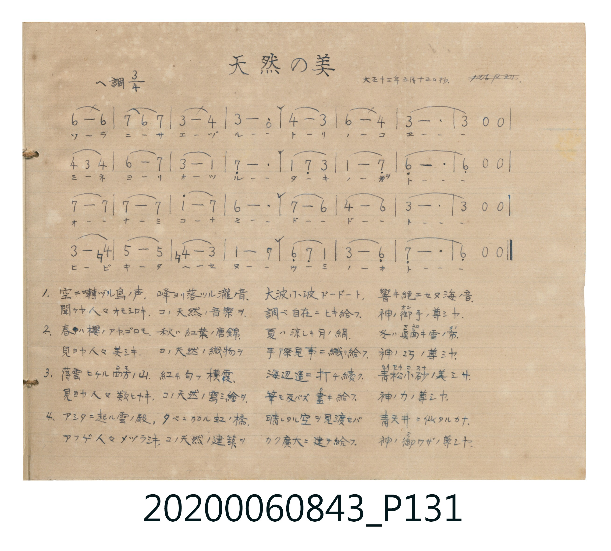

# 天然の美

> Re:Shōka 使用 AI 協助辨識與重建樂譜，可能會有錯誤。歡迎回報。

- **鋼琴伴奏版**：<br><audio controls src="tennen_no_bi.mp3"></audio>

- 詞：武島羽衣
- 曲：田中穗積
- 唱歌帳（2020.006.0843）P131.jpg（大正十三年五月十五日抄）

## 說明

原書資訊與歌詞全文（對應 P131.jpg，手抄簡譜單頁）：
調性與拍號：ヘ調四分之三拍子（關係小調 D 小調 3/4 拍）
抄寫註記：「大正十三年五月十五日抄.」


## 歌詞

```text
1. 空ニ囀ヅル鳥ノ声、峰ヨリ落ツル瀧ノ音、
大波小波ドードート、響キ絶エセヌ海ノ音、
聞ケヤ人々オモシロキ、コノ天然ノ音樂ヲ、
調ベ自在ニヒキ給フ、神ノ御手ノ尊シヤ。

2. 春ハ櫻ノアヤゴロモ、秋ハ紅葉ノ唐錦、
夏ハ涼シキ月ノ絹、冬ハ眞白キ雪ノ布、
見ヨヤ人々美シキ、コノ天然ノ織物ヲ、
手際見事ニ織リ給フ、神ノ巧ノ尊シヤ。

3. 薄雲ヒケル四方ノ山、紅ヰ匂フ横霞、
海辺遙ニ打チ續ク、青松白砂ノ美シサ、
見ヨヤ人々類ヒナキ、コノ天然ノ寫シ繪ヲ、
筆モ及バズ畫キ給フ、神ノ力ノ尊シヤ。

4. アシタニ起ル雲ノ殿、夕ベニカカル虹ノ橋、
晴レタル空ヲ見渡セバ、青天井ニ似タルカナ、
アフゲ人々メヅラシキ、コノ天然ノ建築ヲ、
カク廣大ニ建テ給フ、神ノ御ワザノ尊シヤ。
```

## ABC

<div class="abc-score" data-abc-src="tennen_no_bi.abc" aria-label="五線譜載入中"></div>

[下載 ABC 原始檔](tennen_no_bi.abc)

## TMD 檔案連結

- [主旋律 TMD 檔案](tennen_no_bi.tmd) [[在 TMD Studio 編輯](https://tmdlang.github.io/Tmd-TS/#tmd=s7IKdvYPcrWy4qpTUCpJTLdSSM7PyUlNLsnMz7MqzsjPTkzOyFeCS5bl55TmploBqXgDQ4RwcX5pUXJqfEFieqpVgKExhgzcpPi8_JLUpPz8bISKgqL8stS8xDygqtzEvNLi5KLMgpL45PyCSoSa1LLMlFSQitSUzJL8oszEHCQnpRYVgx0LcUNJUWIexAygIEJVSUYq0N15iSWlRakIUaBR6Zl5VrmpmVmZ8SWpFSUQp2lpKTxdsvJ5y7bHjeue7-tT0NLiUrRVsDTjsrdVcOPKTq20VXDJ5bIx1jexAxn1YuW893tmPVu77Onmbc_37X2xcDHYhmezNwGFn0_Z8GTH2ucrpz9f2QsWfjpl47O1PU93bH6_p8PIwMhAz8DATM_AwsT4_Z5OUNjpZRWkA6WeLln-bO3ip72NT3Z0Pt255cmuKc_mdIC4QMb0pc-6WoDKlbi49LUUbKkFuBQUFJ72zX82e8eLze0vVnS96GgHuhTou6etK55Nawc5akPvs_ZOBYQze551dgPd8nzDwhdr5zydtu7lgkagu4DeBpn1YtX-Zw3LQaZ0976YOR8o-rh5BlDw6ezZTzvanuzsBnoNKPV07QSg0S-nz3myv-nphn6gAgUXBSgDGMQKQCVAM0EGAm16un71ixW7X6yYATKtoYdgKOk9bujlAuk11FN4vnLX4-bup7MbHje3Pm5e_XLz0sfNfU8Xb3jc0Ph084bHzSseN696MWHv4-YWoOzzhuVA2ZfzNwNlQfpBYQO0bPMioMuA5OPmzsfNe2BkB1DRy_n7Hzetfb512-OmFY-bdj9u7nm2dTu6ES8a5z1u2vi4ecmTXbseN7Q-blr1uHnR4yagurVAzUB1j5s2gxwFSX1gzc9WND1u3oRkxKr9j5tnvmhf9XQO0MHdj5snga1d9rh5KlDR86XzQPr3LQRGDIixoQts-pLHDU3gYDDSU3g2A-jv_mergU7se9wE9MmSx01bQA4AugRowHKgvv7nW1pfTAT6re_plAkve5Yhh0E_SPO2PSBjm9YCQxuo6PnWnaAwbFsD0jln3vOZe4FSL2cD_db3dEczktOXAc0GOhrqe2DWgpiC6e_nO6c871yJ4m-gh17Omg004skuoCndQBXA6EL393ZQpGF42lhP4cW0lpezN4EDCxj8q4FJ8Nm0nSC1GzeCdG8BJogNT3uAIT312YpVL-fMQ7J36_YX-3a9bJwJtPRZ5-THzY3Pd_U8bloPivK5k57N3Qf07vMFQJ19MP9sxenjlwuBrpz0uBnoPiyeBqZtoP7nO4HhhuTv52vbgDHztL_rcfOEx027nk8FKsKI767Z2PxtoqcAimCQm4BppvsFKD2uBgdD37N1-0FRtmQqMC2BUlET0NTVQNkXM0Gh8mxlN1IAzASmjjVgI1aDs9AmoK-e7VgITuQTIMEA9MOTXUCzup_sAaYMkEqwcV0IU8Apberjpk3QlN-8EJwLV-JKAU9373q-HpgCkUIC7Mj1T3cvBmZEUEbeDXRLG2bKf9y8_nET2Ajk8ADqp7yEhAIFLX0urpDUvLzUPL98p0yrsPzkxByHGoMahWqwU21MtOzADGyls8LzNWue7Gh4sbBHQcMCVM49X9-gAy9SNbFoANoGMqxGwSxeQRdE1CiYx4NoIFmjYAwUM4HSukDaBEgagxSjiRsrGABhDThh4HbYrh5yHGYCNB1kF8hOc6idhhBnQiw3BDFBrjIEqVAHuRvsGZAckEGMy3Z0kuMyc6iLYLRhHJQBcirIdpCEGTTYQDRJwQUsRshxFDjK1IEMUyDDFGS5OjTSwMEDDR0gDQpDkGJYnKMFWC0Xl66dAiIhKgB5ylwA)]
- [鋼琴伴奏 TMD 檔案](tennen_no_bi_piano.tmd) [[在 TMD Studio 編輯](https://tmdlang.github.io/Tmd-TS/#tmd=s7IKdvYPcrWy4tLSUni6ZOXzlm2PG9c939f3fk_Hy-49zydsebJny9Ol_c87O97v6VTQ0uJStFWwNOOyt1Vw48pOrbRVcMnlsjHWN7HjqlNQerFy3vs9s56tXfZ087bn-_a-WLhYCST8bPYmoPDzKRue7Fj7fOX05yt7wcJPp2x8trbn6Y7NQLuMDIwM9AwMzPQMLEyMgTYFGBob6mUVpAOlni5Z_mzt4qe9jU92dD7dueXJrinP5nSAuEDG9KXPulqAypW4uEJS8_JS8_zynTKtwvKTE3McagxqFKq5FIDAxkTLDsyoUTCLV9AFETUK5vEgGkjWKBgDxUygtC6QNgGSxiDFaOLGCgZAWAM1ygTIB8mCVJlDVRlCDIYoNwQxQeYYglSog2wCWw-SAzKQzTKHmgGjDeOgDJDhIPUgCTOo00A0dieBPaIOZJgCGaYg5epQr4CdAHUBkAa5E6QYFhJojqpFCc6AzMS8_CAPEgLUUBtkuJE2KHggbJDxID4wiIB8oMO0QT5DVwFiYQtiiGpwwIDVkhvMpuraoIAEU-g8M21woEN5xmAbQUZAVYEEYF4AOQefs-HRYKwNiggQSWRUmKrHa8M9ZhyvjS9GfHDGCNDQeG1jGAkyKB5mMpTCpgpTxChewQTsBgiJRQC7KchhQY4ZxLmXeF-hxA0WXeSGDzZ9RHoP2UmYKgyBCTpe2xRGAtMFUIl5fLw20HQoRVR8gWwCKtMGmgelcHsWns507RQQSU2BJJ4yFwA)]

## 分析

```text
================================================================================
📊 TMD Song Profile: [ 天然の美 ]
================================================================================
⏱  Duration:       1:00 (60.0s), 32 measures total
🎼 Key & Tempo:    首調基準 F, != 96.0 BPM, <3/4>
   - 分析範圍：      由實際發聲的音符與和弦推測調性；播放脈絡另行呈現
🎤 人聲音域:    D4 (MIDI 62) – F5 (MIDI 77) [跨度: 15 個半音 / 1.2 個八度, 難度: moderate]
   - 最低音:  D4 in [TennenNoBi #1 @ m.1, 0:00]
   - 最高音: F5 in [TennenNoBi #1 @ m.19, 0:33]
   - 適合: soprano, mezzo-soprano, contralto, tenor, baritone, bass
🏛  結構:      TennenNoBi (60.0s)
⚡ 編曲密度:        Peak 1 軌道同時演奏
🗝  調性診斷：       D 小調（純淨自然小調，未偵測到可信轉調）
   - 風格氣質:    純淨自然小調（陰鬱抒情、旋律集中，無明顯調外色彩）
   - 轉調歷程:    全曲維持單一推測調性（未偵測到可信轉調）
   - 核心骨幹音:  A, E, D, F, A#
   - 調性數值:    D 小調 [相關度: 0.72, 穩定度: Moderate, 自然音純度: 96.6%]
   - 候選調性 (K-S): D 小調 (0.72), A 大調 (0.68), A 小調 (0.64)
   - 五度圈歷程:   +2
   - 各段落調性細節:
     • [TennenNoBi #1]: D 小調 (r: 0.72, 自然音純度: 96.6%, 調外音: B)

  [ 五度圈游移軌跡 ]
               C  
         F            G  
      Bb              [D ]*
      Eb               A  
         Ab           E  
            Db       B  
               F# 
     (* = active key center)

  [ 十二半音累積音高分佈 ]
     C  : ███                        3.4%
     C# :                            0.0%
     D  : █████████████████████     22.7%
     D# :                            0.0%
     E  : ██████████████████████    23.9%
     F  : ██████████                11.4%
     F# :                            0.0%
     G  :                            0.0%
     G# :                            0.0%
     A  : ████████████████████████  26.1%
     A# : ████████                   9.1%
     B  : ███                        3.4%
--------------------------------------------------------------------------------
Assignment 軌道音域：
  - Vocal         : D4 – F5 (15 個半音 / 1.2 個八度, 57 個音符)
================================================================================
```


## 原書掃描頁




